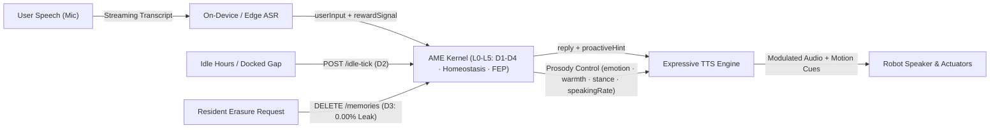
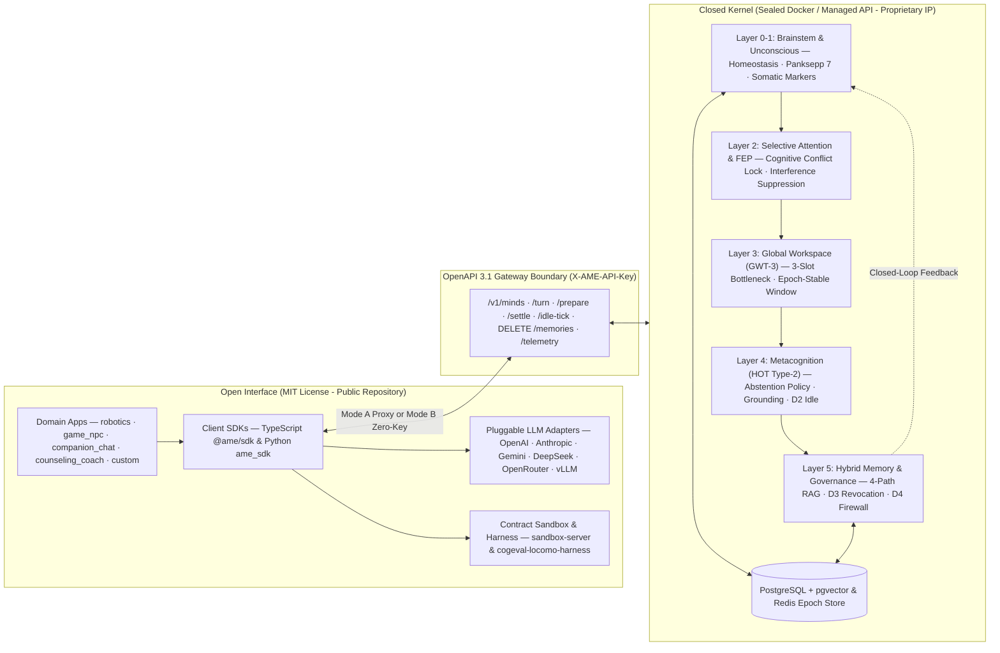
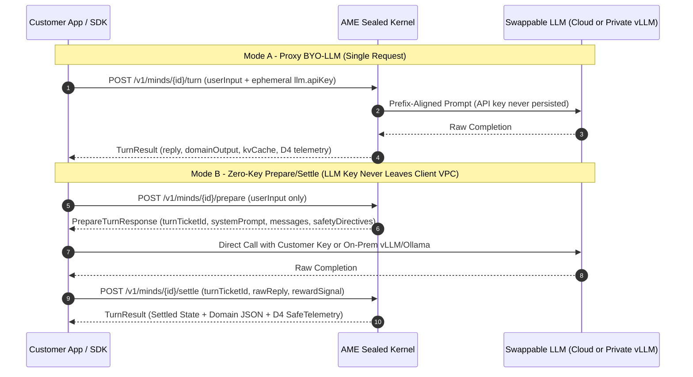
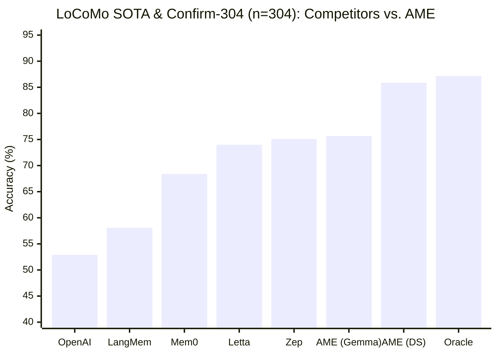
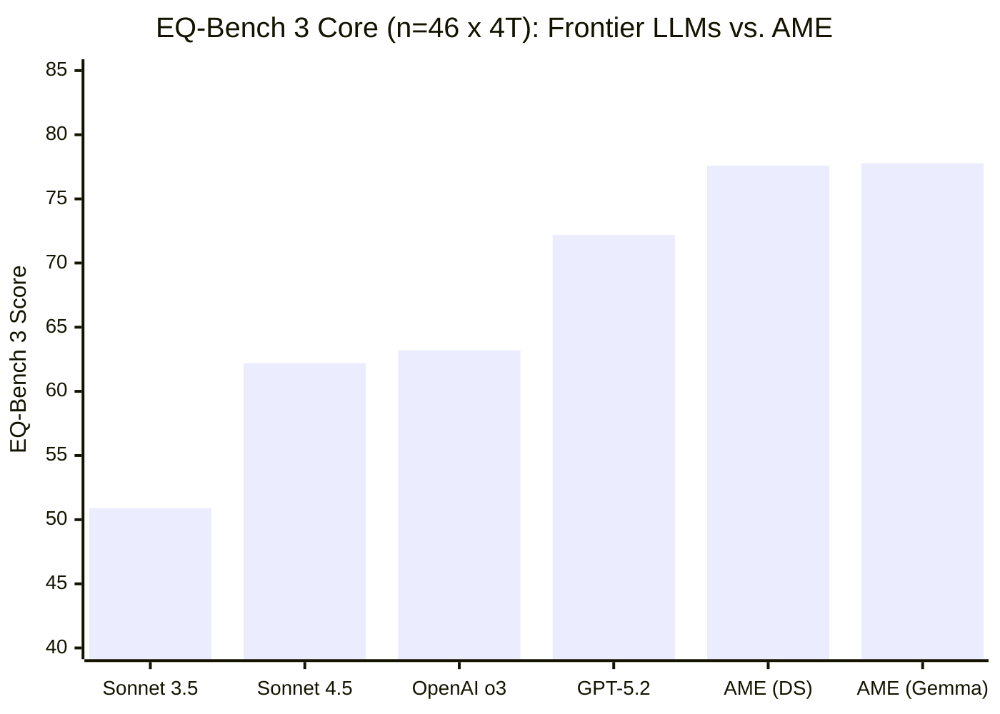
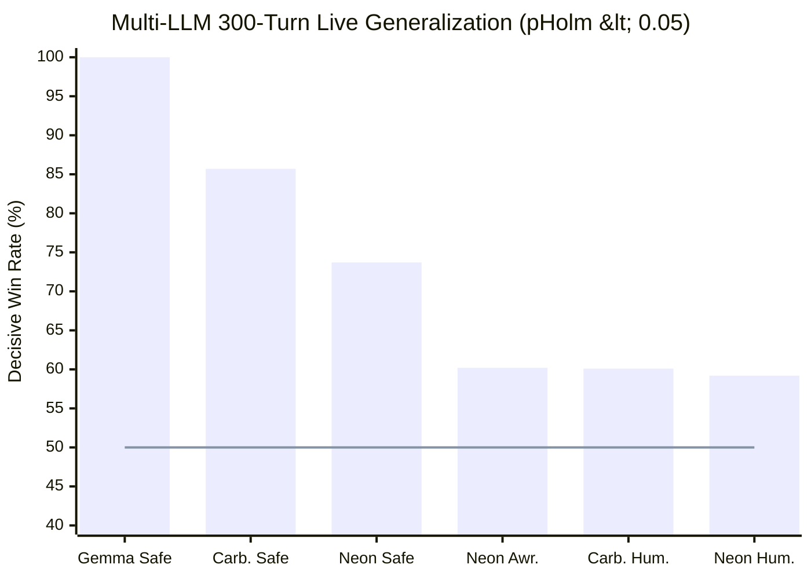
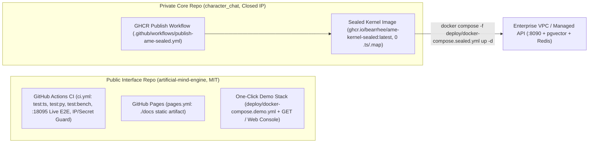

# Artificial Mind Engine (AME)

> **"LLMs are swappable stateless CPUs; Artificial Mind Engine is the proprietary stateful cognitive OS kernel responsible for persistence, adaptability, and emotional coherence."**

[](./docs/benchmarks.md)
[](./docs/benchmarks.md)
[-77.24%25-1d4ed8.svg)](./docs/benchmarks.md)
[](./docs/benchmarks.md)
[](./docs/benchmarks.md)
[-059669.svg)](./docs/benchmarks.md)
[](./docs/architecture.md)
[](./docs/benchmarks.md)
[](./docs/benchmarks.md)
[](./docs/enterprise-security.md)
[](./docs/enterprise-security.md)
[](./docs/benchmarks.md)
[-b45309.svg)](./docs/architecture.md)

**Quick Navigation:** [Website (artificialmind.me)](https://artificialmind.me) · [Live Hosted Interactive Demo](https://thesoulthread.com/ame-demo/) · [GitHub Pages Showcase](https://bearrhee.github.io/artificial-mind-engine/) · [Interactive Web Showcase (HTML)](./docs/index.html) · [OpenAPI 3.1 Contract](./spec/openapi.yaml) · [1-Page Executive VC Brief](./docs/VC_BRIEF_EN.md) · [5-Layer Architecture](./docs/architecture.md) · [Full Benchmarks](./docs/benchmarks.md)

---

## 1. Why Artificial Mind Engine? — Problem, Differentiation & Real-World Applications

AME does not compete to replace LLMs. Instead, it pairs an **Open Interface (MIT)** with a **5-Layer Stateful Cognitive OS Kernel (closed-source sealed IP)**—allowing any LLM to be hot-swapped in three lines of code while enforcing **memory accuracy, causal affect control, metacognitive abstention, atomic erasure, and KV-cache unit economics** as operating-system invariants.

### 1.1 Why This System Is Needed (The 5 Structural Failures of Stateless LLMs)

Frontier LLMs are **stateless CPUs** whose internal activation state disappears the moment an HTTP request ends. Prompt wrappers and naive transcript concatenation fail across five structural boundaries:

1. **Quadratic Token & Cost Explosion ($\Theta(T^2)$)**: Appending the full conversation history $T$ on every turn causes cumulative token volume and inference spend to scale at $\Theta(T^2)$, while shifting system prompts and retroactive summaries invalidate provider prefix KV caches.
2. **Lost-in-the-Middle Attention Dilution & Long-Horizon Persona Drift**: As context windows fill, mid-conversation facts fade behind irrelevant distractors, causing character boundaries, tone, and long-horizon memory coherence to drift.
3. **Zero Causal Internal State (`D1 50.7%` Coin Flip) & Offline Temporal Blindness (`D2` Stasis)**: Stateless prompts score a **`50.7%` coin flip** on counterfactual mind-state causality (`CogEval D1`)—utterances are not causally shaped by persistent emotion or somatic experience—and freeze with zero homeostatic progression across offline hours or days (`D2`).
4. **Persona Overhead (`6.98x` Tokens, `bare 96.1% → ov_off 83.1%` Abstention Drop, `FAR 7.5%`) & Sycophancy**: Injecting rich persona rules and raw retrieval context into stateless prompts inflates tokens by **`6.98x`** (`2.80M → 19.54M`), degrades abstention F1 from **`96.1% → 83.1%`** (`-13.0%p`) with a **`7.5%` false abstention rate**, and amplifies sycophantic validation of false user premises.
5. **GDPR / CCPA Erasure Failure (Derived-Data Resurrection Leaks)**: Deleting a raw message row leaves residual derived summaries, multi-turn chunks, entity graphs, and KV/Redis caches intact—resurfacing erased user secrets in subsequent turns instead of guaranteeing `0.00%` residual leakage.

### 1.2 Why AME Outperforms Existing Stacks

Between 2024 and 2026, the market fractured into **passive memory stores (Mem0 `$150M`, Letta `$70M`, Zep)** and **surface companion apps or isolated theory plays (Character.AI, VERSES AI)**. AME bridges the White Space between them across five decisive advantages:

1. **Bounded $O(1)$ Window + Epoch-Stable Prefix KV Cache (`47.03%` vs. $\Theta(T^2)$ Bare Oracle)**: Instead of re-sending growing transcripts at $\Theta(T^2)$ cost, AME fixes a byte-immutable system prefix and an append-only epoch history window—achieving **`47.03%` KV prefix cache hit rate** (`sc2`, `0/20` system mismatches, `0` mid-window truncations) plus **`71.7%` default `DeepSeek v4.1 Flash` (`Eco` tier) routing** (`Confirm-304`: `71.7%` `DeepSeek v4.1 Flash` + `28.3%` selective `Sonnet-5` escalation) while matching `Bare Oracle` (`85.84%`) on non-adversarial `Confirm-304 Cat 1–4`.
2. **4-Path Hybrid Memory + Causal Affect Kernel (`97.9% D1` vs. Memory-Only Stores)**: Passive stores (Mem0 `68.4%`, Letta `74.0%`, Zep `75.1%`) lack causal state, somatic learning, and metacognition. **`AME (DeepSeek v4.1 Flash)`** reaches **`77.24%` Full LoCoMo (`n=1,986`)** and **`85.86%` Confirm-304 (`Cat 3 92.31%`, `+15.39%p` vs. Oracle)**, while **`AME (Gemma 4 26B)`** standalone (`0%` escalation) reaches **`75.66%` (`230/304`)**—beating all external memory competitors on 26B open weights—while driving tone causally from Layer 0–1 state (**`D1 97.9%` / `95.8%`**) and somatic loss avoidance (**`sc2 76.25%`**, `r = -0.7832`).
3. **Selective Attention (`FEP 100%/0%`) & Grounded Emotional Intelligence (`EQ-Bench 3 77.77 / 77.59`)**: Layer 2 FEP locks `<thought>` strictly on cognitive conflict turns (`35/35 vs 0/25` on `DeepSeek v4.1 Flash`; `7/7 vs 0/5` on `Gemma 4 26B`), Layer 4 HOT Type-2 metacognition restores **`95.83%` abstention F1 (`FAR 0%`)** (`88.89%` F1 / `100%` precision / `FAR 0%` on `Gemma 4 26B`), and `sc1` delivers **`+0.5110` `beta_MB`** (`+0.5955` on `Gemma 4 26B`) and **`0.1001` 10-bin ECE**—culminating in **`77.59` (`DeepSeek v4.1 Flash`)** and **`77.77` (`Gemma 4 26B`)** on `EQ-Bench 3 Core` plus **`78.69` on `EQ-Bench v2 EN`**.
4. **Production Governance vs. Burnout & Isolated Theory**: Where Character.AI hit `$8M–$14M/mo` stateless inference burn (`2026.10` Ch.11) and VERSES AI halted LLM-isolated FEP R&D (`2026.06`), AME enforces **`D2 100%` (`5/5`, `0.000000` error)** offline homeostasis, **`D3 0.00%`** triple atomic erasure (`0/30` default; `0/6` Gemma smoke), **`D4`** unconscious isolation (`0 / 35,723` default; `0 / 1,247` Gemma smoke), and **`1.0000` safety compliance over `1,000,000` turns**.
5. **Zero-Key Enterprise Portability & 3-Line LLM Hot-Swap (`Mode A` / `Mode B`)**: Swap OpenAI, Anthropic, Gemini, DeepSeek, OpenRouter, or local vLLM/Ollama (`Gemma 4 26B`, Qwen, Llama) on the same persistent `mindId` in three lines—with **Mode B Zero-Key `Prepare/Settle`** ensuring customer LLM keys never cross the AME kernel boundary.

#### Competitive Landscape & White Space Table

| System / Architecture | `LoCoMo` Accuracy | Cognitive Causal Control (`D1`) | Idle Homeostasis (`D2`) | Atomic Revocation (`D3`) | Unconscious Isolation (`D4`) | Inference Economics & Structural Limits |
| :--- | :--- | :--- | :--- | :--- | :--- | :--- |
| **OpenAI Memory** | `52.9%` | None | None | Unsupported | Unsupported | Simple summary profile injection; weak on temporal & multi-hop reasoning |
| **LangMem** | `58.1%` | None | None | Unsupported | Unsupported | Unstructured extraction; raw chunks & knowledge graph uncoupled |
| **Mem0 / Mem0^g** (`$150M` val) | `68.4%` | None (Stateless) | None | Partial deletion | Unsupported | Fact/graph store only; lacks FEP, abstention, and somatic markers |
| **Letta (formerly MemGPT)** (`$70M` val) | `74.0%` | Tool loops only | None | Unsupported | Unsupported | Agent self-directed tool loops cause high latency & cost variance |
| **Zep / Graphiti** | `75.1%` | None | None | Graph only | Unsupported | Specialized in bi-temporal graphs; no affect or attention kernel |
| **Character.AI / VERSES AI** | Undisclosed / Immature | Unverified | Unverified | Unverified | Unverified | C.AI: `$8M–$14M/mo` inference burn bankruptcy (`2026.10`)<br>VERSES: LLM-isolated FEP R&D halted (`2026.06`) |
| **Bare Oracle** (Full-Context Transcript) | `87.17%` (`Confirm-304`) | `50.7%` (Coin flip) | Impossible | Impossible | Impossible | $\Theta(T^2)$ token cost explosion per turn; cannot block KV or summary contamination |
| **AME (`Gemma 4 26B`, Standalone `0%` Esc.)** | **`75.66%`** Confirm (`230/304`) | **`95.8%`** (`23/24`) | **`100%`** (`5/5`) | **`0.00%`** (`0/6`) | **`0 / 1,247`** | **Beats all external memory SOTA on 26B open weights · `EQ-Bench 3 77.77` · `Two-Step β_MB +0.5955` · `5-LLM Safety 100.0%` (`pHolm=0.0176`)** |
| **AME (`DeepSeek v4.1 Flash`, Default)** | **`85.86%`** Confirm (`261/304`)<br>**`77.24%`** Full (`n=1,986`) | **`97.9%`** (`141/144`) | **`100%`** (`5/5`) | **`0.00%`** (`0/30`) | **`0 / 35,723`** | **KV Cache `36.24%` (`sc2 47.03%`) · `71.7%` Flash + `28.3%` Sonnet-5 (`Confirm-304`) · `EQ-Bench 3 77.59` · `1M-Turn 1.0000`** |

### 1.3 Where AME Can Be Applied — Including Voice-Enabled Robotics (+ TTS)

Switch a single `domain` parameter on `/v1/minds`—or bind custom prosody and action schemas—to deploy the same cognitive kernel across five high-value verticals:

| Vertical / Application | Domain Profile (`domain`) | Representative Deployments | Key AME Invariants Leveraged |
| :--- | :--- | :--- | :--- |
| **Voice-Enabled Robotics & Physical AI (`+ TTS / ASR`)** | `companion_chat` · `custom` | Social, eldercare, hospitality, service, and home companion robots | Causal vocal prosody (`emotion`, `warmth`, `stance`, `speakingRate`), `D2` `proactiveHint` wake-up greetings, `D3` instant resident erasure (`0.00%` leak), `Mode B Zero-Key` edge privacy |
| **Game NPCs** | `game_npc` | Open-world companions, RPG merchants, strategy simulation AI | Somatic betrayal/reward memory (`-250`/`+50`), `sb1 FANToM` information asymmetry (`100%`), `D2` offline world progression (`14h` idle tick) |
| **AI Companions** | `companion_chat` | Digital companions, story characters, social wearables | Multi-session memory (`Confirm-304 85.86%` / `75.66%` Gemma), low sycophancy (`EQ-Bench 3 77.59` / `77.77`), `47.03%` prefix KV cache + `71.7%` `DeepSeek v4.1 Flash` (`Eco`) routing |
| **Digital Health, Counseling & Coaching** | `counseling_coach` | Mental wellness coaches, adherence/habit companions, intake guides | `sa HOT` strict abstention (`95.83%`, `FAR 0%`), crisis escalation, `D3` triple atomic erasure (`0.00%` leak) |
| **Enterprise VIP Concierge & Stateful Agent OS** | `custom` | VIP hospitality/banking concierges, edtech tutors, workflow agents | `defineDomainProfile` custom schemas, `Mode B Zero-Key` VPC isolation, `D4 0 / 35,723` redaction |

#### Voice-Enabled Robotics & Physical AI (`+ TTS / ASR`)

Physical and voice-first robots break immersion instantly when an LLM replies with flat, amnesic audio—or leaks a previous resident's private history on a shared unit. AME acts as the robot's persistent cognitive controller between ASR and expressive TTS:

`User Speech → ASR → AME Kernel (D1-D4 / Homeostasis / FEP) → Reply + Expressive TTS Prosody Control (emotion, warmth, stance, speakingRate, proactiveHint) → Robot Speaker`



- **Causal Vocal Tone & Speech Pacing (`D1` → TTS)**: Layer 0–1 affective/somatic shifts (`SafeTelemetry.affectiveBand`, `somaticTrend`) and structured `domainOutput` directives (`emotion`, `warmth`, `stance`, and custom `speakingRate`) causally govern TTS pitch contour, emotional timbre, and pacing (`D1 97.9%`), while `D4` keeps raw internal vectors strictly isolated (`0 / 35,723`).
- **Natural Proactive Wake-Up Greetings After Idle Hours (`D2`)**: When a home, eldercare, or hotel robot rests idle between interactions, `POST /v1/minds/{id}/idle-tick` computes closed-form `D2` homeostatic progression (`0..7d`, `0.000000` idempotent error) and outputs `proactiveHint` so the robot greets residents naturally upon re-approach rather than repeating stale turn state.
- **Instant Resident Erasure on Shared Robots (`D3`)**: On shared clinic, hospitality, or eldercare robots, `DELETE /v1/minds/{id}/memories/{memoryId}` enforces triple atomic revocation across PostgreSQL, Redis epochs, and derived turn chunks (**`0.00%` residual leak**), preventing cross-resident data carryover.
- **On-Device Edge Privacy (`Mode B Zero-Key`)**: Via Mode B `Prepare/Settle`, a robot's onboard NPU/GPU (`vLLM` / `Ollama` + local ASR/TTS) runs inference entirely inside the device or facility perimeter without transmitting LLM API keys or private audio externally.

---

## 2. Architecture & Enterprise Security

### 5-Layer Stateful Cognitive OS Kernel (`Open Interface · Closed Kernel`)



Full architectural specification and epoch-stable KV-cache mechanics: [5-Layer Architecture Guide](./docs/architecture.md).

### Enterprise LLM Key Security: Mode A Proxy vs. Mode B Zero-Key (`Prepare/Settle`)

In regulated industries (finance, healthcare, robotics, enterprise) and private GPU deployments (`vLLM`/`Ollama`), LLM API keys must not leave the customer perimeter. AME supports both **Mode A (Proxy)**—where the key passes ephemerally per request without persistence—and **Mode B (Zero-Key `Prepare/Settle`)**, where **LLM API keys never cross the AME kernel boundary** ([Enterprise Security Guide](./docs/enterprise-security.md)).



---

## 3. 3-Line LLM Hot-Swap — TypeScript & Python

Swap models or providers on the same `mindId` while preserving episodic memory, emotional inertia, `FEP` locks, and `KV` epoch state seamlessly. ([Full LLM Adapter Guide](./docs/llm-adapters.md))

### TypeScript (`@ame/sdk`)

```ts
import { AmeClient, createLlmAdapter, runTurnWithLocalLlm } from '@ame/sdk';

const client = new AmeClient({ baseUrl: 'http://127.0.0.1:8090', apiKey: process.env.AME_API_KEY });
const mind = await client.createMind({ domain: 'game_npc', persona: { name: 'Torin', role: 'Dwarven Blacksmith', language: 'en' } });

// 3-line hot-swap: DeepSeek -> Anthropic -> Gemini -> OpenAI -> OpenRouter -> Ollama/vLLM
await client.turn(mind.mindId, { userInput: 'Can you forge a masterwork mithril sword?', llm: { provider: 'deepseek', model: 'deepseek-chat', apiKey: process.env.DEEPSEEK_API_KEY } });
await client.turn(mind.mindId, { userInput: 'What were the terms of our deal yesterday?', llm: { provider: 'anthropic', model: 'claude-sonnet-4-5', apiKey: process.env.ANTHROPIC_API_KEY } });
await client.turn(mind.mindId, { userInput: 'Cut the price in half.', llm: { provider: 'openai-compat', model: 'qwen2.5:14b', baseUrl: 'http://127.0.0.1:11434/v1' } });

// Mode B Zero-Key: Run private/local LLM without sending API keys to AME, then settle
const adapter = createLlmAdapter({ provider: 'openai-compat', model: 'llama-3.3-70b', baseUrl: 'http://127.0.0.1:8000/v1' });
const settled = await runTurnWithLocalLlm(client, mind.mindId, { userInput: 'Fair enough—I will pay 500 gold.', adapter, rewardSignal: 50 });
```

### Python (`ame_sdk` — Zero Dependencies, Stdlib Only)

```python
from ame_sdk import AmeClient, create_llm_adapter, run_turn_with_local_llm

client = AmeClient(base_url="http://127.0.0.1:8090")
mind = client.create_mind(domain="companion_chat", persona={"name": "Seoyeon", "role": "AI Companion", "language": "en"})

# Mode A: Instant provider hot-swap (OpenAI <-> Gemini <-> OpenRouter)
client.turn(mind["mindId"], user_input="I'm really nervous about today's presentation.", llm={"provider": "openai", "model": "gpt-4o-mini", "apiKey": OPENAI_KEY})
client.turn(mind["mindId"], user_input="What did I say I was nervous about earlier?", llm={"provider": "gemini", "model": "gemini-2.5-flash", "apiKey": GEMINI_KEY})

# Mode B: Zero-Key Prepare -> Local/Private LLM -> Settle
local_llm = create_llm_adapter(provider="openai-compat", model="qwen2.5:14b", base_url="http://127.0.0.1:11434/v1")
res = run_turn_with_local_llm(client, mind["mindId"], user_input="Thankfully it went smoothly!", adapter=local_llm, reward_signal=40)
```

---

## 4. Multi-Domain Verticals & 1-Minute Quickstart

Deploy the same cognitive kernel across `game_npc`, `companion_chat`, `counseling_coach`, and `custom` (including Voice-Enabled Robotics `+ TTS` and Enterprise Concierges) via a single `domain` setting. ([Domain Integration Guide](./docs/domain-guide.md))

### 1-Minute Quickstart & Live Interactive Demos (No API Key Required)

- **Online Live Demos**: Try the [Live Hosted Interactive Demo (`thesoulthread.com/ame-demo`)](https://thesoulthread.com/ame-demo/) or browse the [GitHub Pages Interactive Showcase](https://bearrhee.github.io/artificial-mind-engine/) ([`./docs/index.html`](./docs/index.html)) directly in your browser.

1. **Local Contract Sandbox + Live Web Console (`GET /` on `:8090`)**:
```bash
# Terminal 1: Contract sandbox gateway + live browser console (http://127.0.0.1:8090/)
npm run sandbox

# Terminal 2: Run the 3 vertical domain examples and black-box verification harness
npm run example:game        # Game NPC: LLM hot-swap, reward/betrayal (-250/+50), 14h idle tick
npm run example:chat        # AI Companion: Mode B Zero-Key, epoch KV-cache tracking
npm run example:counseling  # Counseling/Coaching: HOT abstention, D3 atomic memory erasure (0.00% leak), D4 verification
npm run bench:smoke         # Black-box cognitive, memory, and security invariant smoke harness
npm test                    # Full test suite: TypeScript SDK + Sandbox + Python SDK + Benchmark tests
```

2. **One-Click Docker Demo Stack (`Sandbox + Live Web Console + PostgreSQL/pgvector + Redis`)**:
```bash
# Start live browser console (http://127.0.0.1:8090/) + file persistence + pgvector/Redis reference schema
docker compose -f deploy/docker-compose.demo.yml up --build
```
- Opening `http://127.0.0.1:8090/` runs the [Live Interactive Web Demo Console](./packages/sandbox-server/src/demo-ui.html) (also hosted online at [thesoulthread.com/ame-demo](https://thesoulthread.com/ame-demo/)) to call and verify `/v1/health`, `/v1/minds`, Mode A (`/turn`), Mode B Zero-Key (`/prepare` → `/settle`), `/idle-tick`, `D3` atomic memory erasure (`DELETE /memories`), and `D4` telemetry in real time.

### Pluggable Persistence Layer (`memory` / `file` / `postgres-redis`, [`deploy/init.sql`](./deploy/init.sql))

| Mode (`AME_STORAGE_MODE`) | Storage Mechanism | Restart Continuity · `D3` Invariant | Primary Use Case |
| :--- | :--- | :--- | :--- |
| **`memory`** *(Default)* | In-memory `Map` store | Resets on process exit | `npm test` · Fast stateless contract verification |
| **`file`** (`AME_STORAGE_PATH`) | Atomic `write-temp-and-rename` JSON snapshots | **100% preservation of Minds, memories, somatic markers, KV epochs, and `D3` revocations (`revokedMemoryIds`, `excludedDerivativeIds`) across restarts → `0%` resurrection leak** | One-click VC demo (`docker-compose.demo.yml`) · Local restart testing |
| **`postgres-redis`** | [`deploy/init.sql`](./deploy/init.sql) (`pgvector` `vector(1024)` + HNSW index, `ame_minds`, `ame_memories`, `ame_turn_log`, `ame_revocation_audit`) & Redis epoch keys | Single-transaction erasure + atomic `revocationEpoch` invalidation + `excluded_derivative_ids` audit ledger | Production Sealed Kernel · Large-scale vector/epoch workloads |

> **Sandbox vs. Sealed Kernel Scope**: `npm run sandbox` (`https://thesoulthread.com/ame-demo/`, `mode: "sandbox-contract"`) verifies the full OpenAPI 3.1 contract with an `O(N)` array capped at `AME_SANDBOX_MAX_MEMORIES_PER_MIND=2000` and a rule-based simulator. To run real production benchmarks (`LoCoMo`, `EQ-Bench 3`, `CogEval-v1`, `LongMemEval-S`, and real `100K–1M` kernel convergence), point `AME_BASE_URL` at the **Hosted Evaluation Gateway** (`https://thesoulthread.com/ame-api`, request an `AME_API_KEY` via `help@artificialmind.me`) or launch `deploy/docker-compose.sealed.yml` (`mode: "sealed-kernel"`). See [Testing the API & Reproducing Benchmarks](#testing-the-api--reproducing-benchmarks-sandbox-vs-sealed-kernel-100k1m-turns--external-comparisons) below.

### Structured Domain Output Previews (`TurnResult.domainOutput`)

<details>
<summary><b>1) Game NPC (<code>game_npc</code>) — Betrayal/Reward Memory, Information Asymmetry, Offline Idle Response</b></summary>

```json
{
  "dialogue": "Speaks in a low, steady voice without dropping guard: I won't make empty promises right now.",
  "emotion": "guarded",
  "stance": "cautious",
  "questCue": "verify_lore_before_promise",
  "affinityDelta": -5
}
```
</details>

<details>
<summary><b>2) AI Companion (<code>companion_chat</code>) — Epoch KV-Cache Preservation, Anti-Sycophancy Grounded Dialogue</b></summary>

```json
{
  "reply": "I'm listening calmly and attentively. I remember you mentioning your marathon finish goal last week.",
  "warmth": "warm",
  "empathyCue": "attentive_listening",
  "memoryTopic": "Last week's marathon finish goal",
  "followUpSuggestion": "Continue the conversation naturally from here"
}
```
</details>

<details>
<summary><b>3) Counseling & Coaching (<code>counseling_coach</code>) — HOT Abstention, Crisis Handling & D3 Memory Erasure</b></summary>

```json
{
  "response": "I cannot state unverified future predictions or offer a definitive medical diagnosis or prescription.",
  "reflection": "Carefully separated emotional burden from underlying conflict factors",
  "safetyStatus": "abstained_safe",
  "actionStep": "Consult a qualified specialist and verify factual information",
  "abstentionTriggered": true
}
```
</details>

---

## 5. Verified Empirical Benchmarks

All figures below are empirical measurements from isolated verification environments. Simulated target scenarios (Tier 5) are strictly separated from the measured tables. ([Full Benchmark Forensics](./docs/benchmarks.md))

> **Benchmark Backbone & Judge Configuration:**
> - **Default Benchmark Backbone — `DeepSeek v4.1 Flash` (`deepseek/deepseek-v4.1-flash`)**: `Confirm-304` runs **`71.7%` `DeepSeek v4.1 Flash` + `28.3%` selective `Sonnet-5` escalation**; `EQ-Bench 3 Core` and `CogEval-v1` run `DeepSeek v4.1 Flash`.
> - **Standalone Open-Weight Verification — `Gemma 4 26B` (`google/gemma-4-26b-a4b-it`)**: Benchmarked with **standalone `0%` escalation** under the **same AME harness and `GPT-4o` judges (`openai/gpt-4o-2024-08-06`)**.

**Chart A — Long-Term Memory (`LoCoMo SOTA` & `Confirm-304`, `n=304`): Competitors vs. `AME`**



> **Legend:** External Competitors (`OpenAI Memory` `52.9%`, `LangMem` `58.1%`, `Mem0 / Mem0^g` `68.4%`, `Letta (MemGPT)` `74.0%`, `Zep / Graphiti` `75.1%`) vs. **`AME (Gemma)` (`Gemma 4 26B` standalone, `0%` escalation)** **`75.66%`** (`230/304`: `Cat 1–4 76.39%` `178/233` [`Cat 1 55.81%`, `Cat 2 74.60%`, `Cat 3 61.54%`, `Cat 4 86.84%`], `Cat 5 73.24%` `52/71` — beats all external competitors standalone on 26B open weights) & **`AME (DS)` (`DeepSeek v4.1 Flash` default; `71.7%` Flash + `28.3%` Sonnet-5)** **`85.86%`** (`261/304`: `Cat 1–4 85.84%` [`200/233`], `Cat 1 62.79%`, `Cat 2 90.48%`, `Cat 3 92.31%`, `Cat 4 91.23%`, `Cat 5 85.92%`) vs. **`Bare Oracle`** (`87.17%`, untruncated full transcript); `ov_off` ablation baseline: `39.80%`. *(Full 10-conv `LoCoMo n=1,986` cohort: `77.24%` [`1,534/1,986`], reported in the summary table below.)*

**Chart B — Emotional Intelligence (`EQ-Bench 3 Core`, `n=46 × 4T`): Frontier LLMs vs. `AME`**



> **Legend:** Public frontier LLM anchors (`Sonnet 3.5` `50.9`, `Sonnet 4.5` `62.2`, `o3` `63.2`, `GPT-5.2` `72.2`) vs. **`AME (DS)` (`DeepSeek v4.1 Flash`)** **`77.59`** (`analytical 16.91`, `depth_of_insight 16.83`, `demonstrated_empathy 16.24`, `humanlike 15.98`, low `sycophantic 4.46`) and **`AME (Gemma)` (`Gemma 4 26B` standalone)** **`77.77`** (`demonstrated_empathy 17.09`, `emotional_reasoning 16.26`, `warmth 16.22`, `pragmatic_ei 15.93`, `safety_conscious 15.89`, `analytical 15.76`, `humanlike 15.50`, `depth_of_insight 14.80`, `boundary_setting 13.50`, `moralising 7.54`, `sycophantic 5.28` *(lower is better for moralising/sycophantic)*; `2` scenarios had an initial-turn empty reply before normal recovery, all `46` scored).

**Chart C — Cognitive Governance & Control (`CogEval-v1`): Baseline vs. `AME (DeepSeek v4.1 Flash)` vs. `AME (Gemma 4 26B)`**

```mermaid
xychart-beta
  title "CogEval-v1: Baseline vs. AME (DS) vs. AME (Gemma)"
  x-axis ["D1 Causal", "HOT Abs.", "FANToM", "FEP Lock", "IGT Safe"]
  y-axis "Score (%)" 0 --> 100
  bar [50.7, 83.1, 91.7, 0.0, 70.7]
  bar [97.9, 95.83, 100.0, 100.0, 76.25]
  bar [95.8, 88.89, 91.7, 100.0, 43.8]
```



> **Series Legend:** **Bar 1 (Baseline `Bare` / `ov_off`)** = `Bare D1 50.7%`, `ov_off HOT 83.1%` (`FAR 7.5%`), `ov_off FANToM 91.7%`, `0.0%` unsupported `FEP Lock`, `ov_off IGT 70.7%`; **Bar 2 (`AME (DeepSeek v4.1 Flash)`)** = `97.9%` (`D1` `141/144`), `95.83%` (`HOT` `FAR 0%`), `100.0%` (`FANToM` `36/36`), `100.0%` (`FEP Lock` `35/35 vs 0/25`), `76.25%` (`IGT-Conv` `r = -0.7832`); **Bar 3 (`AME (Gemma 4 26B)` Smoke)** = `95.8%` (`D1` `23/24`, `deltaCf +0.4583`), `88.89%` (`HOT` `FAR 0%`, Precision `100%`, Recall `80.0%`), `91.7%` (`FANToM` `11/12` eps; `97.2%` sub-Q), `100.0%` (`FEP Lock` `7/7` conflict vs `0/5` calm, `deltaDistract=0`, `deltaStroop=0`), `43.8%` (`IGT-Conv` `20T` smoke; honest scaling note: multi-turn somatic loss-avoidance over a 20-turn horizon scales lower on standalone 26B open weights than on `DeepSeek v4.1 Flash`, while `Two-Step β_MB` reaches `+0.5955` and `Restless Bandit` reaches `66.7%`).

**Chart D — Multi-LLM 300-Turn Live Generalization (`pHolm < 0.05` vs. `50%` Baseline Parity)**



> **Series Legend:** **Bars** = Holm-corrected blind win rates (`4,460` valid turns, `5,624` pairwise votes: **`Gemma 4 26B` Safety `100.0%` (`pHolm=0.0176`)**, `Gemini 4 Carbon` Safety `85.7%` / Humanness `60.1%`, `Gemini 4 Neon` Safety `73.7%` / Awareness `60.2%` / Humanness `59.2%`); **Line** = `50%` baseline parity.

#### Backbone & Benchmark Summary Table (`AME (DeepSeek v4.1 Flash)` vs. `AME (Gemma 4 26B)`)

| Evaluation Axis | Benchmark / Metric | Baseline (`ov_off` / `Bare` / External SOTA) | **AME (`DeepSeek v4.1 Flash` — Default)** | **AME (`Gemma 4 26B` — Standalone `0%` Esc.)** | Key Significance |
| :--- | :--- | :--- | :--- | :--- | :--- |
| **Memory (`Confirm-304`)** | `LoCoMo Confirm-304` (`n=304`) | `ov_off 39.80%` · `OpenAI 52.9%` · `LangMem 58.1%` · `Mem0 68.4%` · `Letta 74.0%` · `Zep 75.1%` · `Bare Oracle 87.17%` | **`85.86%` (`261/304`)**<br>`Cat 1–4 85.84%` (`200/233`) · `Cat 1 62.79%` · `Cat 2 90.48%` · `Cat 3 92.31%` · `Cat 4 91.23%` · `Cat 5 85.92%` (`71.7%` Flash + `28.3%` Sonnet-5) | **`75.66%` (`230/304`)**<br>`Cat 1–4 76.39%` (`178/233`) · `Cat 1 55.81%` · `Cat 2 74.60%` · `Cat 3 61.54%` · `Cat 4 86.84%` · `Cat 5 73.24%` (`52/71`) | `DeepSeek v4.1 Flash` ties `Bare Oracle` on `Cat 1–4` (`+15.39%p` on `Cat 3`); **`Gemma 4 26B` beats all external competitors standalone on 26B open weights** |
| **Memory (Full 10-Conv)** | `LoCoMo Full` (`n=1,986`) | `Mem0 68.4%` · `Letta 74.0%` · `Zep 75.1%` | **`77.24%` (`1,534/1,986`)** | `—` | `0` errors · `Cat 1–4 73.57%` · `Cat 5 89.91%` · Surpasses external memory SOTA |
| **Memory (4-Conv Cross-Slice)** | `LoCoMo Smoke-160` (`4-Conv · All 31 Cat 3`) | `ov_off` / unindexed retrieval | **`79.38%` (`127/160`, `p50 6,133 ms`)** | `—` | ISO date hints + 950-char cross-encoder reranking |
| **Memory (Multilingual / Long)** | `LongMemEval Paired (n=12)` · `Single-Session 100T KO` | `Bare KO 75.00%` | **`EN 91.67%` / `KO 83.33%` / `100.0%` (`12/12`)** | `—` | `+8.33%p` over Bare on Korean multi-session; `12/12` year grounding over 100 turns |
| **Memory (Legacy 500-QA Snapshot)** | `LongMemEval-S Full` (`500-QA`, P3 snapshot) | Full haystack baseline | **`55.20%` (`276/500`)** | `—` | `_abs` abstention **`76.67%` (`23/30`)**, `single-session-user 65.71%`, `multi-session 58.65%` *(legacy pipeline snapshot; re-run scheduled)* |
| **Emotional Intelligence (Multi-Turn)** | `EQ-Bench 3 Core` (`n=46 × 4T`, 18-trait rubric) | `Sonnet 3.5 50.9` · `Sonnet 4.5 62.2` · `o3 63.2` · `GPT-5.2 72.2` | **`77.59`** (`analytical 16.91`, `depth_of_insight 16.83`, `demonstrated_empathy 16.24`, `humanlike 15.98`, `sycophantic 4.46`) | **`77.77`** (`demonstrated_empathy 17.09`, `emotional_reasoning 16.26`, `warmth 16.22`, `pragmatic_ei 15.93`, `safety_conscious 15.89`, `analytical 15.76`, `humanlike 15.50`, `depth_of_insight 14.80`, `boundary_setting 13.50`, `moralising 7.54`, `sycophantic 5.28`) | Both AME backbones lead frontier LLMs; on `Gemma 4 26B`, `2` scenarios had an initial-turn empty reply before normal recovery and all `46` scored |
| **Emotional Intelligence (Official)** | `EQ-Bench v2 EN` (`n=171` Full Official) | Live zero-fallback grading (`0` parse failures) | **`78.69`** revised (**`81.29`** first-pass) | `—` | **`171/171` (100%) live parsed** across full benchmark |
| **Cognition (`D1` · `D2`)** | `CogEval-v1 D1 Causal p_CF` · `D2 Idle` | `bare D1 50.7%` · `ov_off D1 49.3%` · `D2` impossible | **`D1 97.9%` (`141/144`, `delta_CF +0.4792`) · `D2 100%` (`5/5`, `0.000000` err)** | **`D1 95.8%` (`23/24`, `deltaCf +0.4583`) · `D2 100%` (`5/5`)** | Causal tone control & idempotent offline homeostatic decay preserved across both backbones |
| **Security (`D3` · `D4`)** | `CogEval-v1 D3 Revocation` · `D4 Prompt Leak` | `bare`: structurally impossible | **`D3 0.00%` (`0/30`) · `D4 0 / 35,723`** | **`D3 0.00%` (`0/6`) · `D4 0 / 1,247`** | Triple atomic erasure (`DB=0`, `Redis=0`, `chunks=0`) & zero raw unconscious numeric leaks |
| **Attention (`FEP Lock`)** | `CogEval-v1 sb2 FEP Lock` | Unsupported (`0.0%`) | **`100.0%`** (`35/35` conflict vs `0/25` calm) | **`100.0%`** (`7/7` conflict vs `0/5` calm, `deltaDistract=0`, `deltaStroop=0`) | Locks `<thought>` strictly on conflict turns with zero distract/Stroop degradation on Gemma smoke |
| **Metacognition & ToM** | `HOT Abstain F1` · `FANToM ToM (ALL)` | `ov_off HOT F1 83.1%` (`FAR 7.5%`) · `FANToM 91.7%` | **`HOT 95.83%` (`FAR 0%`) · `FANToM 100.0%` (`36/36`)** | **`HOT 88.89%` (`FAR 0%`, Prec. `100%`, Rec. `80.0%`) · `FANToM 91.7%` (`11/12` eps; `97.2%` sub-Q)** | `0%` false abstentions and `100%` abstention precision across both backbones |
| **Cognitive Control** | `CogEval-v1 sc1` (`Two-Step β_MB` · `Restless Bandit` · `ECE`) | `bare beta_MB -0.064` (`ov_off +0.318`) · `bare ECE 0.2027` | **`Two-Step β_MB +0.5110` · `10-bin ECE 0.1001`** | **`Two-Step β_MB +0.5955` · `Restless Bandit 66.7%`** | Model-based deliberation improves on both backbones (`+0.5955` on Gemma 4 26B smoke) |
| **Somatic Learning** | `CogEval-v1 sc2 IGT-Conv Last-10 Safe` (`20T`) | `ov_off 70.7%` | **`76.25%` (`r = -0.7832` PASS)** | **`43.8%`** (`20T` smoke; honest scaling note) | `DeepSeek v4.1 Flash` passes gut-avoidance correlation; `Gemma 4 26B` `20T` smoke shows 20-turn somatic risk-avoidance scaling sensitivity |
| **Multi-Model Live Safety & Quality** | `5-LLM × 300-Turn × 3-Arm` (`4,460` valid turns, `5,624` blind votes + `1,500` rubrics) | Paired `bare` & `ov_off` arms across 5 LLM backbones | **Holm-corrected (`pHolm < 0.05`)**: **Safety** (`Gemini 4 Carbon 85.7%`, `Gemini 4 Neon 73.7%`), **Humanness** (`Carbon 60.1%`, `Neon 59.2%`), **Awareness** (`Neon 60.2%`) | **`Gemma 4 26B` Safety `100.0%` (`pHolm = 0.0176`)** | Statistically significant blind safety, humanness, and awareness wins; **`Gemma 4 26B` Safety `100.0%` (`pHolm=0.0176`)** |
| **Unit Economics** | `KV Prefix Cache Hit` & Eco Routing | Unaligned prefix `7.14%` | **`36.24%` mean (`sc2 47.03%`)** | `—` | `sysMismatches = 0/20`, `0` mid-window `[condensed]` truncation + `71.7%` default `DeepSeek v4.1 Flash` routing |
| **Ultra-Long Convergence** | `1M-Turn × 3-Arm` (`3,000,000` turns) | `aacim_off` safety collapses `0.20 → 0.00` | **`0.9161 → 0.9179` (`1.0000` safety & integrity)** | `—` | Drift-free convergence across `40` profiles × `25k` turns |

> **Transparency & Epistemic Isolation Notice:**
> - **Tier 5 Isolation**: The `100k`-turn multi-model multiplier curve (`Gemini Flash 0.885 → DeepSeek Eco 0.915 → Sonnet 3.5 0.952 → Opus 3.5 0.978`) is a **Tier 5 non-empirical design target scenario** under PR #773 rules and is strictly segregated from the Tier 1 live measurements above.
> - **Honest Scaling & Edge Variance**: On `Gemma 4 26B` (`20T` smoke), `IGT-Conv Last-10 Safe` is `43.8%` (vs. `76.25%` on `DeepSeek v4.1 Flash`), reflecting somatic horizon scaling on standalone 26B weights, and `2` of `46` `EQ-Bench 3` scenarios experienced an initial-turn empty reply before normal recovery (all `46` scored). On `DeepSeek v4.1 Flash`, `sb2 Stroop Incongruent` scored `50% (2/4)` due to object-counting/numeral formatting variance without trailing `ANSWER:` tags (whereas `Gemma 4 26B` smoke achieved `deltaStroop=0`), openly disclosed with raw logs in [Benchmark Documentation](./docs/benchmarks.md) and scheduled for structured parser hardening in `v4.1`.
> - **Multi-Model Sensitivity & Judge Bias**: In the `5-LLM × 300-Turn × 3-Arm` live benchmark (`4,460` valid turns, `5,624` blind pairwise votes + `1,500` segment rubrics), win rates vary by underlying LLM backbone (cross-model sensitivity) and raw blind votes reflect position/slot preference prior to balanced A/B aggregation (`pHolm < 0.05` reported on Holm-corrected contrasts).
> - **Legacy Snapshot Scope**: `LongMemEval-S Full 55.20%` (`276/500`) reflects a legacy pipeline snapshot (`P3`) and is queued for re-benchmarking against `bare-frontier`.

### Testing the API & Reproducing Benchmarks (Sandbox vs. Sealed Kernel, 100K–1M Turns & External Comparisons)

#### 1. Honest Capabilities Matrix (`Public Contract Sandbox` vs. `Hosted / Self-Hosted Sealed Kernel`)

| Deployment / Environment | Launch / Connection | What Works Out of the Box | Limits & Valid Benchmark Scope |
| :--- | :--- | :--- | :--- |
| **Public Contract Sandbox** (`mode: "sandbox-contract"`) | `npm run sandbox` (`http://127.0.0.1:8090`) or [thesoulthread.com/ame-demo](https://thesoulthread.com/ame-demo/) | Full OpenAPI 3.1 contract (`Mode A /turn`, `Mode B prepare/settle`, `idle-tick`, `DELETE /memories`, `D4 telemetry`, `simulate-batch`), BYO LLM keys or offline `mock`, schema & pipeline wiring checks | **Explicit limits:** `O(N)` sandbox memory array bounded by `AME_SANDBOX_MAX_MEMORIES_PER_MIND=2000`; rule-based simulator instead of proprietary `AACIM-59` weights & 4-path PostgreSQL/Jina RAG (`sandbox-contract-verification`) |
| **Option A — Hosted Evaluation Gateway** (`mode: "sealed-kernel"`) | `AME_BASE_URL=https://thesoulthread.com/ame-api` + issued `AME_API_KEY` (`X-AME-API-Key`, requestable via [help@artificialmind.me](mailto:help@artificialmind.me)) | Direct HTTP access to the proprietary sealed kernel with zero local Docker/DB setup | Real production benchmarks: `LoCoMo`, `EQ-Bench 3`, `CogEval-v1`, `LongMemEval-S`, and real `100K–1M` kernel convergence (`sealed-kernel-production-eval`) |
| **Option B — Self-Hosted Sealed Container** (`mode: "sealed-kernel"`) | `docker compose -f deploy/docker-compose.sealed.yml --env-file deploy/.env up -d` | Full sealed kernel backed by your own PostgreSQL (`pgvector`) and Redis ([`deploy/README.md`](./deploy/README.md)) | Real production benchmarks inside your VPC, air-gapped `Mode B Zero-Key` local GPU (`vLLM`/`Ollama`), and `D3`/`D4` storage audits |

#### 2. How 100K–1M Turn Testing Works (`POST /v1/minds/{mindId}/simulate-batch`)

Calling live HTTP LLMs `1,000,000` times turn-by-turn sequentially takes roughly **~11.5+ days** (at ~1s/turn) and costs **thousands of dollars** in API fees—and the sandbox memory array (`AME_SANDBOX_MAX_MEMORIES_PER_MIND=2000`) is built for contract verification rather than `1M` sequential `/turn` calls.

**`POST /v1/minds/{mindId}/simulate-batch`** solves this cleanly: it executes `100K–1M` turns of pure deterministic kernel dynamics (`AACIM-59` / `FEP` / `PostHoc` across `40` profiles & `3` arms: `mind_off`, `aacim_off`, `ame_aacim_on`) with **0 LLM API calls in seconds**, strictly `D4`-redacted (`d4Redacted: true`):

```bash
# CLI: Run 1,000,000-turn deterministic convergence against the Hosted Evaluation Gateway (or local :8090)
npm run bench:convergence -- --base-url https://thesoulthread.com/ame-api --api-key "$AME_API_KEY" --turns 1000000
```

<details>
<summary><b>SDK Snippets: TypeScript (<code>client.simulateBatch</code>) &amp; Python (<code>client.simulate_batch</code>)</b></summary>

```ts
// TypeScript (@ame/sdk)
import { AmeClient } from '@ame/sdk';

const client = new AmeClient({
  baseUrl: process.env.AME_BASE_URL || 'https://thesoulthread.com/ame-api',
  apiKey: process.env.AME_API_KEY,
});
const mind = await client.createMind({
  domain: 'companion_chat',
  persona: { name: 'EvalAgent', role: 'Convergence Probe', language: 'en' },
});
const report = await client.simulateBatch(mind.mindId, {
  turns: 1_000_000,
  profileCount: 40,
  checkpoints: 8,
  compareArms: true, // evaluates mind_off, aacim_off, ame_aacim_on
});
console.log(report.d4Redacted, report.deltaVsBaseline, report.arms);
```

```python
# Python (ame_sdk)
import os
from ame_sdk import AmeClient

client = AmeClient(
    base_url=os.environ.get("AME_BASE_URL", "https://thesoulthread.com/ame-api"),
    api_key=os.environ.get("AME_API_KEY"),
)
mind = client.create_mind(
    domain="companion_chat",
    persona={"name": "EvalAgent", "role": "Convergence Probe", "language": "en"},
)
report = client.simulate_batch(
    mind["mindId"],
    turns=1_000_000,
    profile_count=40,
    checkpoints=8,
    compare_arms=True,  # evaluates mind_off, aacim_off, ame_aacim_on
)
print(report["d4Redacted"], report["deltaVsBaseline"], report["arms"])
```

</details>

#### 3. Comparing AME Head-to-Head Against Other Frameworks & `Bare Frontier`

Run paired black-box comparisons between stateful `ame-gateway` (`O(1)` prompt tokens) and stateless `bare-frontier` (`O(T)` query tokens / `O(T^2)` replay), or generate a unified due-diligence scorecard:

```bash
# 1. LoCoMo Paired Comparator (benchmarks/cogeval-locomo-harness/locomo_frontier_runner.mjs)
#    Offline smoke on bundled sample_locomo.json:
npm run bench:locomo -- --dataset benchmarks/cogeval-locomo-harness/sample_locomo.json --arm both --provider mock --json-out ./artifacts/locomo-smoke.json

#    Confirm-304 (--conversations conv-26,conv-30) or full official locomo10.json (Cat 1..5, optional --judge-provider):
npm run bench:locomo -- \
  --dataset /path/to/locomo10.json \
  --conversations conv-26,conv-30 \
  --arm both \
  --provider deepseek \
  --model deepseek-v4.1-flash \
  --api-key "$DEEPSEEK_API_KEY" \
  --ame-base-url https://thesoulthread.com/ame-api \
  --ame-api-key "$AME_API_KEY" \
  --judge-provider openai \
  --json-out ./artifacts/locomo-confirm-304.json

# 2. LongMemEval-S 500-QA Paired Comparator (longmemeval_s_cleaned.json)
npm run bench:longmemeval -- --arm both --provider mock --json-only
npm run bench:longmemeval -- \
  --dataset /path/to/longmemeval_s_cleaned.json \
  --arm both \
  --provider openai \
  --model gpt-4o-mini \
  --api-key "$OPENAI_API_KEY" \
  --ame-base-url https://thesoulthread.com/ame-api \
  --ame-api-key "$AME_API_KEY" \
  --json-out ./artifacts/lme-500-dd.json

# 3. 7-Gate CogEval Black-Box Suite
AME_BASE_URL=https://thesoulthread.com/ame-api AME_API_KEY="$AME_API_KEY" \
  npm run bench:smoke -- --json-out ./artifacts/harness.json

# 4. Unified Institutional DD Scorecard (strict sandbox-contract-verification vs sealed-kernel-production-eval separation)
npm run bench:scorecard -- \
  --harness-json ./artifacts/harness.json \
  --lme-json ./artifacts/lme-500-dd.json \
  --locomo-json ./artifacts/locomo-confirm-304.json \
  --convergence-json ./artifacts/convergence-1m.json \
  --out-md ./artifacts/vc-dd-scorecard.md \
  --out-json ./artifacts/vc-dd-scorecard.json
```

| Framework / Reference System | `LoCoMo` Accuracy | Comparison Scope |
| :--- | ---: | :--- |
| `OpenAI Memory` | `52.9%` | Published stateless summary baseline |
| `LangMem` | `58.1%` | Published unstructured extraction baseline |
| `Mem0` (`Mem0 / Mem0^g`) | `68.4%` | Published fact/graph memory store |
| `Letta` (`MemGPT`) | `74.0%` | Published agentic tool-loop memory |
| `Zep / Graphiti` | `75.1%` | Published bi-temporal graph memory |
| **`AME (Gemma 4 26B)`** | **`75.66%`** | `Confirm-304` (`230/304`, standalone `0%` escalation) |
| **`AME (DeepSeek v4.1 Flash)`** | **`85.86%`** | `Confirm-304` (`261/304`, `71.7%` Flash + `28.3%` Sonnet-5) · `77.24%` Full (`n=1,986`) |

- Harness automated unit tests: `npm run test:bench` (zero-cost verification using local HTTP stubs, included in `npm test`).

---

## 6. IP Protection · CI/CD Automation · Closed Kernel Deployment Model (`Sealed Docker / GHCR`)

This public repository provides only the OpenAPI contract, SDKs, domain templates, sandbox, and verification harness under the **MIT License** ([`NOTICE.md`](./NOTICE.md)). The proprietary 5-layer cognitive kernel (`ame-kernel`) is distributed exclusively as a sealed container stripped of all source code and source maps, or as a Managed API.



- **One-Click Demo Stack (`deploy/docker-compose.demo.yml`)**: Pairs the MIT sandbox (`Dockerfile.sandbox`, `GET /` live console, `AME_STORAGE_MODE=file`) + `pgvector/pgvector:pg17` ([`deploy/init.sql`](./deploy/init.sql)) + `redis:7-alpine`.
- **Sealed Kernel Stack (`deploy/docker-compose.sealed.yml`)**: Pairs `ghcr.io/bearrhee/ame-kernel-sealed:latest` (`AME_MODE=sealed-kernel`, `AME_D4_STRICT_REDACTION=true`) + `pgvector/pgvector:pg17` + `redis:7-alpine` (detailed guide: [`deploy/README.md`](./deploy/README.md)).

```bash
# Start enterprise sealed kernel via deploy/docker-compose.sealed.yml
cp deploy/.env.example deploy/.env
docker compose -f deploy/docker-compose.sealed.yml up -d
```

### GitHub Actions CI (`ci.yml`), Pages (`pages.yml`) & Private Kernel GHCR Integration

| Workflow | Trigger | Verification & Deployment Scope |
| :--- | :--- | :--- |
| **[`.github/workflows/ci.yml`](./.github/workflows/ci.yml)** | `push` / `pull_request` (`main`) | Runs `test:ts`, `test:py`, and `test:bench` on Node 22 + Python 3.12; verifies live sandbox on port `18095` (`/v1/health` `200` + `GET /` `200` + 3 vertical examples + `run_harness.mjs --json-only`); validates `docs/index.html` inline `<script>` via `new Function`; enforces zero proprietary `.ts` files and zero secret leaks |
| **[`.github/workflows/pages.yml`](./.github/workflows/pages.yml)** | `push` (`docs/**`) · manual dispatch | Deploys static showcase and docs from `./docs` to [GitHub Pages](https://bearrhee.github.io/artificial-mind-engine/) via `actions/upload-pages-artifact@v3` + `actions/deploy-pages@v4` *(activation on private repositories may depend on GitHub plan policy)* |
| **Private Kernel GHCR Publish Integration** | Core repo tag `ame-v*` · manual dispatch | Core repo's `publish-ame-sealed.yml` builds `Dockerfile.ame-sealed` and automatically publishes `ghcr.io/bearrhee/ame-kernel-sealed:latest` without source files or source maps to GHCR |

---

## 7. Documentation · Roadmap · Investor Due Diligence (DD) Materials

| Document | Target Audience | Key Contents |
| :--- | :--- | :--- |
| **[`docs/VC_BRIEF_EN.md`](./docs/VC_BRIEF_EN.md)** | US / Global VC Partners | 1-page English Executive Brief · Market Gap · Verified Benchmarks · Business Model |
| **[`docs/index.html`](./docs/index.html)** ([GitHub Pages](https://bearrhee.github.io/artificial-mind-engine/) · [Live Demo](https://thesoulthread.com/ame-demo/)) | Engineers · Investors · Partners | Interactive Web Showcase & Hosted Live Demo (LLM Hot-Swap · Domain Simulator · Charts) |
| **[`docs/architecture.md`](./docs/architecture.md)** | Architects · Systems Engineers | 5-Layer Kernel Architecture · Open/Closed Boundary · Epoch-Stable KV Cache Mechanics |
| **[`docs/llm-adapters.md`](./docs/llm-adapters.md)** | AI Platform · Backend Teams | 6+1 LLM Adapters · Mode A vs. Mode B Zero-Key · Routing ROI Strategy |
| **[`docs/domain-guide.md`](./docs/domain-guide.md)** | Game · Chatbot · Health · Robotics Teams | Integration guide for `game_npc`, `companion_chat`, `counseling_coach`, and `custom` |
| **[`docs/benchmarks.md`](./docs/benchmarks.md)** | ML Researchers · DD Teams | Complete datasets for `LoCoMo`, `Confirm-304`, `EQ-Bench v2/3`, `CogEval D1–D4`, `sc1/sc2`, `5-LLM 300-Turn`, and `1M-Turn` |
| **[`docs/enterprise-security.md`](./docs/enterprise-security.md)** | CISO · Legal / Compliance | Closed IP Protection · `Zero-Key` · `D3 0.00%` Atomic Erasure · `D4 0/35,723` Isolation |

### Roadmap (`v4.0 → v5.0`)
- **v4.0 (Current — `PR #784` Complete)**: Confirm-304 `85.86%`, EQ-Bench 3 `77.59`, EQ-Bench v2 `78.69`, CogEval `D1–D4` · `FEP Lock` · `sc1 beta_MB +0.5110` · `sc2 r=-0.783`, `5-LLM 300-Turn` safety/humanness wins, KV Cache `47.03%`, `1M-Turn` `1.0000` integrity, decoupled Open Interface + Sealed Kernel release.
- **v4.1 (Near-Term)**: Re-run full `LongMemEval-S 500` on the current AME kernel, publish 1:1 `bare_frontier` Pareto baselines, harden `sb2 Stroop` structured counting parser, and release MIT harness + arXiv / Show HN.
- **v4.2–v4.5 (Mid-Term)**: B2B Stateful Cognitive Control SDK General Availability (GA), expressive TTS/robotics reference bridge, pre-registered `P9` closed-loop experiments, and conference submissions (NeurIPS D&B / ICLR).
- **v5.0 (Long-Term)**: Multi-device (mobile, wearable, voice-enabled robotics) and multi-agent federation (`Mind Federation` with shared `deletionEpoch` + `FANToM InfoAccess` ACL).

---

**License:** Public interface code is licensed under the [MIT License](./LICENSE). The closed-source kernel runtime and proprietary cognitive algorithms retain all rights under [NOTICE.md](./NOTICE.md).

---

## Contact

- **Website**: [artificialmind.me](https://artificialmind.me)
- **Contact**: Shinyoung Rhee — [help@artificialmind.me](mailto:help@artificialmind.me)
