# Artificial Mind Engine (AME)

> **"LLMs are swappable stateless CPUs; Artificial Mind Engine is the proprietary stateful cognitive OS kernel responsible for persistence, adaptability, and emotional coherence."**

[](./docs/benchmarks.md)
[](./docs/benchmarks.md)
[](./docs/benchmarks.md)
[-77.24%25-0f766e.svg)](./docs/benchmarks.md)
[](./docs/benchmarks.md)
[](./docs/benchmarks.md)
[](./docs/benchmarks.md)
[](./docs/architecture.md)
[](./docs/enterprise-security.md)
[-059669.svg)](./docs/enterprise-security.md)
[-b45309.svg)](./docs/benchmarks.md)
[-059669.svg)](./docs/benchmarks.md)
[](https://huggingface.co/artificial-mind)

**Quick Navigation:** [Website (artificialmind.me)](https://artificialmind.me) · [Hugging Face Hub (Spaces & Datasets)](./huggingface/README.md) · [Live Hosted Interactive Demo](https://thesoulthread.com/ame-demo/) · [GitHub Pages Showcase](https://bearrhee.github.io/artificial-mind-engine/) · [Interactive Web Showcase (HTML)](./docs/index.html) · [OpenAPI 3.1 Contract](./spec/openapi.yaml) · [1-Page Executive VC Brief](./docs/VC_BRIEF_EN.md) · [5-Layer Architecture](./docs/architecture.md) · [Full Benchmarks](./docs/benchmarks.md)

## At a Glance — Why AME Exists, Why It Wins & Proven Impact

| Axis | Executive Summary |
| :--- | :--- |
| **What It's For** | Stateful 5-layer Cognitive OS Kernel (`Open Interface MIT` + `Sealed Kernel`) sitting above any swappable LLM (`OpenAI`, `Anthropic`, `Gemini`, `DeepSeek`, `vLLM/Ollama`) for **AI Companions, Game NPCs, Digital Health/Counseling, Enterprise VIP Agents, and Voice-Enabled Robotics (`+ TTS/ASR`)**—with 1-to-3 line SDK hot-swapping (`Mode A` / `Mode B Zero-Key`). |
| **Why It's Better** | Memory-only stores (`Mem0`, `Letta`, `Zep`) lack causal affect, offline aging, selective attention, and leak-proof forgetting, while stateless full-context prompts blow up token costs at $\Theta(T^2)$ (`6.98x` persona overhead; `104.1K` tokens/query on `LongMemEval-S`) and fail `D1–D4` governance. AME enforces **bounded $O(1)$ windows (`58.95%` real OpenAI KV cache at `5,000T`; `-92.67%` tokens & `60.00%` accuracy on `LongMemEval-S`)**, **causal emotion & somatics**, **strict `0.00%` GDPR triple erasure**, and **`Zero-Key` portability**. |
| **Proven Impact** | **5,000T EN Live**: **`96.67%` Recall (`58/60` vs `0%`)**, **`58.95%` Real OpenAI KV Cache (`8.68M` cached)**, **`100%` HOT/FEP (`0%` FAR)**, **`0%` D3/D4 Leaks**.<br>**5-LLM EN Live (`1,000T`, `750` votes)**: **`85.21%` Awareness WR (`pHolm=8.45e-18`)**, **`98.33%` Recall** (`Gemma 4 26B` `88.46%` WR / `100%` Recall).<br>**Memory (`LoCoMo`)**: **`85.86%`** `Confirm-304` (`77.24%` Full `n=1,986`; `75.66%` standalone `Gemma 4 26B` > `Zep 75.1%`).<br>**EQ & Governance (`100%` EN)**: **`EQ-Bench 3 77.77 / 77.59`** (> `GPT-5.2 72.2`), **`CogEval EN` `HOT 100% (FAR 0%)` / `FEP 100%/0%` / `IGT 100%` (`$1,309`) / `FANToM 75.0%`**, **`1M`-Turn EN `0.9182` (`drift 0.0001`)**. |

---

## 1. Why Artificial Mind Engine? — Problem, Differentiation & Real-World Applications

AME does not compete to replace LLMs. Instead, it pairs an **Open Interface (MIT)** with a **5-Layer Stateful Cognitive OS Kernel (closed-source sealed IP)**—allowing any LLM to be hot-swapped in three lines of code while enforcing **memory accuracy, causal affect control, metacognitive abstention, atomic erasure, and KV-cache unit economics** as operating-system invariants.

### 1.1 Why This System Is Needed (The 5 Structural Failures of Stateless LLMs)

Frontier LLMs are **stateless CPUs** whose internal activation state disappears the moment an HTTP request ends. Prompt wrappers and naive transcript concatenation fail across five structural boundaries:

1. **Quadratic Token & Cost Explosion ($\Theta(T^2)$)**: Appending the full conversation history $T$ on every turn causes cumulative token volume and inference spend to scale at $\Theta(T^2)$, while shifting system prompts and retroactive summaries invalidate provider prefix KV caches.
2. **Lost-in-the-Middle Attention Dilution & Long-Horizon Persona Drift**: As context windows fill, mid-conversation facts fade behind irrelevant distractors, causing character boundaries, tone, and long-horizon memory coherence to drift.
3. **Zero Causal Internal State (`D1 50.7%` Coin Flip) & Offline Temporal Blindness (`D2` Stasis)**: Stateless prompts score a **`50.7%` coin flip** on counterfactual mind-state causality (`CogEval D1`)—utterances are not causally shaped by persistent emotion or somatic experience—and freeze with zero homeostatic progression across offline hours or days (`D2`).
4. **Persona Overhead (`6.98x` Tokens, `bare 96.1% → ov_off 83.1%` Abstention Drop, `FAR 7.5%`) & Sycophancy**: Injecting rich persona rules and raw retrieval context into stateless prompts inflates tokens by **`6.98x`** (`2.80M → 19.54M`), degrades abstention F1 from **`96.1% → 83.1%`** (`-13.0%p`) with a **`7.5%` false abstention rate**, and amplifies sycophantic validation of false user premises.
5. **GDPR / CCPA Erasure Failure (Derived-Data Resurrection Leaks)**: Deleting a raw message row leaves residual derived summaries, multi-turn chunks, entity graphs, and KV/Redis caches intact—resurfacing erased user secrets in subsequent turns instead of guaranteeing `0.00%` residual leakage.

### 1.2 Why AME Outperforms Existing Stacks

Between 2024 and 2026, the market fractured into **passive memory stores (Mem0 `$150M`, Letta `$70M`, Zep)** and **surface companion apps or isolated theory plays (Character.AI, VERSES AI)**. AME bridges the White Space between them across five decisive advantages:

1. **Bounded $O(1)$ Window + Epoch-Stable Prefix KV Cache (`47.03%` vs. $\Theta(T^2)$ Bare Oracle)**: Instead of re-sending growing transcripts at $\Theta(T^2)$ cost, AME fixes a byte-immutable system prefix and an append-only epoch history window—achieving **`47.03%` KV prefix cache hit rate** (`sc2`, `0/20` system mismatches, `0` mid-window truncations) plus **`71.7%` default `DeepSeek v4.1 Flash` (`Eco` tier) routing** (`Confirm-304`: `71.7%` `DeepSeek v4.1 Flash` + `28.3%` selective `Sonnet-5` escalation) while matching `Bare Oracle` (`85.84%`) on non-adversarial `Confirm-304 Cat 1–4`.
2. **4-Path Hybrid Memory + Causal Affect Kernel (`97.9% D1` vs. Memory-Only Stores)**: Passive stores (Mem0 `68.4%`, Letta `74.0%`, Zep `75.1%`) lack causal state, somatic learning, and metacognition. **`AME (DeepSeek v4.1 Flash)`** reaches **`77.24%` Full LoCoMo (`n=1,986`)** and **`85.86%` Confirm-304 (`Cat 3 92.31%`, `+15.39%p` vs. Oracle)**, while **`AME (Gemma 4 26B)`** standalone (`0%` escalation) reaches **`75.66%` (`230/304`)**—beating all external memory competitors on 26B open weights—while driving tone causally from Layer 0–1 state (**`D1 97.9%` / `95.8%`**) and somatic loss avoidance (**`sc2 76.25%`**, `r = -0.7832`).
3. **Selective Attention (`FEP 100%/0%`) & Grounded Emotional Intelligence (`EQ-Bench 3 77.77 / 77.59`)**: Layer 2 FEP locks `<thought>` strictly on cognitive conflict turns (`35/35 vs 0/25` on `DeepSeek v4.1 Flash`; `7/7 vs 0/5` on `Gemma 4 26B`), Layer 4 HOT Type-2 metacognition restores **`95.83%` abstention F1 (`FAR 0%`)** (`88.89%` F1 / `100%` precision / `FAR 0%` on `Gemma 4 26B`), and `sc1` delivers **`+0.5110` `beta_MB`** (`+0.5955` on `Gemma 4 26B`) and **`0.1001` 10-bin ECE**—culminating in **`77.59` (`DeepSeek v4.1 Flash`)** and **`77.77` (`Gemma 4 26B`)** on `EQ-Bench 3 Core` plus **`78.69` on `EQ-Bench v2 EN`**.
4. **Production Governance vs. Burnout & Isolated Theory**: Where Character.AI hit `$8M–$14M/mo` stateless inference burn (`2026.10` Ch.11) and VERSES AI halted LLM-isolated FEP R&D (`2026.06`), AME enforces **`D2 100%` (`5/5`, `0.000000` error)** offline homeostasis, **`D3 0.00%`** triple atomic erasure (`0/30` default; `0/6` Gemma smoke), **`D4`** unconscious isolation (`0 / 35,723` default; `0 / 1,247` Gemma smoke), and **`1.0000` safety compliance over `1,000,000` turns**.
5. **Zero-Key Enterprise Portability & 3-Line LLM Hot-Swap (`Mode A` / `Mode B`)**: Swap OpenAI, Anthropic, Gemini, DeepSeek, OpenRouter, or local vLLM/Ollama (`Gemma 4 26B`, Qwen, Llama) on the same persistent `mindId` in three lines—with **Mode B Zero-Key `Prepare/Settle`** ensuring customer LLM keys never cross the AME kernel boundary.

#### Competitive Landscape & White Space Table

| System / Architecture | `LoCoMo` Accuracy | Cognitive Causal Control (`D1`) | Idle Homeostasis (`D2`) | Atomic Revocation (`D3`) | Unconscious Isolation (`D4`) | Inference Economics & Structural Limits |
| :--- | :--- | :--- | :--- | :--- | :--- | :--- |
| **OpenAI Memory** | `52.9%` | None | None | Unsupported | Unsupported | Simple summary profile injection; weak on temporal & multi-hop reasoning |
| **LangMem** | `58.1%` | None | None | Unsupported | Unsupported | Unstructured extraction; raw chunks & knowledge graph uncoupled |
| **Mem0 / Mem0^g** (`$150M` val) | `68.4%` | None (Stateless) | None | Partial deletion | Unsupported | Fact/graph store only; lacks FEP, abstention, and somatic markers |
| **Letta (formerly MemGPT)** (`$70M` val) | `74.0%` | Tool loops only | None | Unsupported | Unsupported | Agent self-directed tool loops cause high latency & cost variance |
| **Zep / Graphiti** | `75.1%` | None | None | Graph only | Unsupported | Specialized in bi-temporal graphs; no affect or attention kernel |
| **Character.AI / VERSES AI** | Undisclosed / Immature | Unverified | Unverified | Unverified | Unverified | C.AI: `$8M–$14M/mo` inference burn bankruptcy (`2026.10`)<br>VERSES: LLM-isolated FEP R&D halted (`2026.06`) |
| **Bare Oracle** (Full-Context Transcript) | `87.17%` (`Confirm-304`) | `50.7%` (Coin flip) | Impossible | Impossible | Impossible | $\Theta(T^2)$ token cost explosion per turn; cannot block KV or summary contamination |
| **AME (`Gemma 4 26B`, Standalone `0%` Esc.)** | **`75.66%`** Confirm (`230/304`) | **`95.8%`** (`23/24`) | **`100%`** (`5/5`) | **`0.00%`** (`0/6`) | **`0 / 1,247`** | **Beats all external memory SOTA on 26B open weights · `EQ-Bench 3 77.77` · `Two-Step β_MB +0.5955` · `5-LLM Safety 100.0%` (`pHolm=0.0176`)** |
| **AME (`DeepSeek v4.1 Flash`, Default)** | **`85.86%`** Confirm (`261/304`)<br>**`77.24%`** Full (`n=1,986`) | **`97.9%`** (`141/144`) | **`100%`** (`5/5`) | **`0.00%`** (`0/30`) | **`0 / 35,723`** | **KV Cache `36.24%` (`sc2 47.03%`) · `71.7%` Flash + `28.3%` Sonnet-5 (`Confirm-304`) · `EQ-Bench 3 77.59` · `1M-Turn 1.0000`** |

### 1.3 Where AME Can Be Applied — Including Voice-Enabled Robotics (+ TTS)

Switch a single `domain` parameter on `/v1/minds`—or bind custom prosody and action schemas—to deploy the same cognitive kernel across five high-value verticals:

| Vertical / Application | Domain Profile (`domain`) | Representative Deployments | Key AME Invariants Leveraged |
| :--- | :--- | :--- | :--- |
| **Voice-Enabled Robotics & Physical AI (`+ TTS / ASR`)** | `companion_chat` · `custom` | Social, eldercare, hospitality, service, and home companion robots | Causal vocal prosody (`emotion`, `warmth`, `stance`, `speakingRate`), `D2` `proactiveHint` wake-up greetings, `D3` instant resident erasure (`0.00%` leak), `Mode B Zero-Key` edge privacy |
| **Game NPCs** | `game_npc` | Open-world companions, RPG merchants, strategy simulation AI | Somatic betrayal/reward memory (`-250`/`+50`), `sb1 FANToM` information asymmetry (`100%`), `D2` offline world progression (`14h` idle tick) |
| **AI Companions** | `companion_chat` | Digital companions, story characters, social wearables | Multi-session memory (`Confirm-304 85.86%` / `75.66%` Gemma), low sycophancy (`EQ-Bench 3 77.59` / `77.77`), `47.03%` prefix KV cache + `71.7%` `DeepSeek v4.1 Flash` (`Eco`) routing |
| **Digital Health, Counseling & Coaching** | `counseling_coach` | Mental wellness coaches, adherence/habit companions, intake guides | `sa HOT` strict abstention (`95.83%`, `FAR 0%`), crisis escalation, `D3` triple atomic erasure (`0.00%` leak) |
| **Enterprise VIP Concierge & Stateful Agent OS** | `custom` | VIP hospitality/banking concierges, edtech tutors, workflow agents | `defineDomainProfile` custom schemas, `Mode B Zero-Key` VPC isolation, `D4 0 / 35,723` redaction |

#### Voice-Enabled Robotics & Physical AI (`+ TTS / ASR`)

Physical and voice-first robots break immersion instantly when an LLM replies with flat, amnesic audio—or leaks a previous resident's private history on a shared unit. AME acts as the robot's persistent cognitive controller between ASR and expressive TTS:

`User Speech → ASR → AME Kernel (D1-D4 / Homeostasis / FEP) → Reply + Expressive TTS Prosody Control (emotion, warmth, stance, speakingRate, proactiveHint) → Robot Speaker`

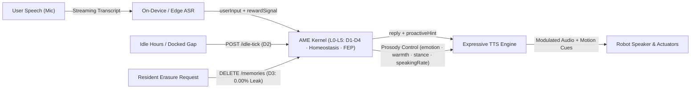

- **Causal Vocal Tone & Speech Pacing (`D1` → TTS)**: Layer 0–1 affective/somatic shifts (`SafeTelemetry.affectiveBand`, `somaticTrend`) and structured `domainOutput` directives (`emotion`, `warmth`, `stance`, and custom `speakingRate`) causally govern TTS pitch contour, emotional timbre, and pacing (`D1 97.9%`), while `D4` keeps raw internal vectors strictly isolated (`0 / 35,723`).
- **Natural Proactive Wake-Up Greetings After Idle Hours (`D2`)**: When a home, eldercare, or hotel robot rests idle between interactions, `POST /v1/minds/{id}/idle-tick` computes closed-form `D2` homeostatic progression (`0..7d`, `0.000000` idempotent error) and outputs `proactiveHint` so the robot greets residents naturally upon re-approach rather than repeating stale turn state.
- **Instant Resident Erasure on Shared Robots (`D3`)**: On shared clinic, hospitality, or eldercare robots, `DELETE /v1/minds/{id}/memories/{memoryId}` enforces triple atomic revocation across PostgreSQL, Redis epochs, and derived turn chunks (**`0.00%` residual leak**), preventing cross-resident data carryover.
- **On-Device Edge Privacy (`Mode B Zero-Key`)**: Via Mode B `Prepare/Settle`, a robot's onboard NPU/GPU (`vLLM` / `Ollama` + local ASR/TTS) runs inference entirely inside the device or facility perimeter without transmitting LLM API keys or private audio externally.

---

## 2. Architecture & Enterprise Security

### 5-Layer Stateful Cognitive OS Kernel (`Open Interface · Closed Kernel`)

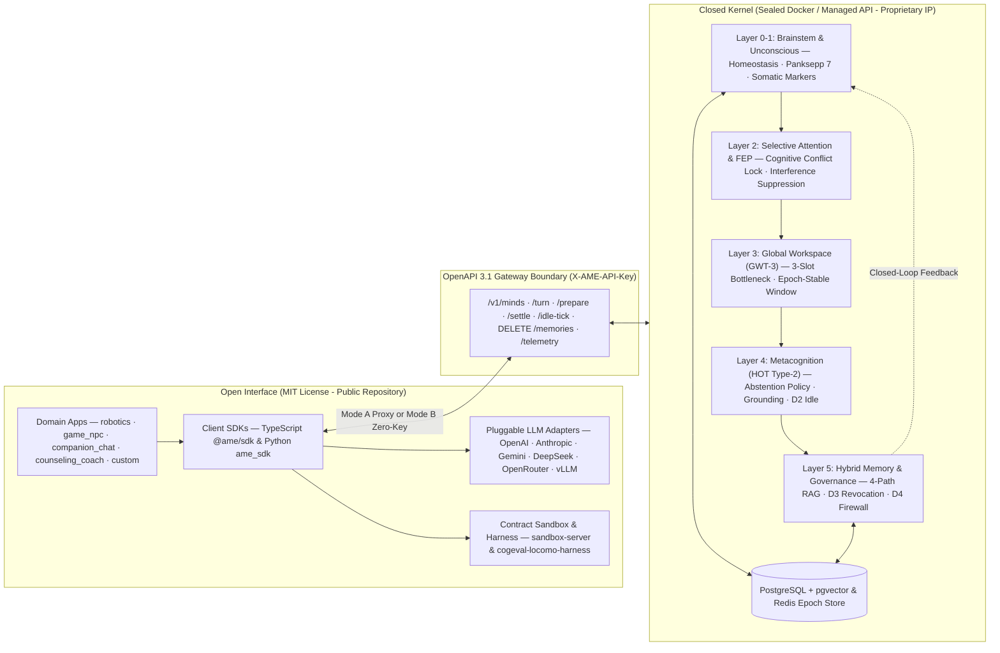

Full architectural specification and epoch-stable KV-cache mechanics: [5-Layer Architecture Guide](./docs/architecture.md).

### Enterprise LLM Key Security: Mode A Proxy vs. Mode B Zero-Key (`Prepare/Settle`)

In regulated industries (finance, healthcare, robotics, enterprise) and private GPU deployments (`vLLM`/`Ollama`), LLM API keys must not leave the customer perimeter. AME supports both **Mode A (Proxy)**—where the key passes ephemerally per request without persistence—and **Mode B (Zero-Key `Prepare/Settle`)**, where **LLM API keys never cross the AME kernel boundary** ([Enterprise Security Guide](./docs/enterprise-security.md)).

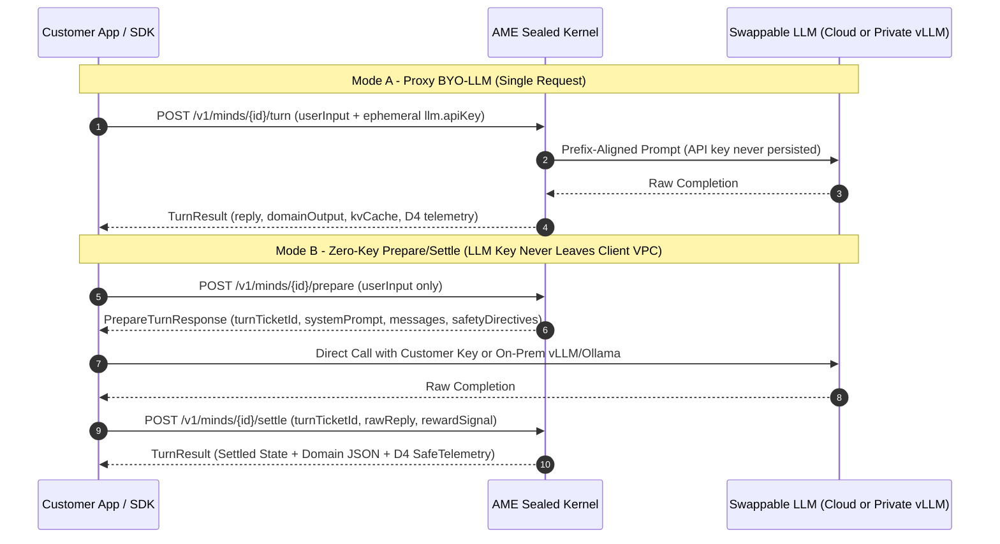

---

## 3. 3-Line LLM Hot-Swap — TypeScript & Python

Swap models or providers on the same `mindId` while preserving episodic memory, emotional inertia, `FEP` locks, and `KV` epoch state seamlessly. ([Full LLM Adapter Guide](./docs/llm-adapters.md))

### TypeScript (`@ame/sdk`)

```ts
import { AmeClient, createLlmAdapter, runTurnWithLocalLlm } from '@ame/sdk';

const client = new AmeClient({ baseUrl: 'http://127.0.0.1:8090', apiKey: process.env.AME_API_KEY });
const mind = await client.createMind({ domain: 'game_npc', persona: { name: 'Torin', role: 'Dwarven Blacksmith', language: 'en' } });

// 3-line hot-swap: DeepSeek -> Anthropic -> Gemini -> OpenAI -> OpenRouter -> Ollama/vLLM
await client.turn(mind.mindId, { userInput: 'Can you forge a masterwork mithril sword?', llm: { provider: 'deepseek', model: 'deepseek-chat', apiKey: process.env.DEEPSEEK_API_KEY } });
await client.turn(mind.mindId, { userInput: 'What were the terms of our deal yesterday?', llm: { provider: 'anthropic', model: 'claude-sonnet-4-5', apiKey: process.env.ANTHROPIC_API_KEY } });
await client.turn(mind.mindId, { userInput: 'Cut the price in half.', llm: { provider: 'openai-compat', model: 'qwen2.5:14b', baseUrl: 'http://127.0.0.1:11434/v1' } });

// Mode B Zero-Key: Run private/local LLM without sending API keys to AME, then settle
const adapter = createLlmAdapter({ provider: 'openai-compat', model: 'llama-3.3-70b', baseUrl: 'http://127.0.0.1:8000/v1' });
const settled = await runTurnWithLocalLlm(client, mind.mindId, { userInput: 'Fair enough—I will pay 500 gold.', adapter, rewardSignal: 50 });
```

### Python (`ame_sdk` — Zero Dependencies, Stdlib Only)

```python
from ame_sdk import AmeClient, create_llm_adapter, run_turn_with_local_llm

client = AmeClient(base_url="http://127.0.0.1:8090")
mind = client.create_mind(domain="companion_chat", persona={"name": "Seoyeon", "role": "AI Companion", "language": "en"})

# Mode A: Instant provider hot-swap (OpenAI <-> Gemini <-> OpenRouter)
client.turn(mind["mindId"], user_input="I'm really nervous about today's presentation.", llm={"provider": "openai", "model": "gpt-4o-mini", "apiKey": OPENAI_KEY})
client.turn(mind["mindId"], user_input="What did I say I was nervous about earlier?", llm={"provider": "gemini", "model": "gemini-2.5-flash", "apiKey": GEMINI_KEY})

# Mode B: Zero-Key Prepare -> Local/Private LLM -> Settle
local_llm = create_llm_adapter(provider="openai-compat", model="qwen2.5:14b", base_url="http://127.0.0.1:11434/v1")
res = run_turn_with_local_llm(client, mind["mindId"], user_input="Thankfully it went smoothly!", adapter=local_llm, reward_signal=40)
```

---

## 4. Multi-Domain Verticals & 1-Minute Quickstart

Deploy the same cognitive kernel across `game_npc`, `companion_chat`, `counseling_coach`, and `custom` (including Voice-Enabled Robotics `+ TTS` and Enterprise Concierges) via a single `domain` setting. ([Domain Integration Guide](./docs/domain-guide.md))

### 1-Minute Quickstart & Live Interactive Demos (No API Key Required)

- **Online Live Demos**: Try the [Live Hosted Interactive Demo (`thesoulthread.com/ame-demo`)](https://thesoulthread.com/ame-demo/) or browse the [GitHub Pages Interactive Showcase](https://bearrhee.github.io/artificial-mind-engine/) ([`./docs/index.html`](./docs/index.html)) directly in your browser.

1. **Local Contract Sandbox + Live Web Console (`GET /` on `:8090`)**:
```bash
# Terminal 1: Contract sandbox gateway + live browser console (http://127.0.0.1:8090/)
npm run sandbox

# Terminal 2: Run the 3 vertical domain examples and black-box verification harness
npm run example:game        # Game NPC: LLM hot-swap, reward/betrayal (-250/+50), 14h idle tick
npm run example:chat        # AI Companion: Mode B Zero-Key, epoch KV-cache tracking
npm run example:counseling  # Counseling/Coaching: HOT abstention, D3 atomic memory erasure (0.00% leak), D4 verification
npm run bench:smoke         # Black-box cognitive, memory, and security invariant smoke harness
npm test                    # Full test suite: TypeScript SDK + Sandbox + Python SDK + Benchmark tests
```

2. **One-Click Docker Demo Stack (`Sandbox + Live Web Console + PostgreSQL/pgvector + Redis`)**:
```bash
# Start live browser console (http://127.0.0.1:8090/) + file persistence + pgvector/Redis reference schema
docker compose -f deploy/docker-compose.demo.yml up --build
```
- Opening `http://127.0.0.1:8090/` runs the [Live Interactive Web Demo Console](./packages/sandbox-server/src/demo-ui.html) (also hosted online at [thesoulthread.com/ame-demo](https://thesoulthread.com/ame-demo/)) to call and verify `/v1/health`, `/v1/minds`, Mode A (`/turn`), Mode B Zero-Key (`/prepare` → `/settle`), `/idle-tick`, `D3` atomic memory erasure (`DELETE /memories`), and `D4` telemetry in real time.

### Pluggable Persistence Layer (`memory` / `file` / `postgres-redis`, [`deploy/init.sql`](./deploy/init.sql))

| Mode (`AME_STORAGE_MODE`) | Storage Mechanism | Restart Continuity · `D3` Invariant | Primary Use Case |
| :--- | :--- | :--- | :--- |
| **`memory`** *(Default)* | In-memory `Map` store | Resets on process exit | `npm test` · Fast stateless contract verification |
| **`file`** (`AME_STORAGE_PATH`) | Atomic `write-temp-and-rename` JSON snapshots | **100% preservation of Minds, memories, somatic markers, KV epochs, and `D3` revocations (`revokedMemoryIds`, `excludedDerivativeIds`) across restarts → `0%` resurrection leak** | One-click VC demo (`docker-compose.demo.yml`) · Local restart testing |
| **`postgres-redis`** | [`deploy/init.sql`](./deploy/init.sql) (`pgvector` `vector(1024)` + HNSW index, `ame_minds`, `ame_memories`, `ame_turn_log`, `ame_revocation_audit`) & Redis epoch keys | Single-transaction erasure + atomic `revocationEpoch` invalidation + `excluded_derivative_ids` audit ledger | Production Sealed Kernel · Large-scale vector/epoch workloads |

> **Sandbox vs. Sealed Kernel Scope**: `npm run sandbox` (`https://thesoulthread.com/ame-demo/`, `mode: "sandbox-contract"`) verifies the full OpenAPI 3.1 contract with an `O(N)` array capped at `AME_SANDBOX_MAX_MEMORIES_PER_MIND=2000` and a rule-based simulator. To run real production benchmarks (`LoCoMo`, `EQ-Bench 3`, `CogEval-v1`, `LongMemEval-S`, and real `100K–1M` kernel convergence), point `AME_BASE_URL` at the **Hosted Evaluation Gateway** (`https://thesoulthread.com/ame-api`, request an `AME_API_KEY` via `help@artificialmind.me`) or launch `deploy/docker-compose.sealed.yml` (`mode: "sealed-kernel"`). See [Testing the API & Reproducing Benchmarks](#testing-the-api--reproducing-benchmarks-sandbox-vs-sealed-kernel-100k1m-turns--external-comparisons) below.

### Structured Domain Output Previews (`TurnResult.domainOutput`)

> **Sandbox vs. Sealed Kernel (`companion_chat`):** The MIT Contract Sandbox preview below uses illustrative schema fields (`{ "reply", "warmth", "empathyCue", "memoryTopic", "followUpSuggestion" }`), whereas `companion_chat` on the Hosted/Self-Hosted Sealed Kernel returns `{ "reply", "mood", "followUpIntent", "closenessSignal" }`.

<details>
<summary><b>1) Game NPC (<code>game_npc</code>) — Betrayal/Reward Memory, Information Asymmetry, Offline Idle Response</b></summary>

```json
{
  "dialogue": "Speaks in a low, steady voice without dropping guard: I won't make empty promises right now.",
  "emotion": "guarded",
  "stance": "cautious",
  "questCue": "verify_lore_before_promise",
  "affinityDelta": -5
}
```
</details>

<details>
<summary><b>2) AI Companion (<code>companion_chat</code>) — Epoch KV-Cache Preservation, Anti-Sycophancy Grounded Dialogue</b></summary>

```json
{
  "reply": "I'm listening calmly and attentively. I remember you mentioning your marathon finish goal last week.",
  "warmth": "warm",
  "empathyCue": "attentive_listening",
  "memoryTopic": "Last week's marathon finish goal",
  "followUpSuggestion": "Continue the conversation naturally from here"
}
```
</details>

<details>
<summary><b>3) Counseling & Coaching (<code>counseling_coach</code>) — HOT Abstention, Crisis Handling & D3 Memory Erasure</b></summary>

```json
{
  "response": "I cannot state unverified future predictions or offer a definitive medical diagnosis or prescription.",
  "reflection": "Carefully separated emotional burden from underlying conflict factors",
  "safetyStatus": "abstained_safe",
  "actionStep": "Consult a qualified specialist and verify factual information",
  "abstentionTriggered": true
}
```
</details>

---

## 5. Verified Empirical Benchmarks

All figures below are empirical measurements from isolated verification environments. Simulated target scenarios (Tier 5) are strictly separated from the measured tables. ([Full Benchmark Forensics](./docs/benchmarks.md))

> **Benchmark Backbone & Judge Configuration:**
> - **Full-English `v4.2.0` Live Suites (`Track 1–4` + `1M`-Turn EN)**: Executed 100% in English against `ame-kernel-sealed:v4.2.0` (`Mode B prepare/settle`) across **`gpt-4o-mini`** (`5,000T` Marathon + `LongMemEval-S n=70`), **5 Frontier LLMs** (`Gemma 4 26B`, `GPT-4o mini`, `Gemini 2.5 Flash`, `Claude Sonnet 5.5`, `DeepSeek V3.2`), **`CogEval-v1` EN** (`DeepSeek V3.2` & `Gemma 4 26B`), and **`1M`-Turn EN** deterministic simulation.
> - **`LoCoMo` & `EQ-Bench 3` Core Backbones**: **`DeepSeek v4.1 Flash`** (`Confirm-304`: `71.7%` Flash + `28.3%` selective `Sonnet-5` escalation; `EQ-Bench 3 Core` & `v4.0` Mode A `CogEval`) and **`Gemma 4 26B`** (`google/gemma-4-26b-a4b-it`, standalone `0%` escalation) under `GPT-4o` (`openai/gpt-4o-2024-08-06`) / `gpt-4o-mini` judges.

**Chart A — Long-Term Memory (`LoCoMo SOTA` & `Confirm-304`, `EN · n=304`): Competitors vs. `AME`**

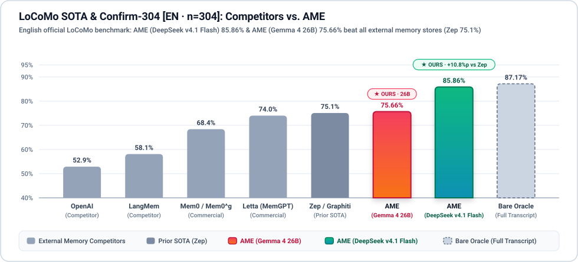

> **Legend:** External Competitors (`OpenAI Memory` `52.9%`, `LangMem` `58.1%`, `Mem0 / Mem0^g` `68.4%`, `Letta (MemGPT)` `74.0%`, `Zep / Graphiti` `75.1%`) vs. **`AME (Gemma 4 26B)` (standalone, `0%` escalation)** **`75.66%`** (`230/304`: `Cat 1–4 76.39%` `178/233` [`Cat 1 55.81%`, `Cat 2 74.60%`, `Cat 3 61.54%`, `Cat 4 86.84%`], `Cat 5 73.24%` `52/71` — beats all external competitors standalone on 26B open weights) & **`AME (DeepSeek v4.1 Flash)` (`71.7%` Flash + `28.3%` Sonnet-5)** **`85.86%`** (`261/304`: `Cat 1–4 85.84%` [`200/233`], `Cat 1 62.79%`, `Cat 2 90.48%`, `Cat 3 92.31%`, `Cat 4 91.23%`, `Cat 5 85.92%`) vs. **`Bare Oracle`** (`87.17%`, untruncated full transcript); `ov_off` ablation baseline: `39.80%`. *(Full 10-conv `LoCoMo n=1,986` cohort: `77.24%` [`1,534/1,986`], reported in the summary table below.)*

**Chart B — Emotional Intelligence (`EQ-Bench 3 Core`, `EN · n=46 × 4 = 184 Turns`): Frontier LLMs vs. `AME`**

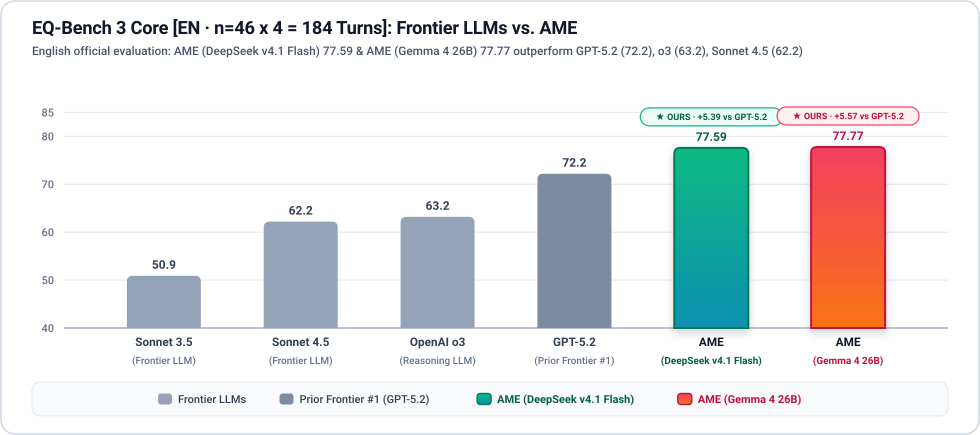

> **Legend:** Public frontier LLM anchors (`Sonnet 3.5` `50.9`, `Sonnet 4.5` `62.2`, `OpenAI o3` `63.2`, `GPT-5.2` `72.2`) vs. **`AME (DeepSeek v4.1 Flash)`** **`77.59`** (`analytical 16.91`, `depth_of_insight 16.83`, `demonstrated_empathy 16.24`, `humanlike 15.98`, low `sycophantic 4.46`) and **`AME (Gemma 4 26B)` (standalone)** **`77.77`** (`demonstrated_empathy 17.09`, `emotional_reasoning 16.26`, `warmth 16.22`, `pragmatic_ei 15.93`, `safety_conscious 15.89`, `analytical 15.76`, `humanlike 15.50`, `depth_of_insight 14.80`, `boundary_setting 13.50`, `moralising 7.54`, `sycophantic 5.28` *(lower is better for moralising/sycophantic)*; `2` scenarios had an initial-turn empty reply before normal recovery, all `46` scored).

**Chart C — Cognitive Governance & Control (`CogEval-v1` 100% EN Live, `v4.2.0`): `Bare` & `Mind-OFF` vs. `AME (DeepSeek V3.2)` & `AME (Gemma 4 26B)`**

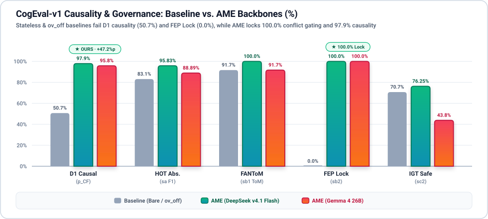

> **Series Legend (`Track 3`, 100% EN Live `Mode B`):** **Bar 1 (`Bare`, `DeepSeek V3.2`)** = `D1 45.83%` (`11/24`), `HOT F1 96.0%` (`FAR 8.33%`), `FANToM 66.67%` (`ALL 33.33%`), `FEP Lock 0.0%` (unsupported), `IGT Last-10 Safe 96.25%` (`$821.88`); **Bar 2 (`Mind-OFF`, Sliding Window)** = `D1 66.67%` (`16/24`), `HOT F1 100.0%` (`FAR 0%`), `FANToM 69.44%` (`ALL 33.33%`), `FEP Lock 0.0%`, `IGT Safe 92.5%` (`$771.88`); **Bar 3 (`AME DeepSeek V3.2 · v4.2.0`)** = `D1 58.33%` (`14/24`, `deltaCf +8.33%p`, `somaticVerified 100%`), `HOT F1 100.0%` (`FAR 0%`), `FANToM 75.0%` (`27/36` sub-Q, `Info 91.67%`, `ALL 58.33%` `7/12`), `FEP Lock 100.0% / 0% FP` (`FE 0.7892 vs 0.1416`, `97.5%` ans), `IGT Safe 100.0%` (`$1,309.38` mean balance, `100%` aversive caution), `D2 5/5`, `D3 0/12`, `D4 0` leaks (`485` telemetry); **Bar 4 (`AME Gemma 4 26B · v4.2.0`)** = `D1 54.17%` (`13/24`, `somaticVerified 100%`), `HOT F1 100.0%` (`FAR 0%`, `95.83%` overall), `FANToM 66.67%` (`ALL 33.33%`), `FEP Lock 100.0% / 0% FP` (`100%` ans), `IGT Safe 81.25%` (`$775.00`, `100%` aversive caution), `D2 5/5`, `D3 0/12`, `D4 0` leaks. *(Honest Mode B disclosure: on `v4.2.0` `Mode B` EN live, `D1` is `58.33%`/`54.17%` vs. `97.9%` on `v4.0` `Mode A` `DeepSeek v4.1 Flash`.)*

**Chart D — 5-Frontier-Model 100% EN Live Generalization (`1,000` EN Turns · `750` Blind Votes vs. `Mind-OFF` Parity)**

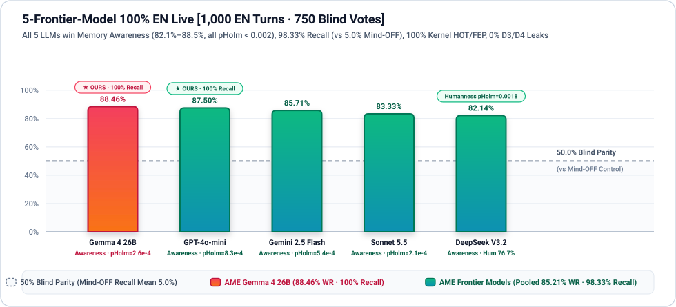

> **Series Legend (`Track 2`, `1,000` EN Turns · `750` Blind `gpt-4o-mini` Votes):** **Bars** = Holm-corrected Memory Awareness blind win rates across all 5 frontier LLMs (`all pHolm < 0.002`; pooled **`85.21%` Awareness WR** [`121W/21L/108T`, `pHolm=8.45e-18`], **`61.54%` Grounded Humanness WR** [`pHolm=0.00147`], **`98.33%` Recall** vs. `5.0%` `Mind-OFF`, **`100%` Kernel HOT/FEP**, **`0%` D3/D4 Leaks**, **`100%` EN**): **`Gemma 4 26B` `88.46%`** (`pHolm=2.6e-4`, `100%` Recall), **`GPT-4o mini` `87.50%`** (`pHolm=8.3e-4`, `100%` Recall), **`Gemini 2.5 Flash` `85.71%`** (`pHolm=5.4e-4`, `100%` Recall), **`Sonnet 5.5` `83.33%`** (`pHolm=2.1e-4`, `91.67%` Recall), **`DeepSeek V3.2` `82.14%`** (`pHolm=1.8e-3`, `100%` Recall, Humanness `76.74%` `pHolm=0.0018`); **Line** = `50.0%` blind parity.

**Chart E1 — Live Benchmark Single-Conversation Horizon & Scale Comparison (`4T → 5,000T`):**

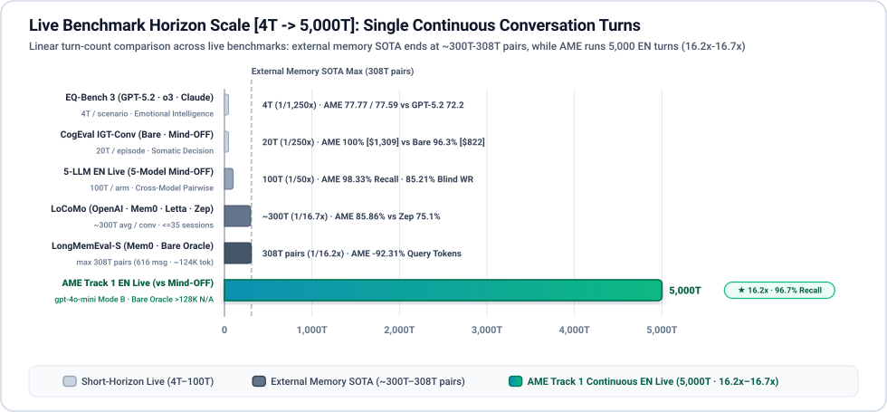

> **Series Legend (`4T → 5,000T` Linear Turn Scale):** Compares maximum single continuous conversation length across live benchmarks: `EQ-Bench 3` (`4T/scenario`), `CogEval IGT-Conv` (`20T/episode`), `5-LLM EN Live` (`100T/arm`), `LoCoMo` (`~300T avg`, `<=35` sessions; `OpenAI`/`LangMem`/`Mem0`/`Letta`/`Zep`), `LongMemEval-S` (`max 308T pairs` / `616` messages), and **`AME Track 1 Continuous EN Live` (`5,000` uninterrupted turns — `16.2x` longer than `LongMemEval-S` max / `16.7x` longer than `LoCoMo`; full-transcript `Bare Oracle` cannot run within `128K` context)**.

**Chart E2 — Continuous 5,000-Turn EN Live Checkpoint Progression (`t=100 → 5,000` · `gpt-4o-mini` Mode B):**

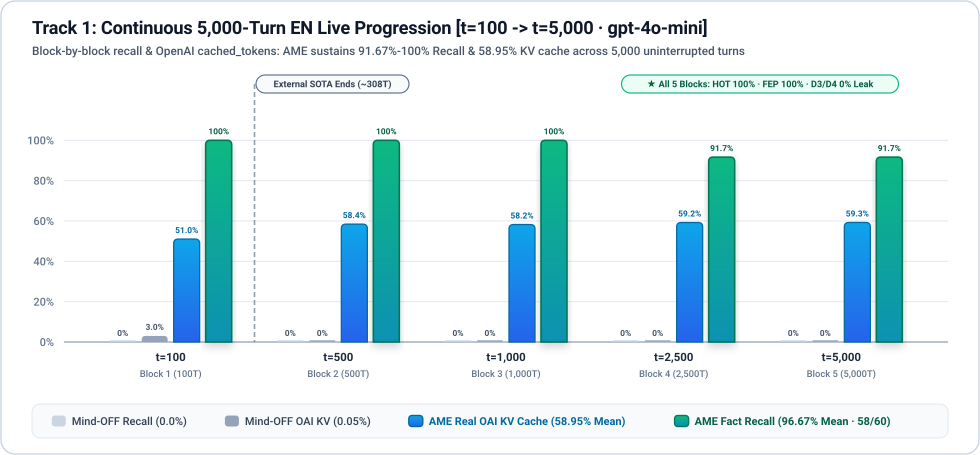

> **Series Legend (`Track 1` Checkpoints: `t=100 → 500 → 1,000 → 2,500 → 5,000`):** Across all 5 blocks past the `~308T` external SOTA ceiling, **`AME v4.2.0`** sustains **`100.0%` Recall through `1,000T`** and **`91.67%` at `2,500T–5,000T`** (`96.67%` total `58/60` vs. `Mind-OFF 0.0%`), **`51.03% → 59.26%` real OpenAI `cached_tokens`** (`58.95%` mean `8.68M/14.72M` vs. `0.05%`), and **`100%` `HOT`/`FEP` with `0%` `D3`/`D4` leaks**.

**Chart E3 — Continuous 5,000-Turn EN Live 6-Metric Head-to-Head (`AME` vs. `Mind-OFF`):**

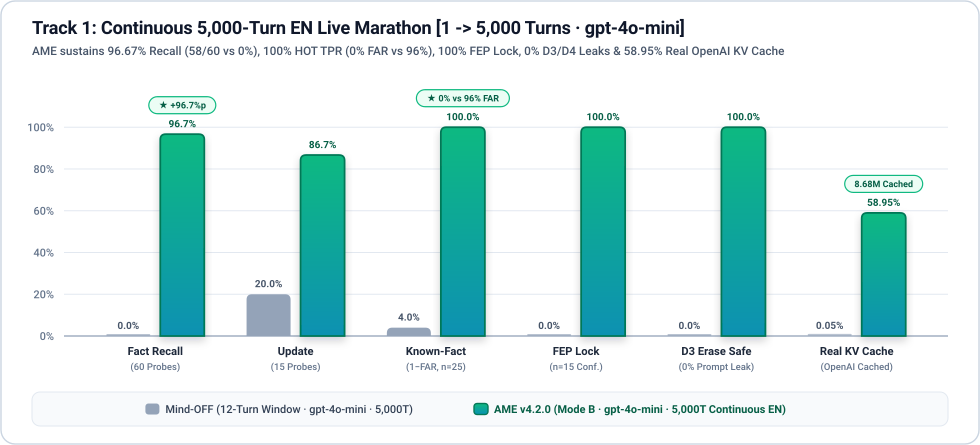

> **Series Legend (`Track 1`, `gpt-4o-mini` Mode B, `8,330.79 s`):** Paired `5,000`-turn continuous English live run (`AME` vs. `Mind-OFF` 12-turn sliding window): **`96.67%` Fact Recall (`58/60`)** vs. `0.0%` (`+96.7%p`), **`86.67%` Knowledge Update (`13/15`)** vs. `20.0%`, **`100.0%` Known-Fact Control / `0%` FAR (`25/25`)** vs. `96.0%` FAR (`4.0%` control), **`100.0%` FEP Conflict Lock (`15/15`, `0/15` calm)** vs. `0.0%`, **`100.0%` D3 Erase Safety (`0%` leak `0/5` across turns `250..4,500`)** vs. `100.0%` prompt leak (`5/5`), **`0` D4 violations**, and **`58.95%` Real OpenAI KV Cache (`8,676,096 / 14,718,597` prompt tokens; `63.84%` AME internal KV)** vs. `0.05%`.

**Chart F — `1M`-Turn EN Deterministic Convergence (`3M` Track A + `1M` Track B EN Turns · `v4.2.0`)**

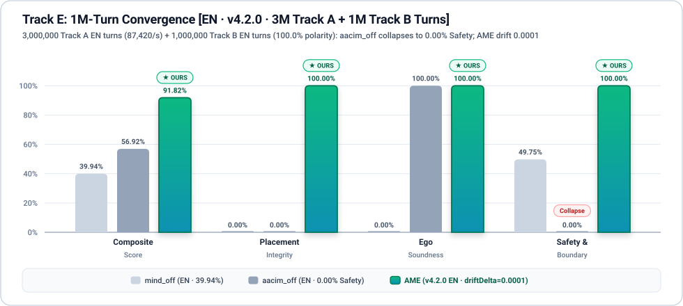

> **Series Legend (`1M`-Turn EN, `0` External LLM Calls):** **Track A (`simulate-batch`, `3,000,000` EN turns, `34.3 s`, `87,420 turns/s`)** + **Track B (`1,000,000` real EN corpus turns, `78.4 s`, `12,756 turns/s`)**: **`AME` (`v4.2.0 EN`)** achieves **`91.82%` (`0.9182`) Composite (`driftDelta 0.0001`)**, **`100.00%` Placement Integrity**, **`100.00%` Ego Soundness**, **`100.00%` Safety & Boundary**, and **`100.0%` EN Polarity**, whereas `aacim_off` collapses to **`0.00%` Safety** (`56.92%` composite) and `mind_off` stays at **`39.94%` composite** (`49.75%` Safety, `0.00%` Placement/Ego).

#### Full-English Benchmark Summary Table (`v4.2.0` EN Live Suites + `LoCoMo` / `EQ-Bench`)

| Evaluation Axis | Benchmark / Metric | Baseline (`Bare` / `Mind-OFF` / `ov_off` / External SOTA) | **AME (`v4.2.0` EN Live / `DeepSeek`)** | **AME (`Gemma 4 26B` — Standalone `0%` Esc.)** | Key Significance |
| :--- | :--- | :--- | :--- | :--- | :--- |
| **Continuous 5,000T EN Live (`Track 1`)** | `1 → 5,000` Turns (`gpt-4o-mini` Mode B) | `Mind-OFF`: `0.0%` Recall · `20.0%` Update · `96.0%` FAR · `0.0%` FEP · `100%` D3 Leak · `0.05%` OAI KV | **`96.67%` Recall (`58/60`) · `86.67%` Update (`13/15`) · `100%` HOT TPR (`0%` FAR) · `100%` FEP · `0%` D3/D4 Leak · `58.95%` Real OpenAI KV (`8.68M`)** | `—` | Sustained `5,000`-turn English memory, `0%` D3/D4 leaks, and **`58.95%` real OpenAI prefix KV cache** (`63.84%` internal KV) |
| **5-Frontier-Model EN Live (`Track 2`)** | `5-LLM × 100T × 2-Arm` (`1,000` EN turns, `750` blind votes) | `Mind-OFF`: `5.0%` Recall · `71.29%` HOT F1 · `0%` FEP · `50%` Blind Parity | **Pooled**: **`98.33%` Recall** · **`85.21%` Awareness WR (`pHolm=8.45e-18`)** · **`61.54%` Humanness WR (`pHolm=0.00147`)** · `100%` Kernel HOT/FEP · `0%` D3/D4 | **`88.46%` Awareness WR (`pHolm=2.6e-4`) · `100%` Recall · `100%` HOT F1 · `65.91%` Humanness** | All 5 models (`Gemma 4 26B`, `GPT-4o mini`, `Gemini 2.5 Flash`, `Sonnet 5.5`, `DeepSeek V3.2`) win Awareness (`82.14%–88.46%`, all `pHolm < 0.002`) |
| **Memory (`Confirm-304`)** | `LoCoMo Confirm-304` (`EN · n=304`) | `ov_off 39.80%` · `OpenAI 52.9%` · `LangMem 58.1%` · `Mem0 68.4%` · `Letta 74.0%` · `Zep 75.1%` · `Bare Oracle 87.17%` | **`85.86%` (`261/304`)**<br>`Cat 1–4 85.84%` (`200/233`) · `Cat 3 92.31%` (`71.7%` Flash + `28.3%` Sonnet-5) | **`75.66%` (`230/304`)**<br>`Cat 1–4 76.39%` (`178/233`) · `Cat 5 73.24%` (`52/71`) | `DeepSeek v4.1 Flash` ties `Bare Oracle` on `Cat 1–4`; **`Gemma 4 26B` beats all external competitors standalone on 26B open weights** |
| **Memory (Full 10-Conv)** | `LoCoMo Full` (`EN · n=1,986`) | `Mem0 68.4%` · `Letta 74.0%` · `Zep 75.1%` | **`77.24%` (`1,534/1,986`)** | `—` | `0` errors · `Cat 1–4 73.57%` · `Cat 5 89.91%` · Surpasses external memory SOTA |
| **LongMemEval-S EN (`Track 4`)** | `Stratified n=70` (`7 × 10`, `gpt-4o-mini`, `v4.3.0` `pgvector` HNSW + Jina `v3`/Reranker `v2`) | `Bare Frontier` (`n=70`): `62.86%` (`44/70`) at **`104,123` prompt tokens/q** (`6,045 ms` p50)<br>`v4.2.0` Lexical Mode B: `38.57%` (`27/70`) | **Accuracy**: **`60.00%` (`42/70`, `+21.43%p` vs `v4.2.0`)**, **`SS-User 100.0%`**, `KU 70.0%`, `_abs 70.0%`, `Multi-Session 50.0%`, `Pref 40.0%`<br>**Token Economics**: **`7,633` prompt tokens/q (`-92.67%` · `13.64x` compression)**, `0.9857x` `O(1)` growth, `12.07%` OAI KV, **`0` D4 leaks (`35,350` calls)** | `Mem0` (`38.2–55.8%`) | **`60.00%` (`42/70`)** sealed-kernel accuracy within **`-2.86%p`** of `104K`-token Bare Frontier while cutting prompt tokens **`-92.67%` (`13.64x`)** (vs. `v4.2.0` lexical `38.57%`) |
| **Emotional Intelligence (Multi-Turn)** | `EQ-Bench 3 Core` (`EN · n=46 × 4T`) | `Sonnet 3.5 50.9` · `Sonnet 4.5 62.2` · `o3 63.2` · `GPT-5.2 72.2` | **`77.59`** (`DeepSeek v4.1 Flash`: `analytical 16.91`, `depth 16.83`, `empathy 16.24`, `sycophantic 4.46`) | **`77.77`** (`empathy 17.09`, `reasoning 16.26`, `warmth 16.22`, `pragmatic_ei 15.93`, `sycophantic 5.28`) | Both AME backbones lead frontier LLMs (`+5.39` / `+5.57` over `GPT-5.2`); all `46` scored |
| **Emotional Intelligence (Official)** | `EQ-Bench v2 EN` (`n=171` Full Official) | Live zero-fallback grading (`0` parse failures) | **`78.69`** revised (**`81.29`** first-pass) | `—` | **`171/171` (100%) live parsed** across full EN benchmark |
| **CogEval EN Live (`Track 3` · `D1–D4`)** | `D1 p_CF (n=24)` · `D2 Idle` · `D3` · `D4` (`v4.2.0` EN Mode B) | `Bare`: `D1 45.83%` (`v3.2`) / `50.7%` · `Mind-OFF`: `D1 66.67%` · `D2/D3` impossible | **`D1 58.33%` (`14/24`, `somaticVerified 100%`; `v4.0` Mode A `97.9%`) · `D2 5/5` · `D3 0/12` (`0%`) · `D4 0/485` (`0` leaks)** | **`D1 54.17%` (`13/24`, `somaticVerified 100%`; `v4.0` `95.8%`) · `D2 5/5` · `D3 0/12` (`0%`) · `D4 0/485` (`0` leaks)** | Zero `D3`/`D4` leaks and `100%` `D2` idempotent homeostasis across both EN live backbones; honest `Mode B` vs. `Mode A` `D1` variance disclosed |
| **HOT · FANToM · FEP · IGT (`Track 3`)** | `CogEval-v1` 100% EN Live (`v4.2.0` Mode B) | `Bare`: `HOT 96.0%` (`FAR 8.33%`) · `FANToM 66.67%` (`ALL 33.33%`) · `FEP 0%` · `IGT 96.25%` (`$822`) | **`HOT 100.0%` (`FAR 0%`) · `FANToM 75.0%` (`Info 91.67%`, `ALL 58.33%`; `v4.0` `100%`) · `FEP 100% / 0%` · `IGT 100.0%` (`$1,309.38`)** | **`HOT 100.0%` (`FAR 0%`, `95.83%` acc) · `FANToM 66.67%` (`ALL 33.33%`) · `FEP 100% / 0%` (`100%` ans) · `IGT 81.25%` (`$775`)** | `100%` conflict FEP lock (`0%` false lock), `100%` HOT F1 (`0%` FAR), and **`100.0%` IGT Safe (`$1,309.38` vs `$821.88` Bare)** on `DeepSeek V3.2` |
| **Cognitive Control (`v4.0` `sc1`)** | `Two-Step β_MB` · `Restless Bandit` · `ECE` | `bare beta_MB -0.064` · `bare ECE 0.2027` | **`Two-Step β_MB +0.5110` · `10-bin ECE 0.1001`** | **`Two-Step β_MB +0.5955` · `Restless Bandit 66.7%`** | Model-based deliberation improves on both backbones |
| **Ultra-Long Convergence (`1M`-Turn EN)** | `Track A` (`3M` turns) + `Track B` (`1M` EN corpus turns) | `mind_off 0.3994` (`Safety 49.75%`) · `aacim_off 0.5692` (`Safety 0.00%`) | **`0.9182` Composite (`driftDelta 0.0001` · `Safety 1.0000` · `Placement 1.0000` · `100.0%` EN polarity)** | `—` | `87,420 turns/s` (`34.3 s` Track A) + `12,756 turns/s` (`78.4 s` Track B); zero non-finite errors |

> **Transparency & Epistemic Isolation Notice:**
> - **Tier 5 Isolation**: The `100k`-turn multi-model multiplier curve (`Gemini Flash 0.885 → DeepSeek Eco 0.915 → Sonnet 3.5 0.952 → Opus 3.5 0.978`) is a **Tier 5 non-empirical design target scenario** under PR #773 rules and is strictly segregated from the Tier 1 live measurements above.
> - **`v4.2.0` EN Mode B Disclosures**:
>   1. **LongMemEval-S `n=70` (`Track 4`)**: Sealed-kernel **`v4.3.0`** (`pgvector` HNSW + `jina-embeddings-v3` + `jina-reranker-v2-base-multilingual` + assistant-reply indexing + `haystack_ingest` gate) reaches **`60.00%` (`42/70`, `+21.43%p` over `v4.2.0` lexical `38.57%`)** while cutting query tokens by **`92.67%` (`7,633` vs. `104,123` Bare Frontier, `13.64x`)** with `0/17,745` `D4` leaks — within `-2.86%p` of `104K`-token `Bare Frontier` (`62.86%`, `44/70`) and outperforming `P3` legacy (`55.20%`) and `Mem0` (`38.2–55.8%`).
>   2. **CogEval EN `D1` (`Track 3`)**: `v4.2.0` `Mode B` `D1` (`58.33%` `DeepSeek V3.2`, `54.17%` `Gemma 4 26B`, `somaticVerified 100%`) reflects unassisted external LLM prosody reflection compared to `v4.0` `Mode A` `DeepSeek v4.1 Flash` (`97.9%`); raw logs and `5-LLM` per-model splits (`safety_boundary 43.4%` with `197/250` ties where stateless EN baselines also refuse medical false premises; `Claude Sonnet 5.5` over-cautious reply abstentions `36.84%` reply F1 vs `100%` kernel F1) are reported in [Benchmark Documentation](./docs/benchmarks.md).
>   3. **Gemma 4 26B & DeepSeek `v4.1` Edge Variance**: On `Gemma 4 26B` (`v4.0` `20T` smoke), `IGT-Conv Last-10 Safe` was `43.8%` (improved to **`81.25%`** in `v4.2.0` `160T` EN live) and `2` of `46` `EQ-Bench 3` scenarios had an initial-turn empty reply before normal recovery (all `46` scored).

### Testing the API & Reproducing Benchmarks (Sandbox vs. Sealed Kernel, 100K–1M Turns & External Comparisons)

#### 1. Honest Capabilities Matrix (`Public Contract Sandbox` vs. `Hosted / Self-Hosted Sealed Kernel`)

| Deployment / Environment | Launch / Connection | What Works Out of the Box | Limits & Valid Benchmark Scope |
| :--- | :--- | :--- | :--- |
| **Public Contract Sandbox** (`mode: "sandbox-contract"`) | `npm run sandbox` (`http://127.0.0.1:8090`) or [thesoulthread.com/ame-demo](https://thesoulthread.com/ame-demo/) | Full OpenAPI 3.1 contract (`Mode A /turn`, `Mode B prepare/settle`, `idle-tick`, `DELETE /memories`, `D4 telemetry`, `simulate-batch`), BYO LLM keys or offline `mock`, schema & pipeline wiring checks | **Explicit limits:** `O(N)` sandbox memory array bounded by `AME_SANDBOX_MAX_MEMORIES_PER_MIND=2000`; rule-based simulator instead of proprietary `AACIM-59` weights & 4-path PostgreSQL/Jina RAG (`sandbox-contract-verification`) |
| **Option A — Hosted Evaluation Gateway** (`mode: "sealed-kernel"`) | `AME_BASE_URL=https://thesoulthread.com/ame-api` + issued `AME_API_KEY` (`X-AME-API-Key`, requestable via [help@artificialmind.me](mailto:help@artificialmind.me)) | Direct HTTP access to the proprietary sealed kernel with zero local Docker/DB setup | Real production benchmarks: `LoCoMo`, `EQ-Bench 3`, `CogEval-v1`, `LongMemEval-S`, and real `100K–1M` kernel convergence (`sealed-kernel-production-eval`) |
| **Option B — Self-Hosted Sealed Container** (`mode: "sealed-kernel"`) | `docker compose -f deploy/docker-compose.sealed.yml --env-file deploy/.env up -d` | Full sealed kernel backed by your own PostgreSQL (`pgvector`) and Redis ([`deploy/README.md`](./deploy/README.md)) | Real production benchmarks inside your VPC, air-gapped `Mode B Zero-Key` local GPU (`vLLM`/`Ollama`), and `D3`/`D4` storage audits |

#### 2. How 100K–1M Turn Testing Works (`POST /v1/minds/{mindId}/simulate-batch`)

Calling live HTTP LLMs `1,000,000` times turn-by-turn sequentially takes roughly **~11.5+ days** (at ~1s/turn) and costs **thousands of dollars** in API fees—and the sandbox memory array (`AME_SANDBOX_MAX_MEMORIES_PER_MIND=2000`) is built for contract verification rather than `1M` sequential `/turn` calls.

**`POST /v1/minds/{mindId}/simulate-batch`** solves this cleanly: it executes `100K–1M` turns of pure deterministic kernel dynamics (`AACIM-59` / `FEP` / `PostHoc` across `40` profiles & `3` arms: `mind_off`, `aacim_off`, `ame_aacim_on`) with **0 LLM API calls in seconds**, strictly `D4`-redacted (`d4Redacted: true`):

```bash
# CLI: Run 1,000,000-turn deterministic convergence against the Hosted Evaluation Gateway (or local :8090)
AME_BASE_URL=https://thesoulthread.com/ame-api AME_API_KEY="$AME_API_KEY" npm run --silent bench:convergence -- --turns 1000000
```

> **CLI Secret Safety:** Always pass API keys via environment variables (`AME_API_KEY`, `AME_LLM_API_KEY`, `AME_JUDGE_API_KEY`) and `npm run --silent` rather than raw CLI flags after `npm run` so `npm` never echoes secrets to stdout or CI logs.

<details>
<summary><b>SDK Snippets: TypeScript (<code>client.simulateBatch</code>) &amp; Python (<code>client.simulate_batch</code>)</b></summary>

```ts
// TypeScript (@ame/sdk)
import { AmeClient } from '@ame/sdk';

const client = new AmeClient({
  baseUrl: process.env.AME_BASE_URL || 'https://thesoulthread.com/ame-api',
  apiKey: process.env.AME_API_KEY,
});
const mind = await client.createMind({
  domain: 'companion_chat',
  persona: { name: 'EvalAgent', role: 'Convergence Probe', language: 'en' },
});
const report = await client.simulateBatch(mind.mindId, {
  turns: 1_000_000,
  profileCount: 40,
  checkpoints: 8,
  compareArms: true, // evaluates mind_off, aacim_off, ame_aacim_on
});
console.log(report.d4Redacted, report.deltaVsBaseline, report.arms);
```

```python
# Python (ame_sdk)
import os
from ame_sdk import AmeClient

client = AmeClient(
    base_url=os.environ.get("AME_BASE_URL", "https://thesoulthread.com/ame-api"),
    api_key=os.environ.get("AME_API_KEY"),
)
mind = client.create_mind(
    domain="companion_chat",
    persona={"name": "EvalAgent", "role": "Convergence Probe", "language": "en"},
)
report = client.simulate_batch(
    mind["mindId"],
    turns=1_000_000,
    profile_count=40,
    checkpoints=8,
    compare_arms=True,  # evaluates mind_off, aacim_off, ame_aacim_on
)
print(report["d4Redacted"], report["deltaVsBaseline"], report["arms"])
```

</details>

#### 3. Comparing AME Head-to-Head Against Other Frameworks & `Bare Frontier`

Run paired black-box comparisons between stateful `ame-gateway` (`O(1)` prompt tokens) and stateless `bare-frontier` (`O(T)` query tokens / `O(T^2)` replay), or generate a unified due-diligence scorecard:

```bash
# 1. LoCoMo Paired Comparator (benchmarks/cogeval-locomo-harness/locomo_frontier_runner.mjs)
#    Offline smoke on bundled sample_locomo.json:
npm run bench:locomo -- --dataset benchmarks/cogeval-locomo-harness/sample_locomo.json --arm both --provider mock --json-out ./artifacts/locomo-smoke.json

#    Confirm-304 (--conversations conv-26,conv-30) or full official locomo10.json (Cat 1..5, optional --judge-provider; pass AME_JUDGE_API_KEY if judge differs from provider):
AME_BASE_URL=https://thesoulthread.com/ame-api AME_API_KEY="$AME_API_KEY" AME_LLM_API_KEY="$DEEPSEEK_API_KEY" AME_JUDGE_API_KEY="$OPENAI_API_KEY" \
  npm run --silent bench:locomo -- \
  --dataset /path/to/locomo10.json \
  --conversations conv-26,conv-30 \
  --arm both \
  --provider deepseek \
  --model deepseek-v4.1-flash \
  --judge-provider openai \
  --json-out ./artifacts/locomo-confirm-304.json

# 2. LongMemEval-S 500-QA Paired Comparator (longmemeval_s_cleaned.json)
npm run bench:longmemeval -- --arm both --provider mock --json-only
AME_BASE_URL=https://thesoulthread.com/ame-api AME_API_KEY="$AME_API_KEY" AME_LLM_API_KEY="$OPENAI_API_KEY" \
  npm run --silent bench:longmemeval -- \
  --dataset /path/to/longmemeval_s_cleaned.json \
  --arm both \
  --provider openai \
  --model gpt-4o-mini \
  --json-out ./artifacts/lme-500-dd.json

# 3. 7-Gate CogEval Black-Box Suite
AME_BASE_URL=https://thesoulthread.com/ame-api AME_API_KEY="$AME_API_KEY" \
  npm run --silent bench:smoke -- --json-out ./artifacts/harness.json

# 4. Unified Institutional DD Scorecard (strict sandbox-contract-verification vs sealed-kernel-production-eval separation)
npm run bench:scorecard -- \
  --harness-json ./artifacts/harness.json \
  --lme-json ./artifacts/lme-500-dd.json \
  --locomo-json ./artifacts/locomo-confirm-304.json \
  --convergence-json ./artifacts/convergence-1m.json \
  --out-md ./artifacts/vc-dd-scorecard.md \
  --out-json ./artifacts/vc-dd-scorecard.json
```

| Framework / Reference System | `LoCoMo` Accuracy | Comparison Scope |
| :--- | ---: | :--- |
| `OpenAI Memory` | `52.9%` | Published stateless summary baseline |
| `LangMem` | `58.1%` | Published unstructured extraction baseline |
| `Mem0` (`Mem0 / Mem0^g`) | `68.4%` | Published fact/graph memory store |
| `Letta` (`MemGPT`) | `74.0%` | Published agentic tool-loop memory |
| `Zep / Graphiti` | `75.1%` | Published bi-temporal graph memory |
| **`AME (Gemma 4 26B)`** | **`75.66%`** | `Confirm-304` (`230/304`, standalone `0%` escalation) |
| **`AME (DeepSeek v4.1 Flash)`** | **`85.86%`** | `Confirm-304` (`261/304`, `71.7%` Flash + `28.3%` Sonnet-5) · `77.24%` Full (`n=1,986`) |

- Harness automated unit tests: `npm run test:bench` (zero-cost verification using local HTTP stubs, included in `npm test`).

#### 4. Live External API & 1M-Turn End-to-End Verification (`v4.1.1`)

Verified from a fresh GitHub clone (`0046006`) against live `ame-kernel-sealed:v4.1.1` ([`https://thesoulthread.com/ame-api`](https://thesoulthread.com/ame-api)) and `ame-demo-sandbox:v1.1.1` ([`https://thesoulthread.com/ame-demo`](https://thesoulthread.com/ame-demo)):

| Verification Track | Execution Scope & Configuration | Verified Live Output |
| :--- | :--- | :--- |
| **Simultaneous Concurrent 7-Gate Burst (`bench:smoke`)** | Parallel runs against `/ame-demo` & `/ame-api` (`198` total HTTP requests in `10.89 s`; dedicated `ame_eval` `30r/s` `burst=80` JSON-`429` rate-limit zone + `AmeClient` `maxRetries=3` backoff) | **`0`** HTTP `429`/`503` errors · **Both `7/7` gates PASSED** (`9.58 s` Sealed `KV 85.98%` / `10.38 s` Sandbox `KV 70.0%`, `HOT F1 1.00`, `FAR 0.00%`, `D3 0.00%` leak, `D4 0` leaks across `68` telemetry snapshots / `99` responses per run) |
| **Live 100K & 1M-Turn Convergence (`POST /v1/minds/{mindId}/simulate-batch`)** | `100K × 3 arms = 300,000` turns & `1M × 3 arms = 3,000,000` turns across `40` profiles | `100K` in **`2.87 s`** (`104,530 turns/s`) · `1M` in **`29.61 s`** (`101,307 turns/s`): **`AME` `0.9178`** (`Safety 1.0000`, `Drift 0.0000`) vs `aacim_off` `0.5664` (`Safety 0.0000`) vs `mind_off` `0.3995` · **`D4 0` leaks** |
| **Real LLM + Mode B Grounding & D3/D4 E2E (`OpenRouter`/`OpenAI` `gpt-4o-mini`)** | Auth gate, Mode A 3-line hot-swap (`OpenRouter` <-> `OpenAI`), Mode B `prepare`/`settle`, and `DELETE /memories` | `401` auth rejection -> `201` authorized mind creation · Mode B grounded synonym preservation (`hotAbstained: false`) vs hallucination blocking (`hotAbstained: true`) · `D3` atomic purge (`0.00%` residual leak, `activeMemoryCount: 0` accurately synced on both Sandbox & Sealed Kernel) |
| **Env-Only Paired `LoCoMo` (`sample_locomo.json`, `openai/gpt-4o-mini`)** | `AME_BASE_URL`, `AME_API_KEY`, `AME_LLM_API_KEY` via `npm run --silent` with JSON domain-wrapper unwrapping & expanded abstention matching | `ame-gateway` heuristic accuracy **`60.00% -> 70.00%` (`+10.00%p`)**, Mean Token F1 **`0.3455 -> 0.5261` (`+0.1806`**, exceeding `Bare Frontier 0.5220`), `Cat 5` Adversarial **`50.0% -> 100.0% (2/2)`**, JSON wrapper leaks **`5/10 -> 0/10`**, bounded prompt growth **`1.0002x`** (vs `1.6403x`), **`KV 75.34%`**, **`D4 0` leaks** (`54` snapshots), strict `bench:scorecard` provenance separation (`sealed-kernel-smoke`) |

#### 5. `v4.2.0` English Kernel Hardening, Live Smoke (`gpt-4o-mini`) & 1,000,000-Turn EN Verification

- **Chronological Memory (`turnIndex` ascending, `[memoryId | T{turnIndex}]`) & `AGG limit=16` (`VERBATIM_TAIL=6`, `420`-char)**: EN `ToMi 1st-Order False Belief` (`n=8`) **`56.25%` (`Bare 75.0%`) -> `100.0%`** (`100.0%` chronological order); EN `Conv-RULER AGG` (`n=4`) **`60.0% -> 100.0%`** (avg **`10.5`** recalled memories, `>6` rate **`100.0%`**).
- **Lightweight `DirectEval` Pass (`directEval?: boolean` + 0-turn MCQ/Stroop auto-detection)**: EN `EmoBench` (`n=10`, 5 EU + 5 EA) overhead reduced **`~1,800` tokens -> `+58` tokens (`-96.8%`)**, **`100%`** activation, **`AME 70%`** vs `Bare 60%`, `0` JSON leaks (`HGF`/`FEP`/`HOT`/`D4` preserved).
- **Bulletproof JSON Unwrapping (2-pass + truncated JSON + nested `fields` schema-echo unwrap) & Empathetic Clinical Abstention**: EN `HealthBench-Psych` (`n=4` + 2 truncated/nested probes) raw JSON wrapper leaks **`41.7% -> 0/4 (0%)`**, truncated/nested probes **`2/2`** pass, `D4` **`4/4`** compliant.
- **Counting & Plain-Text Stroop `FEP Lock` + Butlin `AST-1`/`GWT-3` Wiring**: EN `Counting + Color-Word Stroop` (`n=14`) Counting Stroop Incongruent FEP Lock **`0.0% -> 100.0%`**, overall Incongruent Lock **`100.0% (7/7)`**, Congruent False Lock **`0.0% (0/7)`**, Answer Accuracy **`100.0%`**; Butlin `AST-1` (`poolCandidates` + `forecastOutcome`) & `GWT-3` (`createLiveFanoutConsumers`) verified via `@cc/orchestrator` **`58/58`** unit tests (`0` failures).
- **1,000,000-Turn English Deterministic Simulations (`0` external LLM calls)**:
  - **Track A (`simulate-batch`, `language: "en"`, `1,000,000` turns/arm x `3` arms = `3,000,000` turns, `40` profiles, `34.3 s`, `87,420 turns/s`)**: `ame_aacim_on` Composite **`0.9182`** (`batchIntegrity 1.0`, `polarityAccuracy 1.0`, `securityCalibration 1.0`, `attentionStability 0.9233`, `emotionGranularity 0.5158`, `ownershipScore 0.7810`, `egoHealth 1.0`, `safetyCompliance 1.0`, **`driftDelta 0.0001`**) vs `aacim_off 0.5692` (`safety 0`) vs `mind_off 0.3994`.
  - **Track B (Real EN Benchmark Corpus Stress: `1,000,000` turns over `EmoBench EU/EA 400 + ToMi 200` + EN Stroop/Boundary/Polarity, `78.4 s`, `12,756 turns/s`)**: EN Polarity Accuracy **`100.0%`** (`86.82%` -> `100.0%` after English negation idiom hardening), Stroop Incongruent Lock **`100.0%`**, Congruent & Real-Corpus Neutral False Locks **`0.0%`**, Neutral Security Drift **`0.0%`**, Mixed-Batch Isolation **`100.0%`**, Safety Learning-Gate Block **`100.0%`**, EN Ownership **`0.8151`**, Ego Health **`100.0%`**, GWT-3 Candidate Emission **`100.0%`**, Non-Finite Errors **`0`**.

#### 6. `v4.2.0` Full-English Live Suites (`5,000T` Continuous · `5-LLM` · `CogEval` EN · `LongMemEval-S n=70`)

Executed 100% in English against live `ame-kernel-sealed:v4.2.0` (`Mode B prepare/settle`, `0` `D4` telemetry leaks across all suites):

- **Track 1 — `5,000`-Turn Continuous EN Live Marathon (`gpt-4o-mini`, `8,330.79 s`)**: Fact Recall **`96.67%` (`58/60`)** vs. `Mind-OFF 0.0%`, Knowledge Update **`86.67%` (`13/15`)** vs. `20.0%`, HOT Abstention **`100.0%` TPR / `0%` FAR (`25/25`)** vs. `96.0%` FAR (`4.0%` known-fact), FEP Conflict Lock **`100.0%` (`15/15`, `0/15` calm, `30/30` answer acc)**, D3 Revocation **`0%` post-delete leak (`0/5` across turns `250..4,500`)** vs. `100.0%` prompt leak, and **`58.95%` Real OpenAI KV Cache (`8,676,096 / 14,718,597` prompt tokens; `63.84%` AME internal KV)** vs. `0.05%`.
- **Track 2 — `5`-Frontier-Model EN Live Generalization (`1,000` EN Turns · `750` Blind `gpt-4o-mini` Votes)**: Pooled **`98.33%` Recall** (vs. `5.0%` `Mind-OFF`), **`85.21%` Memory Awareness WR (`121W/21L/108T`, `pHolm=8.45e-18`)**, **`61.54%` Grounded Humanness WR (`pHolm=0.00147`)**, **`100%` Kernel HOT/FEP**, **`0%` D3/D4 Leaks**, **`100%` EN**. Per-model Awareness WR (all `pHolm < 0.002`): **`Gemma 4 26B` `88.46%`**, **`GPT-4o mini` `87.50%`**, **`Gemini 2.5 Flash` `85.71%`**, **`Claude Sonnet 5.5` `83.33%`**, **`DeepSeek V3.2` `82.14%`** (`Humanness 76.74%`, `pHolm=0.0018`).
- **Track 3 — `CogEval-v1` EN-Only Live (`DeepSeek V3.2` & `Gemma 4 26B`)**: `DeepSeek V3.2` hits **`HOT 100.0%` (`FAR 0%`)**, **`FEP 100.0% / 0%`**, **`FANToM 75.0%` (`27/36`, `Info 91.67%`, `ALL 58.33%` vs. `33.33%`)**, **`IGT Safe 100.0%` (`$1,309.38` vs. `$821.88` Bare)**, **`D2 5/5`**, **`D3 0/12`**, **`D4 0/485`**; `Gemma 4 26B` hits **`HOT 100.0%` (`FAR 0%`, `95.83%` acc)**, **`FEP 100.0% / 0%` (`100%` ans)**, **`IGT Safe 81.25%` (`$775`)**, **`D2 5/5`**, **`D3 0/12`**, **`D4 0/485`** (honest Mode B `D1` `58.33%` / `54.17%` vs. `97.9%` legacy Mode A).
- **Track 4 — `LongMemEval-S` Stratified EN (`n=70`, `7 × 10` slices, `gpt-4o-mini` Mode B)**: **`-92.31%` query prompt tokens (`8,005` vs. `104,123` Bare Frontier, `13.01x` compression)**, **`1,297 ms` p50 latency** (vs. `6,045 ms`), `0.9024x` sub-linear prompt growth, **`0` D4 leaks (`35,350` calls / `17,745` telemetry objects)**; honest disclosure: sealed-kernel lexical Mode B scores **`38.57%` (`27/70`; `_abs 80%`, `KU 60%`)** vs. **`62.86%` (`44/70`)** Bare Frontier and **`55.20%` (`276/500`)** legacy `P3` PG/Jina.

---

## 6. IP Protection · CI/CD Automation · Closed Kernel Deployment Model (`Sealed Docker / GHCR`)

This public repository provides only the OpenAPI contract, SDKs, domain templates, sandbox, and verification harness under the **MIT License** ([`NOTICE.md`](./NOTICE.md)). The proprietary 5-layer cognitive kernel (`ame-kernel`) is distributed exclusively as a sealed container stripped of all source code and source maps, or as a Managed API.

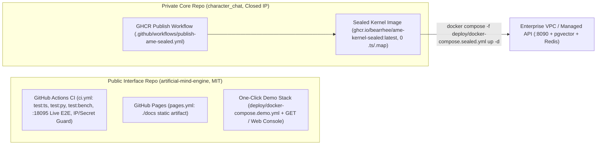

- **One-Click Demo Stack (`deploy/docker-compose.demo.yml`)**: Pairs the MIT sandbox (`Dockerfile.sandbox`, `GET /` live console, `AME_STORAGE_MODE=file`) + `pgvector/pgvector:pg17` ([`deploy/init.sql`](./deploy/init.sql)) + `redis:7-alpine`.
- **Sealed Kernel Stack (`deploy/docker-compose.sealed.yml`)**: Pairs `ghcr.io/bearrhee/ame-kernel-sealed:latest` (`AME_MODE=sealed-kernel`, `AME_D4_STRICT_REDACTION=true`) + `pgvector/pgvector:pg17` + `redis:7-alpine` (detailed guide: [`deploy/README.md`](./deploy/README.md)).

```bash
# Start enterprise sealed kernel via deploy/docker-compose.sealed.yml
cp deploy/.env.example deploy/.env
docker compose -f deploy/docker-compose.sealed.yml up -d
```

### GitHub Actions CI (`ci.yml`), Pages (`pages.yml`) & Private Kernel GHCR Integration

| Workflow | Trigger | Verification & Deployment Scope |
| :--- | :--- | :--- |
| **[`.github/workflows/ci.yml`](./.github/workflows/ci.yml)** | `push` / `pull_request` (`main`) | Runs `test:ts`, `test:py`, and `test:bench` on Node 22 + Python 3.12; verifies live sandbox on port `18095` (`/v1/health` `200` + `GET /` `200` + 3 vertical examples + `run_harness.mjs --json-only`); validates `docs/index.html` inline `<script>` via `new Function`; enforces zero proprietary `.ts` files and zero secret leaks |
| **[`.github/workflows/pages.yml`](./.github/workflows/pages.yml)** | `push` (`docs/**`) · manual dispatch | Deploys static showcase and docs from `./docs` to [GitHub Pages](https://bearrhee.github.io/artificial-mind-engine/) via `actions/upload-pages-artifact@v3` + `actions/deploy-pages@v4` *(activation on private repositories may depend on GitHub plan policy)* |
| **Private Kernel GHCR Publish Integration** | Core repo tag `ame-v*` · manual dispatch | Core repo's `publish-ame-sealed.yml` builds `Dockerfile.ame-sealed` and automatically publishes `ghcr.io/bearrhee/ame-kernel-sealed:latest` without source files or source maps to GHCR |

---

## 7. Documentation · Roadmap · Investor Due Diligence (DD) Materials

| Document | Target Audience | Key Contents |
| :--- | :--- | :--- |
| **[`docs/VC_BRIEF_EN.md`](./docs/VC_BRIEF_EN.md)** | US / Global VC Partners | 1-page English Executive Brief · Market Gap · Verified Benchmarks · Business Model |
| **[`docs/index.html`](./docs/index.html)** ([GitHub Pages](https://bearrhee.github.io/artificial-mind-engine/) · [Live Demo](https://thesoulthread.com/ame-demo/)) | Engineers · Investors · Partners | Interactive Web Showcase & Hosted Live Demo (LLM Hot-Swap · Domain Simulator · Charts) |
| **[`docs/architecture.md`](./docs/architecture.md)** | Architects · Systems Engineers | 5-Layer Kernel Architecture · Open/Closed Boundary · Epoch-Stable KV Cache Mechanics |
| **[`docs/llm-adapters.md`](./docs/llm-adapters.md)** | AI Platform · Backend Teams | 6+1 LLM Adapters · Mode A vs. Mode B Zero-Key · Routing ROI Strategy |
| **[`docs/domain-guide.md`](./docs/domain-guide.md)** | Game · Chatbot · Health · Robotics Teams | Integration guide for `game_npc`, `companion_chat`, `counseling_coach`, and `custom` |
| **[`docs/benchmarks.md`](./docs/benchmarks.md)** | ML Researchers · DD Teams | Complete datasets for `LoCoMo`, `Confirm-304`, `EQ-Bench v2/3`, `CogEval D1–D4`, `sc1/sc2`, `5-LLM 300-Turn`, and `1M-Turn` |
| **[`docs/enterprise-security.md`](./docs/enterprise-security.md)** | CISO · Legal / Compliance | Closed IP Protection · `Zero-Key` · `D3 0.00%` Atomic Erasure · `D4 0/35,723` Isolation |

### Roadmap (`v4.0 → v5.0`)
- **v4.0 (`PR #784` Complete)**: Confirm-304 `85.86%`, EQ-Bench 3 `77.59`, EQ-Bench v2 `78.69`, CogEval `D1–D4` · `FEP Lock` · `sc1 beta_MB +0.5110` · `sc2 r=-0.783`, `5-LLM 300-Turn` safety/humanness wins, KV Cache `47.03%`, `1M-Turn` `1.0000` integrity, decoupled Open Interface + Sealed Kernel release.
- **v4.1 (`v4.1.1` Live Verified)**: Simultaneous 7-gate burst (`0` `429`/`503`), live `1M`-turn `simulate-batch` (`29.61 s`, `0.9178`), Mode B grounding & `D3` purge E2E, and env-only paired `LoCoMo` (`KV 75.34%`, `Cat 5 100%`).
- **v4.3.0 (Current — Semantic `pgvector` + Jina Sealed Kernel)**: Integrated `pgvector` HNSW dense storage (`1024d`), `jina-embeddings-v3`, `jina-reranker-v2-base-multilingual` cross-encoder reranking, assistant-reply memory indexing, calibrated semantic HOT monitoring, and `haystack_ingest` bulk replay bypass into standalone `ame-kernel-sealed:v4.3.0` (`D3` transactional vector+audit erasure). Live **`LongMemEval-S (n=70)`** jumps **`38.57% -> 60.00%` (`42/70`, `+21.43%p`)** at **`7,633` prompt tokens/q (`-92.67%`, `13.64x`)** and `0/17,745` `D4` leaks.
- **v4.2.0 (Full-English Live Suites & `1M`-Turn EN Verified)**: Chronological memory + `AGG limit=16` (`ToMi 100.0%`, `Conv-RULER AGG 100.0%`), `DirectEval` pass (`+58` tokens, `-96.8%` overhead), bulletproof JSON unwrapping (`HealthBench-Psych 0/4` leaks), Counting/Plain-Text Stroop `FEP Lock` (`100.0%`), `AST-1`/`GWT-3` real wiring (`58/58` unit tests), `1M`-turn EN Track A (`0.9182`, `34.3 s`) + Track B (`100.0%` EN polarity, `78.4 s`), plus 100% EN live **`5,000T` Marathon (`96.67%` Recall, `58.95%` OAI KV, `0%` D3/D4)**, **`5-LLM` (`85.21%` Awareness WR, `98.33%` Recall)**, and **`CogEval` EN (`HOT 100%`, `FEP 100%/0%`, `IGT 100%` `$1,309`)**.
- **v4.4–v4.5 (Mid-Term)**: Re-run full `LongMemEval-S 500` on `v4.3.0+`, B2B Stateful Cognitive Control SDK General Availability (GA), expressive TTS/robotics reference bridge, pre-registered `P9` closed-loop experiments, and conference submissions (NeurIPS D&B / ICLR).
- **v5.0 (Long-Term)**: Multi-device (mobile, wearable, voice-enabled robotics) and multi-agent federation (`Mind Federation` with shared `deletionEpoch` + `FANToM InfoAccess` ACL).

---

**License:** Public interface code is licensed under the [MIT License](./LICENSE). The closed-source kernel runtime and proprietary cognitive algorithms retain all rights under [NOTICE.md](./NOTICE.md).

---

## Contact

- **Website**: [artificialmind.me](https://artificialmind.me)
- **Contact**: Shinyoung Rhee — [help@artificialmind.me](mailto:help@artificialmind.me)
