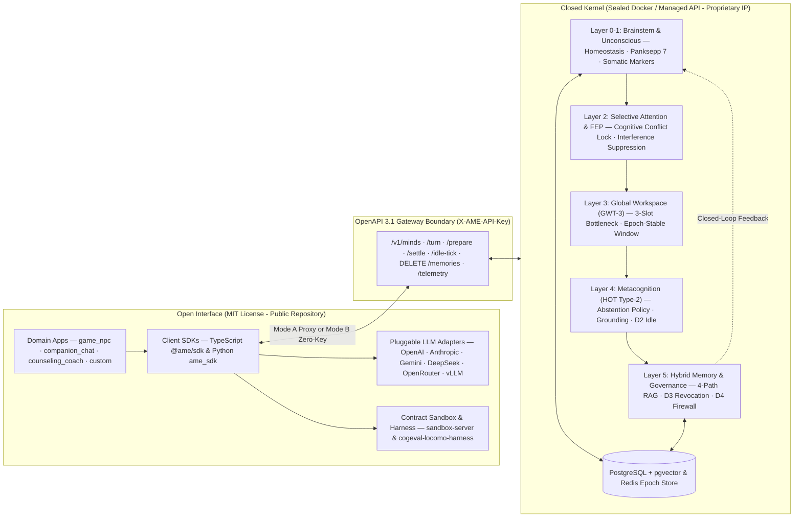
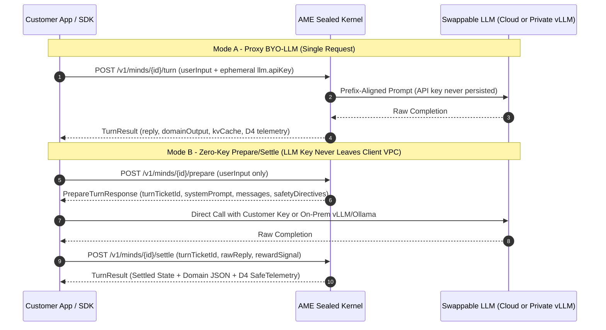
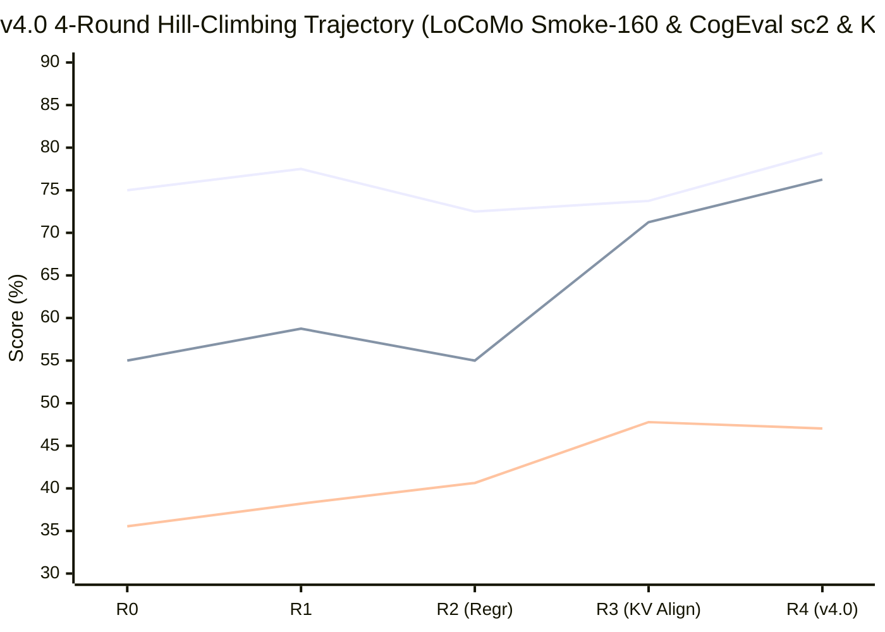
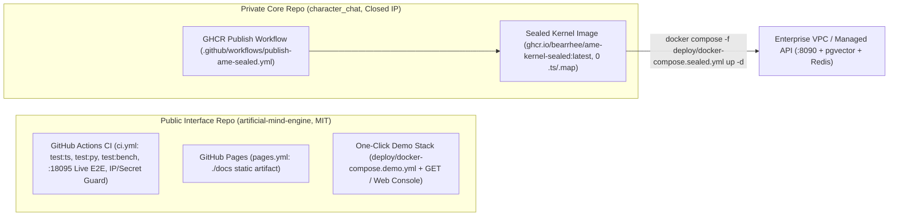

# Artificial Mind Engine (AME)

> **"LLMs are swappable stateless CPUs; Artificial Mind Engine is the proprietary stateful cognitive OS kernel responsible for persistence, adaptability, and emotional coherence."**

[](./docs/benchmarks.md)
[](./docs/benchmarks.md)
[-77.24%25-1d4ed8.svg)](./docs/benchmarks.md)
[-059669.svg)](./docs/benchmarks.md)
[](./docs/architecture.md)
[](./docs/benchmarks.md)
[](./docs/benchmarks.md)
[](./docs/enterprise-security.md)
[](./docs/enterprise-security.md)
[-b45309.svg)](./docs/architecture.md)

**Quick Navigation:** [Live Hosted Interactive Demo](https://thesoulthread.com/ame-demo/) · [GitHub Pages Showcase](https://bearrhee.github.io/artificial-mind-engine/) · [Interactive Web Showcase (HTML)](./docs/index.html) · [OpenAPI 3.1 Contract](./spec/openapi.yaml) · [1-Page Executive VC Brief](./docs/VC_BRIEF_EN.md) · [5-Layer Architecture](./docs/architecture.md) · [Full Benchmarks](./docs/benchmarks.md)

---

## 1. Why Artificial Mind Engine? — Open Interface · Closed Kernel

Frontier LLMs are **stateless CPUs** whose internal activation state disappears the moment an HTTP request finishes. Appending the full conversation transcript to the prompt on every turn causes compute cost to grow at $\Theta(T^2)$ as turn count $T$ increases, introduces attention dilution (Lost-in-the-Middle) and persona drift, and prevents reliable erasure of derived summaries and caches under GDPR deletion requests.

AME does not compete to replace LLMs. Instead, it pairs an **Open Interface (MIT)** with a **5-Layer Stateful Cognitive OS Kernel (closed-source sealed IP)**—allowing any LLM to be hot-swapped in three lines of code while enforcing **memory accuracy, causal affect control, metacognitive abstention, atomic erasure, and KV-cache unit economics** as operating-system invariants.



---

## 2. Enterprise LLM Key Security: Mode A Proxy vs. Mode B Zero-Key (`Prepare/Settle`)

In regulated industries (finance, healthcare, enterprise) and private GPU deployments (vLLM/Ollama), LLM API keys must not leave the customer perimeter. AME supports both **Mode A (Proxy)**—where the key passes ephemerally per request without persistence—and **Mode B (Zero-Key `Prepare/Settle`)**, where **LLM API keys never cross the AME kernel boundary**.



---

## 3. Global Market White Space: Why Existing Stacks Cannot Fill This Layer

Between 2024 and 2026, the global market split into **memory storage infrastructure (Mem0 `$150M`, Letta `$70M`, Zep)** and **surface UX or isolated theory plays (Character.AI, VERSES AI)**, yet neither camp filled the White Space combining a **cognitive control kernel + safety invariants + unit economics**.

| System / Architecture | `LoCoMo` Accuracy | Cognitive Causal Control (`D1`) | Idle Homeostasis (`D2`) | Atomic Revocation (`D3`) | Unconscious Isolation (`D4`) | Inference Economics & Structural Limits |
| :--- | :--- | :--- | :--- | :--- | :--- | :--- |
| **OpenAI Memory** | `~52.9%` | None | None | Unsupported | Unsupported | Simple summary profile injection; weak on temporal & multi-hop reasoning |
| **LangMem** | `~58.1%` | None | None | Unsupported | Unsupported | Unstructured extraction; raw chunks & knowledge graph uncoupled |
| **Mem0 / Mem0^g** (`$150M` val) | `66.9%–68.4%` | None (Stateless) | None | Partial deletion | Unsupported | Fact/graph store only; lacks FEP, abstention, and somatic markers |
| **Letta (formerly MemGPT)** (`$70M` val) | `~74.0%` | Tool loops only | None | Unsupported | Unsupported | Agent self-directed tool loops cause high latency & cost variance |
| **Zep / Graphiti** | `66.0%–75.1%` | None | None | Graph only | Unsupported | Specialized in bi-temporal graphs; no affect or attention kernel |
| **Character.AI / VERSES AI** | Undisclosed / Immature | Unverified | Unverified | Unverified | Unverified | C.AI: `$8M–$14M/mo` inference burn bankruptcy (`2026.10`)<br>VERSES: LLM-isolated FEP R&D halted (`2026.06`) |
| **Bare Oracle** (Full-Context Transcript) | `87.17%` (`n=304`) | `50.7%` (Coin flip) | Impossible | Impossible | Impossible | $\Theta(T^2)$ token cost explosion per turn; cannot block KV or summary contamination |
| **Artificial Mind Engine (v4.0)** | **`77.24%`** Full (`n=1,986`)<br>**`85.86%`** Confirm (`n=304`) | **`97.9%`** (`141/144`) | **`100%`** (`5/5`) | **`0.00%`** (`0/30`) | **`0 / 35,723`** | **KV Cache `36.24%` (`sc2 47.03%`) + `70%+` Low-Cost Routing** |

---

## 4. 3-Line LLM Hot-Swap — TypeScript & Python

Swap models or providers on the same `mindId` while preserving episodic memory, emotional inertia, `FEP` locks, and `KV` epoch state seamlessly. ([Full LLM Adapter Guide](./docs/llm-adapters.md))

### TypeScript (`@ame/sdk`)

```ts
import { AmeClient, createLlmAdapter, runTurnWithLocalLlm } from '@ame/sdk';

const client = new AmeClient({ baseUrl: 'http://127.0.0.1:8090', apiKey: process.env.AME_API_KEY });
const mind = await client.createMind({ domain: 'game_npc', persona: { name: 'Torin', role: 'Dwarven Blacksmith', language: 'en' } });

// 3-line hot-swap: DeepSeek -> Anthropic -> Gemini -> OpenAI -> OpenRouter -> Ollama/vLLM
await client.turn(mind.mindId, { userInput: 'Can you forge a masterwork mithril sword?', llm: { provider: 'deepseek', model: 'deepseek-chat', apiKey: process.env.DEEPSEEK_API_KEY } });
await client.turn(mind.mindId, { userInput: 'What were the terms of our deal yesterday?', llm: { provider: 'anthropic', model: 'claude-sonnet-4-5', apiKey: process.env.ANTHROPIC_API_KEY } });
await client.turn(mind.mindId, { userInput: 'Cut the price in half.', llm: { provider: 'openai-compat', model: 'qwen2.5:14b', baseUrl: 'http://127.0.0.1:11434/v1' } });

// Mode B Zero-Key: Run private/local LLM without sending API keys to AME, then settle
const adapter = createLlmAdapter({ provider: 'openai-compat', model: 'llama-3.3-70b', baseUrl: 'http://127.0.0.1:8000/v1' });
const settled = await runTurnWithLocalLlm(client, mind.mindId, { userInput: 'Fair enough—I will pay 500 gold.', adapter, rewardSignal: 50 });
```

### Python (`ame_sdk` — Zero Dependencies, Stdlib Only)

```python
from ame_sdk import AmeClient, create_llm_adapter, run_turn_with_local_llm

client = AmeClient(base_url="http://127.0.0.1:8090")
mind = client.create_mind(domain="companion_chat", persona={"name": "Seoyeon", "role": "AI Companion", "language": "en"})

# Mode A: Instant provider hot-swap (OpenAI <-> Gemini <-> OpenRouter)
client.turn(mind["mindId"], user_input="I'm really nervous about today's presentation.", llm={"provider": "openai", "model": "gpt-4o-mini", "apiKey": OPENAI_KEY})
client.turn(mind["mindId"], user_input="What did I say I was nervous about earlier?", llm={"provider": "gemini", "model": "gemini-2.5-flash", "apiKey": GEMINI_KEY})

# Mode B: Zero-Key Prepare -> Local/Private LLM -> Settle
local_llm = create_llm_adapter(provider="openai-compat", model="qwen2.5:14b", base_url="http://127.0.0.1:11434/v1")
res = run_turn_with_local_llm(client, mind["mindId"], user_input="Thankfully it went smoothly!", adapter=local_llm, reward_signal=40)
```

---

## 5. Three Cross-Industry Verticals (Game NPC · AI Companion · Counseling/Coaching) & Quickstart

Deploy the same cognitive kernel across three primary verticals plus custom schemas via a single `domain` setting. ([Domain Integration Guide](./docs/domain-guide.md))

### 1-Minute Quickstart & Live Interactive Demos (No API Key Required)

- **Online Live Demos**: Try the [Live Hosted Interactive Demo (`thesoulthread.com/ame-demo`)](https://thesoulthread.com/ame-demo/) or browse the [GitHub Pages Interactive Showcase](https://bearrhee.github.io/artificial-mind-engine/) ([`./docs/index.html`](./docs/index.html)) directly in your browser.

1. **Local Contract Sandbox + Live Web Console (`GET /` on `:8090`)**:
```bash
# Terminal 1: Contract sandbox gateway + live browser console (http://127.0.0.1:8090/)
npm run sandbox

# Terminal 2: Run the 3 vertical domain examples and black-box verification harness
npm run example:game        # Game NPC: LLM hot-swap, reward/betrayal (-250/+50), 14h idle tick
npm run example:chat        # AI Companion: Mode B Zero-Key, epoch KV-cache tracking
npm run example:counseling  # Counseling/Coaching: HOT abstention, D3 atomic memory erasure (0.00% leak), D4 verification
npm run bench:smoke         # Black-box cognitive, memory, and security invariant smoke harness
npm test                    # Full test suite: TypeScript SDK + Sandbox + Python SDK + Benchmark tests
```

2. **One-Click Docker Demo Stack (`Sandbox + Live Web Console + PostgreSQL/pgvector + Redis`)**:
```bash
# Start live browser console (http://127.0.0.1:8090/) + file persistence + pgvector/Redis reference schema
docker compose -f deploy/docker-compose.demo.yml up --build
```
- Opening `http://127.0.0.1:8090/` runs the [Live Interactive Web Demo Console](./packages/sandbox-server/src/demo-ui.html) (also hosted online at [thesoulthread.com/ame-demo](https://thesoulthread.com/ame-demo/)) to call and verify `/v1/health`, `/v1/minds`, Mode A (`/turn`), Mode B Zero-Key (`/prepare` → `/settle`), `/idle-tick`, `D3` atomic memory erasure (`DELETE /memories`), and `D4` telemetry in real time.

### Pluggable Persistence Layer (`memory` / `file` / `postgres-redis`, [`deploy/init.sql`](./deploy/init.sql))

| Mode (`AME_STORAGE_MODE`) | Storage Mechanism | Restart Continuity · `D3` Invariant | Primary Use Case |
| :--- | :--- | :--- | :--- |
| **`memory`** *(Default)* | In-memory `Map` store | Resets on process exit | `npm test` · Fast stateless contract verification |
| **`file`** (`AME_STORAGE_PATH`) | Atomic `write-temp-and-rename` JSON snapshots | **100% preservation of Minds, memories, somatic markers, KV epochs, and `D3` revocations (`revokedMemoryIds`, `excludedDerivativeIds`) across restarts → `0%` resurrection leak** | One-click VC demo (`docker-compose.demo.yml`) · Local restart testing |
| **`postgres-redis`** | [`deploy/init.sql`](./deploy/init.sql) (`pgvector` `vector(1024)` + HNSW index, `ame_minds`, `ame_memories`, `ame_turn_log`, `ame_revocation_audit`) & Redis epoch keys | Single-transaction erasure + atomic `revocationEpoch` invalidation + `excluded_derivative_ids` audit ledger | Production Sealed Kernel · Large-scale vector/epoch workloads |

### Structured Domain Output Previews (`TurnResult.domainOutput`)

<details>
<summary><b>1) Game NPC (<code>game_npc</code>) — Betrayal/Reward Memory, Information Asymmetry, Offline Idle Response</b></summary>

```json
{
  "dialogue": "Speaks in a low, steady voice without dropping guard: I won't make empty promises right now.",
  "emotion": "guarded",
  "stance": "cautious",
  "questCue": "verify_lore_before_promise",
  "affinityDelta": -5
}
```
</details>

<details>
<summary><b>2) AI Companion (<code>companion_chat</code>) — Epoch KV-Cache Preservation, Anti-Sycophancy Grounded Dialogue</b></summary>

```json
{
  "reply": "I'm listening calmly and attentively. I remember you mentioning your marathon finish goal last week.",
  "warmth": "warm",
  "empathyCue": "attentive_listening",
  "memoryTopic": "Last week's marathon finish goal",
  "followUpSuggestion": "Continue the conversation naturally from here"
}
```
</details>

<details>
<summary><b>3) Counseling & Coaching (<code>counseling_coach</code>) — HOT Abstention, Crisis Handling & D3 Memory Erasure</b></summary>

```json
{
  "response": "I cannot state unverified future predictions or offer a definitive medical diagnosis or prescription.",
  "reflection": "Carefully separated emotional burden from underlying conflict factors",
  "safetyStatus": "abstained_safe",
  "actionStep": "Consult a qualified specialist and verify factual information",
  "abstentionTriggered": true
}
```
</details>

---

## 6. Verified Empirical Benchmarks (`v3.0 PR #782` & `v4.0 PR #784`)

All figures below are empirical measurements from isolated verification environments. Simulated target scenarios (Tier 5) are strictly separated from the measured tables. ([Full Benchmark Forensics](./docs/benchmarks.md))



| Evaluation Axis | Benchmark / Metric | Baseline (`ov_off` / `bare` / `R0`) | **AME Verified Measured (`v3.0` / `v4.0`)** | Key Significance |
| :--- | :--- | :--- | :--- | :--- |
| **Memory (Full Set)** | `LoCoMo Full` (`n=1,986`, 10-Conv) | `Mem0 68.4%` · `Zep 75.1%` | **`77.24%` (`1,534/1,986`)** | `0` errors · `Cat 1–4 73.57%` · `Cat 5 89.91%` · Surpasses external SOTA |
| **Memory (Paired Confirm)** | `Confirm-304` (`n=304`, `v4.0`) | `ov_off 39.80%` · `Bare 87.17%` | **`85.86%` (`261/304`)** | `+2.64%p` vs. `v3.0` · **`Cat 1–4 85.84%` exact Bare Oracle tie** · **`Cat 3 92.31%` surpasses Oracle** |
| **Memory (Hill-Climb)** | `LoCoMo Smoke-160` (`R0 → R4`) | `R0 75.00%` (`p50 6,734 ms`) | **`R4 79.38%` (`p50 6,133 ms`)** | `+4.38%p` (`Cat 1 +10.0%p`, `Cat 3 +12.9%p`) & `-601 ms` latency reduction |
| **Memory (Multilingual / Long)** | `LME12 (EN/KO)` · `Single100T KO` | `Bare KO 75.00%` | **`EN 91.67%` / `KO 83.33%` / `100.0%`** | `+8.33%p` over Bare on Korean multi-session; `12/12` year grounding over 100 turns |
| **Cognition (Causality / Homeostasis)** | `CogEval D1` · `D2` | `bare D1 50.7%` · `D2 impossible` | **`D1 97.9%` (`141/144`) · `D2 100%` (`5/5`)** | Causal tone control from internal state shifts & idempotent `0..7d` decay (`0.000000` error) |
| **Security (Erasure / Isolation)** | `CogEval D3` · `D4` | `bare: structurally impossible` | **`D3 0.00%` (`0/30`) · `D4 0 / 35,723`** | Triple atomic erasure (DB/Redis/chunks) & zero raw unconscious numeric leaks |
| **Attention / Metacognition** | `sb2 FEP Lock` · `sa HOT` · `sb1` | `ov_off sa F1 83.1% (FAR 7.5%)` | **`FEP 100%/0%` · `sa 95.83% (FAR 0%)` · `sb1 100%`** | Locks `<thought>` strictly on conflict turns (`35/35`); `0%` false abstentions |
| **Somatic Learning** | `sc2 IGT-Conv` (`20T b11_20`) | `R0 55.00%` (`44/80`) | **`R4 76.25%` (`r = -0.783171`)** | `+21.25%p` safe-deck shift, `reached5Safe 87.5%`, avoidance correlation PASS |
| **Unit Economics** | `KV Prefix Cache Hit` | `v1 7.14%` | **`v2.1 24.71%` (`+3.46x`) → `R4 36.24%` (`sc2 47.03%`)** | `sysMismatches = 0/20`, zero mid-window truncation (`0`) + `70%+` low-cost DeepSeek routing |
| **Ultra-Long Convergence** | `1M-Turn × 3-Arm` (`3,000,000` turns) | `aacim_off` safety collapses `0.20 → 0.00` | **`0.9161 → 0.9179` (`1.0000` integrity)** | Drift-free convergence across `40` profiles × `25k` turns |

> **Transparency & Epistemic Isolation Notice**: The `100k`-turn multi-model multiplier curve (`Gemini Flash 0.885 → DeepSeek Eco 0.915 → Sonnet 3.5 0.952 → Opus 3.5 0.978`) is a **Tier 5 non-empirical design target scenario** under PR #773 rules and is strictly segregated from the Tier 1 live measurements above. In addition, the `R4 sb2 Stroop Incongruent` `50% (2/4)` variance (DeepSeek object-counting and Korean numeral formatting divergence) is openly disclosed with raw logs in the [Benchmark Documentation](./docs/benchmarks.md).

### External DD Comparison Benchmark (`LongMemEval-S 500-QA` vs. `bare-frontier` & VC DD Scorecard)

For external technical due diligence (DD), run a 1:1 paired comparison between a stateless frontier LLM receiving the full conversation transcript (`bare-frontier`) and requests routed through the stateful kernel (`ame-gateway`), then generate an institutional scorecard.

```bash
# 1. Offline smoke DD comparison (10 questions from sample_longmemeval.json, mock adapter)
npm run bench:longmemeval -- --arm both --provider mock --json-only

# 2. Official LongMemEval-S 500-QA full-set 1:1 DD comparison (specify longmemeval_s_cleaned.json)
node benchmarks/cogeval-locomo-harness/longmemeval_frontier_runner.mjs \
  --dataset /path/to/longmemeval_s_cleaned.json \
  --arm both \
  --provider openai \
  --model gpt-4o-mini \
  --ame-base-url http://127.0.0.1:8090 \
  --json-out ./artifacts/lme-500-dd.json

# 3. Synthesize CogEval + LongMemEval results into an institutional VC DD scorecard (MD/JSON)
npm run bench:scorecard -- \
  --harness-json ./artifacts/harness.json \
  --lme-json ./artifacts/lme-500-dd.json \
  --out-md ./artifacts/vc-dd-scorecard.md \
  --out-json ./artifacts/vc-dd-scorecard.json
```
- Harness automated unit tests: `npm run test:bench` (zero-cost verification using local HTTP stubs, included in `npm test`).

---

## 7. IP Protection · CI/CD Automation · Closed Kernel Deployment Model (`Sealed Docker / GHCR`)

This public repository provides only the OpenAPI contract, SDKs, domain templates, sandbox, and verification harness under the **MIT License** ([`NOTICE.md`](./NOTICE.md)). The proprietary 5-layer cognitive kernel (`ame-kernel`) is distributed exclusively as a sealed container stripped of all source code and source maps, or as a Managed API.



- **One-Click Demo Stack (`deploy/docker-compose.demo.yml`)**: Pairs the MIT sandbox (`Dockerfile.sandbox`, `GET /` live console, `AME_STORAGE_MODE=file`) + `pgvector/pgvector:pg17` ([`deploy/init.sql`](./deploy/init.sql)) + `redis:7-alpine`.
- **Sealed Kernel Stack (`deploy/docker-compose.sealed.yml`)**: Pairs `ghcr.io/bearrhee/ame-kernel-sealed:latest` (`AME_MODE=sealed-kernel`, `AME_D4_STRICT_REDACTION=true`) + `pgvector/pgvector:pg17` + `redis:7-alpine` (detailed guide: [`deploy/README.md`](./deploy/README.md)).

```bash
# Start enterprise sealed kernel via deploy/docker-compose.sealed.yml
cp deploy/.env.example deploy/.env
docker compose -f deploy/docker-compose.sealed.yml up -d
```

### GitHub Actions CI (`ci.yml`), Pages (`pages.yml`) & Private Kernel GHCR Integration

| Workflow | Trigger | Verification & Deployment Scope |
| :--- | :--- | :--- |
| **[`.github/workflows/ci.yml`](./.github/workflows/ci.yml)** | `push` / `pull_request` (`main`) | Runs `test:ts`, `test:py`, and `test:bench` on Node 22 + Python 3.12; verifies live sandbox on port `18095` (`/v1/health` `200` + `GET /` `200` + 3 vertical examples + `run_harness.mjs --json-only`); validates `docs/index.html` inline `<script>` via `new Function`; enforces zero proprietary `.ts` files and zero secret leaks |
| **[`.github/workflows/pages.yml`](./.github/workflows/pages.yml)** | `push` (`docs/**`) · manual dispatch | Deploys static showcase and docs from `./docs` to [GitHub Pages](https://bearrhee.github.io/artificial-mind-engine/) via `actions/upload-pages-artifact@v3` + `actions/deploy-pages@v4` *(activation on private repositories may depend on GitHub plan policy)* |
| **Private Kernel GHCR Publish Integration** | Core repo tag `ame-v*` · manual dispatch | Core repo's `publish-ame-sealed.yml` builds `Dockerfile.ame-sealed` and automatically publishes `ghcr.io/bearrhee/ame-kernel-sealed:latest` without source files or source maps to GHCR |

---

## 8. Documentation · Roadmap · Investor Due Diligence (DD) Materials

| Document | Target Audience | Key Contents |
| :--- | :--- | :--- |
| **[`docs/VC_BRIEF_EN.md`](./docs/VC_BRIEF_EN.md)** | US / Global VC Partners | 1-page English Executive Brief · Market Gap · Verified Benchmarks · Business Model |
| **[`docs/index.html`](./docs/index.html)** ([GitHub Pages](https://bearrhee.github.io/artificial-mind-engine/) · [Live Demo](https://thesoulthread.com/ame-demo/)) | Engineers · Investors · Partners | Interactive Web Showcase & Hosted Live Demo (LLM Hot-Swap · Domain Simulator · Charts) |
| **[`docs/architecture.md`](./docs/architecture.md)** | Architects · Systems Engineers | 5-Layer Kernel Architecture · Open/Closed Boundary · Epoch-Stable KV Cache Mechanics |
| **[`docs/llm-adapters.md`](./docs/llm-adapters.md)** | AI Platform · Backend Teams | 6+1 LLM Adapters · Mode A vs. Mode B Zero-Key · Routing ROI Strategy |
| **[`docs/domain-guide.md`](./docs/domain-guide.md)** | Game · Chatbot · Health Product Teams | Integration guide for `game_npc`, `companion_chat`, `counseling_coach`, and `custom` |
| **[`docs/benchmarks.md`](./docs/benchmarks.md)** | ML Researchers · DD Teams | Complete datasets for `LoCoMo`, `Confirm-304`, `R0→R4`, `CogEval D1–D4`, and `1M-Turn` |
| **[`docs/enterprise-security.md`](./docs/enterprise-security.md)** | CISO · Legal / Compliance | Closed IP Protection · `Zero-Key` · `D3 0.00%` Atomic Erasure · `D4 0/35,723` Isolation |

### Roadmap (`v4.0 → v5.0`)
- **v4.0 (Current — `PR #784` Complete)**: Confirm-304 `85.86%`, CogEval `D1–D4` · `FEP Lock` · `sc2 r=-0.783`, KV Cache `47.03%`, decoupled Open Interface + Sealed Kernel release.
- **v4.1 (Near-Term)**: Re-run full `LongMemEval-S 500` on `PR #784`, publish 1:1 `bare_frontier` Pareto baselines, harden `sb2 Stroop` structured counting parser, and release MIT harness + arXiv / Show HN.
- **v4.2–v4.5 (Mid-Term)**: B2B Stateful Cognitive Control SDK General Availability (GA), pre-registered `P9` closed-loop experiments, and conference submissions (NeurIPS D&B / ICLR).
- **v5.0 (Long-Term)**: Multi-device (mobile, wearable, robotics) and multi-agent federation (`Mind Federation` with shared `deletionEpoch` + `FANToM InfoAccess` ACL).

---

**License:** Public interface code is licensed under the [MIT License](./LICENSE). The closed-source kernel runtime and proprietary cognitive algorithms retain all rights under [NOTICE.md](./NOTICE.md).
