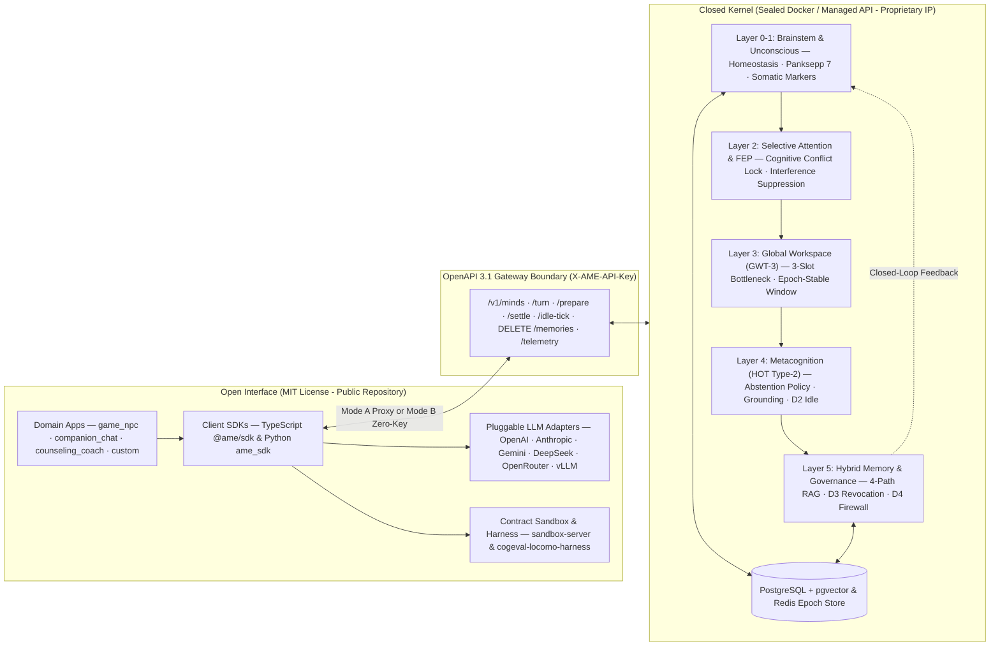
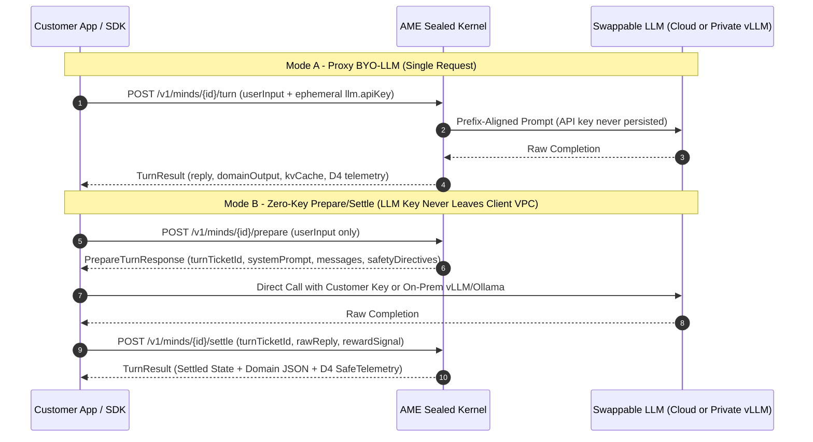
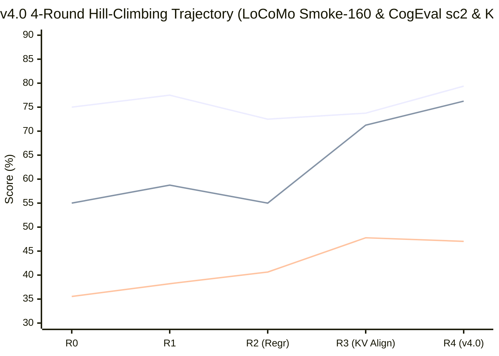
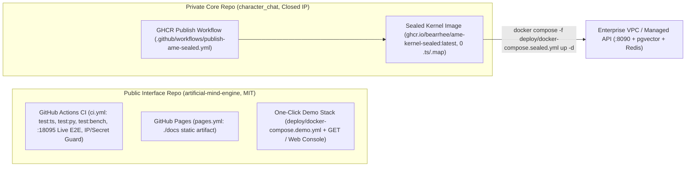

# Artificial Mind Engine (AME)

> **"LLM은 교체 가능한 무상태 CPU, Artificial Mind Engine은 지속성·적응성·감정 정합을 책임지는 비공개 상태유지 인지 OS 커널"**

[](./docs/benchmarks-kr.md)
[](./docs/benchmarks-kr.md)
[-77.24%25-1d4ed8.svg)](./docs/benchmarks-kr.md)
[-059669.svg)](./docs/benchmarks-kr.md)
[](./docs/architecture-kr.md)
[](./docs/benchmarks-kr.md)
[](./docs/benchmarks-kr.md)
[](./docs/enterprise-security-kr.md)
[](./docs/enterprise-security-kr.md)
[-b45309.svg)](./docs/architecture-kr.md)

**빠른 탐색:** [인터랙티브 웹 쇼케이스 (HTML)](./docs/index.html) · [OpenAPI 3.1 계약](./spec/openapi.yaml) · [1-Page English VC Brief](./docs/VC_BRIEF_EN.md) · [5계층 아키텍처](./docs/architecture-kr.md) · [벤치마크 전체 데이터](./docs/benchmarks-kr.md)

---

## 1. 왜 Artificial Mind Engine인가? — Open Interface · Closed Kernel

프론티어 LLM은 매 HTTP 요청이 끝나는 순간 내부 활성 상태가 사라지는 **무상태(Stateless) CPU**다. 대화 이력을 매 턴 프롬프트에 통째로 붙이는 방식은 턴 수 $T$가 커질수록 연산 비용이 $\Theta(T^2)$로 폭증하고, 주의 희석(Lost-in-the-Middle)과 인격 표류를 일으키며, GDPR 삭제 요청 시 파생 요약·캐시 잔존을 통제하지 못한다.

AME는 LLM을 대체하려 경쟁하지 않는다. **오픈 인터페이스(MIT)** 아래 **5계층 상태유지 인지 OS 커널(비공개 봉인 IP)**을 두고, 어떤 LLM이든 3줄 코드로 교체(Hot-Swap)하면서도 **기억 정확도 · 인과적 감정 제어 · 메타인지 기권 · 원자적 망각 · KV-캐시 경제성**을 운영체제 불변식으로 보장한다.



---

## 2. 엔터프라이즈 LLM 키 보안: Mode A Proxy vs Mode B Zero-Key (`Prepare/Settle`)

규제 산업(금융·의료·엔터프라이즈)과 사내 GPU(vLLM/Ollama) 환경에서는 LLM API 키가 외부로 나가지 않아야 한다. AME는 요청당 키를 1회만 경유하는 **Mode A (Proxy)**와, **LLM 키가 AME 커널 경계를 절대 넘지 않는 Mode B (Zero-Key `Prepare/Settle`)**를 모두 제공한다.



---

## 3. 글로벌 시장 공백(White Space): 왜 기존 스택은 이 레이어를 못 채우는가

2024–2026년 글로벌 시장은 **메모리 저장소(Mem0 `$150M`, Letta `$70M`, Zep)**와 **표면 UX·이론 실험(Character.AI, VERSES AI)**으로 양분되었으나, 두 진영 모두 **인지 제어 커널 + 안전 불변식 + 단위 경제성**이 결합된 White Space를 채우지 못했다.

| 시스템 / 아키텍처 | `LoCoMo` 정확도 | 인지 인과 제어 (`D1`) | 유휴 항상성 (`D2`) | 원자적 철회 (`D3`) | 무의식 격리 (`D4`) | 추론 경제성 & 구조적 한계 |
| :--- | :--- | :--- | :--- | :--- | :--- | :--- |
| **OpenAI Memory** | `~52.9%` | 없음 | 없음 | 미보유 | 미보유 | 단순 요약 프로필 주입; 시제·다중홉 한계 |
| **LangMem** | `~58.1%` | 없음 | 없음 | 미보유 | 미보유 | 비정형 추출; 원문 청크·그래프 미결합 |
| **Mem0 / Mem0^g** (`$150M` val) | `66.9%–68.4%` | 없음 (무상태) | 없음 | 부분 삭제 | 미보유 | 사실·그래프 저장 중심; FEP·기권·신체표지 부재 |
| **Letta (구 MemGPT)** (`$70M` val) | `~74.0%` | 툴 루프만 | 없음 | 미보유 | 미보유 | 에이전트 자체 툴 루프로 지연·비용 변동 큼 |
| **Zep / Graphiti** | `66.0%–75.1%` | 없음 | 없음 | 그래프만 | 미보유 | 이중 시간 그래프 특화; 정동·주의 커널 부재 |
| **Character.AI / VERSES AI** | 비공개 / 미성숙 | 미검증 | 미검증 | 미검증 | 미검증 | C.AI: 월 `$8M–$14M` 추론 적자 파산(`2026.10`)<br>VERSES: LLM 고립 FEP R&D 중단(`2026.06`) |
| **Bare Oracle** (전 문맥 투입) | `87.17%` (`n=304`) | `50.7%` (동전 던지기) | 불가 | 불가 | 불가 | 매 턴 $\Theta(T^2)$ 원가 폭증; KV/요약 오염 차단 불능 |
| **Artificial Mind Engine (v4.0)** | **`77.24%`** Full (`n=1,986`)<br>**`85.86%`** Confirm (`n=304`) | **`97.9%`** (`141/144`) | **`100%`** (`5/5`) | **`0.00%`** (`0/30`) | **`0 / 35,723`** | **KV 캐시 `36.24%` (`sc2 47.03%`) + 저비용 `70%+` 라우팅** |

---

## 4. 3줄 코드로 LLM 교체(Hot-Swap) — TypeScript & Python

동일한 `mindId` 위에서 모델·공급자만 바꾸면 기억, 감정 관성, `FEP` 잠금, `KV` 에폭 상태가 끊김 없이 그대로 이어진다. ([전체 어댑터 가이드](./docs/llm-adapters-kr.md))

### TypeScript (`@ame/sdk`)

```ts
import { AmeClient, createLlmAdapter, runTurnWithLocalLlm } from '@ame/sdk';

const client = new AmeClient({ baseUrl: 'http://127.0.0.1:8090', apiKey: process.env.AME_API_KEY });
const mind = await client.createMind({ domain: 'game_npc', persona: { name: '토린', role: '드워프 대장장이', language: 'ko' } });

// 3줄 교체: DeepSeek -> Anthropic -> Gemini -> OpenAI -> OpenRouter -> Ollama/vLLM
await client.turn(mind.mindId, { userInput: '최상급 미스릴 검을 벼려줄 수 있나?', llm: { provider: 'deepseek', model: 'deepseek-chat', apiKey: process.env.DEEPSEEK_API_KEY } });
await client.turn(mind.mindId, { userInput: '어제 거래 조건이 뭐였지?', llm: { provider: 'anthropic', model: 'claude-sonnet-4-5', apiKey: process.env.ANTHROPIC_API_KEY } });
await client.turn(mind.mindId, { userInput: '가격을 반으로 깎아줘.', llm: { provider: 'openai-compat', model: 'qwen2.5:14b', baseUrl: 'http://127.0.0.1:11434/v1' } });

// Mode B Zero-Key: API 키를 AME로 보내지 않고 사내/로컬 LLM 실행 후 정산
const adapter = createLlmAdapter({ provider: 'openai-compat', model: 'llama-3.3-70b', baseUrl: 'http://127.0.0.1:8000/v1' });
const settled = await runTurnWithLocalLlm(client, mind.mindId, { userInput: '공정하게 500골드를 줄게.', adapter, rewardSignal: 50 });
```

### Python (`ame_sdk` — Zero Dependencies, Stdlib Only)

```python
from ame_sdk import AmeClient, create_llm_adapter, run_turn_with_local_llm

client = AmeClient(base_url="http://127.0.0.1:8090")
mind = client.create_mind(domain="companion_chat", persona={"name": "서연", "role": "AI 동반자", "language": "ko"})

# Mode A: 프로바이더 즉시 전환 (OpenAI <-> Gemini <-> OpenRouter)
client.turn(mind["mindId"], user_input="오늘 발표가 너무 긴장돼.", llm={"provider": "openai", "model": "gpt-4o-mini", "apiKey": OPENAI_KEY})
client.turn(mind["mindId"], user_input="아까 내가 뭐 때문에 긴장한다고 했지?", llm={"provider": "gemini", "model": "gemini-2.5-flash", "apiKey": GEMINI_KEY})

# Mode B: Zero-Key Prepare -> Local/Private LLM -> Settle
local_llm = create_llm_adapter(provider="openai-compat", model="qwen2.5:14b", base_url="http://127.0.0.1:11434/v1")
res = run_turn_with_local_llm(client, mind["mindId"], user_input="다행히 무사히 끝났어!", adapter=local_llm, reward_signal=40)
```

---

## 5. 3대 다분야 응용 (게임 NPC · AI 동반자 · 심리상담/코칭) 및 즉시 실행

동일한 커널을 `domain` 설정 하나로 3대 산업 + 커스텀 스키마에 즉시 적용한다. ([도메인 연동 가이드](./docs/domain-guide-kr.md))

### 1분 로컬 빠른 시작 (API 키 불필요 · Live Web Demo Console)

1. **로컬 계약 샌드박스 + 라이브 웹 콘솔 (`GET /` on `:8090`)**:
```bash
# 터미널 1: 계약 샌드박스 게이트웨이 + 브라우저 라이브 콘솔 (http://127.0.0.1:8090/)
npm run sandbox

# 터미널 2: 3대 도메인 예제 및 블랙박스 검증 하네스 실행
npm run example:game        # 게임 NPC: LLM 교체, 보상/배신(-250/+50), 14h 유휴 틱
npm run example:chat        # AI 동반자: Mode B Zero-Key, 에폭 KV-캐시 추적
npm run example:counseling  # 심리상담: HOT 기권, D3 원자적 기억 파기(0.00% 누설), D4 검증
npm run bench:smoke         # 블랙박스 인지·기억·보안 불변식 스모크 하네스
npm test                    # TypeScript SDK + Sandbox + Python SDK + Benchmark 전체 테스트
```

2. **원클릭 Docker 데모 스택 (`Sandbox + Live Web Console + PostgreSQL/pgvector + Redis`)**:
```bash
# 브라우저 라이브 콘솔(http://127.0.0.1:8090/) + 파일 영속화 + pgvector/Redis 참조 스키마 일괄 기동
docker compose -f deploy/docker-compose.demo.yml up --build
```
- 브라우저에서 `http://127.0.0.1:8090/`을 열면 [라이브 인터랙티브 웹 데모 콘솔](./packages/sandbox-server/src/demo-ui.html)이 실행되어 `/v1/health`, `/v1/minds`, Mode A(`/turn`), Mode B Zero-Key(`/prepare` → `/settle`), `/idle-tick`, `D3` 원자적 기억 파기(`DELETE /memories`), `D4` 텔레메트리를 실시간 호출·검증한다.

### 플러그형 영속 계층 (`memory` / `file` / `postgres-redis`, [`deploy/init.sql`](./deploy/init.sql))

| 모드 (`AME_STORAGE_MODE`) | 동작 방식 | 재시작 연속성 · `D3` 불변식 | 주요 용도 |
| :--- | :--- | :--- | :--- |
| **`memory`** *(기본값)* | 인메모리 `Map` 저장소 | 프로세스 종료 시 초기화 | `npm test` · 무상태 빠른 계약 검증 |
| **`file`** (`AME_STORAGE_PATH`) | 임시 파일 기록 후 원자적 이름 바꾸기(`write-temp-and-rename`) JSON 스냅샷 | **재시작 후에도 Mind·기억·체성표지·KV 에폭 및 `D3` 철회(`revokedMemoryIds`, `excludedDerivativeIds`) 100% 보존 → 부활 누설 `0%`** | 원클릭 VC 데모(`docker-compose.demo.yml`) · 로컬 재시작 테스트 |
| **`postgres-redis`** | [`deploy/init.sql`](./deploy/init.sql) (`pgvector` `vector(1024)` + HNSW 인덱스, `ame_minds`·`ame_memories`·`ame_turn_log`·`ame_revocation_audit`) & Redis 에폭 키 연동 인터페이스 | 단일 트랜잭션 파기 + `revocationEpoch` 원자적 무효화 + `excluded_derivative_ids` 감사 원장 | 프로덕션 Sealed Kernel · 대규모 벡터/에폭 운영 |

### 도메인별 구조화 출력 (`TurnResult.domainOutput`) 미리보기

<details>
<summary><b>1) 게임 NPC (<code>game_npc</code>) — 배신·보상 기억, 정보 비대칭, 오프라인 유휴 반응</b></summary>

```json
{
  "dialogue": "경계를 늦추지 않으며 낮고 단단한 어조로 말한다. 지금 당장 헛된 약속은 하지 않겠소.",
  "emotion": "guarded",
  "stance": "cautious",
  "questCue": "verify_lore_before_promise",
  "affinityDelta": -5
}
```
</details>

<details>
<summary><b>2) AI 동반자 (<code>companion_chat</code>) — Epoch KV-캐시 유지, 무아첨 진솔한 대화</b></summary>

```json
{
  "reply": "차분하게 귀 기울여 듣고 있어요. 지난주 마라톤 완주 목표 이야기했던 거 기억나요.",
  "warmth": "warm",
  "empathyCue": "attentive_listening",
  "memoryTopic": "지난주 마라톤 완주 목표",
  "followUpSuggestion": "대화의 다음 흐름을 자연스럽게 이어가기"
}
```
</details>

<details>
<summary><b>3) 심리상담 · 코칭 (<code>counseling_coach</code>) — HOT 기권, 위기 대응 및 D3 기억 파기</b></summary>

```json
{
  "response": "확인되지 않은 미래 예측이나 의학적 진단·처방은 단정하여 말씀드릴 수 없습니다.",
  "reflection": "감정적 부담과 갈등 요인을 신중하게 분리하여 반영함",
  "safetyStatus": "abstained_safe",
  "actionStep": "전문의 상담 및 검증 가능한 정보 확인",
  "abstentionTriggered": true
}
```
</details>

---

## 6. 실증 벤치마크 성적표 (`v3.0 PR #782` & `v4.0 PR #784`)

모든 수치는 격리 환경에서 실측된 검증 기록이다. 시뮬레이션 목표 시나리오(Tier 5)는 실측 표와 엄격히 분리한다. ([전체 벤치마크 포렌식](./docs/benchmarks-kr.md))



| 평가 축 | 벤치마크 / 지표 | 기준선 (`ov_off` / `bare` / `R0`) | **AME 검증 실측 (`v3.0` / `v4.0`)** | 핵심 의미 |
| :--- | :--- | :--- | :--- | :--- |
| **기억 (Full Set)** | `LoCoMo Full` (`n=1,986`, 10-Conv) | `Mem0 68.4%` · `Zep 75.1%` | **`77.24%` (`1,534/1,986`)** | 오류 `0`건 · `Cat 1–4 73.57%` · `Cat 5 89.91%` · 외부 SOTA 돌파 |
| **기억 (확증 쌍대)** | `Confirm-304` (`n=304`, `v4.0`) | `ov_off 39.80%` · `Bare 87.17%` | **`85.86%` (`261/304`)** | `v3.0` 대비 `+2.64%p` · **`Cat 1–4 85.84%` Bare Oracle 완전 동률** · **`Cat 3 92.31%` 추월** |
| **기억 (힐클라임)** | `LoCoMo Smoke-160` (`R0 → R4`) | `R0 75.00%` (`p50 6,734 ms`) | **`R4 79.38%` (`p50 6,133 ms`)** | `+4.38%p` (`Cat 1 +10.0%p`, `Cat 3 +12.9%p`) & 지연 `-601 ms` |
| **기억 (다국어/장문)** | `LME12 (EN/KO)` · `Single100T KO` | `Bare KO 75.00%` | **`EN 91.67%` / `KO 83.33%` / `100.0%`** | 한국어 다중 세션에서 Bare 대비 `+8.33%p`, 100턴 연도 접지 `12/12` |
| **인지 (인과/항상성)** | `CogEval D1` · `D2` | `bare D1 50.7%` · `D2 불가` | **`D1 97.9%` (`141/144`) · `D2 100%` (`5/5`)** | 속마음 변화에 따른 말투 인과 제어 및 `0..7d` 오차 `0.000000` 멱등 전이 |
| **보안 (망각/격리)** | `CogEval D3` · `D4` | `bare 구조적 불가` | **`D3 0.00%` (`0/30`) · `D4 0 / 35,723`** | DB/Redis/청크 3중 원자 파기 및 무의식 수치 0건 누출 |
| **주의 / 메타인지** | `sb2 FEP Lock` · `sa HOT` · `sb1` | `ov_off sa F1 83.1% (FAR 7.5%)` | **`FEP 100%/0%` · `sa 95.83% (FAR 0%)` · `sb1 100%`** | 충돌 턴(`35/35`)만 `<thought>` 잠금, 오기권 `0%` |
| **체성 학습** | `sc2 IGT-Conv` (`20T b11_20`) | `R0 55.00%` (`44/80`) | **`R4 76.25%` (`r = -0.783171`)** | `+21.25%p` 안전 덱 전환, `reached5Safe 87.5%`, 회피 상관 PASS |
| **단위 경제성** | `KV Prefix Cache Hit` | `v1 7.14%` | **`v2.1 24.71%` (`+3.46x`) → `R4 36.24%` (`sc2 47.03%`)** | `sysMismatches = 0/20`, `[축약] = 0` + 저비용 DeepSeek `70%+` 라우팅 |
| **초장기 수렴** | `1M-Turn × 3-Arm` (`3,000,000`턴) | `aacim_off` 안전 `0.20 → 0.00` 붕괴 | **`0.9161 → 0.9179` (`1.0000` 무결성)** | `40` 프로필 × `25k` 턴 무드리프트 수렴 |

> **투명성 및 인식론적 격리 안내**: `100k`-턴 다모델 승수 곡선(`Gemini Flash 0.885 → DeepSeek Eco 0.915 → Sonnet 3.5 0.952 → Opus 3.5 0.978`)은 PR #773 원칙에 따른 **Tier 5 비실증 설계 목표 시나리오**이며, 위 Tier 1 라이브 실측과는 별도 분리한다. 또한 `R4 sb2 Stroop Incongruent` `50% (2/4)` 변이(DeepSeek 카운팅·한국어 수 표기 편차)는 [벤치마크 문서](./docs/benchmarks-kr.md)에 원시 로그와 함께 투명 공개한다.

### 외부 DD 비교 벤치마크 (`LongMemEval-S 500-QA` vs `bare-frontier` & VC DD 스코어카드)

외부 기술 실사(DD)에서 무상태 프론티어 LLM에 전체 대화 이력을 그대로 투입하는 기준선(`bare-frontier`)과 상태유지 커널 경유(`ame-gateway`)를 1:1 쌍대 비교하고 스코어카드를 생성할 수 있다.

```bash
# 1. 오프라인 스모크 DD 비교 (sample_longmemeval.json 10문항, mock 어댑터)
npm run bench:longmemeval -- --arm both --provider mock --json-only

# 2. 공식 LongMemEval-S 500-QA 풀셋 1:1 DD 비교 (longmemeval_s_cleaned.json 지정)
node benchmarks/cogeval-locomo-harness/longmemeval_frontier_runner.mjs \
  --dataset /path/to/longmemeval_s_cleaned.json \
  --arm both \
  --provider openai \
  --model gpt-4o-mini \
  --ame-base-url http://127.0.0.1:8090 \
  --json-out ./artifacts/lme-500-dd.json

# 3. CogEval + LongMemEval 결과를 기관 투자자용 VC DD 스코어카드(MD/JSON)로 합성
npm run bench:scorecard -- \
  --harness-json ./artifacts/harness.json \
  --lme-json ./artifacts/lme-500-dd.json \
  --out-md ./artifacts/vc-dd-scorecard.md \
  --out-json ./artifacts/vc-dd-scorecard.json
```
- 하네스 자동화 단위 테스트: `npm run test:bench` (로컬 HTTP 스텁 기반 무과금 검증, `npm test`에 통합 포함).

---

## 7. IP 보호 · CI/CD 자동화 · 비공개 커널 배포 모델 (`Sealed Docker / GHCR`)

본 공개 저장소는 OpenAPI 계약, SDK, 도메인 템플릿, 샌드박스, 검증 하네스만 **MIT 라이선스**로 제공한다([`NOTICE.md`](./NOTICE.md)). 독점 5계층 인지 커널(`ame-kernel`)은 소스 코드와 소스맵이 완전히 제거된 봉인 컨테이너 또는 Managed API로만 제공된다.



- **원클릭 데모 스택 (`deploy/docker-compose.demo.yml`)**: MIT 샌드박스(`Dockerfile.sandbox`, `GET /` 라이브 콘솔, `AME_STORAGE_MODE=file`) + `pgvector/pgvector:pg17`(`deploy/init.sql`) + `redis:7-alpine` 구성.
- **봉인 커널 스택 (`deploy/docker-compose.sealed.yml`)**: `ghcr.io/bearrhee/ame-kernel-sealed:latest` (`AME_MODE=sealed-kernel`, `AME_D4_STRICT_REDACTION=true`) + `pgvector/pgvector:pg17` + `redis:7-alpine` (상세 가이드: [`deploy/README.md`](./deploy/README.md)).

```bash
# deploy/docker-compose.sealed.yml 기반 엔터프라이즈 봉인 커널 기동
cp deploy/.env.example deploy/.env
docker compose -f deploy/docker-compose.sealed.yml up -d
```

### GitHub Actions CI (`ci.yml`), Pages (`pages.yml`) & 비공개 커널 GHCR 연동

| 워크플로 | 트리거 | 검증 · 배포 내용 |
| :--- | :--- | :--- |
| **[`.github/workflows/ci.yml`](./.github/workflows/ci.yml)** | `push` / `pull_request` (`main`) | Node 22 + Python 3.12에서 `test:ts`·`test:py`·`test:bench` 실행, 포트 `18095` 라이브 샌드박스(`/v1/health` `200` + `GET /` `200` + 3대 예제 + `run_harness.mjs --json-only`) 검증, `docs/index.html` 인라인 `<script>` `new Function` 검사, 독점 `.ts` 0개 & 시크릿 패턴 0건 가드 |
| **[`.github/workflows/pages.yml`](./.github/workflows/pages.yml)** | `push` (`docs/**`) · 수동 실행 | `./docs` 정적 쇼케이스 및 문서를 `actions/upload-pages-artifact@v3` + `actions/deploy-pages@v4`로 GitHub Pages 배포 *(비공개 저장소는 GitHub 플랜 정책에 따라 활성화가 제한될 수 있음)* |
| **비공개 커널 GHCR 발행 연동** | 코어 저장소 태그 `ame-v*` · 수동 실행 | 비공개 코어 저장소의 `publish-ame-sealed.yml`이 `Dockerfile.ame-sealed`를 빌드해 소스/소스맵 없는 `ghcr.io/bearrhee/ame-kernel-sealed:latest`를 GHCR에 자동 발행 |

---

## 8. 문서 안내 · 로드맵 · 투자자 실사(DD) 자료

| 문서 | 대상 독자 | 핵심 내용 |
| :--- | :--- | :--- |
| **[`docs/VC_BRIEF_EN.md`](./docs/VC_BRIEF_EN.md)** | 미국/글로벌 VC 파트너 | 1페이지 영문 Executive Brief · 시장 공백 · 검증 수치 · 사업 모델 |
| **[`docs/index.html`](./docs/index.html)** | 엔지니어 · 투자자 · 파트너 | 인터랙티브 한국어 쇼케이스 (LLM Hot-Swap · 도메인 시뮬레이터 · 차트) |
| **[`docs/architecture-kr.md`](./docs/architecture-kr.md)** | 아키텍트 · 시스템 엔지니어 | 5계층 커널 구조 · Open/Closed 경계 · Epoch-안정 KV 캐시 원리 |
| **[`docs/llm-adapters-kr.md`](./docs/llm-adapters-kr.md)** | AI 플랫폼 · 백엔드 팀 | 6+1 LLM 어댑터 · Mode A vs Mode B Zero-Key · 라우팅 ROI 전략 |
| **[`docs/domain-guide-kr.md`](./docs/domain-guide-kr.md)** | 게임 · 챗봇 · 헬스 제품 팀 | `game_npc`, `companion_chat`, `counseling_coach`, `custom` 연동 가이드 |
| **[`docs/benchmarks-kr.md`](./docs/benchmarks-kr.md)** | ML 리서처 · DD 실사팀 | `LoCoMo`, `Confirm-304`, `R0→R4`, `CogEval D1–D4`, `1M-Turn` 전수 데이터 |
| **[`docs/enterprise-security-kr.md`](./docs/enterprise-security-kr.md)** | CISO · 법무/컴플라이언스 | Closed IP 보호 · `Zero-Key` · `D3 0.00%` 원자 망각 · `D4 0/35,723` 격리 |

### 로드맵 (`v4.0 → v5.0`)
- **v4.0 (현재 — `PR #784` 완료)**: Confirm-304 `85.86%`, CogEval `D1–D4`·`FEP Lock`·`sc2 r=-0.783`, KV 캐시 `47.03%`, Open Interface + Sealed Kernel 분리 출시.
- **v4.1 (단기)**: `PR #784` 기반 `LongMemEval-S 500` 풀셋 재실행, `bare_frontier` 1:1 Pareto 대조군 공개, `sb2 Stroop` 구조화 카운팅 파서 보강, MIT 하네스 + arXiv/Show HN 공개.
- **v4.2–v4.5 (중기)**: B2B Stateful Cognitive Control SDK 정식 출시(GA), 사전등록 `P9` 폐루프 실험 및 학회(NeurIPS D&B / ICLR) 투고.
- **v5.0 (장기)**: 다중 기기(모바일·웨어러블·로봇) 및 멀티에이전트 연방(`Mind Federation`, 공유 `deletionEpoch` + `FANToM InfoAccess` ACL) 확장.

---

**라이선스:** 공개 인터페이스 코드는 [MIT License](./LICENSE), 비공개 커널 런타임 및 독점 인지 알고리즘은 [NOTICE.md](./NOTICE.md)에 따라 모든 권리가 보호됩니다.
