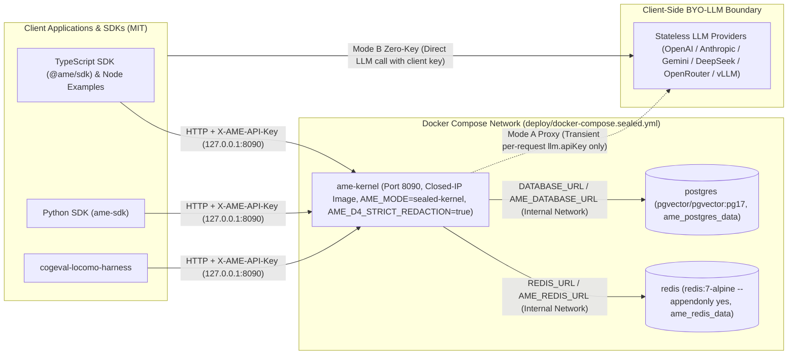

# Sealed Kernel Deployment Guide (`ame-kernel`)

This directory contains the Docker Compose deployment template for running the **Artificial Mind Engine (AME) Sealed Kernel** (`ame-kernel`) alongside its backing PostgreSQL (`pgvector/pgvector:pg17`) and Redis (`redis:7-alpine`) stores.

`artificial-mind-engine` separates the **open MIT-licensed gateway interface, SDKs, examples, and black-box harness** from the **proprietary closed-IP cognitive kernel image** (`ghcr.io/bearrhee/ame-kernel-sealed:latest`). No kernel source code or model weights are mounted from the host.

---

## Architecture



### Service Inventory

| Service | Image | Host Port | Persistence | Role |
| :--- | :--- | :--- | :--- | :--- |
| `ame-kernel` | `${AME_SEALED_IMAGE:-ghcr.io/bearrhee/ame-kernel-sealed:latest}` | `${AME_PORT:-8090}:8090` | None (zero source bind mounts) | Closed-IP Cognitive OS Kernel & OpenAPI 3.1 Gateway |
| `postgres` | `pgvector/pgvector:pg17` | Internal only | `ame_postgres_data:/var/lib/postgresql/data` | Persistent Mind state, memories, embeddings, revocation ledger |
| `redis` | `redis:7-alpine` (`--appendonly yes`) | Internal only | `ame_redis_data:/data` | Ephemeral turn tickets, KV prefix epoch, `revocationEpoch` state |

---

## Testing the API & Reproducing Benchmarks: Public Contract Sandbox vs. Sealed Kernel

Before deploying or benchmarking, choose the execution tier matching your evaluation goal:

| Environment | How to Connect / Launch | What Works Out of the Box | Limits & Production Scope |
| :--- | :--- | :--- | :--- |
| **Public Contract Sandbox** (`mode: "sandbox-contract"`) | `npm run sandbox` (`http://127.0.0.1:8090`) or [thesoulthread.com/ame-demo](https://thesoulthread.com/ame-demo/) | Full OpenAPI 3.1 contract (`Mode A /turn`, `Mode B prepare/settle`, `idle-tick`, `DELETE /memories`, `D4 telemetry`, `simulate-batch`), BYO LLM keys or offline `mock`, schema/pipeline wiring checks | `O(N)` memory array bounded by `AME_SANDBOX_MAX_MEMORIES_PER_MIND=2000`; rule-based simulator instead of proprietary `AACIM-59` weights & 4-path PG/Jina RAG |
| **Option A — Hosted Evaluation Gateway** (`mode: "sealed-kernel"`) | `export AME_BASE_URL=https://thesoulthread.com/ame-api` + issued `AME_API_KEY` (`X-AME-API-Key`, requestable via [help@artificialmind.me](mailto:help@artificialmind.me)) | Zero-setup access to the sealed proprietary kernel without pulling GHCR images or provisioning local Postgres/Redis | Real `LoCoMo`, `EQ-Bench 3`, `CogEval-v1`, `LongMemEval-S`, and real `100K–1M` kernel convergence (`sealed-kernel-production-eval`) |
| **Option B — Self-Hosted Sealed Container** (`mode: "sealed-kernel"`) | `docker compose -f deploy/docker-compose.sealed.yml --env-file deploy/.env up -d` | Full sealed kernel running locally or in your private VPC with your own PostgreSQL (`pgvector`) & Redis | Full production benchmarks + air-gapped / VPC `Mode B Zero-Key` inference |

---

## Prerequisites

- **Docker Engine** and **Docker Compose v2+** (`docker compose version`)
- A valid **AME License Key** (`AME_LICENSE_KEY`) for `AME_MODE=sealed-kernel`
- Registry authentication (`docker login ghcr.io`) if pulling a private commercial/evaluation `AME_SEALED_IMAGE`

---

## Step-by-Step Launch

### 1. Create `deploy/.env` from `.env.example`

From the `deploy/` directory (or repository root):

```bash
# Inside deploy/
cp .env.example .env
```

Or on Windows PowerShell from the repository root:

```powershell
Copy-Item deploy/.env.example deploy/.env
```

Edit `deploy/.env` and replace all placeholder secrets:

- `AME_API_KEY`: Shared gateway secret required in the `X-AME-API-Key` header.
- `AME_LICENSE_KEY`: Commercial or evaluation license key for the sealed kernel.
- `POSTGRES_PASSWORD`: Strong URL-safe password (alphanumeric, `-`, `_`) for PostgreSQL.

> **Important:** Never put LLM provider API keys (`OPENAI_API_KEY`, `ANTHROPIC_API_KEY`, `GEMINI_API_KEY`, etc.) inside `deploy/.env`. See [Security Boundaries](#security-boundaries-d3--d4--byo-llm).

### 2. Start the Sealed Kernel Stack

Run from the repository root:

```bash
docker compose -f deploy/docker-compose.sealed.yml --env-file deploy/.env up -d
```

Docker Compose waits for `postgres` (`pg_isready`) and `redis` (`redis-cli ping`) to become healthy before starting `ame-kernel`.

### 3. Verify Container Health & `/v1/health`

Check container status:

```bash
docker compose -f deploy/docker-compose.sealed.yml --env-file deploy/.env ps
```

Probe the unauthenticated `/v1/health` endpoint:

```bash
curl -fsS http://127.0.0.1:8090/v1/health
```

PowerShell:

```powershell
Invoke-RestMethod -Uri "http://127.0.0.1:8090/v1/health"
```

Expected response shape (per [`spec/openapi.yaml`](../spec/openapi.yaml)):

```json
{
  "ok": true,
  "service": "ame-kernel",
  "version": "1.0.0",
  "mode": "sealed-kernel",
  "domains": ["game_npc", "companion_chat", "counseling_coach", "custom"]
}
```

Confirm `"mode": "sealed-kernel"` and `"ok": true`.

---

## Running Examples, Convergence & Benchmarks (Option A Hosted or Option B `:8090`)

Both `@ame/sdk` (`packages/sdk-ts`) and `ame-sdk` (`packages/sdk-python`) read `AME_BASE_URL` and `AME_API_KEY` automatically.

### Set Target Environment Variables

**Bash / Zsh (Option B Self-Hosted `:8090` or Option A Hosted Gateway):**

```bash
# Option B (Self-Hosted Sealed Kernel Container)
export AME_BASE_URL="http://127.0.0.1:8090"
export AME_API_KEY="your-ame-api-key-from-deploy-env"

# OR Option A (Hosted Evaluation Gateway — request key via help@artificialmind.me)
# export AME_BASE_URL="https://thesoulthread.com/ame-api"
# export AME_API_KEY="your-issued-eval-api-key"
```

**PowerShell:**

```powershell
$env:AME_BASE_URL = "http://127.0.0.1:8090" # or "https://thesoulthread.com/ame-api"
$env:AME_API_KEY = "your-ame-api-key-from-deploy-env"
```

### TypeScript / Node Examples

Run the domain examples defined in root [`package.json`](../package.json) against the sealed kernel:

```bash
npm run example:game
npm run example:chat
npm run example:counseling
```

### Python SDK (`packages/sdk-python`)

Install or point `PYTHONPATH` to `packages/sdk-python`, then verify `/v1/health` and Mind creation against `http://127.0.0.1:8090`:

```bash
PYTHONPATH=packages/sdk-python python -c "
from ame_sdk.client import AmeClient
with AmeClient() as client:
    print(client.health())
"
```

### 100K–1M Turn Kernel Convergence (`POST /v1/minds/{mindId}/simulate-batch`)

Calling a live HTTP LLM `1,000,000` times turn-by-turn sequentially takes **~11.5+ days** and **thousands of dollars** in API fees, while the local sandbox memory array (`AME_SANDBOX_MAX_MEMORIES_PER_MIND=2000`) is scoped to contract verification. **`POST /v1/minds/{mindId}/simulate-batch`** runs `100K–1M` turns of deterministic kernel dynamics (`AACIM-59` / `FEP` / `PostHoc` across `40` profiles & `3` arms: `mind_off`, `aacim_off`, `ame_aacim_on`) in seconds with **0 LLM API calls**, strictly `D4`-redacted (`d4Redacted: true`):

```bash
# CLI convergence benchmark (works against Hosted Evaluation Gateway or http://127.0.0.1:8090)
npm run bench:convergence -- --base-url https://thesoulthread.com/ame-api --api-key "$AME_API_KEY" --turns 1000000
```

- **TypeScript (`@ame/sdk`):** `await client.simulateBatch(mind.mindId, { turns: 1_000_000, profileCount: 40, checkpoints: 8, compareArms: true })` (evaluates `mind_off`, `aacim_off`, `ame_aacim_on`)
- **Python (`ame_sdk`):** `client.simulate_batch(mind["mindId"], turns=1_000_000, profile_count=40, checkpoints=8, compare_arms=True)`

### Head-to-Head External Benchmarks & Unified DD Scorecard

Run the black-box verification suite, `LoCoMo` / `LongMemEval-S` paired comparators (`ame-gateway` vs `bare-frontier`), and unified DD scorecard against your sealed kernel (`http://127.0.0.1:8090` or `https://thesoulthread.com/ame-api`):

```bash
# 1. 7-Gate CogEval black-box suite
npm run bench:smoke -- --json-out ./artifacts/harness.json

# 2. LoCoMo Paired Comparator (sample_locomo.json offline, or full locomo10.json / --conversations conv-26,conv-30 for Confirm-304)
npm run bench:locomo -- --dataset benchmarks/cogeval-locomo-harness/sample_locomo.json --arm both --provider mock --json-out ./artifacts/locomo-smoke.json
npm run bench:locomo -- \
  --dataset /path/to/locomo10.json \
  --conversations conv-26,conv-30 \
  --arm both --provider deepseek --model deepseek-v4.1-flash --api-key "$DEEPSEEK_API_KEY" \
  --ame-base-url "$AME_BASE_URL" --ame-api-key "$AME_API_KEY" \
  --judge-provider openai --json-out ./artifacts/locomo-confirm-304.json

# 3. LongMemEval-S 500-QA Paired Comparator
npm run bench:longmemeval -- \
  --dataset /path/to/longmemeval_s_cleaned.json \
  --arm both --provider openai --model gpt-4o-mini --api-key "$OPENAI_API_KEY" \
  --ame-base-url "$AME_BASE_URL" --ame-api-key "$AME_API_KEY" \
  --json-out ./artifacts/lme-500-dd.json

# 4. Unified DD Scorecard (strict sandbox-contract-verification vs sealed-kernel-production-eval separation)
npm run bench:scorecard -- \
  --harness-json ./artifacts/harness.json \
  --lme-json ./artifacts/lme-500-dd.json \
  --locomo-json ./artifacts/locomo-confirm-304.json \
  --convergence-json ./artifacts/convergence-1m.json \
  --out-md ./artifacts/vc-dd-scorecard.md \
  --out-json ./artifacts/vc-dd-scorecard.json
```

Published `LoCoMo` reference benchmarks for comparison: `OpenAI Memory` (`52.9%`), `LangMem` (`58.1%`), `Mem0` (`68.4%`), `Letta` (`74.0%`), `Zep / Graphiti` (`75.1%`), `AME (Gemma 4 26B)` (`75.66%` Confirm-304 standalone), and `AME (DeepSeek v4.1 Flash)` (`85.86%` Confirm-304 / `77.24%` Full `n=1,986`).

---

## Security Boundaries (`D3` / `D4` / `BYO-LLM`)

### 1. Closed-IP & Host Isolation

- **Zero source bind mounts:** `ame-kernel` has no host volume mounts in `docker-compose.sealed.yml`. All proprietary kernel binaries remain encapsulated inside the container image.
- **Internal database isolation:** Neither `postgres` (5432) nor `redis` (6379) publishes ports to the host; only `ame-kernel` exposes `${AME_PORT:-8090}`.
- **Production ingress note:** In multi-host or public deployments, place `ame-kernel` behind a TLS-terminating reverse proxy or bind host port mapping to loopback (`127.0.0.1:${AME_PORT:-8090}:8090`).

### 2. BYO-LLM Credential Boundary (Zero Stored LLM Keys)

`deploy/.env` **never stores LLM provider API keys**. You retain full control over provider credentials:

- **Mode A — Proxy BYO-LLM (`POST /v1/minds/{mindId}/turn`):**
  The client passes `llm.apiKey` transiently inside each request payload. `ame-kernel` executes the upstream LLM call in memory and never persists or logs `llm.apiKey`.
- **Mode B — Zero-Key Prepare/Settle (`POST /v1/minds/{mindId}/prepare` → client LLM call → `POST /v1/minds/{mindId}/settle`):**
  `ame-kernel` returns prefix-aligned prompts, safety directives, and an ephemeral `turnTicketId`. Your application invokes your chosen LLM (cloud or on-prem vLLM/Ollama) directly, so LLM API keys never cross the `ame-kernel` network boundary.

### 3. `D3` Triple Atomic Memory Revocation

Calling `DELETE /v1/minds/{mindId}/memories/{memoryId}` enforces three-layer erasure across the backing stores:

1. **PostgreSQL transactional deletion:** Deletes the primary memory record, linked turn chunks, and derived traces.
2. **Redis epoch invalidation:** Atomically increments `revocationEpoch` and purges stale cached state tied to prior epochs.
3. **Query-time opt-out guard:** Returns a `RevocationReceipt` verifying `residualLeakCheck: "0.00%"` so revoked secrets cannot resurrect in subsequent turns.

### 4. `D4` Unconscious–Conscious Firewall

`docker-compose.sealed.yml` hard-pins `AME_D4_STRICT_REDACTION=true`:

- Raw internal continuous vectors (`Layer 0–1` affective/endocrine state) are never serialized into prompts, logs, or API responses.
- `/v1/minds/{mindId}`, `/v1/minds/{mindId}/telemetry`, and `TurnResult.telemetry` emit only `SafeTelemetry` (`d4Redacted: true`).

---

## Lifecycle & Maintenance

View logs:

```bash
docker compose -f deploy/docker-compose.sealed.yml --env-file deploy/.env logs -f ame-kernel
```

Stop containers while preserving persistent Postgres & Redis volumes (`ame_postgres_data`, `ame_redis_data`):

```bash
docker compose -f deploy/docker-compose.sealed.yml --env-file deploy/.env down
```

Destroy containers **and wipe all persistent Mind memories and Redis epochs** (irreversible):

```bash
docker compose -f deploy/docker-compose.sealed.yml --env-file deploy/.env down -v
```

---

## Contact

- **Website**: [artificialmind.me](https://artificialmind.me)
- **Contact**: Shinyoung Rhee — [help@artificialmind.me](mailto:help@artificialmind.me)
