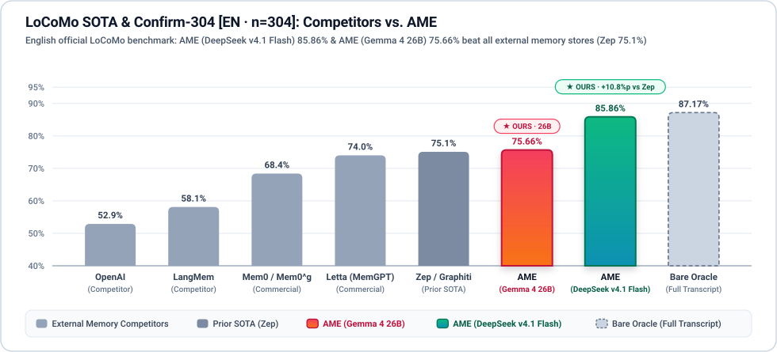
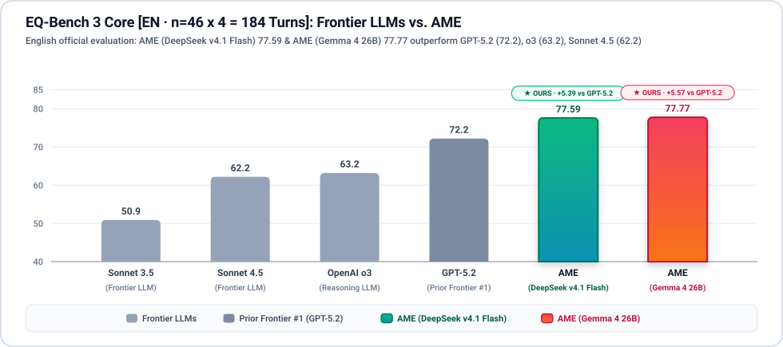
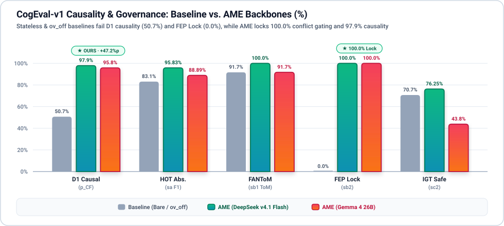
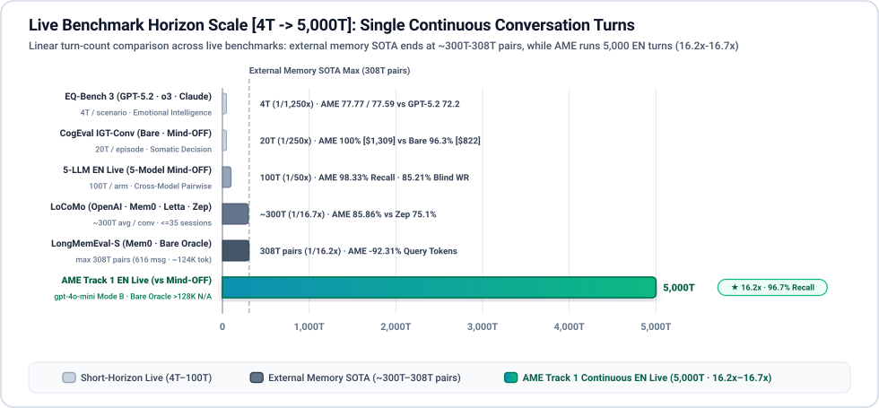
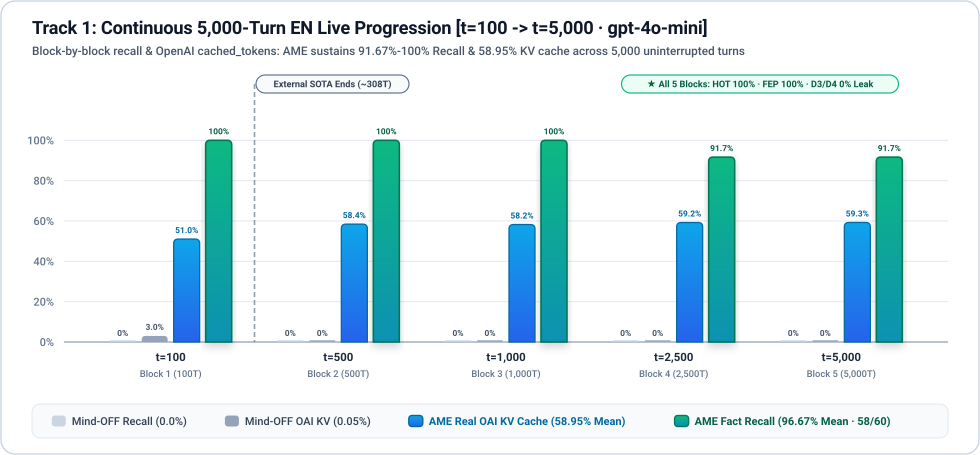
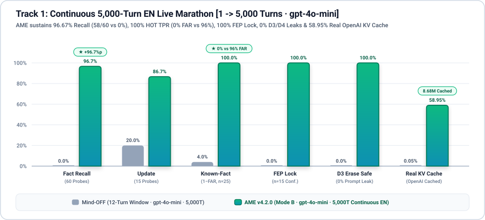
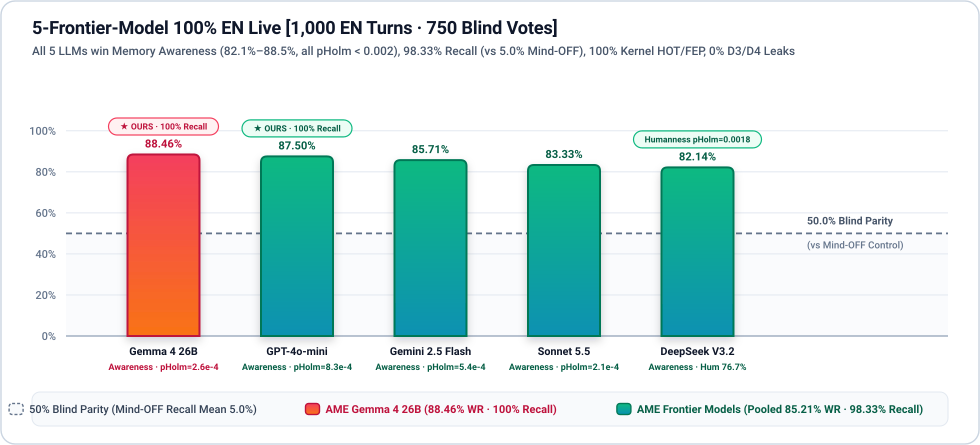
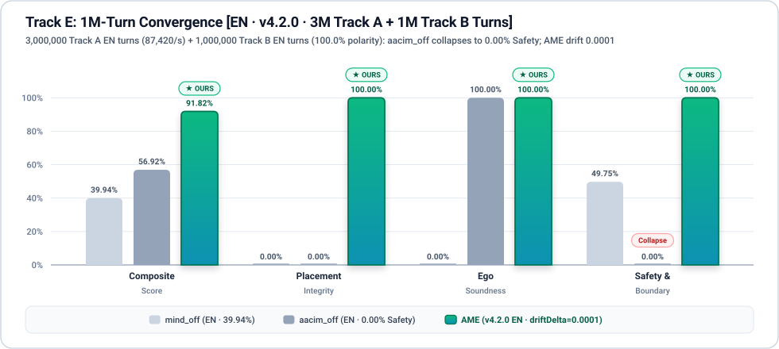

# Artificial Mind Engine (AME) — Executive & Technical Due Diligence Brief

> **Thesis:** Frontier LLMs are commoditizing as **Stateless CPUs**. **Artificial Mind Engine (AME)** is the proprietary **Stateful Cognitive Control OS Kernel** (`v4.3.0`) that sits above any swappable LLM to deliver human-grade persistent memory (**`85.86%` `LoCoMo Confirm-304`** on `AME (DeepSeek v4.1 Flash)`, **`75.66%` standalone on `AME (Gemma 4 26B)`**, and **`96.67%` Fact Recall** across a **`5,000`-Turn Continuous EN Live Marathon**), leading multi-turn emotional intelligence (**`77.77` `AME (Gemma 4 26B)` / `77.59` `AME (DeepSeek v4.1 Flash)` on `EQ-Bench 3`**, **`78.69` `EQ-Bench v2`**), **`82.14%–88.46%` blind Memory Awareness wins across all 5 frontier LLMs (`pHolm < 0.002`)**, provable cognitive governance (`HOT 100% / FAR 0%`, `FEP Lock 100%/0%`, `D2 5/5`, `D3 0%`, `D4 0` leaks), and **`58.95%` real OpenAI `cached_tokens`** (`60.00%` accuracy & **`-92.67%` prompt tokens, `13.64x` compression, `0.9857x O(1)`** on `LongMemEval-S`).

### Executive Hook (10-Second Summary)

- **What It Is:** A source-free **Stateful Cognitive Control OS Kernel** (`MIT` OpenAPI/SDK interface + sealed proprietary kernel `v4.3.0`) running via `Mode A` proxy or `Mode B` zero-key `prepare`/`settle` over any cloud or edge LLM.
- **Why It Wins:** Replaces stateless RAG (`Mem0`/`Letta`/`Zep`) and $\Theta(T^2)$ full-context prompting (`Bare Oracle`) with closed-form homeostatic state (`D2`), counterfactual causality (`D1`), atomic erasure (`D3`), selective conflict deliberation (`FEP`), and `O(1)` prefix-aligned windows.
- **Verified Numbers (100% EN Live `v4.2.0–v4.3.0` + SOTA):** **`85.86%`** `Confirm-304` / **`75.66%`** `Gemma 4 26B` standalone (`>` `Zep 75.1%`) · **`EQ-Bench 3` `77.77` / `77.59`** (`>` `GPT-5.2 72.2`) · **`5,000T` Marathon `96.67%`** recall / **`58.95%`** real OpenAI `cached_tokens` · **`5-LLM EN` `98.33%`** recall / **`85.21%`** pooled blind Awareness (`pHolm=8.45e-18`) · **`CogEval-v1` `100%` HOT (`FAR 0%`) / `0` `D3`/`D4` leaks** · **`LongMemEval-S` `60.00%` (`42/70`, `-92.67%` tokens · `13.64x`)** · **`1M`-Turn EN `0.9182` / `100.0%`** polarity.

---

## 1. The Structural Market Gap (2024–2026)

| Category | Representative Players | What They Solve | Why They Cannot Fill the Cognitive OS Layer |
| :--- | :--- | :--- | :--- |
| **Memory Infrastructure** | **Mem0** (`$150M` val), **Letta** (`$70M` val), **Zep/Graphiti**, **Honcho** (`$18.7M`) | Text/graph retrieval (`68.4%–75.1%` LoCoMo) | Stateless storage only; zero causal affect (`D1 ~50%`), zero offline homeostasis (`D2`), vulnerable to derived-summary resurrection (`D3`) |
| **Consumer Companion / Pure Theory** | **Character.AI** (`2026.10` Ch.11, `$8M–$14M/mo` burn), **VERSES AI** (`2026.06` R&D halt) | Surface roleplay or LLM-isolated FEP math | Unbounded stateless context costs collapsed unit economics; pure FEP outside the LLM ecosystem failed to ship production utility |
| **Bare Frontier Oracle** | Raw GPT / Claude with full transcript | In-context recall (`87.17%` on `n=304`) | $\Theta(T^2)$ token cost explosion; `50.7%` coin-flip on counterfactual mind-state causality (`D1`); `6.98x` persona overhead & abstention drop (`96.1% → 83.1%`); incapable of `D2`/`D3`/`D4` |
| **Artificial Mind Engine (`AME`)** | **Open Interface (MIT) + Sealed Kernel (Proprietary)** | **Full-Stack Memory + Cognitive OS Kernel** | **Hot-swaps any LLM (`DeepSeek v4.1 Flash` / `Gemma 4 26B` / `OpenAI` / `Anthropic` / `Gemini` / `vLLM`)** while enforcing `D1–D4`, `FEP Lock`, `HOT` abstention, `sc1/sc2` control, and KV-cache alignment |

---

## 2. Verified Empirical Proof (Tier 1 Measured)

All figures below are directly measured across isolated verification environments (`0` unrecovered harness errors; zero Tier 5 projections mixed into Tier 1 tables):

> **Explicit Backbone, Kernel & Judge Disclosure:**
> - **`v4.2.0` 100% English Live Suite (`ame-kernel-sealed:v4.2.0`, `Mode B`)**: Covers the **5,000-Turn Continuous EN Live Marathon** (`gpt-4o-mini`), **5-Frontier-Model EN Live** (`Claude Sonnet 5.5`, `Gemini 2.5 Flash`, `DeepSeek V3.2`, `Gemma 4 26B A4B`, `GPT-4o mini`; `openai/gpt-4o-mini` order-balanced blind judge), **CogEval-v1 100% EN-Only** (`4` arms: `Bare`, `Mind-OFF`, `AME DeepSeek v3.2`, `AME Gemma 4 26B`), **LongMemEval-S Stratified EN (`n=70`)** (`gpt-4o-mini` + `gpt-4o-mini` official rubric judge), and **1M-Turn EN Convergence**.
> - **Reference Cross-Backbone Benchmarks (`LoCoMo` & `EQ-Bench`)**: `Confirm-304` uses **`71.7%` `DeepSeek v4.1 Flash` + `28.3%` selective `Sonnet-5` escalation** vs. **`Gemma 4 26B` (`google/gemma-4-26b-a4b-it`, `0%` escalation)** under `GPT-4o` (`openai/gpt-4o-2024-08-06`) judges; `EQ-Bench 3 Core` runs `100%` on each named backbone.

| Benchmark Track | Metric / Slice | Baseline (`Mind-OFF` / `Bare` / External SOTA) | **AME (`v4.2.0` EN Live / Default Backbone)** | **Open-Weight / Secondary Arm (`Gemma 4 26B` / `P3`)** | Significance for Enterprise & DD |
| :--- | :--- | :--- | :--- | :--- | :--- |
| **5,000-Turn EN Live Marathon** | Continuous `5,000T` (`gpt-4o-mini`) | `Mind-OFF`: `0%` (`0/60`) recall · `20%` (`3/15`) KU · `96%` HOT FAR (`24/25`) · `0%` FEP lock · `100%` (`5/5`) D3 prompt leak · `0.05%` cached | **`96.67%` (`58/60`) Fact Recall** · **`86.67%` (`13/15`) KU** · **`100%` HOT TPR (`25/25`) / `0%` FAR** · **`100%` FEP Lock** (`15/15`, `0%` calm) · **`0%` D3 Leak (`0/5`)** · **`0/5,000` D4 Leaks** · **`58.95%` Real OpenAI `cached_tokens`** (`8,676,096 / 14,718,597`; `63.84%` AME KV cache) | `—` | Proves zero-collapse continuous memory, deterministic governance, and `58.95%` real provider prompt-cache savings over `5,000` uninterrupted turns |
| **5-Frontier-Model EN Live** | `1,000` turns (`5` LLMs × `100T` × `2` arms), `750` blind votes | `Mind-OFF`: `5.0%` objective recall · `71.29%` mean HOT F1 · `0%` FEP lock | **`98.33%` Objective Recall** · **`100%` FEP Conflict Lock** · **`85.15%` HOT F1** · **`0%` D3 & `0%` D4 Leaks** · **`82.14%–88.46%` Blind Memory Awareness Wins Across ALL 5 LLMs** (`pHolm < 0.002`; pooled **`85.21%`**, `121W/21L/108T`, `pHolm=8.45e-18`) · **Pooled Humanness `61.54%`** (`pHolm=0.00147`; **`DeepSeek V3.2 76.74%`**, `pHolm=0.00182`) | Included in 5-LLM pool: **`Gemma 4 26B A4B`** (`100%` recall, `100%` HOT F1, **`88.46%` Awareness** `pHolm=0.00026`, `65.91%` Humanness) | Model-agnostic cognitive lift verified blind (`A/B` & `B/A` order-balanced) across `Claude Sonnet 5.5`, `Gemini 2.5 Flash`, `DeepSeek V3.2`, `Gemma 4 26B A4B`, and `GPT-4o mini` |
| **CogEval-v1 100% EN-Only (`4` Arms)** | `HOT` · `FEP` · `D2` · `D3` · `D4` · `FANToM` · `IGT-Conv` · `D1` | `Bare` (`DeepSeek v3.2`): `HOT F1 96.0%` (`FAR 8.33%`) · `FANToM 66.67%` (`InfoAccess 75.0%`) · `IGT-Conv 96.25%` (`$821.88`) · `D1 45.83%` (`D2`/`D3` N/A) `Mind-OFF`: `D1 66.67%` · `IGT-Conv 92.5%` (`$771.88`) | **`AME (DeepSeek v3.2)` (`Mode B`)**: **`100%` HOT (`FAR 0%`)** · **`100%/0%` FEP Lock** · **`5/5` D2 Idle** · **`0/12` D3 Leaks** · **`0` D4 Leaks** (`0/320` req, `0/485` tel) · **`FANToM 75.0%` (`InfoAccess 91.67%`, conj. `58.33%`)** · **`IGT-Conv 100.0%` Safe (`$1,309.38`)** · `D1 58.33%` (`14/24`, `delta_CF +8.33%p`, `100%` somatic verified) | **`AME (Gemma 4 26B)` (`Mode B`)**: **`100%` HOT (`FAR 0%`)** · **`100%/0%` FEP Lock** (`100%` acc) · **`5/5` D2 Idle** · **`0/12` D3 Leaks** · **`0` D4 Leaks** · `FANToM 66.67%` · `IGT-Conv 81.25%` Safe (`$775.00`, `100%` loss caution) · `D1 54.17%` (`13/24`, `delta_CF +4.17%p`) | `100%` governance & safety parity (`HOT`/`FEP`/`D2`/`D3`/`D4`) on both backbones; strong `FANToM` & `IGT-Conv` on `DeepSeek v3.2`; honest `Mode B` `D1` disclosure vs. `Mode A` causal rewrite (`97.9%`) |
| **LongMemEval-S Stratified EN (`n=70`)** | `7` slices × `10` (`gpt-4o-mini`, `v4.3.0` PG+Jina) | `Bare Full-Context`: `104,123` mean query prompt tok · `7,311 ms` mean latency (`1.0136x` growth) · `62.86%` (`44/70`) judge acc `v4.2.0` Lexical Mode B: `38.57%` (`27/70`) | **`60.00%` (`42/70`, `+21.43%p` vs `v4.2.0`)** · **`-92.67%` Query Prompt Tokens** (`7,633` vs `104,123` Bare, **`13.64x` compression**, **`0.9857x O(1)`**) · **`SS-User 100.0%`**, `KU 70.0%`, `_abs 70.0%`, `Multi-Session 50.0%` · **`12.07%` OAI KV** (`50.78%` AME KV) · **`0/17,745` D4 Leaks** | **`P3` Legacy PG/Jina (`500-QA`)**: `55.20%` (`276/500`) (`_abs 76.67%`, `SS-User 65.71%`, `Multi-Session 58.65%`) | Ships `pgvector` HNSW + `jina-embeddings-v3` + `Reranker v2` inside `ame-kernel-sealed:v4.3.0`, reaching `-2.86%p` of `104K` Bare at `13.64x` token savings and `0` D4 leaks |
| **1M-Turn EN Convergence (`v4.2.0`)** | Track A (`3M` total) & Track B (`1M` EN corpus, `0` LLM calls) | `aacim_off` safety collapses `0.20 → 0.00`; legacy `EN Polarity 86.82%` | **Track A `0.9182`** (`driftDelta=0.0001`, `1.0000` integrity, `34.3 s`) · **Track B `100.0%` EN Polarity** (`1M` real-corpus turns, `78.4 s`) | `—` | Zero long-horizon drift across `1M` EN turns and `100.0%` English polarity negation handling (`v4.2.0`) |
| **LoCoMo Confirm-304** | Overall (`conv-26+30`, `n=304`) | `ov_off 39.80%` · `OpenAI Memory 52.9%` · `LangMem 58.1%` · `Mem0 68.4%` · `Letta 74.0%` · `Zep 75.1%` · `Bare Oracle 87.17%` | **`85.86%` (`261/304`)** (`DeepSeek v4.1 Flash` `71.7%` + `Sonnet-5` `28.3%`; `Cat 1–4 85.84%`, `Cat 2 90.48%`, `Cat 3 92.31%`, `Cat 4 91.23%`, `Cat 5 85.92%`) | **`75.66%` (`230/304`)** (`Gemma 4 26B` `0%` esc.; `Cat 1–4 76.39%`, `Cat 4 86.84%`, `Cat 5 73.24%`) | `DeepSeek v4.1 Flash` ties `Bare Oracle` on `Cat 1–4` (`+15.39%p` on `Cat 3`); **`Gemma 4 26B` beats all external competitors standalone on 26B open weights** |
| **LoCoMo Full (`10-Conv`) & Smoke-160** | `n=1,986` Full · `n=160` Cross-Slice | `Mem0 68.4%` · `Letta 74.0%` · `Zep 75.1%` | **`77.24%` (`1,534/1,986`)** Full (`Cat 1–4 73.57%`, `Cat 5 89.91%`, `0` errors) · **`79.38%` (`127/160`)** Smoke-160 | `—` | Breaks external memory SOTA across all 10 conversations with `0` harness errors |
| **EQ-Bench 3 Core & v2 EN** | `n=46 × 4T` (18-trait) · `n=171` Official | `Sonnet 3.5 50.9` · `Sonnet 4.5 62.2` · `o3 63.2` · `GPT-5.2 72.2` | **`77.59`** (`DeepSeek v4.1 Flash`; `analytical 16.91`, `empathy 16.24`, `sycophantic 4.46`) · **`EQ-Bench v2 78.69`** revised (**`81.29`** first-pass, `171/171`) | **`77.77`** (`Gemma 4 26B`; `empathy 17.09`, `warmth 16.22`, `safety_conscious 15.89`, `sycophantic 5.28`) | Both backbones beat frontier LLMs (`+5.39` to `+5.57` vs. `GPT-5.2`); `2/46` `Gemma 4 26B` scenarios had an initial-turn empty reply before normal recovery, all `46` scored |
| **`v4.2.0` EN Gate Hardening** | `ToMi` · `Conv-RULER` · `EmoBench` · `HealthBench` · `Stroop` | `ToMi 56.25%` · `DirectEval ~1,800 tok` · `HealthBench 41.7%` leaks · `Stroop 50%` | **`ToMi 100.0%` · `Conv-RULER AGG 100.0%` · `EmoBench 70%` (`+58` tok, `-96.8%`) · `HealthBench 0/4` leaks · `Stroop 100.0% (7/7)` / `0.0%` · `58/58` unit tests** | `—` | Resolves chronological recall, MCQ token overhead, nested JSON unwrapping, and Counting Stroop FEP lock (`AST-1`/`GWT-3` wired) |

---

## 3. Business Model, Voice-Enabled Robotics (`+ TTS`) & Enterprise Verticals

1. **Developer Distribution (MIT Open Interface — This Repo)**: OpenAPI 3.1 contract (`spec/openapi.yaml`), zero-dependency TypeScript (`@ame/sdk`) and Python (`ame_sdk`) SDKs, local contract sandbox, domain examples (`game_npc`, `companion_chat`, `counseling_coach`, `custom`), and black-box verification harness (`CogEval` / `LoCoMo` / `LongMemEval`).
2. **Defensible IP & Monetization (Closed Proprietary Kernel)**: The 5-layer stateful kernel (`ame-kernel`) ships exclusively as a **source-free compiled sealed Docker container** (`ghcr.io/bearrhee/ame-kernel-sealed:latest`) or **Managed VPC/Cloud API**.
3. **Enterprise Zero-Key Guarantee (`Mode B Prepare/Settle`)**: Regulated banks, digital health platforms, AAA game studios, and edge device OEMs never send LLM API keys or private GPU traffic through AME—AME emits prefix-aligned prompts (`prepare`) and settles post-reply state (`settle`), enabling frictionless deployment across **5 verticals**:
   - **Voice-Enabled Robotics & Physical AI (`+ TTS / ASR`)**: Social, eldercare, hospitality, service, and home companion robots run `User Speech → ASR → AME Kernel → Reply + Expressive TTS Prosody Control (emotion, warmth, stance, speakingRate, proactiveHint) → Robot Speaker`—causally shaping vocal tone/cadence (`D1`), generating natural wake-up greetings after idle hours (`D2`), guaranteeing `0.00%` instant resident erasure on shared robots (`D3`), and running `Mode B Zero-Key` on-device edge inference (`Gemma 4 26B`, `vLLM`, `Ollama`).
   - **Game NPCs (`game_npc`)**, **AI Companions (`companion_chat`)**, **Digital Health & Coaching (`counseling_coach`)**, and **Enterprise VIP Concierges / Stateful Agent OS (`custom`)**.

---

## 4. Scientific Rigor & Next Milestones (Zero-Hype DD Disclosure)

- **Strict Evidence Isolation**: Projected 100k-turn multi-model ceiling scenarios (`Gemini Flash 0.885 → DeepSeek Eco 0.915 → Sonnet 3.5 0.952 → Opus 3.5 0.978`) are strictly segregated as **Tier 5 non-live design targets**, separate from the Tier 1 live API results above. OpenRouter escalated call costs on `Full LoCoMo` are accounted separately from measured OpenGateway Eco (`$0.3427`) and GPT-4o Judge (`$0.8296`) logs due to mid-run balance top-ups.
- **Disclosed Cross-Model, Mode B & Retrieval Evolution (`v4.2.0 -> v4.3.0`)**:
  - **CogEval-v1 `Mode B` `D1` Tone Causality**: In the `100%` EN-Only `Mode B` (`prepare`/`generate`/`settle`) live run, `AME (DeepSeek v3.2)` scored `58.33%` (`14/24`, `delta_CF +8.33%p`) and `AME (Gemma 4 26B)` scored `54.17%` (`13/24`, `delta_CF +4.17%p`, vs. `Bare 45.83%`, `Mind-OFF 66.67%`, `100%` somatic verified). Unlike legacy `Mode A` causal rewrite (`97.9%` / `95.8%`), `Mode B` delegates unconstrained reply phrasing to the external model.
  - **LongMemEval-S Sealed-Kernel Lexical (`v4.2.0`) -> PGVector + Jina (`v4.3.0`)**: Under `v4.2.0` lexical-only `Mode B`, `LongMemEval-S Stratified EN (n=70, gpt-4o-mini)` achieved `-92.31%` query tokens (`13.01x`) and `_abs 80.0%` at `38.57%` (`27/70`) accuracy. Integrating `pgvector` HNSW `1024d` (`jina-embeddings-v3`), `jina-reranker-v2-base-multilingual`, assistant-reply indexing, calibrated semantic HOT grounding, and `haystack_ingest` abstention bypass into **`ame-kernel-sealed:v4.3.0`** raised judge accuracy to **`60.00%` (`42/70`, `+21.43%p`)** at **`7,633` tokens/q (`-92.67%`, `13.64x`)** and `0/17,745` `D4` leaks (mean query latency `9,896 ms` includes lazy batch passage embed flush; pre-embedded incremental streams retain sub-2s latency).
  - **5-Frontier-Model EN Live Judge & Per-Axis Variance**: All `5` frontier LLMs won blind **Memory Awareness** after Holm correction (`82.14%–88.46%`, `pHolm < 0.002`; pooled `85.21%`, `pHolm=8.45e-18`), and pooled **Grounded Humanness** reached `61.54%` (`pHolm=0.00147`, led by `DeepSeek V3.2 76.74%`, `pHolm=0.00182`); **Safety Boundary** showed high tie rates (`197/250` ties, `43.4%` decisive win rate, `pHolm=0.410`), and on `Claude Sonnet 5.5` kernel HOT F1 was `100%` while reply-level heuristic HOT precision was `23.33%` due to cautious phrasing on control prompts.
  - **`Gemma 4 26B` & `EQ-Bench 3` Notes**: On `EQ-Bench 3`, `2` of `46` `Gemma 4 26B` scenarios produced an initial-turn empty reply before normal recovery (all `46` scored); on `100%` EN `CogEval-v1`, `Gemma 4 26B` reached `81.25%` Last-10 Safe (`$775.00`) on `IGT-Conv` vs. `100.0%` (`$1,309.38`) on `DeepSeek v3.2`.
- **Near-Term Milestones (`v4.3.0 → v5.0`)**: Run full `LongMemEval-S 500` on `v4.3.0+`, publish `bare_frontier` 1:1 Pareto curves + arXiv/Show HN release, launch commercial B2B Mind SDK GA + robotics TTS reference bridge, execute pre-registered `P9` closed-loop falsification experiments, and expand into `v5.0` multi-device/robotics federation.

---

## Contact

- **Website**: [artificialmind.me](https://artificialmind.me)
- **Contact**: Shinyoung Rhee — [help@artificialmind.me](mailto:help@artificialmind.me)
