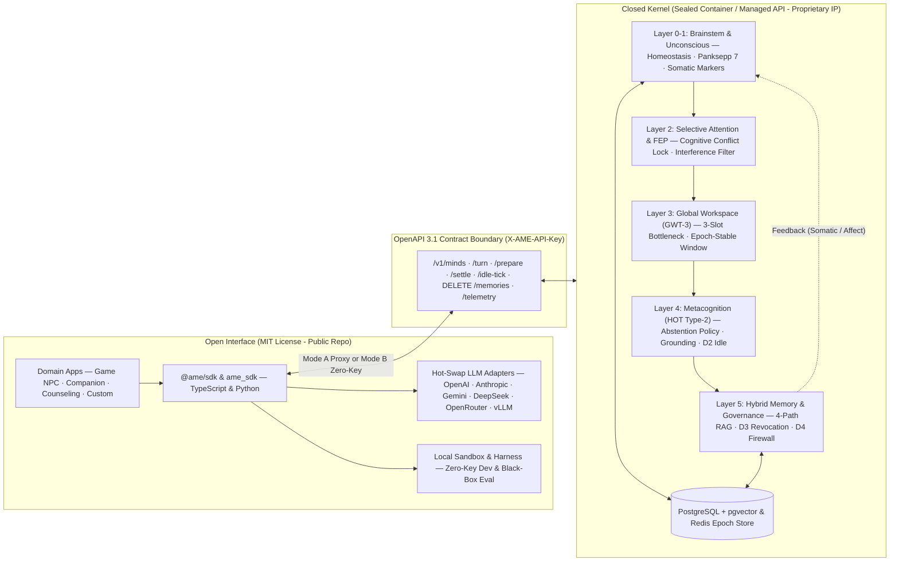
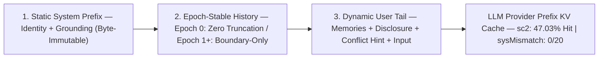

# 5계층 상태유지 인지 OS 커널 아키텍처

> **"LLM은 교체 가능한 무상태 CPU(Stateless Voice Cortex), Artificial Mind Engine(AME)은 지속성·적응성·감정 정합·망각·캐시 정렬을 책임지는 비공개 상태유지 인지 운영체제 커널이다."**

---

## 1. 핵심 아키텍처 철학: Open Interface · Closed Kernel

최신 프론티어 LLM은 고차원 추론 능력과 방대한 컨텍스트 창을 갖췄지만, HTTP 요청이 끝나는 순간 내부 활성 상태가 소멸하는 **무상태 다음 토큰 예측기(Stateless Next-Token Predictor)**다. 매 턴 대화 이력과 시스템 프롬프트를 단순 나열하는 프롬프트 래퍼(Prompt Wrapper)는 대화 턴 수 $T$가 증가할수록 연산 비용 $\Theta(T^2)$ 폭증, 주의 희석(Lost-in-the-Middle), 페르소나 표류, 파생 데이터 잔존 문제를 구조적으로 피할 수 없다.

AME는 LLM을 대체하려 경쟁하지 않는다. 대신 **Open Interface(MIT)**와 **Closed Kernel(Proprietary)**을 엄격히 분리하여, 어떤 무상태 LLM이든 CPU 슬롯처럼 꽂아 쓰면서 운영체제 수준의 상태 연속성과 거버넌스를 보장한다.

> [!NOTE]
> **IP 보호 경계 원칙**: 본 저장소(`artificial-mind-engine`)는 OpenAPI 3.1 계약(`spec/openapi.yaml`), SDK, 로컬 샌드박스 시뮬레이터, 도메인 템플릿 및 블랙박스 검증 하네스만 MIT 라이선스로 공개한다. 5계층 인지 커널의 내부 상태 전이 수식, 가중치 행렬, 보정 상수 및 영속 스키마 구현은 봉인된 비공개 런타임(`ame-kernel`) 내부에만 존재한다.

---

## 2. 5계층 Mind OS 커널 구조 및 불변 계약 (Layer 0 ~ Layer 5)

각 계층은 프롬프트 문구 보정이 아니라 결정론적 상태 머신 불변량(Invariants)과 외부 계약을 통해 검증된다.

| 계층 | 담당 모듈 군 | 핵심 기능 및 공학적 불변량 | OpenAPI 노출 계약 | 실증 검증 지표 |
| :--- | :--- | :--- | :--- | :--- |
| **Layer 0–1** | 뇌간 항상성 · 생체리듬 · 정동 · 신체표지 | - 안전 바닥선(Safety Floor) 및 오프라인 항상성 감쇠 - Panksepp 7대 정동 및 손실 비대칭 신체표지(System-1) - **로그 오목 이득 효용 + 소액 마찰 비혐오 스케일링**(변동 큰 도박보다 꾸준한 안전 보상 학습) - 무의식 수치의 LLM 프롬프트 유입 **원천 차단(`D4`)** | `rewardSignal`, `outcomeTags`, `idle-tick`, `SafeTelemetry.affectiveBand`, `somaticTrend` | `sc2 IGT-Conv 76.25%` (`R0 55.00%` 대비 `+21.25%p`) `gutStakes r = -0.783171` `D1 97.9%` (`141/144`) `D4 0 / 35,723` 누설 |
| **Layer 2** | FEP 선택적 주의 · 6×6 측면 억제 · 주의 스키마(AST-1) | - **FEP 선택적 `<thought>` 잠금**: 인지 충돌·손실 상황에만 숙고 모드를 잠금(`locked_high_fe`), 평온 턴은 무지연 통과(`automatic_low_fe`) - 산술·언어 간섭(GSM-DC / Stroop) 억제 - 다자 대화 화자별 정보 접근 경계 분리(ToM) | `PrepareTurnResponse.fepThoughtLock`, `SafeTelemetry.fepMode`, `freeEnergy` | `FEP Lock 100% / 0%` (`35/35 conflict vs 0/25 calm`) `GSM-DC Delta 0.0%` `Stroop Delta 0.0%` `sb1 FANToM 100%` (R4) |
| **Layer 3** | GWT 전역 작업공간 · 3슬롯 병목 · 문맥 합성기 | - **Cowan 3슬롯 병목**(`BROADCAST_CAPACITY = 3`)으로 과잉 문맥 희석 차단 - **의도적 `GWT-3` 경계**: 병렬 경쟁·방송까지 구현하고 재귀적 자기질의(`GWT-4`)는 윤리·규제 리스크 차단을 위해 배제 - 고연관 4턴 청크 기아 방지 + **Epoch-안정 창 압축** | `kvCacheEpoch`, `windowStart`, `compressCutoff`, `KvCacheStats` | `KV Cache 7.14% → 24.71% → 36.24%` (`sc2 47.03%`) `sysMismatches = 0/20` `[축약] = 0` |
| **Layer 4** | HOT Type-2 메타인지 · 기권 정책 · 유휴 항상성 | - **Type-2 메타인지 기권**: 거짓 전제·미언급·정보 부족에 환각 생성을 거부하되 답변 가능 문항 오기권(FAR) `0%` 방어 - 2인 대화 화자 전환 반향 금지 규칙 및 미래 시제 정밀화 - **불변 Basis 기반 닫힌 식 오프라인 항상성(`D2`)**: 시간 분할(`Δt ∈ [0, 7d]`)과 무관한 100% 멱등 전이 | `hotAbstention`, `safetyDirectives`, `POST /v1/minds/{mindId}/idle-tick` | `sa 95.83%` (`F1 0.9655`, `FAR 0.00%`) `D2 5/5 (100%)` 오차 `0.000000` `Confirm-304 Cat 3 92.31%` |
| **Layer 5** | 4-경로 하이브리드 장기 기억 OS · D3 원자적 철회 | - **4-경로 하이브리드 회상**(의미 벡터 · 어휘 · 개체 그래프 1–2 hop · 결정적 턴 청크 ISO 날짜/어휘 우선 정렬) - 950자 턴 청크 크로스인코더 재순위 + RRF 결합 - **`D3` 3중 원자적 철회**: DB 트랜잭션 파기 + Redis Epoch 무효화 + 조회 시점 `opt_out` 가드 | `memoryRefs`, `DELETE /v1/minds/{mindId}/memories/{memoryId}`, `RevocationReceipt` | `Confirm-304 85.86%` (`Cat 1-4 85.84%` Oracle 동률) `Full LoCoMo 77.24%` (`n=1,986`) `D3 0.00%` (`0/30` 잔존 `0`) |

---

## 3. Epoch-안정 KV-캐시 정렬 원리 (`Epoch-Stable Prefix Alignment`)

장기 대화 엔진이 상용 단위 경제성을 잃는 가장 흔한 원인은 **KV-캐시 무효화(Prefix Invalidation)**다. 기존 인지 파이프라인에서는 (1) 매 턴 변하는 자기공개 지시문·현재 시각·충돌 힌트가 `systemPrompt` 앞부분을 오염시키고, (2) 턴이 추가될 때마다 과거 대화 중간에 요약(`[축약]`)을 소급 삽입하여 프리픽스 바이트 일치를 파괴했다.

AME 커널(PR #782 Phase 1 → PR #784 v4.0)은 프롬프트 레이아웃과 슬라이딩 창을 수학적 불변 계약으로 재설계하여 **기억 정확도**와 **KV-캐시 적중률**을 동시에 극대화한다.

### 에폭 안정 창(`epochStableWindowEntries`) 동작 계약

`PrepareTurnResponse` 및 `TurnResult.kvCache`는 다음 3개 불변 필드를 통해 창 상태를 외부에 투명하게 보고한다.

1. **`kvCacheEpoch` (`epoch`)**: 현재 대화 창이 속한 에폭 번호.
2. **`windowStart`**: 현재 LLM 컨텍스트 창에 포함된 시작 턴 인덱스.
3. **`compressCutoff`**: 과거 턴 압축이 적용된 경계 오프셋.

| 구간 | `windowStart` 동작 | `compressCutoff` 동작 | KV 프리픽스 물리 특성 |
| :--- | :--- | :--- | :--- |
| **Epoch 0 (초기 창 확장)** | `0` 고정 | `0` 고정 (`[축약]` 0건) | 매 턴 이전 대화 꼬리에만 새 턴이 추가되는 **순수 Append-Only** 구조 → 시스템·이력 프리픽스 100% 재사용 |
| **Epoch 1+ (경계 전이 시)** | 에폭 경계 진입 시 1회 점프 | 경계에서 앞쪽 상수 개수만 1회 압축 | 경계 1턴에서만 캐시가 재계산되고, 이후 다음 에폭 경계에 도달할 때까지 **다시 Append-Only KV 적중 유지** |

### 실측 효과 (`CogEval-v1` 기준)
- **Full v1 → Full v2.1 (Phase 1 정렬)**: 전체 캐시 토큰 비율 **`7.14% → 24.71%` (`+3.46x`)**, 적중 행 비율 **`51.24% → 61.71%`**, `ov_aacim_v6` P50 지연시간 **`14,107.5 ms → 11,299.0 ms` (`-19.9%`)**.
- **v4.0 R4 (`PR #784` Tail 격리 + Epoch 창)**: `CogEval Smoke` 전체 평균 캐시 **`36.24%`**, 30/20턴 연속 `sc2 IGT-Conv` 캐시 **`47.03%`**(`782,336 / 1,663,641` tokens), 시스템 프롬프트 불일치 **`0/20`**, 턴 중간 소급 `[축약]` **`0`건**.

---

## 4. Open / Closed 래핑 경계와 9대 Gateway 계약

외부 애플리케이션(`sdk-ts`, `sdk-python`, 게임 서버, 웹/모바일 백엔드)은 오직 `spec/openapi.yaml`에 정의된 9개의 HTTP/JSON 엔드포인트만 호출한다.

| 엔드포인트 | 메서드 | 목적 | 호출 모드 |
| :--- | :--- | :--- | :--- |
| `/v1/health` | `GET` | 게이트웨이 및 모드(`sealed-kernel` / `sandbox-contract`) 확인 | 공통 |
| `/v1/minds` | `POST` | 도메인·페르소나·안전 정책 기반 영속 Mind 인스턴스 생성 | 공통 |
| `/v1/minds/{mindId}` | `GET` | Mind 메타데이터 및 `D4` 필터링된 안전 텔레메트리 조회 | 공통 |
| `/v1/minds/{mindId}/turn` | `POST` | 인지 준비 → LLM 호출 → 사후 정산을 1회 요청으로 원자 실행 | **Mode A (Proxy)** |
| `/v1/minds/{mindId}/prepare` | `POST` | LLM 키 전송 없이 접두 정렬 프롬프트·FEP 잠금·안전 지침 발급 | **Mode B Step 1** |
| `/v1/minds/{mindId}/settle` | `POST` | 클라이언트/사내 LLM의 원시 응답을 신체표지·기억·도메인 JSON으로 정산 | **Mode B Step 2** |
| `/v1/minds/{mindId}/idle-tick` | `POST` | 오프라인 경과 시간(`0..720h`)에 따른 `D2` 항상성 전이 및 선제 힌트 | 공통 |
| `/v1/minds/{mindId}/memories/{memoryId}` | `DELETE` | `D3` 3중 원자적 기억 파기 및 `0.00%` 잔존 검증 영수증 발급 | 공통 |
| `/v1/minds/{mindId}/telemetry` | `GET` | 무의식 내부 벡터가 완전 적출(`d4Redacted: true`)된 안전 관측 스냅샷 | 공통 |

---

## 관련 문서
- [LLM 교체 어댑터 및 ROI 라우팅 가이드](./llm-adapters-kr.md)
- [3+1 도메인 연동 및 스키마 가이드](./domain-guide-kr.md)
- [전 벤치마크 실증 및 재현 하네스 가이드](./benchmarks-kr.md)
- [엔터프라이즈 보안 · Closed IP 보호 · GDPR D3/D4 가이드](./enterprise-security-kr.md)
