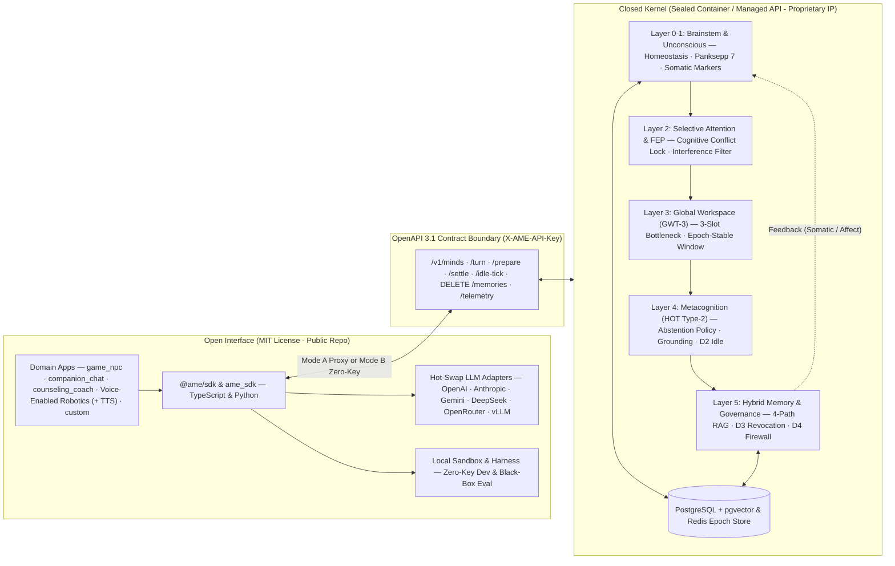
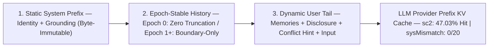

# 5-Layer Stateful Cognitive OS Kernel Architecture

> **"An LLM is a swappable stateless CPU (Stateless Voice Cortex); Artificial Mind Engine (AME) is the proprietary stateful cognitive OS kernel responsible for persistence, adaptation, affective alignment, forgetting, and cache alignment."**

---

## 1. Core Architectural Philosophy: Open Interface · Closed Kernel

While modern frontier LLMs offer high-order reasoning and massive context windows, they remain **Stateless Next-Token Predictors** whose internal activation state vanishes the moment an HTTP request ends. Prompt wrappers that naively concatenate conversation history and system prompts every turn structurally suffer from $\Theta(T^2)$ compute cost explosion as turn count $T$ grows, attention dilution (Lost-in-the-Middle), persona drift, and residual derived-data leakage.

AME does not compete to replace LLMs. Instead, it strictly separates the **Open Interface (MIT)** from the **Closed Kernel (Proprietary)**, allowing any stateless LLM to plug in like a swappable CPU while guaranteeing OS-level state continuity and governance across **`game_npc`**, **`companion_chat`**, **`counseling_coach`**, **Voice-Enabled Robotics (`+ TTS`)**, and **`custom`** enterprise applications.

> [!NOTE]
> **IP Protection Boundary Principle**: This repository (`artificial-mind-engine`) releases only the OpenAPI 3.1 contract (`spec/openapi.yaml`), SDKs, local sandbox simulator, domain templates, and black-box verification harness under the MIT License. The 5-layer cognitive kernel's internal state-transition equations, weight matrices, calibration constants, and persistence schema implementations reside exclusively inside the sealed proprietary runtime (`ame-kernel`).

---

## 2. 5-Layer Mind OS Kernel Structure & Invariant Contracts (Layer 0 – Layer 5)

Each layer is verified through deterministic state-machine invariants and external contracts rather than ad-hoc prompt phrasing tweaks.

| Layer | Module Group | Core Functions & Engineering Invariants | Exposed OpenAPI Contract | Empirical Verification Metrics |
| :--- | :--- | :--- | :--- | :--- |
| **Layer 0–1** | Brainstem Homeostasis · Circadian Rhythm · Affect · Somatic Markers | - Safety Floor & offline homeostatic decay - Panksepp 7 primary affects, expressive affective alignment & loss-asymmetric somatic markers (System-1) - **Log-concave gain utility + micro-friction non-aversive scaling** (learning steady safe rewards over high-variance gambles) - **Hard firewall blocking** unconscious raw metrics from entering LLM prompts (`D4`) | `rewardSignal`, `outcomeTags`, `idle-tick`, `SafeTelemetry.affectiveBand`, `somaticTrend` | `sc2 IGT-Conv 76.25%` (`v4.0`, `gutStakes r = -0.783171`) `EQ-Bench 3 Core 77.59` (`sycophantic 4.46`) · `EQ-Bench v2 EN 78.69` `D1 97.9%` (`141/144`) · `D4 0 / 35,723` leaks |
| **Layer 2** | FEP Selective Attention · 6×6 Lateral Inhibition · Attention Schema (AST-1) | - **FEP selective `<thought>` lock**: Locks deliberative mode only under cognitive conflict or loss (`locked_high_fe`), while calm turns pass with zero overhead (`automatic_low_fe`) - Model-based deliberation & active-inference belief calibration (`CogEval C1 beta_MB` / Restless Bandit ECE) - Arithmetic & linguistic interference suppression (GSM-DC / Stroop) - Multi-party speaker information-access boundary isolation (ToM) | `PrepareTurnResponse.fepThoughtLock`, `SafeTelemetry.fepMode`, `freeEnergy` | `FEP Lock 100% / 0%` (`35/35 conflict vs 0/25 calm`) `CogEval C1 beta_MB +0.5110` · `Restless Bandit ECE 0.1001` `GSM-DC Delta 0.0%` · `Stroop Delta 0.0%` `sb1 FANToM 100%` (`v4.0`) |
| **Layer 3** | GWT Global Workspace · 3-Slot Bottleneck · Context Synthesizer | - **Cowan 3-slot bottleneck** (`BROADCAST_CAPACITY = 3`) prevents excessive-context dilution - **Intentional `GWT-3` boundary**: Implements parallel competition and broadcast while deliberately excluding recursive self-query (`GWT-4`) to eliminate ethical and regulatory risk - Anti-starvation for high-relevance 4-turn chunks + **Epoch-stable window compaction** | `kvCacheEpoch`, `windowStart`, `compressCutoff`, `KvCacheStats` | `v4.0` (`PR #784`) KV Cache: `47.03%` continuous `sc2` · `36.24%` CogEval mean `sysMismatches = 0/20` `0` mid-window truncations (`[condensed] = 0`) |
| **Layer 4** | HOT Type-2 Metacognition · Abstention Policy · Idle Homeostasis | - **Type-2 metacognitive abstention**: Refuses hallucination on false premises, unmentioned facts, or insufficient evidence while maintaining `0%` False Abstention Rate (FAR) on answerable queries - Two-party turn-shift anti-echo rule & future-tense precision hardening - **Invariant-basis closed-form offline homeostasis (`D2`)**: 100% idempotent state transition regardless of time partitioning (`Δt ∈ [0, 7d]`) | `hotAbstention`, `safetyDirectives`, `POST /v1/minds/{mindId}/idle-tick` | `sa 95.83%` (`F1 0.9655`, `FAR 0.00%`) `D2 5/5 (100%)` error `0.000000` `1M-Turn 1.0000 safety` (`0.9179` composite stability) `Confirm-304 Cat 3 92.31%` |
| **Layer 5** | 4-Path Hybrid Long-Term Memory OS · D3 Atomic Revocation | - **4-path hybrid recall** (semantic vector · lexical · 1–2 hop entity graph · deterministic turn-chunk ISO date/lexical priority ordering) - 950-char turn-chunk cross-encoder reranking + RRF fusion - **`D3` triple atomic revocation**: DB transactional erasure + Redis Epoch invalidation + read-time `opt_out` guard | `memoryRefs`, `DELETE /v1/minds/{mindId}/memories/{memoryId}`, `RevocationReceipt` | `Confirm-304 85.86%` (`Cat 1-4 85.84%` Oracle tie) `Full LoCoMo 77.24%` (`n=1,986`) · `LoCoMo Smoke-160 79.38%` (`p50 6,133 ms`) `D3 0.00%` (`0/30`, `0` residual) |

---

## 3. Epoch-Stable KV-Cache Alignment Principle (`Epoch-Stable Prefix Alignment`)

The most common cause of collapsed commercial unit economics in long-horizon conversational engines is **KV-cache prefix invalidation**. In legacy cognitive pipelines, (1) per-turn changing self-disclosure directives, current timestamps, and conflict hints polluted the front of `systemPrompt`, and (2) every time a turn was appended, summaries (`[condensed]`) were retroactively injected into the middle of past dialogue, breaking byte-level prefix alignment.

The AME kernel (PR #782 Phase 1 → PR #784 v4.0) redesigns prompt layout and sliding-window mechanics around mathematical invariant contracts, simultaneously maximizing **memory accuracy** and **KV-cache hit rates**.

### Epoch-Stable Window (`epochStableWindowEntries`) Operational Contract

`PrepareTurnResponse` and `TurnResult.kvCache` transparently expose window state via the following three immutable contract fields:

1. **`kvCacheEpoch` (`epoch`)**: Epoch number to which the current conversation window belongs.
2. **`windowStart`**: Starting turn index included in the current LLM context window.
3. **`compressCutoff`**: Boundary offset up to which historical turn compaction has been applied.

| Regime | `windowStart` Behavior | `compressCutoff` Behavior | KV Prefix Physical Properties |
| :--- | :--- | :--- | :--- |
| **Epoch 0 (Initial Window Growth)** | Fixed at `0` | Fixed at `0` (`0` `[condensed]` markers) | **Pure Append-Only** structure where new turns append strictly to the tail of prior history → 100% reuse of system and history prefixes |
| **Epoch 1+ (At Boundary Transition)** | Jumps once upon crossing an epoch boundary | Compacts only a fixed leading count once at the boundary | Cache recomputes only on the single boundary turn, then **preserves Append-Only KV hits** until the next epoch boundary |

### Measured Empirical Impact (`CogEval-v1`)
- **Phase 1 Alignment Baseline (`Full v1 → Full v2.1`, `PR #782`)**: Overall cached token ratio **`7.14% → 24.71%` (`+3.46x`)**, cache-hit row ratio **`51.24% → 61.71%`**, `ov_aacim_v6` P50 latency **`14,107.5 ms → 11,299.0 ms` (`-19.9%`)**.
- **v4.0 (`PR #784` Tail Isolation + Epoch Window)**: `CogEval` overall mean KV cache hit **`36.24%`**, 30/20-turn continuous `sc2 IGT-Conv` cache hit **`47.03%`** (`782,336 / 1,663,641` tokens), `LoCoMo Smoke-160` **`79.38%`** (`p50 6,133 ms`), `sysMismatches` **`0/20`**, and **`0`** mid-window truncations (`[condensed]` markers **`0`**).

---

## 4. Open / Closed Wrapping Boundary & 9 Core Gateway Contracts

External applications (`sdk-ts`, `sdk-python`, game servers, web/mobile backends, and voice-enabled robotics `+ TTS` runtimes) call only the 9 HTTP/JSON endpoints defined in `spec/openapi.yaml`.

| Endpoint | Method | Purpose | Invocation Mode |
| :--- | :--- | :--- | :--- |
| `/v1/health` | `GET` | Check gateway status and runtime mode (`sealed-kernel` / `sandbox-contract`) | Common |
| `/v1/minds` | `POST` | Create a persistent Mind instance configured with domain, persona, and safety policy | Common |
| `/v1/minds/{mindId}` | `GET` | Retrieve Mind metadata and `D4`-filtered safe telemetry | Common |
| `/v1/minds/{mindId}/turn` | `POST` | Atomically execute cognitive preparation → LLM call → post-turn settlement in a single request | **Mode A (Proxy)** |
| `/v1/minds/{mindId}/prepare` | `POST` | Issue prefix-aligned prompt, FEP lock state, and safety directives without transmitting LLM keys | **Mode B Step 1** |
| `/v1/minds/{mindId}/settle` | `POST` | Settle raw client/on-prem LLM completion into somatic markers, memory, and domain JSON | **Mode B Step 2** |
| `/v1/minds/{mindId}/idle-tick` | `POST` | Compute `D2` homeostatic transition and proactive cues over offline elapsed time (`0..720h`) | Common |
| `/v1/minds/{mindId}/memories/{memoryId}` | `DELETE` | Execute `D3` triple atomic memory erasure and issue a `0.00%` residual verification receipt | Common |
| `/v1/minds/{mindId}/telemetry` | `GET` | Retrieve safe observation snapshot with unconscious internal vectors strictly redacted (`d4Redacted: true`) | Common |

---

## Related Documentation
- [LLM Hot-Swap Adapters & Model Routing ROI Guide](./llm-adapters.md)
- [3+1 Domain Integration & Schema Guide](./domain-guide.md)
- [Full Benchmark Proof & Reproducibility Harness Guide](./benchmarks.md)
- [Enterprise Security · Closed IP Protection · GDPR D3/D4 Guide](./enterprise-security.md)
