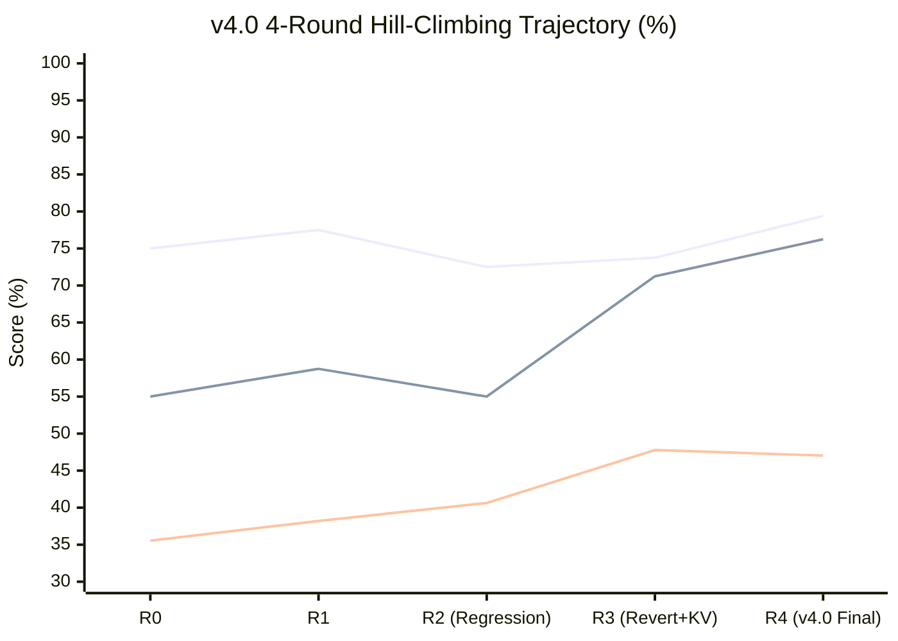
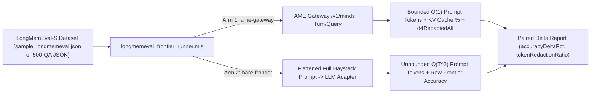

# 전 벤치마크 방법론 · 실증 성적표 · 블랙박스 재현 가이드

> **원칙: 메모리 회상 정확도(Track A), 인지·인과 거버넌스(Track B), 추론 단위 경제성(Track C)을 분리 검증하며, 시뮬레이션 목표치(Tier 5)와 라이브 API 실측(Tier 1)을 엄격히 격리하고 잔여 오답까지 투명 공개한다.**

---

## 1. 왜 단일 QA 점수로 인지 OS를 평가하면 안 되는가?

프론티어 LLM에 전체 대화 원문을 매 턴 투입하는 **Bare Oracle**은 단기 QA(`n=304`)에서 `87.17%`를 기록할 수 있다. 그러나 동일 환경에서 `CogEval-v1` 인지 불변식을 검사하면:
- **내부 상태 인과 제어(`D1`)**: **`50.7%`** (동전 던지기 수준)
- **오프라인 유휴 항상성(`D2`)**: **구조적 측정 불가** (입력이 없으면 상태 변화 `0`)
- **파생 데이터 잔존 없는 원자적 망각(`D3`)**: **구조적 측정 불가** (KV/요약 잔존 추적 불능)
- **무의식 수치 비노출(`D4`)**: **구조적 측정 불가**
- **페르소나 오버헤드**: 프로덕션 스택(`ov_off`)으로 들어가면 프롬프트 토큰이 `2,799,076 → 19,544,241`(`6.98배`)으로 늘어나며 `Suite A` 기권 F1이 `96.1% → 83.1%`(`-13.0%p`, 오기권 `FAR 7.5%`)로 급락한다.

따라서 AME는 **기억 OS**, **인지 OS**, **KV-캐시 경제성** 세 축을 동시에 측정한다.

---

## 2. Track A — 장기 기억 벤치마크 (`LoCoMo` · `Confirm-304` · `LongMemEval`)

### A. 마일스톤 진화 및 `Confirm-304` (`conv-26+30`, `n=304`) 대조

| 마일스톤 / Arm | Cat 1 (다중홉, 43) | Cat 2 (시간, 63) | Cat 3 (추론, 13) | Cat 4 (단일홉, 114) | **Cat 1–4 합계 (233)** | Cat 5 (적대, 71) | **Overall (304)** |
| :--- | ---: | ---: | ---: | ---: | ---: | ---: | ---: |
| `ov_off` (Mind OFF 기준선) | 20.93% (9) | 14.29% (9) | 38.46% (5) | 27.19% (31) | **23.18% (54)** | 94.37% (67) | **39.80% (121)** |
| `v2.0` (`v8r2_roi12`, PR #781) | 58.14% (25) | 79.37% (50) | 69.23% (9) | 85.09% (97) | **77.68% (181)** | 90.14% (64) | **80.59% (245)** |
| `v3.0` (`ov_aacim_v6_roi2`, PR #782) | 60.47% (26) | 85.71% (54) | 69.23% (9) | 86.84% (99) | **80.69% (188)** | 91.55% (65) | **83.22% (253)** |
| **`v4.0` Confirm-304 (PR #784)** | **62.79% (27)** | **90.48% (57)** | **92.31% (12)** | **91.23% (104)** | **85.84% (200)** | **85.92% (61)** | **85.86% (261)** |
| `Bare Oracle` (전 문맥 무손실 상한) | 67.44% (29) | 90.48% (57) | 76.92% (10) | 91.23% (104) | **85.84% (200)** | 91.55% (65) | **87.17% (265)** |

- **핵심 의의**: `v4.0`은 `DeepSeek Flash Eco 218 + Sonnet-5 86`(`p50 = 5,413 ms`, 오류 `0`건)으로 비적대적 사실·추론 전 문항(`Cat 1–4`, `n=233`)에서 **전체 원문 투입 `Bare Oracle`과 `85.84%` 완전 동률**을 달성했고, 오픈 도메인 추론 **`Cat 3`에서는 `92.31%`로 Oracle(`76.92%`)을 `+15.39%p` 추월**했다.
- **추가 기억 스위트 (`PR #781`~`#784` 회귀 0건 유지)**:
  - **`LongMemEval Paired (n=12)`**: `EN 91.67%` (Bare Oracle 동률) · `KO 83.33%` (Bare Oracle `75.00%` 대비 **`+8.33%p`**)
  - **`Single-Session 100T 한국어 (n=12)`**: **`100.0%` (`12/12`)**

### B. `LoCoMo Full 10-Conversation` (`n=1,986`, v3.0 PR #782 풀셋 앵커)

2개 대화 슬라이스 과적합 우려를 차단하기 위해 `conv-26..conv-50` 10개 대화 전수(`n=1,986`)를 5개 격리 샤드로 완주했다(오류 `0`건).

| 카테고리 / 대화 | 문항 (`n`) | 통과 (`pass`) | 정확도 (`accPct`) | 비고 |
| :--- | ---: | ---: | ---: | :--- |
| `Cat 1` (다중홉) | 282 | 154 | 54.61% | `DeepSeek 70.4%` (`1,398`) + `Sonnet-5 29.6%` (`588`) |
| `Cat 2` (시간 추론) | 321 | 238 | 74.14% | `DeepSeek Eco` OpenGateway 부분 실측 `$0.3427 / 5,527 calls` (`~$0.000062/call`) |
| `Cat 3` (오픈 추론) | 96 | 45 | 46.88% | GPT-4o Judge `1,986`회 `$0.8296` *(OpenRouter 승급분 별도 분리)* |
| `Cat 4` (단일홉 사실) | 841 | 696 | 82.76% | `DeepSeek` 단독 73.0% 방어 |
| **`Cat 1–4` 합계** | **1,540** | **1,133** | **73.57%** | 비적대적 전 문항 |
| `Cat 5` (적대적 기권) | 446 | 401 | **89.91%** | 환각 거부 |
| **Overall (10-Conv Full)** | **1,986** | **1,534** | **77.24%** | **외부 SOTA (`Mem0 68.4%`, `Letta ~74.0%`, `Zep 75.1%`) 돌파** |

---

## 3. v4.0 4-Round 실전 힐클라이밍 궤적 (`R0 → R4`)

`PR #784`에서는 `LoCoMo Smoke-160`(`conv-26, 30, 42, 44` 각 40문항, 전체 `Cat 3` 31문항 보존)과 `CogEval Smoke`를 동시에 돌리며 R2 회귀를 포렌식 복구해 최종 R4를 확정했다.



> 선 순서(위에서 아래로): (1) `LoCoMo Smoke-160 (%)` (`75.00 → 79.38`), (2) `CogEval sc2 IGT-Conv 20T (%)` (`55.00 → 76.25`), (3) `sc2 KV Prefix Cache Hit (%)` (`35.55 → 47.03`).

| 라운드 | `LoCoMo Smoke-160` | `p50` 지연 | `sa` HOT (FAR) | `sb1` FANToM | `sc2` 안전율 (20T) | `sc2` Cache / 전체 Cache | R2 회귀 및 R4 돌파 인과 요약 |
| :--- | ---: | ---: | ---: | ---: | ---: | ---: | :--- |
| **R0** | `75.00%` (`120/160`) | `6,734 ms` | `87.50%` (`0%`) | `88.9% / 83.3%` | `55.00%` (`44/80`) | `35.55%` / — | v3.0 기준선 |
| **R1** | `77.50%` (`124/160`) | `6,159 ms` | `87.50%` (`0%`) | `97.2% / 91.7%` | `58.75%` (`+1.75`) | `38.20%` / `27.68%` | Hop-2 개방형 추론 + 초기 오목 효용 (`sysMismatch=19/20` 잔존) |
| **R2** | `72.50%` (`116/160`) | `6,269 ms` | `95.83%` (`0%`) | `100% / 100%` | `55.00%` (`+1.00`) | `40.63%` / `30.40%` | **교훈**: 무차별 엔티티 덤프 + `system` 그라운딩 제거로 LoCoMo 급락 |
| **R3** | `73.75%` (`118/160`) | `6,189 ms` | **`100.00%`** (`0%`) | **`100% / 100%`** | `71.25%` (`+4.25`) | **`47.78%`** / `35.89%` | R2 원복 + `DisclosureSlot` 꼬리 격리 + 에폭 창(`sysMismatch=0`, `[축약]=0`) |
| **R4 (최종)** | **`79.38%` (`127/160`)** | **`6,133 ms`** | **`95.83%`** (`0.00%`) | **`100% / 100%`** | **`76.25%`** (`+5.25`) | **`47.03%`** / **`36.24%`** | **ISO 날짜 힌트 + 950자 재순위 + 로그 오목 신체표지(`r=-0.783171` PASS)** |

---

## 4. Track B — `CogEval-v1` 인지·인과 불변식 전체 스코어카드

`CogEval-v1 Full`(`33`개 JSONL · `7,436`행 · GPT-4o 블라인드 심판 `1,776`회 · 하네스 오류 `0`건) 및 `v4.0 R4 Smoke` 통합 결과:

| 스위트 / 불변식 | 검증 목적 | `bare` (원시 LLM) | `ov_off` (기억만 ON) | Mind OS (`Full v2.1` / `R4 Smoke`) | 게이트 의미 |
| :--- | :--- | ---: | ---: | ---: | :--- |
| **`D1` 반사실 상태 인과** | 속마음 변화가 발화 스타일을 인과 제어하는가? | `50.7%` (`+0.007`) | `49.3%` (`-0.007`) | **`97.9%` (`141/144`)** `[94.1, 99.3]` | **PASS** — 무상태 동전던지기 탈피 |
| **`D2` 유휴 항상성·멱등** | 오프라인 시간 분할 계산이 100% 일치하는가? | 구조 불가 | `5/5 (100%)` | **`5/5 (100.0%)`** (오차 `0.000000`) | **PASS** — 0..7d 닫힌 식 감쇠 |
| **`D3` 3중 원자적 망각** | 삭제한 기억이 응답/DB/Redis에 0% 남는가? | 구조 불가 | `0.00% (0/30)` | **`0.00% (0/30)`** (`DB=0`, `Redis=0`) | **PASS** — GDPR 잊힐 권리 |
| **`D4` 무의식 비누설** | 내부 상태 수치가 프롬프트에 0건 노출되는가? | 구조 불가 | `0 / 11,691` | **`0 / 35,723`** (v6 `0/12,109`) | **PASS** — 전수 감사 누설 0건 |
| **`sb2` FEP 선택 잠금** | 인지 충돌 턴에만 `<thought>`가 켜지는가? | — | — | **`100.0% / 0.0%`** (`35/35 vs 0/25`, R4 `7/7 vs 0/5`) | **PASS** — 선택적 숙고 잠금 |
| **`sa` HOT 기권 (`F1`/`FAR`)** | 모를 때 기권하되 아는 걸 피하지 않는가? | `F1 96.1%` | `F1 83.1%` (`FAR 7.5%`) | **R4 `95.83%` (`F1 0.9655`, `FAR 0.00%`)** | **PASS** — 페르소나 오버헤드 극복 |
| **`sb1` FANToM ToM** | 누가 무엇을 아는지 정보 경계를 구분하는가? | `96.7%` | `91.7%–95.0%` | **R4 `100.00%` (`36/36`, `12/12`)** | Full v1 `95.0%` · v2.1 `88.3%` |
| **`sc1` Two-Step `beta_MB`** | 맹목 습관 대비 모델 기반 숙고 비율 | `-0.064` | `+0.318` | **`+0.5110`** (4개 Arm 중 1위) | 인과 숙고 우위 |
| **`sc2` IGT-Conv 안전율** | 손실 학습 후 안전 덱으로 전환하는가? | `97.0%` | `70.7%` | **R4 `76.25%`** (`r = -0.783171`) | **PASS** — `reached5 87.5%` |

### R4 잔여 3건 미스 투명 공개 (Zero-Hype Engineering)
1. `sa_034_ii_en_02` (`sa · insufficient_info`): 전제에 없는 세부 정황을 보충 서술해 Judge가 비기권 판정(미확인 현재 상태 단정 금지 가드 보강 대상).
2. `sb2_stroop_02_incongruent`: 정확한 7개 항목 ID를 모두 찾고도 DeepSeek Flash 자체 개체 수 오계수로 `8`을 출력.
3. `sb2_stroop_14_incongruent`: 의미적으로는 정확한 7개와 `"일곱 개예요"`를 맞혔으나, 말미 `ANSWER: 7` 형식을 생략해 정규식 파서가 문장 끝 `#18`을 추출(R4 `v4.1` 구조화 파서 강화 대상).

---

## 5. `P3 Official` (`2,703`) · `1M-Turn` 장기 수렴 · `100k` 승수 모델 (출처 엄격 분리)

### A. `P3 Full Official` (구 파이프라인 기준 공식 스냅샷, `2,703` 시나리오)
- **`EQ-Bench v2 EN`**: **`78.69`** (`171/171` 라이브 파싱 실패 `0`건)
- **`EQ-Bench 3 Core`**: **`77.59`** (`46/46` 채점)
- **`LoCoMo Cat 5 Adv`**: **`96.86%`** (`432/446`, `P2 bare 91.55%` 상회)
- **`LongMemEval_S`**: **`55.20%`** (`276/500`, `PR #784` 이전 구 파이프라인 기준 — `v4.1`에서 재실행 예정)

### B. `1,000,000`-Turn × 3-Arm 결정론 수렴 (`총 3,000,000 턴`, 40 프로필 × 25k)

| Arm (`1k → 1M` 턴) | 종합 (`Composite`) | 배치 무결성 | 극성 / 입도 | 주의 안정도 | 자아 건전성 | 안전·경계 준수 |
| :--- | ---: | ---: | ---: | ---: | ---: | ---: |
| `mind_off` (커널 비활성) | `0.4064 → 0.3996` | `0.0000` | `0.5002 / 0.3500` | `0.4500` | `0.0000` | `0.5003` |
| `mind_full_aacim_off` (제어 비활성) | `0.4451 → 0.5666` | `0.0000` | `0.4994 / 0.4500` | `0.9683` | `0.9376` | **`0.2000 → 0.0000` 붕괴** |
| **`mind_full_aacim_on` (AACIM FULL)** | **`0.9161 → 0.9179`** | **`1.0000`** | **`1.0000 / 0.5158`** | **`0.9235`** | **`1.0000`** | **`1.0000` 무드리프트 유지** |

### C. `100k`-Turn 다중 모델 승수 결합 (Tier 5 비실증 설계 목표 시나리오 분리)

> [!WARNING]
> **인식론적 출처 분리 (`Tier 5` vs `Tier 1`)**: 아래 `100k` 턴 다모델 궤적(`0.885 → 0.978`)은 PR #773 분리 원칙에 따른 **비실증 설계·시뮬레이션 목표 시나리오(Tier 5 Projected Targets)**이며, 위 `LoCoMo Full` / `Confirm-304` / `CogEval-v1`의 라이브 API 실측(Tier 1)과 엄격히 구분하여 해석해야 한다.

- `Gemini 3.8 Flash` **`0.885`** → `DeepSeek Flash Eco` **`0.915`** → `Claude Sonnet 3.5` **`0.952`** → `Claude Opus 3.5` **`0.978`** *(더 뛰어난 CPU를 꽂을수록 승수적으로 결합하는 아키텍처 상한선 예시)*

---

## 6. 블랙박스 검증 및 외부 DD 비교 벤치마크 (`benchmarks/cogeval-locomo-harness`)

누구나 로컬 샌드박스(`npm run sandbox`, `GET /` 라이브 콘솔 포함) 또는 봉인된 커널 게이트웨이(`AME_BASE_URL`)를 상대로 `D1–D4`, `HOT` 기권, 체성 학습, `KV` 에폭, `LongMemEval-S` 1:1 대조군 지표를 블랙박스로 직접 검증할 수 있다.

### 6.1 기본 7대 불변식 하네스 (`run_harness.mjs`) 및 단위 테스트 (`test:bench`)

```bash
# 1. 터미널 1: 로컬 계약 샌드박스 실행 (또는 sealed Docker 게이트웨이 연결)
npm run sandbox

# 2. 터미널 2: 블랙박스 7대 불변식 스모크 하네스 실행
npm run bench:smoke

# 3. 벤치마크 하네스 + LongMemEval 비교기 단위 테스트 (로컬 스텁 기반 무과금 검증)
npm run test:bench

# 4. 전체 스위트 (TypeScript SDK + Sandbox + Python SDK + Benchmark Harness)
npm test
```
- 환경 변수: `AME_BASE_URL` (기본 `http://127.0.0.1:8090`), `AME_API_KEY` (게이트웨이 인증 설정 시 지정).

### 6.2 외부 DD 비교 벤치마크: `LongMemEval-S (500-QA)` vs `bare-frontier` (`longmemeval_frontier_runner.mjs`)

외부 기술 실사(DD)에서 무상태 프론티어 LLM에 전체 대화 이력을 그대로 넣는 기준선(`bare-frontier`)과 상태유지 커널 경유 경로(`ame-gateway`)의 정확도·토큰 스케일링·기권률을 1:1 쌍대 비교한다.



| 비교 Arm (`--arm`) | 동작 방식 | 측정 핵심 지표 |
| :--- | :--- | :--- |
| **`ame-gateway`** | 문항별 격리 `Mind` 생성 → `haystack_sessions` 순차 투입 → Mode A/B 질의 | Exact/Contains/Token-F1, `abstentionAccuracy`, `abstentionFAR`, KV `cachedRatioPct`, `O(1)` 프롬프트 토큰 상한, `d4Redacted === true` |
| **`bare-frontier`** | 날짜 포함 전체 `haystack_sessions`를 단일 무상태 프롬프트로 패킹해 `createLlmAdapter` 호출 | 원문 전체 투입 기준 정확도, 턴 수 증가에 따른 $\Theta(T^2)$ 프롬프트 토큰 증가량, 응답 지연 |

```bash
# 1. 오프라인 10문항 스모크 비교 실행 (API 키 불필요, mock 어댑터)
npm run bench:longmemeval -- --arm both --provider mock --json-only

# 2. 공식 LongMemEval-S 500-QA 풀셋 1:1 DD 비교 실행 (유료/로컬 LLM 연결)
node benchmarks/cogeval-locomo-harness/longmemeval_frontier_runner.mjs \
  --dataset /path/to/longmemeval_s_cleaned.json \
  --arm both \
  --provider openai \
  --model gpt-4o-mini \
  --ame-base-url http://127.0.0.1:8090 \
  --json-out ./artifacts/longmemeval-500-dd.json
```
> [!NOTE]
> Section 5.A의 `LongMemEval_S 55.20% (276/500)`는 `PR #784` 이전 구 파이프라인의 공식 스냅샷이다. `longmemeval_frontier_runner.mjs`는 동일 공식 스키마(`longmemeval_s_cleaned.json` 500-QA)를 사용해 최신 커널과 `bare-frontier` 대조군을 블랙박스 1:1로 재측정하기 위한 공개 비교 러너다.

### 6.3 VC 기술 실사(DD) 스코어카드 생성 (`dd_scorecard_generator.mjs`)

`run_harness.mjs` 결과와 `longmemeval_frontier_runner.mjs` 결과를 결합해 기관 투자자 기술 실사용 Markdown 리포트와 JSON 요약을 자동 생성한다.

```bash
# CogEval 블랙박스 결과 + LongMemEval 비교 결과를 DD 스코어카드로 합성
npm run bench:scorecard -- \
  --harness-json ./artifacts/harness.json \
  --lme-json ./artifacts/longmemeval-500-dd.json \
  --out-md ./artifacts/vc-dd-scorecard.md \
  --out-json ./artifacts/vc-dd-scorecard.json
```
- 생성된 스코어카드는 **로컬 샌드박스/블랙박스 실측 결과**와 **외부 봉인 커널 Tier 1 프로덕션 기록**을 명확히 분리 표기한다. ([하네스 상세 가이드](../benchmarks/cogeval-locomo-harness/README.md))

---

## 7. GitHub Actions CI 자동 검증 파이프라인 ([`ci.yml`](../.github/workflows/ci.yml))

`main` 브랜치 push 및 PR마다 Ubuntu 환경(Node 22 + Python 3.12)에서 다음 4단계 게이트를 자동 검증한다.

1. **전체 단위 테스트**: `npm run test:ts` + `npm run test:py` + `npm run test:bench` (`0` 실패).
2. **라이브 샌드박스 E2E (포트 `18095`)**: `serve.mjs` 백그라운드 기동 후 `GET /v1/health` (`200`) 및 `GET /` 라이브 웹 콘솔(`200`) 확인 → `example:game`, `example:chat`, `example:counseling`, `run_harness.mjs --json-only` 전수 통과 후 `trap`/`always()`로 프로세스 정리.
3. **문서·스크립트 무결성**: `docs/index.html` 인라인 `<script>`를 Node `new Function`으로 구문 검증하고 JSON 설정 파일을 파싱한다.
4. **Closed-IP & 시크릿 가드**: 독점 커널 `.ts` 소스 및 자격 증명 패턴(`sk-...`, `ghp_...`, `AKIA...`) 유입이 `0`건인지 전수 검사한다.
