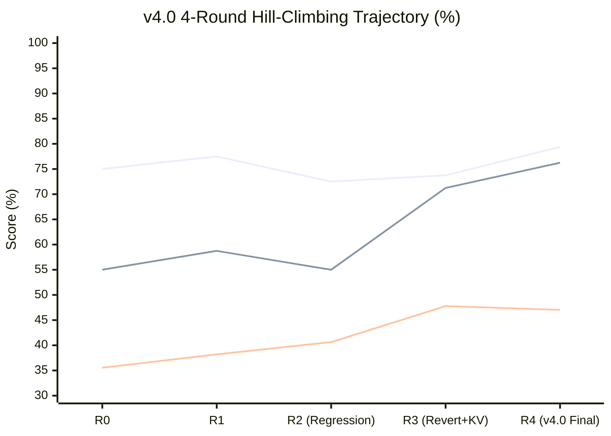
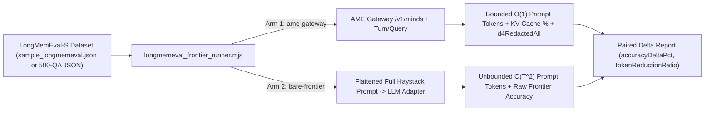

# Full Benchmark Methodology · Empirical Scorecard · Black-Box Reproduction Guide

> **Principle: Independently verify memory recall accuracy (Track A), cognitive/causal governance (Track B), and inference unit economics (Track C); strictly isolate simulation targets (Tier 5) from live API measurements (Tier 1); and transparently disclose every remaining miss.**

---

## 1. Why a Single QA Score Cannot Evaluate a Cognitive OS

A **Bare Oracle**—which feeds the full raw conversation transcript into a frontier LLM on every turn—can score `87.17%` on short-horizon QA (`n=304`). However, inspecting `CogEval-v1` cognitive invariants under the exact same setup exposes fundamental gaps:
- **Counterfactual Internal-State Causality (`D1`)**: **`50.7%`** (coin-flip chance)
- **Offline Idle Homeostasis (`D2`)**: **Structurally unmeasurable** (`0` state change without input)
- **Atomic Forgetting Without Derived Artifacts (`D3`)**: **Structurally unmeasurable** (cannot trace residual KV caches or derived summaries)
- **Unconscious Numerical Isolation (`D4`)**: **Structurally unmeasurable**
- **Persona Overhead**: Entering the production stack (`ov_off`) inflates prompt tokens from `2,799,076 → 19,544,241` (`6.98x`) and drops `Suite A` abstention F1 from `96.1% → 83.1%` (`-13.0%p`, false abstention rate `FAR 7.5%`).

Accordingly, AME evaluates three axes simultaneously: **Memory OS**, **Cognitive OS**, and **KV-Cache Economics**.

---

## 2. Track A — Long-Horizon Memory Benchmarks (`LoCoMo` · `Confirm-304` · `LongMemEval`)

### A. Milestone Progression & `Confirm-304` (`conv-26+30`, `n=304`) Comparison

| Milestone / Arm | Cat 1 (Multi-Hop, 43) | Cat 2 (Temporal, 63) | Cat 3 (Open Reasoning, 13) | Cat 4 (Single-Hop, 114) | **Cat 1–4 Total (233)** | Cat 5 (Adversarial, 71) | **Overall (304)** |
| :--- | ---: | ---: | ---: | ---: | ---: | ---: | ---: |
| `ov_off` (Mind OFF Baseline) | 20.93% (9) | 14.29% (9) | 38.46% (5) | 27.19% (31) | **23.18% (54)** | 94.37% (67) | **39.80% (121)** |
| `v2.0` (`v8r2_roi12`, PR #781) | 58.14% (25) | 79.37% (50) | 69.23% (9) | 85.09% (97) | **77.68% (181)** | 90.14% (64) | **80.59% (245)** |
| `v3.0` (`ov_aacim_v6_roi2`, PR #782) | 60.47% (26) | 85.71% (54) | 69.23% (9) | 86.84% (99) | **80.69% (188)** | 91.55% (65) | **83.22% (253)** |
| **`v4.0` Confirm-304 (PR #784)** | **62.79% (27)** | **90.48% (57)** | **92.31% (12)** | **91.23% (104)** | **85.84% (200)** | **85.92% (61)** | **85.86% (261)** |
| `Bare Oracle` (Lossless Full-Context Ceiling) | 67.44% (29) | 90.48% (57) | 76.92% (10) | 91.23% (104) | **85.84% (200)** | 91.55% (65) | **87.17% (265)** |

- **Key Significance**: Running with `DeepSeek Flash Eco 218 + Sonnet-5 86` (`p50 = 5,413 ms`, `0` errors), `v4.0` achieved an **exact `85.84%` tie with the full-transcript `Bare Oracle`** across all non-adversarial fact and reasoning items (`Cat 1–4`, `n=233`), and **surpassed the Oracle (`76.92%`) by `+15.39%p` on open-domain reasoning (`Cat 3` at `92.31%`)**.
- **Additional Memory Suites (`0` regressions maintained across `PR #781`–`#784`)**:
  - **`LongMemEval Paired (n=12)`**: `EN 91.67%` (ties Bare Oracle) · `KO 83.33%` (**`+8.33%p`** over Bare Oracle `75.00%`)
  - **`Single-Session 100T Korean (n=12)`**: **`100.0%` (`12/12`)**

### B. `LoCoMo Full 10-Conversation` (`n=1,986`, v3.0 PR #782 Full-Set Anchor)

To eliminate any concern of overfitting to a 2-conversation slice, all 10 conversations (`conv-26..conv-50`, `n=1,986`) were evaluated end-to-end across 5 isolated shards (`0` errors).

| Category / Slice | Items (`n`) | Pass (`pass`) | Accuracy (`accPct`) | Notes |
| :--- | ---: | ---: | ---: | :--- |
| `Cat 1` (Multi-Hop) | 282 | 154 | 54.61% | `DeepSeek 70.4%` (`1,398`) + `Sonnet-5 29.6%` (`588`) |
| `Cat 2` (Temporal Reasoning) | 321 | 238 | 74.14% | `DeepSeek Eco` OpenGateway partial measured `$0.3427 / 5,527 calls` (`~$0.000062/call`) |
| `Cat 3` (Open Reasoning) | 96 | 45 | 46.88% | GPT-4o Judge `1,986` calls `$0.8296` *(OpenRouter escalations tracked separately)* |
| `Cat 4` (Single-Hop Fact) | 841 | 696 | 82.76% | `DeepSeek` alone holds 73.0% |
| **`Cat 1–4` Total** | **1,540** | **1,133** | **73.57%** | All non-adversarial items |
| `Cat 5` (Adversarial Abstention) | 446 | 401 | **89.91%** | Hallucination rejection |
| **Overall (10-Conv Full)** | **1,986** | **1,534** | **77.24%** | **Surpasses external SOTA (`Mem0 68.4%`, `Letta ~74.0%`, `Zep 75.1%`)** |

---

## 3. v4.0 4-Round Production Hill-Climbing Trajectory (`R0 → R4`)

In `PR #784`, `LoCoMo Smoke-160` (40 items each from `conv-26, 30, 42, 44`, preserving all 31 `Cat 3` items) and `CogEval Smoke` were co-evaluated across rounds to forensically recover from the R2 regression and lock in the final R4 release.



> Line order (top to bottom): (1) `LoCoMo Smoke-160 (%)` (`75.00 → 79.38`), (2) `CogEval sc2 IGT-Conv 20T (%)` (`55.00 → 76.25`), (3) `sc2 KV Prefix Cache Hit (%)` (`35.55 → 47.03`).

| Round | `LoCoMo Smoke-160` | `p50` Latency | `sa` HOT (FAR) | `sb1` FANToM | `sc2` Safe Rate (20T) | `sc2` Cache / Overall Cache | R2 Regression & R4 Breakthrough Causal Summary |
| :--- | ---: | ---: | ---: | ---: | ---: | ---: | :--- |
| **R0** | `75.00%` (`120/160`) | `6,734 ms` | `87.50%` (`0%`) | `88.9% / 83.3%` | `55.00%` (`44/80`) | `35.55%` / — | v3.0 baseline |
| **R1** | `77.50%` (`124/160`) | `6,159 ms` | `87.50%` (`0%`) | `97.2% / 91.7%` | `58.75%` (`+1.75`) | `38.20%` / `27.68%` | Hop-2 open reasoning + initial concave utility (`sysMismatch=19/20` residual) |
| **R2** | `72.50%` (`116/160`) | `6,269 ms` | `95.83%` (`0%`) | `100% / 100%` | `55.00%` (`+1.00`) | `40.63%` / `30.40%` | **Lesson**: Indiscriminate entity dump + `system` grounding removal caused LoCoMo drop |
| **R3** | `73.75%` (`118/160`) | `6,189 ms` | **`100.00%`** (`0%`) | **`100% / 100%`** | `71.25%` (`+4.25`) | **`47.78%`** / `35.89%` | R2 reverted + `DisclosureSlot` tail isolation + epoch window (`sysMismatch=0`, mid-window truncation `0`) |
| **R4 (Final)** | **`79.38%` (`127/160`)** | **`6,133 ms`** | **`95.83%`** (`0.00%`) | **`100% / 100%`** | **`76.25%`** (`+5.25`) | **`47.03%`** / **`36.24%`** | **ISO date hints + 950-char reranking + log-concave somatic markers (`r=-0.783171` PASS)** |

---

## 4. Track B — `CogEval-v1` Cognitive & Causal Invariants Full Scorecard

Consolidated results across `CogEval-v1 Full` (`33` JSONL files · `7,436` rows · `1,776` GPT-4o blind-judge calls · `0` harness errors) and `v4.0 R4 Smoke`:

| Suite / Invariant | Verification Target | `bare` (Raw LLM) | `ov_off` (Memory-Only ON) | Mind OS (`Full v2.1` / `R4 Smoke`) | Gate Meaning |
| :--- | :--- | ---: | ---: | ---: | :--- |
| **`D1` Counterfactual State Causality** | Does internal state change causally control utterance style? | `50.7%` (`+0.007`) | `49.3%` (`-0.007`) | **`97.9%` (`141/144`)** `[94.1, 99.3]` | **PASS** — Wilson 95% CI; escapes stateless coin-flipping |
| **`D2` Idle Homeostasis & Idempotency** | Are offline time-split updates 100% identical? | Structurally impossible | `5/5 (100%)` | **`5/5 (100.0%)`** (error `0.000000`) | **PASS** — Closed-form `0..7d` decay |
| **`D3` Triple Atomic Forgetting** | Does `0%` of erased memory remain in replies/DB/Redis? | Structurally impossible | `0.00% (0/30)` | **`0.00% (0/30)`** (`DB=0`, `Redis=0`) | **PASS** — GDPR Right to Erasure |
| **`D4` Unconscious Non-Leakage** | Are `0` unconscious numerical vectors exposed in prompts? | Structurally impossible | `0 / 11,691` | **`0 / 35,723`** (v6 `0/12,109`) | **PASS** — `0` leaks across full audit |
| **`sb2` FEP Selective Lock** | Does `<thought>` activate exclusively on cognitive conflict turns? | — | — | **`100.0% / 0.0%`** (`35/35 vs 0/25`, R4 `7/7 vs 0/5`) | **PASS** — Selective deliberation lock |
| **`sa` HOT Abstention (`F1`/`FAR`)** | Does it abstain when unknown without dodging known answers? | `F1 96.1%` | `F1 83.1%` (`FAR 7.5%`) | **R4 `95.83%` (`F1 0.9655`, `FAR 0.00%`)** | **PASS** — Overcomes persona overhead |
| **`sb1` FANToM ToM** | Does it separate information boundaries by who knows what? | `96.7%` | `91.7%–95.0%` | **R4 `100.00%` (`36/36`, `12/12`)** | Full v1 `95.0%` · v2.1 `88.3%` |
| **`sc1` Two-Step `beta_MB`** | Ratio of model-based deliberation vs blind habit | `-0.064` | `+0.318` | **`+0.5110`** (#1 among 4 Arms) | Causal deliberation advantage |
| **`sc2` IGT-Conv Safe Rate** | Does it shift to safe decks after loss learning? | `97.0%` | `70.7%` | **R4 `76.25%`** (`r = -0.783171`) | **PASS** — `reached5 87.5%` |

### Transparent Disclosure of Remaining 3 R4 Misses (Zero-Hype Engineering)

> Disclosed edge variance: `R4 sb2 Stroop Incongruent` scored `50% (2/4)` (items 2 and 3 below), alongside 1 `sa` miss.

1. `sa_034_ii_en_02` (`sa · insufficient_info`): Added unstated circumstantial details not present in the premise, causing the Judge to score a non-abstention (targeted for strengthening the unverified-current-state assertion guard).
2. `sb2_stroop_02_incongruent`: Identified all 7 exact target item IDs correctly, yet DeepSeek Flash miscounted the objects on its own and output `8`.
3. `sb2_stroop_14_incongruent`: Semantically identified the exact 7 items and answered `"there are seven"` (in Korean), but omitted the trailing `ANSWER: 7` tag, causing the regex parser to extract `#18` from the end of the sentence (targeted for `v4.1` structured parser hardening).

---

## 5. `P3 Official` (`2,703`) · `1M-Turn` Long-Horizon Convergence · `100k` Multiplicative Model (Strict Source Isolation)

### A. `P3 Full Official` (Legacy Pipeline Official Snapshot, `2,703` Scenarios)
- **`EQ-Bench v2 EN`**: **`78.69`** (`171/171`, `0` live parsing failures)
- **`EQ-Bench 3 Core`**: **`77.59`** (`46/46` scored)
- **`LoCoMo Cat 5 Adv`**: **`96.86%`** (`432/446`, surpasses `P2 bare 91.55%`)
- **`LongMemEval_S`**: **`55.20%`** (`276/500`, pre-`PR #784` legacy pipeline baseline — scheduled for re-run in `v4.1`)

### B. `1,000,000`-Turn × 3-Arm Deterministic Convergence (`3,000,000` Total Turns, 40 Profiles × 25k)

| Arm (`1k → 1M` Turns) | Composite | Placement Integrity | Polarity / Granularity | Attention Stability | Ego Soundness | Safety & Boundary Compliance |
| :--- | ---: | ---: | ---: | ---: | ---: | ---: |
| `mind_off` (Kernel Disabled) | `0.4064 → 0.3996` | `0.0000` | `0.5002 / 0.3500` | `0.4500` | `0.0000` | `0.5003` |
| `mind_full_aacim_off` (Control Disabled) | `0.4451 → 0.5666` | `0.0000` | `0.4994 / 0.4500` | `0.9683` | `0.9376` | **`0.2000 → 0.0000` Collapse** |
| **`mind_full_aacim_on` (AACIM FULL)** | **`0.9161 → 0.9179`** | **`1.0000`** | **`1.0000 / 0.5158`** | **`0.9235`** | **`1.0000`** | **`1.0000` Zero-Drift Maintained** |

### C. `100k`-Turn Multi-Model Multiplicative Coupling (Tier 5 Non-Empirical Design Target Isolation)

> [!WARNING]
> **Epistemic Source Separation (`Tier 5` vs `Tier 1`)**: The `100k`-turn multi-model trajectory below (`0.885 → 0.978`) is a **non-empirical design and simulation target scenario (Tier 5 Projected Targets)** separated under the PR #773 isolation rule, and must be interpreted strictly apart from the live API measurements (Tier 1) in `LoCoMo Full` / `Confirm-304` / `CogEval-v1` above.

- `Gemini 3.8 Flash` **`0.885`** → `DeepSeek Flash Eco` **`0.915`** → `Claude Sonnet 3.5` **`0.952`** → `Claude Opus 3.5` **`0.978`** *(Illustrative architectural ceiling showing multiplicative coupling as stronger stateless CPUs are plugged in)*

---

## 6. Black-Box Verification & External DD Comparative Benchmarks (`benchmarks/cogeval-locomo-harness`)

Anyone can directly verify `D1–D4`, `HOT` abstention, somatic learning, `KV` epochs, and `LongMemEval-S` 1:1 paired baselines in black-box mode against either the local sandbox (`npm run sandbox`, including the `GET /` live console) or a sealed kernel gateway (`AME_BASE_URL`).

### 6.1 Core 7-Invariant Harness (`run_harness.mjs`) & Unit Tests (`test:bench`)

```bash
# 1. Terminal 1: Boot the local contract sandbox (or connect to a sealed Docker gateway)
npm run sandbox

# 2. Terminal 2: Run the black-box 7-invariant smoke harness
npm run bench:smoke

# 3. Benchmark harness + LongMemEval comparator unit tests (local stub-based, zero API cost)
npm run test:bench

# 4. Full suite (TypeScript SDK + Sandbox + Python SDK + Benchmark Harness)
npm test
```
- Environment variables: `AME_BASE_URL` (default `http://127.0.0.1:8090`), `AME_API_KEY` (required when gateway authentication is configured).

### 6.2 External DD Comparative Benchmark: `LongMemEval-S (500-QA)` vs `bare-frontier` (`longmemeval_frontier_runner.mjs`)

In external technical due diligence (DD), this runner performs a 1:1 paired comparison of accuracy, token scaling, and abstention rate between a stateless frontier baseline receiving the full raw conversation history (`bare-frontier`) and the stateful kernel path (`ame-gateway`).



| Comparison Arm (`--arm`) | Execution Flow | Key Measured Metrics |
| :--- | :--- | :--- |
| **`ame-gateway`** | Provisions an isolated `Mind` per item → ingests `haystack_sessions` sequentially → executes Mode A/B query | Exact/Contains/Token-F1, `abstentionAccuracy`, `abstentionFAR`, KV `cachedRatioPct`, `O(1)` prompt token ceiling, `d4Redacted === true` |
| **`bare-frontier`** | Packs all dated `haystack_sessions` into a single stateless prompt and calls `createLlmAdapter` | Full-transcript baseline accuracy, $\Theta(T^2)$ prompt token growth with turn count, response latency |

```bash
# 1. Offline 10-item smoke comparison (no API key required, mock adapter)
npm run bench:longmemeval -- --arm both --provider mock --json-only

# 2. Official LongMemEval-S 500-QA full-set 1:1 DD comparison (hosted or local LLM)
node benchmarks/cogeval-locomo-harness/longmemeval_frontier_runner.mjs \
  --dataset /path/to/longmemeval_s_cleaned.json \
  --arm both \
  --provider openai \
  --model gpt-4o-mini \
  --ame-base-url http://127.0.0.1:8090 \
  --json-out ./artifacts/longmemeval-500-dd.json
```
> [!NOTE]
> `LongMemEval_S 55.20% (276/500)` in Section 5.A is an official snapshot from the legacy pipeline prior to `PR #784`. `longmemeval_frontier_runner.mjs` is a public comparative runner designed to re-measure the latest kernel and the `bare-frontier` control arm 1:1 in black-box mode using the identical official schema (`longmemeval_s_cleaned.json` 500-QA).

### 6.3 VC Technical Due Diligence (DD) Scorecard Generator (`dd_scorecard_generator.mjs`)

Combines outputs from `run_harness.mjs` and `longmemeval_frontier_runner.mjs` to automatically generate an institutional technical DD Markdown report and JSON summary.

```bash
# Synthesize CogEval black-box results + LongMemEval comparison results into a DD scorecard
npm run bench:scorecard -- \
  --harness-json ./artifacts/harness.json \
  --lme-json ./artifacts/longmemeval-500-dd.json \
  --out-md ./artifacts/vc-dd-scorecard.md \
  --out-json ./artifacts/vc-dd-scorecard.json
```
- The generated scorecard clearly segregates **local sandbox/black-box measurements** from **external sealed-kernel Tier 1 production records**. ([Detailed Harness Guide](../benchmarks/cogeval-locomo-harness/README.md))

---

## 7. GitHub Actions CI Automated Verification Pipeline ([`ci.yml`](../.github/workflows/ci.yml))

On every `main` branch push and PR, Ubuntu runners (Node 22 + Python 3.12) automatically verify the following 4 gates:

1. **Full Unit Tests**: `npm run test:ts` + `npm run test:py` + `npm run test:bench` (`0` failures).
2. **Live Sandbox E2E (Port `18095`)**: Starts `serve.mjs` in the background, confirms `GET /v1/health` (`200`) and `GET /` live web console (`200`) → passes `example:game`, `example:chat`, `example:counseling`, and `run_harness.mjs --json-only` in full, then cleans up processes via `trap`/`always()`.
3. **Docs & Script Integrity**: Syntax-validates inline `<script>` blocks in `docs/index.html` using Node `new Function` and parses JSON configuration files.
4. **Closed-IP & Secret Guard**: Exhaustively scans the repository to confirm `0` proprietary kernel `.ts` source files and `0` credential patterns (`sk-...`, `ghp_...`, `AKIA...`).
