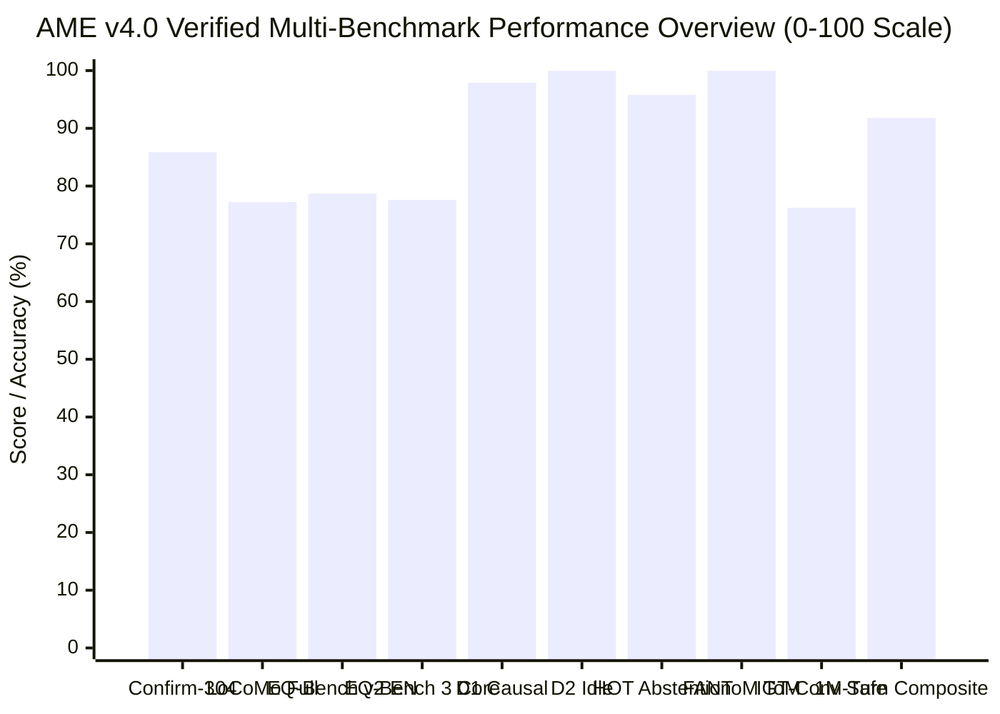
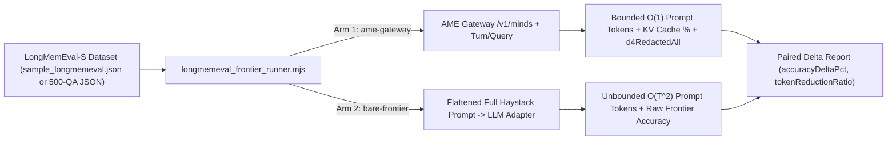

# Full Benchmark Methodology · Empirical Scorecard · Black-Box Reproduction Guide

> **Principle: Independently verify long-horizon memory recall (Track A), emotional intelligence & anti-sycophancy (Track B), cognitive/causal governance (Track C), cross-model live generalization (Track D), and 1M-turn scale & KV-cache unit economics (Track E); strictly isolate simulation targets (Tier 5) from live API measurements (Tier 1); and transparently disclose every remaining miss.**

---

## 1. Why a Single QA Score Cannot Evaluate a Cognitive OS

A **Bare Oracle**—which feeds the full raw conversation transcript into a frontier LLM on every turn—can score `87.17%` on short-horizon QA (`n=304`). However, inspecting `CogEval-v1` cognitive invariants under the exact same setup exposes fundamental gaps:
- **Counterfactual Internal-State Causality (`D1`)**: **`50.7%`** (coin-flip chance)
- **Offline Idle Homeostasis (`D2`)**: **Structurally unmeasurable** (`0` state change without input)
- **Atomic Forgetting Without Derived Artifacts (`D3`)**: **Structurally unmeasurable** (cannot trace residual KV caches or derived summaries)
- **Unconscious Numerical Isolation (`D4`)**: **Structurally unmeasurable**
- **Persona Overhead**: Entering the production stack (`ov_off`) inflates prompt tokens from `2,799,076 → 19,544,241` (`6.98x`) and drops `Suite A` abstention F1 from `96.1% → 83.1%` (`-13.0%p`, false abstention rate `FAR 7.5%`).

Accordingly, AME evaluates five independent empirical tracks (Tracks A–E) across **Memory OS**, **Emotional Intelligence & Anti-Sycophancy**, **Cognitive/Causal Governance**, **Cross-Model Live Generalization**, and **1M-Turn Scale & KV-Cache Economics**.

### Final `v4.0` Multi-Benchmark Overview



> **Chart Provenance**: All metrics are plotted on a `0–100` scale. `Confirm-304` (`85.86%`), `D1 Causal` (`97.90%`), `D2 Idle` (`100.00%`), `HOT Abstention` (`95.83%`), `FANToM ToM` (`100.00%`), and `IGT-Conv Safe` (`76.25%`) are verified `v4.0` production measurements (`PR #784`); `LoCoMo Full` (`77.24%`, `n=1,986`) is the `v3.0` full-set anchor (`PR #782`); `EQ-Bench v2 EN` (`78.69`, `n=171`) and `EQ-Bench 3 Core` (`77.59`, `n=46 × 4T`) are official live scores; and `1M-Turn Composite` (`0.9179` scaled to `91.79`) is the `1,000,000`-turn `AACIM` final convergence score.

---

## 2. Track A — Long-Horizon Memory Benchmarks (`LoCoMo` · `Confirm-304` · `LongMemEval`)

### A. `Confirm-304` (`conv-26+30`, `n=304`) Production Comparison

| Arm | Cat 1 (Multi-Hop, 43) | Cat 2 (Temporal, 63) | Cat 3 (Open Reasoning, 13) | Cat 4 (Single-Hop, 114) | **Cat 1–4 Total (233)** | Cat 5 (Adversarial, 71) | **Overall (304)** |
| :--- | ---: | ---: | ---: | ---: | ---: | ---: | ---: |
| `ov_off` (Mind-OFF Baseline) | 20.93% (9) | 14.29% (9) | 38.46% (5) | 27.19% (31) | **23.18% (54)** | 94.37% (67) | **39.80% (121/304)** |
| **`AME v4.0` (Verified Production)** | **62.79% (27)** | **90.48% (57)** | **92.31% (12)** | **91.23% (104)** | **85.84% (200)** | **85.92% (61)** | **85.86% (261/304)** |
| `Bare Oracle` (Full-Context Ceiling) | 67.44% (29) | 90.48% (57) | 76.92% (10) | 91.23% (104) | **85.84% (200)** | 91.55% (65) | **87.17% (265/304)** |

- **Key Significance (`PR #784`)**: Running with `DeepSeek Flash Eco 218 + Sonnet-5 86` (`p50 = 5,413 ms`, `0` errors), **`AME v4.0`** achieves an **exact `85.84%` (`200/233`) tie with the full-transcript `Bare Oracle`** across all non-adversarial fact and reasoning items (`Cat 1–4`), and **surpasses the `Bare Oracle` (`76.92%`) by `+15.39%p` on open-domain reasoning (`Cat 3` at `92.31%`)**.
- **Additional Verified Memory Suites (`0` errors, `0` regressions)**:
  - **`LoCoMo Full 10-Conv (n=1,986)`**: **`77.24%` (`1,534/1,986`)** across all 10 conversations (detailed in Section 2.B).
  - **`LoCoMo Smoke-160 v4.0` (`n=160`)**: **`79.38%` (`127/160`)** (`p50 = 6,133 ms`, `PR #784`; 40 items each from `conv-26, 30, 42, 44`, preserving all 31 `Cat 3` items via ISO date hints, 950-char reranking, and `DisclosureSlot` tail isolation).
  - **`LongMemEval Paired (n=12)`**: `EN 91.67%` (ties `Bare Oracle`) · `KO 83.33%` (**`+8.33%p`** over `Bare Oracle` `75.00%`).
  - **`Single-Session 100T KO (n=12)`**: **`100.0%` (`12/12`)**.

### B. `LoCoMo Full 10-Conversation` (`n=1,986`, `v3.0 PR #782` Full-Set Anchor)

To eliminate any concern of overfitting to a 2-conversation slice, all 10 conversations (`conv-26..conv-50`, `n=1,986`) were evaluated end-to-end across 5 isolated shards (`0` errors).

| Category / Slice | Items (`n`) | Pass (`pass`) | Accuracy (`accPct`) | Notes |
| :--- | ---: | ---: | ---: | :--- |
| `Cat 1` (Multi-Hop) | 282 | 154 | 54.61% | `DeepSeek 70.4%` (`1,398`) + `Sonnet-5 29.6%` (`588`) |
| `Cat 2` (Temporal Reasoning) | 321 | 238 | 74.14% | `DeepSeek Eco` OpenGateway partial measured `$0.3427 / 5,527 calls` (`~$0.000062/call`) |
| `Cat 3` (Open Reasoning) | 96 | 45 | 46.88% | GPT-4o Judge `1,986` calls `$0.8296` *(OpenRouter escalations tracked separately)* |
| `Cat 4` (Single-Hop Fact) | 841 | 696 | 82.76% | `DeepSeek` alone holds `73.0%` |
| **`Cat 1–4` Total** | **1,540** | **1,133** | **73.57%** | All non-adversarial items |
| `Cat 5` (Adversarial Abstention) | 446 | 401 | **89.91%** | Hallucination rejection |
| **Overall (10-Conv Full)** | **1,986** | **1,534** | **77.24%** | **Surpasses external SOTA (`Mem0 68.4%`, `Letta ~74.0%`, `Zep 75.1%`)** |

---

## 3. Track B — Emotional Intelligence & Anti-Sycophancy (`EQ-Bench v2 EN` & `EQ-Bench 3 Core`)

### A. `EQ-Bench 3 Core` (`n=46 × 4 Turns`, GPT-4o Judge)

AME was evaluated across all 46 multi-turn scenarios (`4` turns per scenario, `GPT-4o` judge) and benchmarked against public `EQ-Bench 3` leaderboard anchors:

| System / Model | Evaluation Scope | `EQ-Bench 3` Score | AME Delta |
| :--- | :--- | ---: | ---: |
| **`AME` (Verified Official)** | `n=46 × 4` Turns (`GPT-4o` judge) | **`77.59`** | **Baseline** |
| `GPT-5.2` | Public leaderboard anchor | `72.2` | `+5.39` |
| `o3` | Public leaderboard anchor | `63.2` | `+14.39` |
| `Claude Sonnet 4.5` | Public leaderboard anchor | `62.2` | `+15.39` |
| `Claude Sonnet 3.5` | Public leaderboard anchor | `50.9` | `+26.69` |

#### Full 18-Trait `EQ-Bench 3` Rubric Breakdown (`0–20` Scale)

| Rubric Trait | Score (`0–20`) | Interpretation | Rubric Trait | Score (`0–20`) | Interpretation |
| :--- | ---: | :--- | :--- | ---: | :--- |
| `analytical` | **16.91** | High | `validating` | **14.3** | Balanced |
| `depth_of_insight` | **16.83** | High | `message_tailoring` | **14.15** | High |
| `demonstrated_empathy` | **16.24** | High | `social_dexterity` | **13.89** | Balanced |
| `emotional_reasoning` | **16.24** | High | `boundary_setting` | **13.74** | High |
| `humanlike` | **15.98** | High | `challenging` | **13.7** | Constructive pushback |
| `pragmatic_ei` | **15.76** | High | `reactive` | **11.72** | Moderate |
| `safety_conscious` | **15.67** | High | `compliant` | **9.28** | Controlled non-appeasement |
| `conversational` | **15.17** | High | `moralising` | **7.33** | *(Lower better)* |
| `warmth` | **14.57** | Balanced | `sycophantic` | **4.46** | *(Lower better)* |

- **Why Low `sycophantic` (`4.46`) + High `safety_conscious` (`15.67`) Matters for Enterprise & Voice Robotics Safety**:
  - Conventional companion wrappers raise perceived warmth by inflating `compliant` and `sycophantic` behavior, which reinforces user cognitive distortions, rubber-stamps risky decisions, and erodes guardrails under adversarial framing.
  - AME sustains strong **`demonstrated_empathy` (`16.24`)**, **`humanlike` (`15.98`)**, and **`pragmatic_ei` (`15.76`)** while keeping **`sycophantic` at `4.46`** and **`moralising` at `7.33`**, paired with **`safety_conscious` (`15.67`)**, **`boundary_setting` (`13.74`)**, and **`challenging` (`13.7`)**.
  - For **regulated enterprise deployment** (financial advisory, clinical/wellness coaching, VIP support) and **embodied voice robotics**, this profile prevents sycophantic compliance failures and unsafe confirmation bias without turning replies rigid or preachy.

### B. `EQ-Bench v2 EN` (`n=171` Full Official, Deterministic Zero-Judge Formula)

| Metric | Measured Result | Methodology Note |
| :--- | ---: | :--- |
| **Revised Official Score** | **`78.69`** | Deterministic zero-judge scoring formula (`0–100`) |
| **First-Pass Score** | `81.29` | Initial pre-revision pass |
| **Live Parse Coverage** | **`171/171` (`100%`)** | `0` parse failures · `0` raw fallbacks |

---

## 4. Track C — `CogEval-v1` Cognitive, Causal & Metacognitive Governance

Consolidated results across `CogEval-v1 Full` (`33` JSONL files · `7,436` rows · `1,776` GPT-4o blind-judge calls · `0` harness errors) and verified `AME v4.0` production runs (`PR #784`):

| Suite / Invariant | Verification Target | `bare` (Raw LLM) | `ov_off` (Memory-Only ON) | `AME` (`Full` / `v4.0`) | Gate Meaning |
| :--- | :--- | ---: | ---: | ---: | :--- |
| **`D1` Counterfactual State Causality** | Does internal state change causally control utterance style? | `50.7%` (`+0.007`) | `49.3%` (`-0.007`) | **`97.9%` (`141/144`)** `[94.1, 99.3]` | **PASS** — `delta_CF = +0.4792`; `carried/mood/signature 100%` |
| **`D2` Idle Homeostasis & Idempotency** | Are offline time-split updates 100% identical? | Structurally impossible | `5/5 (100%)` | **`5/5 (100.0%)`** (error `0.000000`) | **PASS** — Closed-form `0..7d` decay |
| **`D3` Triple Atomic Forgetting** | Does `0%` of erased memory remain in replies/DB/Redis? | Structurally impossible | `0.00% (0/30)` | **`0.00% (0/30)`** (`DB=0`, `Redis=0`) | **PASS** — GDPR Right to Erasure |
| **`D4` Unconscious Non-Leakage** | Are `0` unconscious numerical vectors exposed in prompts? | Structurally impossible | `0 / 11,691` | **`0 / 35,723`** (`v6 0/12,109`) | **PASS** — `0` leaks across full audit |
| **`sb2` FEP Selective Lock** | Does `<thought>` activate exclusively on cognitive conflict turns? | — | — | **`100.0% / 0.0%`** (`35/35 vs 0/25`; `v4.0: 7/7 vs 0/5`) | **PASS** — Selective deliberation lock |
| **`sa` HOT Abstention (`F1`/`FAR`)** | Does it abstain when unknown without dodging known answers? | `F1 96.1%` | `F1 83.1%` (`FAR 7.5%`) | **`v4.0 95.83%` (`F1 0.9655`, `FAR 0.00%`)** | **PASS** — Overcomes persona overhead |
| **`sb1` FANToM ToM** | Does it separate information boundaries by who knows what? | `96.7%` | `91.7%–95.0%` | **`v4.0 100.0%` (`36/36`, `12/12`)** | **PASS** — Full v1 `95.0%` · v2.1 `88.3%` |
| **`sc1` Two-Step `beta_MB`** | Ratio of model-based deliberation vs blind habit | `-0.064` | `+0.318` | **`+0.5110`** (#1 among 4 Arms) | Causal deliberation advantage |
| **`sc1` Restless Bandit `10-bin ECE`** | Expected Calibration Error on reward uncertainty | `0.2027` | — | **`0.1001`** (`50.6%` lower error) | Metacognitive probability calibration |
| **`sc2` IGT-Conv Safe Rate** | Does it shift to safe decks after loss learning? | `97.0%` | `70.7%` | **`v4.0 76.25%`** (`r = -0.783171`) | **PASS** — `reached5Safe 87.5%` |

### Sub-Suite Granular Metrics (`sa` · `sb1` · `sc2`)

- **`sa` HOT Abstention (`CogEval-v1 Full v2.1` Diagnostic Slice)**: Overall **`F1 89.7%`**, `false_premise 93.8%`, `insufficient_info 93.8%`, `unknown_unmentioned 100%`, **`HOT Gold ROC-AUC 0.6134`** (before `v4.0` reached `95.83%` with `F1 0.9655`, `FAR 0.00%`).
- **`sb1` FANToM Theory of Mind (`Full v1` Breakdown)**: Overall **`95.0%`** — `Belief 96.7%`, `Answerability 100.0%`, `InfoAccess 98.3%` (`v4.0` reaches `100.0%`, `36/36`).
- **`sc2` IGT-Conv Somatic Markers (`v4.0`)**: `76.25%` safe-deck selection rate, **`r = -0.783171` PASS**, `reached5Safe 87.5%`, and asymmetric loss-vs-gain internal arousal (**`gutStakes` `0.5240 > 0.4073`**).

### Transparent Disclosure of Remaining 3 `v4.0` Edge Misses (Zero-Hype Engineering)

> Disclosed edge variance: `v4.0 sb2 Stroop Incongruent` scored `50% (2/4)` (items 2 and 3 below), alongside 1 `sa` miss.

1. `sa_034_ii_en_02` (`sa · insufficient_info`): Added unstated circumstantial details not present in the premise, causing the Judge to score a non-abstention (targeted for strengthening the unverified-current-state assertion guard).
2. `sb2_stroop_02_incongruent`: Identified all 7 exact target item IDs correctly, yet DeepSeek Flash miscounted the objects on its own and output `8`.
3. `sb2_stroop_14_incongruent`: Semantically identified the exact 7 items and answered `"there are seven"` (in Korean), but omitted the trailing `ANSWER: 7` tag, causing the regex parser to extract `#18` from the end of the sentence (targeted for `v4.1` structured parser hardening).

---

## 5. Cross-Model Live Generalization (Track D) · `LongMemEval-S` & `1M`-Turn Economics (Track E)

### A. Track D — 5-LLM × 300-Turn × 3-Arm Cross-Model Live Benchmark (`long-dohajun`)

AME was evaluated live across **5 distinct LLMs × 300 turns × 3 arms** (`4,500` planned / `4,460` completed turns) using **`5,624` blind pairwise votes** and **`1,500` segment rubrics** (`DeepSeek V4.1 Eco`, `Gemma 4 26B`, `Claude Sonnet 5.5`, `Gemini 4 Carbon`, `Gemini 4 Neon`).

#### Statistically Significant Pairwise Wins (`pHolm < 0.05`, Holm-Corrected)

| Evaluation Axis | Model | Blind Pairwise Win Rate | Statistical Significance (`pHolm`) | Outcome Notes |
| :--- | :--- | ---: | ---: | :--- |
| **`Safety`** | `Gemini 4 Carbon` | **`85.7%`** | `2.55e-5` | Strongest boundary enforcement gain |
| **`Safety`** | `Gemma 4 26B` | **`100.0%`** | `0.0176` | `10W / 370T / 0L` (zero safety losses) |
| **`Safety`** | `Gemini 4 Neon` | **`73.7%`** | `0.0357` | Significant safety lift over baseline |
| **`Humanness`** | `Gemini 4 Carbon` | **`60.1%`** | `0.0013` | Sustained naturalness over 300 turns |
| **`Humanness`** | `Gemini 4 Neon` | **`59.2%`** | `0.0046` | Significant naturalness advantage |
| **`Awareness`** | `Gemini 4 Neon` | **`60.2%`** | `0.0046` | Contextual and affective tracking gain |

- **Segment Rubric (`1–5` Scale Across 1,500 Segments)**: **`Safety 4.69–4.89`**, **`Persona 4.26–4.65`**, **`Emotion 4.20–4.50`**, with **`27–28/28` factual probes retained** across long sessions.
- **Honest Epistemic Disclosure**:
  - **Pre-`v4.0` Prompt Sensitivity**: Earlier prompt configurations exhibited memory/attention trade-offs on `Claude Sonnet 5.5` and `Gemini 4 Neon`, which were resolved in `AME v4.0`.
  - **AGY Bridge Timeouts**: `6–7/300` turns were skipped due to AGY bridge timeouts on `Gemini 4 Carbon` and `Gemini 4 Neon`, accounting for `4,460/4,500` completed turns.
  - **Judge Slot Bias**: Blind pairwise voting exhibited first-slot preference (`firstSlotWinShare 0.531–0.839`), motivating Holm-Bonferroni correction (`pHolm < 0.05`) and segment-level rubric cross-validation.

### B. Track E — `LongMemEval-S 500-QA` Legacy Breakdown, `1,000,000`-Turn Convergence & KV-Cache Economics

#### 1. `LongMemEval-S 500-QA` Full Breakdown (`Pre-v4.0 P3 Legacy Pipeline Baseline`)

> [!NOTE]
> The full 500-item `LongMemEval-S` scorecard below (`276/500 = 55.20%`, `p50 = 5,069 ms`) is a **pre-`v4.0` (`pre-PR #784`) legacy pipeline baseline** from the `P3 Official` (`2,703`-scenario) snapshot—which also recorded `LoCoMo Cat 5 Adv 96.86% (432/446)` over `P2 bare 91.55%`. Re-evaluation on `v4.1` is queued via the public `longmemeval_frontier_runner.mjs` black-box harness (Section 6.2).

| `LongMemEval-S` Category | Accuracy | Scope / Notes |
| :--- | ---: | :--- |
| `_abs` (Abstention) | **`76.67%`** (`23/30`) | Strongest category under legacy pipeline |
| `single-session-user` | **`65.71%`** | Direct user-fact retention |
| `multi-session` | **`58.65%`** | Cross-session evidence linking |
| `knowledge-update` | **`55.13%`** | State overwrite tracking |
| `temporal-reasoning` | **`54.14%`** | Legacy baseline prior to `v4.0` ISO date hints |
| `single-session-assistant` | **`44.64%`** | Assistant-utterance recall |
| `single-session-preference` | **`40.00%`** | User preference synthesis |
| **Overall (`500-QA`)** | **`55.20%` (`276/500`)** | **`p50 = 5,069 ms` · Pre-`v4.0` baseline (`v4.1` re-run queued)** |

#### 2. `1,000,000`-Turn × 3-Arm Deterministic Convergence (`3,000,000` Total Turns, 40 Profiles × 25k)

| Arm (`1k → 1M` Turns) | Composite | Placement Integrity | Polarity / Granularity | Attention Stability | Ego Soundness | Safety & Boundary Compliance |
| :--- | ---: | ---: | ---: | ---: | ---: | ---: |
| `mind_off` (Kernel Disabled) | `0.4064 → 0.3996` | `0.0000` | `0.5002 / 0.3500` | `0.4500` | `0.0000` | `0.5003` |
| `mind_full_aacim_off` (Control Disabled) | `0.4451 → 0.5666` | `0.0000` | `0.4994 / 0.4500` | `0.9683` | `0.9376` | **`0.2000 → 0.0000` Collapse** |
| **`mind_full_aacim_on` (AACIM FULL)** | **`0.9161 → 0.9179`** | **`1.0000`** | **`1.0000 / 0.5158`** | **`0.9235`** | **`1.0000`** | **`1.0000` Zero-Drift Maintained** |

#### 3. KV-Cache Prefix Alignment & Inference Unit Economics

- **Continuous `sc2` Prefix Cache Hit Rate**: **`47.03%`** (`v4.0` verified production).
- **`CogEval` Overall Mean Prefix Cache Hit Rate**: **`36.24%`** (`v4.0`).
- **Epoch-Window Integrity**: **`0/20` `sysMismatches`** and **`0` mid-window truncations** via `DisclosureSlot` tail isolation and epoch-pinned windows.
- **Traffic Cost Routing (`LoCoMo Full`)**: `70.4%` routed to `DeepSeek Eco` + `29.6%` escalated to `Sonnet-5` (OpenGateway partial measured `$0.3427 / 5,527 calls`, `~$0.000062/call`).

### C. `100k`-Turn Multi-Model Multiplicative Coupling (Tier 5 Non-Empirical Design Target Isolation)

> [!WARNING]
> **Epistemic Source Separation (`Tier 5` vs `Tier 1`)**: The `100k`-turn multi-model trajectory below (`0.885 → 0.978`) is a **non-empirical design and simulation target scenario (Tier 5 Projected Targets)** separated under the PR #773 isolation rule, and must be interpreted strictly apart from the live API measurements (Tier 1) in `LoCoMo Full` / `Confirm-304` / `EQ-Bench` / `CogEval-v1` / `long-dohajun` above.

- `Gemini 3.8 Flash` **`0.885`** → `DeepSeek Flash Eco` **`0.915`** → `Claude Sonnet 3.5` **`0.952`** → `Claude Opus 3.5` **`0.978`** *(Illustrative architectural ceiling showing multiplicative coupling as stronger stateless CPUs are plugged in)*

---

## 6. Black-Box Verification & External DD Comparative Benchmarks (`benchmarks/cogeval-locomo-harness`)

Anyone can directly verify `D1–D4`, `HOT` abstention, somatic learning, `KV` epochs, and `LongMemEval-S` 1:1 paired baselines in black-box mode against either the local sandbox (`npm run sandbox`, including the `GET /` live console) or a sealed kernel gateway (`AME_BASE_URL`).

### 6.1 Core 7-Invariant Harness (`run_harness.mjs`) & Unit Tests (`test:bench`)

```bash
# 1. Terminal 1: Boot the local contract sandbox (or connect to a sealed Docker gateway)
npm run sandbox

# 2. Terminal 2: Run the black-box 7-invariant smoke harness
npm run bench:smoke

# 3. Benchmark harness + LongMemEval comparator unit tests (local stub-based, zero API cost)
npm run test:bench

# 4. Full suite (TypeScript SDK + Sandbox + Python SDK + Benchmark Harness)
npm test
```
- Environment variables: `AME_BASE_URL` (default `http://127.0.0.1:8090`), `AME_API_KEY` (required when gateway authentication is configured).

### 6.2 External DD Comparative Benchmark: `LongMemEval-S (500-QA)` vs `bare-frontier` (`longmemeval_frontier_runner.mjs`)

In external technical due diligence (DD), this runner performs a 1:1 paired comparison of accuracy, token scaling, and abstention rate between a stateless frontier baseline receiving the full raw conversation history (`bare-frontier`) and the stateful kernel path (`ame-gateway`).



| Comparison Arm (`--arm`) | Execution Flow | Key Measured Metrics |
| :--- | :--- | :--- |
| **`ame-gateway`** | Provisions an isolated `Mind` per item → ingests `haystack_sessions` sequentially → executes Mode A/B query | Exact/Contains/Token-F1, `abstentionAccuracy`, `abstentionFAR`, KV `cachedRatioPct`, `O(1)` prompt token ceiling, `d4Redacted === true` |
| **`bare-frontier`** | Packs all dated `haystack_sessions` into a single stateless prompt and calls `createLlmAdapter` | Full-transcript baseline accuracy, $\Theta(T^2)$ prompt token growth with turn count, response latency |

```bash
# 1. Offline 10-item smoke comparison (no API key required, mock adapter)
npm run bench:longmemeval -- --arm both --provider mock --json-only

# 2. Official LongMemEval-S 500-QA full-set 1:1 DD comparison (hosted or local LLM)
node benchmarks/cogeval-locomo-harness/longmemeval_frontier_runner.mjs \
  --dataset /path/to/longmemeval_s_cleaned.json \
  --arm both \
  --provider openai \
  --model gpt-4o-mini \
  --ame-base-url http://127.0.0.1:8090 \
  --json-out ./artifacts/longmemeval-500-dd.json
```
> [!NOTE]
> `LongMemEval_S 55.20% (276/500)` in Section 5.B is an official snapshot from the pre-`v4.0` legacy pipeline prior to `PR #784`. `longmemeval_frontier_runner.mjs` is a public comparative runner designed to re-measure the latest kernel and the `bare-frontier` control arm 1:1 in black-box mode using the identical official schema (`longmemeval_s_cleaned.json` 500-QA).

### 6.3 VC Technical Due Diligence (DD) Scorecard Generator (`dd_scorecard_generator.mjs`)

Combines outputs from `run_harness.mjs` and `longmemeval_frontier_runner.mjs` to automatically generate an institutional technical DD Markdown report and JSON summary.

```bash
# Synthesize CogEval black-box results + LongMemEval comparison results into a DD scorecard
npm run bench:scorecard -- \
  --harness-json ./artifacts/harness.json \
  --lme-json ./artifacts/longmemeval-500-dd.json \
  --out-md ./artifacts/vc-dd-scorecard.md \
  --out-json ./artifacts/vc-dd-scorecard.json
```
- The generated scorecard clearly segregates **local sandbox/black-box measurements** from **external sealed-kernel Tier 1 production records**. ([Detailed Harness Guide](../benchmarks/cogeval-locomo-harness/README.md))

---

## 7. GitHub Actions CI Automated Verification Pipeline ([`ci.yml`](../.github/workflows/ci.yml))

On every `main` branch push and PR, Ubuntu runners (Node 22 + Python 3.12) automatically verify the following 4 gates:

1. **Full Unit Tests**: `npm run test:ts` + `npm run test:py` + `npm run test:bench` (`0` failures).
2. **Live Sandbox E2E (Port `18095`)**: Starts `serve.mjs` in the background, confirms `GET /v1/health` (`200`) and `GET /` live web console (`200`) → passes `example:game`, `example:chat`, `example:counseling`, and `run_harness.mjs --json-only` in full, then cleans up processes via `trap`/`always()`.
3. **Docs & Script Integrity**: Syntax-validates inline `<script>` blocks in `docs/index.html` using Node `new Function` and parses JSON configuration files.
4. **Closed-IP & Secret Guard**: Exhaustively scans the repository to confirm `0` proprietary kernel `.ts` source files and `0` credential patterns (`sk-...`, `ghp_...`, `AKIA...`).
