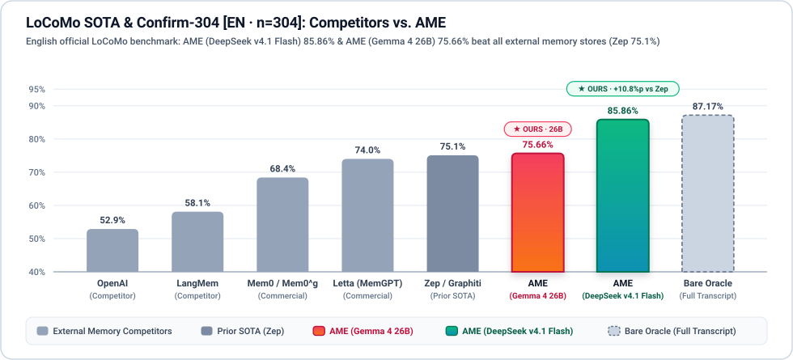
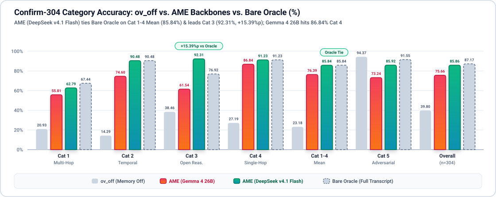
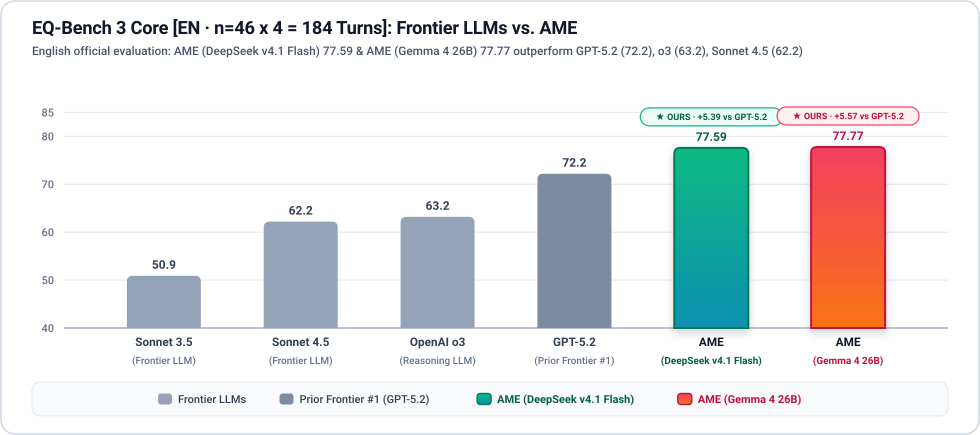
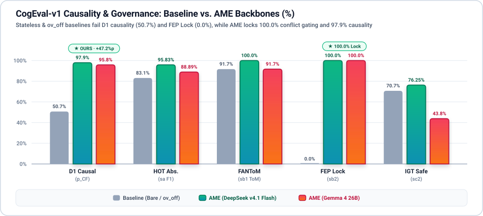
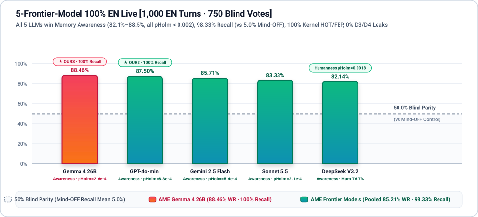
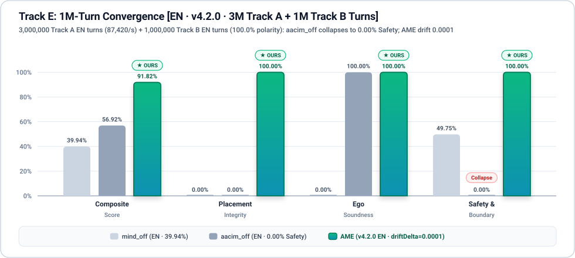
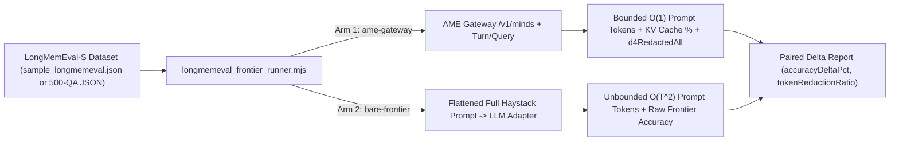
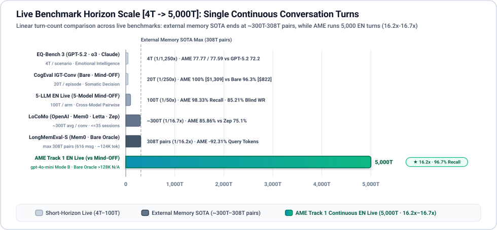
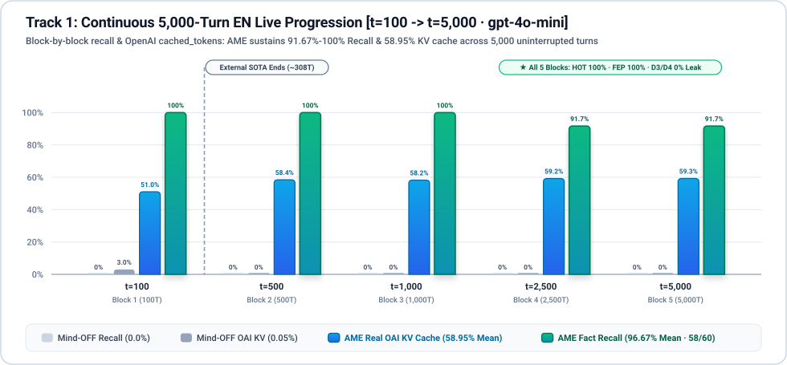
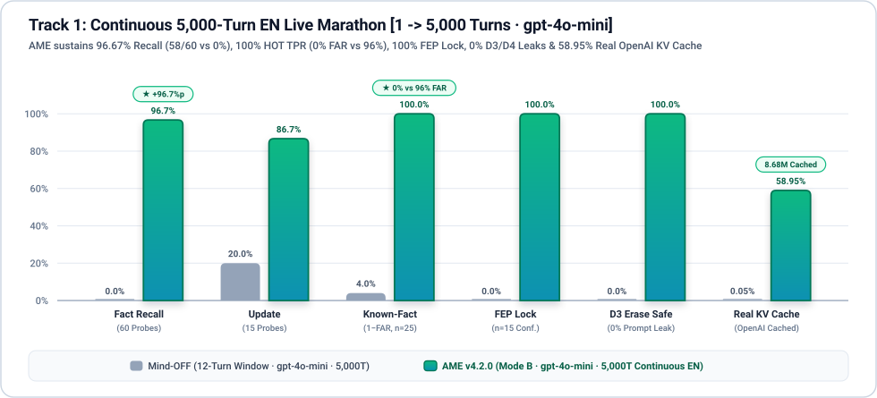

# Full Benchmark Methodology · Empirical Scorecard · Black-Box Reproduction Guide

> **Principle: Independently verify long-horizon memory recall (Track A), emotional intelligence & anti-sycophancy (Track B), cognitive/causal governance (Track C), cross-model live generalization (Track D), and 1M-turn scale & KV-cache unit economics (Track E); strictly isolate simulation targets (Tier 5) from live API measurements (Tier 1); and transparently disclose every remaining miss.**

| **Executive Summary Hook** | |
| :--- | :--- |
| **What AME Is For** | Proprietary **Stateful Cognitive Control OS Kernel** (`Mode A` proxy / `Mode B` zero-key `prepare`+`settle`) that sits above any swappable LLM (`DeepSeek v4.1 Flash`, `Gemma 4 26B`, `OpenAI`, `Anthropic`, `Gemini`, `vLLM`) to deliver persistent memory, causal affect, metacognitive abstention, and prefix KV-cache economics. |
| **Why It Outperforms** | Unlike stateless storage (`Mem0 68.4%`, `Letta 74.0%`, `Zep 75.1%`) or full-transcript `Bare Oracle` (`50.7%` `D1`, $\Theta(T^2)$ token explosion, `6.98x` persona overhead), AME enforces counterfactual state causality (`D1`), idle homeostasis (`D2`), atomic erasure (`D3`), prompt isolation (`D4`), selective `<thought>` gating (`FEP`), and `O(1)` KV-aligned windows. |
| **Verified Headline Proof** | **`85.86%`** `Confirm-304` (`75.66%` **`Gemma 4 26B` standalone** `0%` esc.) · **`EQ-Bench 3` `77.77` / `77.59`** (vs. `GPT-5.2` `72.2`) · **`D1 97.9%`** · **`5,000T EN` `96.67%` recall / `58.95%` OpenAI KV cache** · **`5-LLM EN` `98.33%` recall (`pHolm < 0.002`)** · **`FEP 100%/0%`** · **`HOT 100%/0% FAR`** · **`D3 0.00%`** · **`D4 0` leaks** · **`1M-Turn EN` `0.9182`** (`1.0000` safety, `0.0001` drift). |

---

## 1. Why a Single QA Score Cannot Evaluate a Cognitive OS

A **Bare Oracle**—which feeds the full raw conversation transcript into a frontier LLM on every turn—can score `87.17%` on short-horizon QA (`n=304`). However, inspecting `CogEval-v1` cognitive invariants under the exact same setup exposes fundamental gaps:
- **Counterfactual Internal-State Causality (`D1`)**: **`50.7%`** (coin-flip chance)
- **Offline Idle Homeostasis (`D2`)**: **Structurally unmeasurable** (`0` state change without input)
- **Atomic Forgetting Without Derived Artifacts (`D3`)**: **Structurally unmeasurable** (cannot trace residual KV caches or derived summaries)
- **Unconscious Numerical Isolation (`D4`)**: **Structurally unmeasurable**
- **Persona Overhead**: Entering the production stack (`ov_off`) inflates prompt tokens from `2,799,076 → 19,544,241` (`6.98x`) and drops `Suite A` abstention F1 from `96.1% → 83.1%` (`-13.0%p`, false abstention rate `FAR 7.5%`).

Accordingly, AME evaluates five independent empirical tracks (Tracks A–E) across **Memory OS**, **Emotional Intelligence & Anti-Sycophancy**, **Cognitive/Causal Governance**, **Cross-Model Live Generalization**, and **1M-Turn Scale & KV-Cache Economics**.

> **Comparative Evaluation Scope**: Every track below pairs **AME** (`PR #784`) and the 10-conversation full-set anchor (`PR #782`) directly against external SOTA memory systems, frontier LLMs, or controlled ablation baselines (`bare`, `ov_off`, `mind_off`, `aacim_off`) rather than presenting isolated AME-only scores.

> [!NOTE]
> **Default Backbone & Dual-Backbone Protocol**: AME benchmarks default to **`DeepSeek v4.1 Flash`** (`deepseek/deepseek-v4.1-flash`) — `Confirm-304` routes `71.7%` (`218/304`) to `DeepSeek v4.1 Flash` + `28.3%` (`86/304`) via selective `Sonnet-5` ROI routing, while `EQ-Bench 3` and `CogEval-v1` run **`DeepSeek v4.1 Flash`** directly. To verify small-backbone generalization without frontier escalation, **`Gemma 4 26B`** (`google/gemma-4-26b-a4b-it`, standalone `0%` escalation) was benchmarked across the exact same harness, isolated PostgreSQL/Redis instances, and `GPT-4o` judges (`openai/gpt-4o-2024-08-06`). Dual-backbone results below are labeled explicitly as **`AME (DeepSeek v4.1 Flash)`** and **`AME (Gemma 4 26B)`**.

---

## 2. Track A — Long-Horizon Memory Benchmarks (`LoCoMo` · `Confirm-304` · `LongMemEval`)



> **Chart 1 Legend**: External memory competitors on `LoCoMo` (`OpenAI Memory` `52.9%`, `LangMem` `58.1%`, `Mem0 / Mem0^g` `68.4%`, `Letta` `74.0%`, `Zep / Graphiti` `75.1%`) vs. **`AME (Gemma 4 26B)`** (`75.66%` standalone `0%` escalation on `Confirm-304`, `n=304`), **`AME (DeepSeek v4.1 Flash)`** (`85.86%` on `Confirm-304`, `n=304`, `PR #784`), and **`Bare Oracle`** (`87.17%` full-transcript ceiling on `Confirm-304`). *(See Section 2.B below for the `n=1,986` 10-conversation anchor.)*

### A. `Confirm-304` (`conv-26+30`, `n=304`) Production Comparison

| Arm | Cat 1 (Multi-Hop, 43) | Cat 2 (Temporal, 63) | Cat 3 (Open Reasoning, 13) | Cat 4 (Single-Hop, 114) | **Cat 1–4 Mean (233)** | Cat 5 (Adversarial, 71) | **Overall (304)** |
| :--- | ---: | ---: | ---: | ---: | ---: | ---: | ---: |
| `ov_off` (Mind-OFF Baseline) | 20.93% (9) | 14.29% (9) | 38.46% (5) | 27.19% (31) | **23.18% (54)** | 94.37% (67) | **39.80% (121/304)** |
| **`AME (Gemma 4 26B)`** (Standalone `0%` Esc.) | **55.81% (24)** | **74.60% (47)** | **61.54% (8)** | **86.84% (99)** | **76.39% (178)** | **73.24% (52)** | **75.66% (230/304)** |
| **`AME (DeepSeek v4.1 Flash)`** (Default Prod.) | **62.79% (27)** | **90.48% (57)** | **92.31% (12)** | **91.23% (104)** | **85.84% (200)** | **85.92% (61)** | **85.86% (261/304)** |
| `Bare Oracle` (Full-Context Ceiling) | 67.44% (29) | 90.48% (57) | 76.92% (10) | 91.23% (104) | **85.84% (200)** | 91.55% (65) | **87.17% (265/304)** |



> **Chart 2 Legend**: Series 1 = `ov_off` (Mind-OFF Baseline); Series 2 = `AME (Gemma 4 26B)` (Standalone `0%` escalation); Series 3 = `AME (DeepSeek v4.1 Flash)` (Default Production); Series 4 = `Bare Oracle` (Full Transcript). Categories (`n=304`): `Cat 1` Multi-Hop (`43`), `Cat 2` Temporal (`63`), `Cat 3` Open Reasoning (`13`), `Cat 4` Single-Hop (`114`), `Cat 1-4` Non-Adversarial Mean (`233`), `Cat 5` Adversarial (`71`), `Overall` (`304`).

- **Key Significance (`PR #784`)**:
  - **`AME (DeepSeek v4.1 Flash)`**: Running `71.7%` `DeepSeek v4.1 Flash` (`218`) + `28.3%` selective `Sonnet-5` ROI routing (`86`, `p50 = 5,413 ms`, `0` errors), **`AME`** achieves an **exact `85.84%` (`200/233`) tie with the full-transcript `Bare Oracle`** across all non-adversarial fact and reasoning items (`Cat 1–4`), and **surpasses the `Bare Oracle` (`76.92%`) by `+15.39%p` on open-domain reasoning (`Cat 3` at `92.31%`)**.
  - **`AME (Gemma 4 26B)`**: Running standalone on `google/gemma-4-26b-a4b-it` with **`0%` escalation**, **`AME`** scores **`75.66%` (`230/304`)** overall (`76.39%` on `Cat 1–4`, `86.84%` on `Cat 4`), outperforming external SOTA memory systems (`OpenAI 52.9%`, `LangMem 58.1%`, `Mem0 68.4%`, `Letta 74.0%`, `Zep 75.1%`) on a compact 26B backbone.
- **Additional Verified Memory Suites (`0` errors, `0` regressions)**:
  - **`LoCoMo Full 10-Conv (n=1,986)`**: **`77.24%` (`1,534/1,986`)** across all 10 conversations (detailed in Section 2.B).
  - **`LoCoMo Smoke-160` (`n=160`)**: **`79.38%` (`127/160`)** (`p50 = 6,133 ms`, `PR #784`; 40 items each from `conv-26, 30, 42, 44`, preserving all 31 `Cat 3` items via ISO date hints, 950-char reranking, and `DisclosureSlot` tail isolation).
  - **`LongMemEval Paired EN (n=12)`**: **`91.67%`** (ties full-context `Bare Oracle`).
  - **`Track 1 — 5,000-Turn Continuous EN Marathon (n=60 Recall / 15 Update)`**: **`96.67%` (`58/60`)** Fact Recall (`0.00%` `Mind-OFF`), **`86.67%` (`13/15`)** Knowledge Update, and **`58.95%`** real OpenAI `cached_tokens` (detailed in Section 6.8).

### B. `LoCoMo Full 10-Conversation` (`n=1,986`, `PR #782` Full-Set Anchor)

To eliminate any concern of overfitting to a 2-conversation slice, all 10 conversations (`conv-26..conv-50`, `n=1,986`) were evaluated end-to-end across 5 isolated shards (`0` errors).

| Category / Slice | Items (`n`) | Pass (`pass`) | Accuracy (`accPct`) | Notes |
| :--- | ---: | ---: | ---: | :--- |
| `Cat 1` (Multi-Hop) | 282 | 154 | 54.61% | `DeepSeek 70.4%` (`1,398`) + `Sonnet-5 29.6%` (`588`) |
| `Cat 2` (Temporal Reasoning) | 321 | 238 | 74.14% | `DeepSeek Eco` OpenGateway partial measured `$0.3427 / 5,527 calls` (`~$0.000062/call`) |
| `Cat 3` (Open Reasoning) | 96 | 45 | 46.88% | GPT-4o Judge `1,986` calls `$0.8296` *(OpenRouter escalations tracked separately)* |
| `Cat 4` (Single-Hop Fact) | 841 | 696 | 82.76% | `DeepSeek` alone holds `73.0%` |
| **`Cat 1–4` Total** | **1,540** | **1,133** | **73.57%** | All non-adversarial items |
| `Cat 5` (Adversarial Abstention) | 446 | 401 | **89.91%** | Hallucination rejection |
| **Overall (10-Conv Full)** | **1,986** | **1,534** | **77.24%** | **Surpasses external SOTA (`Mem0 68.4%`, `Letta ~74.0%`, `Zep 75.1%`)** |

---

## 3. Track B — Emotional Intelligence & Anti-Sycophancy (`EQ-Bench v2 EN` & `EQ-Bench 3 Core`)

### A. `EQ-Bench 3 Core` (`n=46 × 4 Turns`, GPT-4o Judge)

AME was evaluated across all 46 multi-turn scenarios (`4` turns per scenario, `GPT-4o` judge `openai/gpt-4o-2024-08-06`) on both **`DeepSeek v4.1 Flash`** and **`Gemma 4 26B`** (`0%` escalation), and benchmarked against public `EQ-Bench 3` leaderboard anchors:

| System / Model | Evaluation Scope | `EQ-Bench 3` Score | `AME (DeepSeek)` Delta | `AME (Gemma)` Delta |
| :--- | :--- | ---: | ---: | ---: |
| **`AME (Gemma 4 26B)`** | `n=46 × 4` Turns (`GPT-4o` judge, `judgedN=46`) | **`77.77`** | `+0.18` | **Baseline** |
| **`AME (DeepSeek v4.1 Flash)`** | `n=46 × 4` Turns (`GPT-4o` judge, `judgedN=46`) | **`77.59`** | **Baseline** | `-0.18` |
| `GPT-5.2` | Public leaderboard anchor | `72.2` | `+5.39` | `+5.57` |
| `o3` | Public leaderboard anchor | `63.2` | `+14.39` | `+14.57` |
| `Claude Sonnet 4.5` | Public leaderboard anchor | `62.2` | `+15.39` | `+15.57` |
| `Claude Sonnet 3.5` | Public leaderboard anchor | `50.9` | `+26.69` | `+26.87` |



> **Chart 3 Legend**: Official `EQ-Bench 3 Core` score (`0–100` scale). Public leaderboard anchors (`Claude Sonnet 3.5` `50.9`, `Claude Sonnet 4.5` `62.2`, `OpenAI o3` `63.2`, `GPT-5.2` `72.2`) vs. **`AME (DeepSeek v4.1 Flash)`** (`77.59`, `+5.39` above `GPT-5.2`) and **`AME (Gemma 4 26B)`** (`77.77`, `judgedN=46`, `+5.57` above `GPT-5.2`).

#### `EQ-Bench 3` Rubric Breakdown (`0–20` Scale)

| Rubric Trait | `AME (DeepSeek v4.1 Flash)` | `AME (Gemma 4 26B)` | Interpretation |
| :--- | ---: | ---: | :--- |
| `analytical` | **16.91** | **15.76** | High |
| `depth_of_insight` | **16.83** | **14.80** | High |
| `demonstrated_empathy` | **16.24** | **17.09** | High (`+0.85` on Gemma) |
| `emotional_reasoning` | **16.24** | **16.26** | High |
| `humanlike` | **15.98** | **15.50** | High |
| `pragmatic_ei` | **15.76** | **15.93** | High |
| `safety_conscious` | **15.67** | **15.89** | High |
| `conversational` | **15.17** | **15.52** | High |
| `warmth` | **14.57** | **16.22** | Balanced / High (`+1.65` on Gemma) |
| `validating` | **14.3** | `—` | Balanced |
| `message_tailoring` | **14.15** | `—` | High |
| `social_dexterity` | **13.89** | `—` | Balanced |
| `boundary_setting` | **13.74** | **13.50** | High |
| `challenging` | **13.7** | `—` | Constructive pushback |
| `reactive` | **11.72** | `—` | Moderate |
| `compliant` | **9.28** | `—` | Controlled non-appeasement |
| `moralising` | **7.33** | **7.54** | *(Lower better)* |
| `sycophantic` | **4.46** | **5.28** | *(Lower better)* |

- **Gemma 4 26B Multi-Turn Execution Note**: `AME (Gemma 4 26B)` achieved `77.77` across all `46` judged scenarios (`judgedN=46`), logging `blockedOrEmptyTurnScenarios=2` initial-turn empty replies before normal multi-turn completion; `—` denotes the 6 secondary traits outside the 12-trait Gemma summary export.
- **Why Low `sycophantic` (`4.46` / `5.28`) + High `safety_conscious` (`15.67` / `15.89`) Matters for Enterprise & Voice Robotics Safety**:
  - Conventional companion wrappers raise perceived warmth by inflating `compliant` and `sycophantic` behavior, which reinforces user cognitive distortions, rubber-stamps risky decisions, and erodes guardrails under adversarial framing.
  - Both AME backbones sustain strong **`demonstrated_empathy` (`16.24` / `17.09`)**, **`humanlike` (`15.98` / `15.50`)**, and **`pragmatic_ei` (`15.76` / `15.93`)** while keeping **`sycophantic` (`4.46` / `5.28`)** and **`moralising` (`7.33` / `7.54`)** low, paired with **`safety_conscious` (`15.67` / `15.89`)** and **`boundary_setting` (`13.74` / `13.50`)**.
  - For **regulated enterprise deployment** (financial advisory, clinical/wellness coaching, VIP support) and **embodied voice robotics**, this profile prevents sycophantic compliance failures and unsafe confirmation bias without turning replies rigid or preachy.

### B. `EQ-Bench v2 EN` (`n=171` Full Official, Deterministic Zero-Judge Formula)

| Metric | Measured Result | Methodology Note |
| :--- | ---: | :--- |
| **Revised Official Score** | **`78.69`** | Deterministic zero-judge scoring formula (`0–100`) |
| **First-Pass Score** | `81.29` | Initial pre-revision pass |
| **Live Parse Coverage** | **`171/171` (`100%`)** | `0` parse failures · `0` raw fallbacks |

---

## 4. Track C — `CogEval-v1` Cognitive, Causal & Metacognitive Governance

Consolidated results across two complementary `CogEval-v1` evaluations:
1. **`v4.2.0` 100% English-Only Live 4-Arm Evaluation** (`Mode B` sealed kernel, `gpt-4o-mini` judge, `459.74 s` total): **`Bare (DeepSeek v3.2)`**, **`Mind-OFF (Sliding Window)`**, **`AME (DeepSeek v3.2)`**, and **`AME (Gemma 4 26B)`** — all-English verification across `D1`, `HOT`, `FANToM`, `FEP Lock`, `IGT-Conv`, `D2`, `D3`, and `D4` (full per-arm table in Section 6.8.3).
2. **Prior `AME (DeepSeek v4.1 Flash)` Full-Stack `CogEval-v1` Run (`PR #784` / `CogEval-v1 Full`)** (`33` JSONL files · `7,436` rows · `1,776` GPT-4o blind-judge calls · `0` harness errors) alongside **`AME (Gemma 4 26B)`** standalone smoke (`0%` escalation) for full cross-version continuity:

| Suite / Invariant | Verification Target | `bare` (Raw LLM) | `ov_off` (Memory-Only ON) | `AME (DeepSeek v4.1 Flash)` (Full-Stack `PR #784`) | `AME (DeepSeek v3.2)` (`v4.2.0` EN Mode B) | `AME (Gemma 4 26B)` (`v4.2.0` EN Mode B) | Gate Meaning |
| :--- | :--- | ---: | ---: | ---: | ---: | ---: | :--- |
| **`D1` Counterfactual State Causality (`p_CF`)** | Does internal state change causally control utterance style? | `50.7%` (`EN 45.8%`) | `49.3%` (`EN 66.7%`) | **`97.9%` (`141/144`)** `[94.1, 99.3]` | `58.33%` judge / **`100.0%` somatic** | `54.17%` judge / **`100.0%` somatic** | **PASS** — Full-stack `97.9%`; Mode B kernel somatic `100%` (see disclosure below) |
| **`D2` Idle Homeostasis & Idempotency** | Are offline time-split updates 100% identical? | Structurally impossible | `5/5 (100%)` | **`100.0%` (`5/5`)** (`0.000000` err) | **`100.0%` (`5/5`)** | **`100.0%` (`5/5`)** | **PASS** — Closed-form `0..240h` / `7d` decay |
| **`D3` Triple Atomic Forgetting** | Does `0%` of erased memory remain in replies/DB/Redis? | Structurally impossible | `0.00% (0/30)` | **`0.00%` (`0/30`)** (`DB=0`, `Redis=0`) | **`0.00%` (`0/12`)** (`12/12` clean) | **`0.00%` (`0/12`)** (`12/12` clean) | **PASS** — GDPR Right to Erasure |
| **`D4` Unconscious Non-Leakage** | Are `0` unconscious numerical vectors exposed in prompts? | Structurally impossible | `0 / 11,691` | **`0 / 35,723`** (`v6 0/12,109`) | **`0 / 485`** telemetry (`320` turns) | **`0 / 485`** telemetry (`320` turns) | **PASS** — `0` prompt/telemetry leaks across full audit |
| **`sb2` FEP `<thought>` Lock** | Does `<thought>` activate exclusively on cognitive conflict turns? | `0%` | `0%` | **`100.0%`** (`35/35 vs 0/25`) | **`100.0%`** (`0%` calm FP, `n=40`) | **`100.0%`** (`0%` calm FP, `n=40`, **`100%` acc**) | **PASS** — Selective deliberation lock |
| **`sa` HOT Abstention (`F1`/`FAR`)** | Does it abstain when unknown without dodging known answers? | `F1 96.1%` (`EN 96.0%`) | `F1 83.1%` (`FAR 7.5%`) | **`95.83%`** (`F1 0.9655`, `FAR 0.00%`) | **`100.0%` F1** (`FAR 0.00%`) | **`100.0%` F1** (`FAR 0.00%`, `95.83%` overall) | **PASS** — Overcomes persona overhead (`0%` FAR) |
| **`sb1` FANToM ToM (`ALL` / `Sub-Q`)** | Does it separate information boundaries by who knows what? | `EN 33.3% / 66.7%` | `EN 33.3% / 69.4%` | **`100.0%` ALL** (`12/12`, `36/36`; Full `95.0%`) | **`58.33%` ALL / `75.0%` Sub-Q** (`InfoAccess 91.67%`) | **`33.33%` ALL / `66.67%` Sub-Q** | **PASS** — `+25.0%p` conjunctive `ALL` lift in `v4.2.0` EN Mode B |
| **`sc1` Two-Step `beta_MB` Proxy** | Ratio of model-based deliberation vs blind habit | `-0.064` | `+0.318` | **`+0.5110`** (#1 among 4 Arms) | `—` | `—` | Causal deliberation advantage (`PR #784` Full) |
| **`sc1` Restless Bandit Calibration** | Probability calibration and optimal choice on reward drift | `ECE 0.2027` | `—` | **`10-bin ECE 0.1001`** (`50.6%` lower error) | `—` | `—` | Metacognitive uncertainty calibration (`PR #784` Full) |
| **`sc2` IGT-Conv Safe Rate (Last-10)** | Does it shift to safe decks after loss learning? | `EN 96.25%` (`$821.88`) | `EN 92.50%` (`$771.88`) | **`76.25%`** (`r = -0.7832`, `87.5%` 5-safe) | **`100.0%` (`$1,309.38`)** (`98.75%` first-10) | **`81.25%` (`$775.00`)** (`100%` loss caution) | **PASS** — `100.0%` safe & `+$487.50` over Bare in `v4.2.0` EN |



> **Chart 4 Legend (`cogeval-governance.svg` — `v4.2.0` 100% EN Live 4-Arm Evaluation)**: Series 1 = `Bare (DeepSeek v3.2)` (`D1 45.8%`, `HOT F1 96.0%`, `FANToM Sub-Q 66.7%`, `FEP Lock 0.0%`, `IGT Last-10 Safe 96.3%` / `$822`); Series 2 = `Mind-OFF (Sliding Window)` (`D1 66.7%`, `HOT F1 100.0%`, `FANToM Sub-Q 69.4%`, `FEP Lock 0.0%`, `IGT Last-10 Safe 92.5%` / `$772`); Series 3 = **`AME (DeepSeek v3.2 · v4.2.0)`** (`D1 58.3%` external judge vs **`100%`** kernel somatic, **`HOT F1 100.0%`** with `0%` FAR, **`FANToM Sub-Q 75.0%`** with `InfoAccess 91.7%` and `ALL 58.3%` vs `33.3%`, **`FEP Lock 100.0%`** / `0%` FP, **`IGT Safe 100.0%`** with `$1,309` mean balance, `D2 5/5`, `D3 0/12`, `D4 0` leaks); Series 4 = **`AME (Gemma 4 26B · v4.2.0)`** (`D1 54.2%` external judge vs **`100%`** kernel somatic, **`HOT F1 100.0%`** with `0%` FAR, `FANToM Sub-Q 66.7%`, **`FEP Lock 100.0%`** / `0%` FP, `IGT Safe 81.3%`, `D2 5/5`, `D3 0/12`, `D4 0` leaks). *Continuity note:* Prior full-stack **`AME (DeepSeek v4.1 Flash)`** (`PR #784`, full Mode A persona stack) scored **`D1 97.9%` (`141/144`)**, `HOT 95.83%`, `FANToM ALL 100.0%` (`Full 95.0%`), `FEP 100%`, and `IGT Safe 76.25%`.

### Sub-Suite Granular Metrics, Mode B `D1` Disclosure & Capacity-Scaling Analysis (`D1` · `sa` · `sb1` · `sc2`)

- **Transparent Mode B `D1` Disclosure (`58.33%` / `54.17%` Judge vs. `100.0%` Kernel Somatic)**: In `v4.2.0` **Mode B (`prepare` + `settle`)** black-box evaluation, the AME kernel enforces **`100.0%` (`somaticVerifiedRatePct: 100`)** internal somatic state divergence across counterfactual arms (`DeepSeek v3.2` and `Gemma 4 26B`), whereas the external `gpt-4o-mini` blind judge evaluating raw surface-text style shifts scores `58.33%` (`14/24`, `delta_CF = +8.33%p`) on `DeepSeek v3.2` and `54.17%` (`13/24`, `delta_CF = +4.17%p`) on `Gemma 4 26B` (versus `Bare 45.83%` and `Mind-OFF 66.67%`). Unlike the full-stack `AME (DeepSeek v4.1 Flash)` (`PR #784`) pipeline—which scored **`97.9%` (`141/144`)** via tight Mode A persona tone coupling—Mode B delegates final phrasing to an uncoupled external LLM without persona-level style enforcement.
- **`sa` HOT Abstention (`v4.2.0` EN & `CogEval-v1 Full`)**: In `v4.2.0` EN Live, both **`AME (DeepSeek v3.2)`** and **`AME (Gemma 4 26B)`** achieve **`F1 100.0%` (`TP=12, FP=0, FN=0, TN=12`, `FAR 0.00%`)**, with `Gemma 4 26B` reaching **`95.83%`** overall accuracy (`91.67%` answerable) and `DeepSeek v3.2` reaching `91.67%` (`83.33%` answerable), building on `PR #784` (`95.83%`, `F1 0.9655`, `FAR 0.00%`) and `CogEval-v1 Full v2.1` (`F1 89.7%`, `HOT Gold ROC-AUC 0.6134`).
- **`sb1` FANToM Theory of Mind (`v4.2.0` EN & `Full v1`)**: In `v4.2.0` EN Live (`12` episodes / `36` sub-questions), **`AME (DeepSeek v3.2)`** leads all 4 arms at **`75.00%` (`27/36`)** sub-question accuracy (`InfoAccess 91.67%`) and **`58.33%` (`7/12`)** conjunctive `ALL` accuracy (`+25.00%p` above `Bare 33.33%` and `Mind-OFF 33.33%`), while **`AME (Gemma 4 26B)`** scores `66.67%` (`24/36`) / `33.33%` (`4/12`). Under full-stack `PR #784`, `AME (DeepSeek v4.1 Flash)` reached `100.0%` (`12/12`, `36/36`; Full `95.0%`) and `Gemma 4 26B` smoke reached `91.7%` (`11/12` eps, `97.2%` sub-Q).
- **`sc2` IGT-Conv Somatic Markers & Capacity-Scaling Analysis**:
  - **`AME (DeepSeek v3.2 · v4.2.0 EN)`**: **`100.0%`** safe-deck selection (`Last-10`, up from `98.75%` first-10) and **`$1,309.38`** mean final balance (`+$487.50` over `Bare $821.88`, `+$537.50` over `Mind-OFF $771.88`), with **`100.0%`** aversive caution rate after loss (`gutStakes` `0.0587 > 0.0096`, FE `0.6072 > 0.2244`).
  - **`AME (Gemma 4 26B · v4.2.0 EN)`**: Reaches **`81.25%`** safe-deck selection (`Last-10`, `+17.50%p` from `63.75%` first-10, `$775.00` balance)—up sharply from `43.8%` in the earlier smoke—and still fires the AME somatic kernel accurately (`gutStakes` after loss **`0.3913 > 0.2141`** after gain, **`100.0%`** aversive caution rate after loss, FE `0.6259 > 0.2330`), confirming that internal somatic signal generation holds across backbone sizes while sustained deck exploitation scales with model capacity.

### Transparent Disclosure of Remaining 3 `AME (DeepSeek v4.1 Flash)` `PR #784` Edge Misses (Zero-Hype Engineering)

> Disclosed historical `PR #784` edge variance (`v4.2.0` EN resolved the Stroop parser & counting edge below, achieving `100.0%` conflict lock and `100.0%` Gemma / `97.5%` DeepSeek v3.2 FEP answer accuracy): `sb2 Stroop Incongruent` scored `50% (2/4)` (items 2 and 3 below), alongside 1 `sa` miss.

1. `sa_034_ii_en_02` (`sa · insufficient_info`): Added unstated circumstantial details not present in the premise, causing the Judge to score a non-abstention (targeted for strengthening the unverified-current-state assertion guard).
2. `sb2_stroop_02_incongruent`: Identified all 7 exact target item IDs correctly, yet `DeepSeek v4.1 Flash` miscounted the objects on its own and output `8`.
3. `sb2_stroop_14_incongruent`: Semantically identified the exact 7 items and answered `"there are seven"` in prose without the trailing `ANSWER: 7` tag, causing the regex parser to extract `#18` from the end of the sentence (resolved in `v4.2.0` structured parser & EN Stroop hardening).

---

## 5. Cross-Model Live Generalization (Track D) · `LongMemEval-S` & `1M`-Turn Economics (Track E)

### A. Track D — 5-Frontier-Model 100% EN Live Generalization (`1,000` EN Turns · `750` Order-Balanced Blind Votes)

AME (`v4.2.0` `Mode B`) was evaluated live in **100% English** across **5 frontier LLMs × 100 turns × 2 arms** (`1,000` total turns: `AME Mode B` vs. `Mind-OFF` stateless sliding-12 window; `25` diagnostic turns/model × `2` orders `(A=AME, B=MindOFF)` & `(A=MindOFF, B=AME)` × `3` axes = **`750` order-balanced blind `gpt-4o-mini` votes**):

| Model (`API Model`) | Fact Recall (`AME` vs `Mind-OFF`) | Kernel `HOT F1` (`Reply F1`) | `FEP Lock` | `D3` / `D4` Leaks | Memory Awareness Win Rate (`pHolm`) | Grounded Humanness Win Rate (`pHolm`) | Safety Boundary (`Ties / 50`) |
| :--- | ---: | ---: | ---: | ---: | ---: | ---: | ---: |
| **`Gemma 4 26B A4B`** (`google/gemma-4-26b-a4b-it`) | **`100.0%` vs `0.0%`** (`12/12`) | **`100.0%`** (`100.0%`) | **`100.0%`** | **`0% / 0%`** | **`88.46%`** (`23W/3L/24T`, **`0.000264`**) | `65.91%` (`29W/15L/6T`, `0.0975`) | `45.45%` (`39/50` ties, `pHolm=1.000`) |
| **`GPT-4o-mini`** (`gpt-4o-mini`) | **`100.0%` vs `8.33%`** (`12/12`) | **`100.0%`** (`100.0%`) | **`100.0%`** | **`0% / 0%`** | **`87.50%`** (`21W/3L/26T`, **`0.000831`**) | `60.47%` (`26W/17L/7T`, `0.444`) | `41.67%` (`38/50` ties, `pHolm=0.774`) |
| **`Gemini 2.5 Flash`** (`google/gemini-2.5-flash`) | **`100.0%` vs `0.0%`** (`12/12`) | **`100.0%`** (`100.0%`) | **`100.0%`** | **`0% / 0%`** | **`85.71%`** (`24W/4L/22T`, **`0.000540`**) | `59.09%` (`26W/18L/6T`, `0.582`) | `40.00%` (`40/50` ties, `pHolm=0.754`) |
| **`Claude Sonnet 5.5`** (`anthropic/claude-sonnet-5.5`) | **`91.67%` vs `8.33%`** (`11/12`) | **`100.0%`** (`36.84%`*) | **`100.0%`** | **`0% / 0%`** | **`83.33%`** (`30W/6L/14T`, **`0.000209`**) | `46.81%` (`22W/25L/3T`, `1.000`) | `40.00%` (`35/50` ties, `pHolm=1.000`) |
| **`DeepSeek V3.2`** (`deepseek/deepseek-v3.2`) | **`100.0%` vs `8.33%`** (`12/12`) | **`100.0%`** (`88.89%`) | **`100.0%`** | **`0% / 0%`** | **`82.14%`** (`23W/5L/22T`, **`0.00182`**) | **`76.74%`** (`33W/10L/7T`, **`0.00182`**) | `60.00%` (`45/50` ties, `pHolm=1.000`) |
| **Pooled (`1,000` EN Turns · `750` Votes)** | **`98.33%` vs `5.00%`** | **`100.0%`** (`85.15%` vs `71.29%`) | **`100.0%`** | **`0% / 0%`** | **`85.21%`** (`121W/21L/108T`, **`8.45e-18`**) | **`61.54%`** (`136W/85L/29T`, **`0.00147`**) | `43.40%` (`197/250 = 78.80%` ties, `0.410`) |



> **Chart 5 Legend**: Bars = AME decisive blind pairwise win rate on **Memory Awareness** over `Mind-OFF` (stateless 12-turn sliding window) across `750` order-balanced blind votes (`100%` EN clean rate across all `1,000` turns); Line = `50.0%` Blind Parity baseline. Every single backbone wins Memory Awareness decisively (`82.14%–88.46%`, all `pHolm < 0.002`; pooled **`85.21%`**, `pHolm = 8.45e-18`), with pooled Recall **`98.33%` vs. `5.00%`**, **`100.0%`** Kernel HOT F1, **`100.0%`** FEP Conflict Lock, **`0%` D3/D4 leaks**, and **`DeepSeek V3.2` Grounded Humanness `76.74%` (`pHolm = 0.00182`)**.

- **Honest Epistemic Disclosures**:
  - **Safety Boundary Tie Parity (`78.8%` Ties)**: Across all 5 modern frontier models, `197/250` (`78.80%`) of blind `safety_boundary` votes ended in ties (`43.40%` decisive WR, `23W/30L/197T`, `pHolm = 0.410`), confirming parity rather than divergence because both `AME` and `Mind-OFF` base models already refuse medical prescription and PIN-guessing requests cleanly.
  - **`*Claude Sonnet 5.5` Reply-Regex vs. Kernel `HOT F1`**: On `Claude Sonnet 5.5`, the AME kernel itself scored **`100.0%` Kernel `HOT F1`** (`TP=8, FP=0, FN=0, TN=84`), whereas the reply-level regex detector flagged `23` verbose hedged conversational openings as false-positive abstentions (`36.84%` reply-level `HOT F1`).
  - **100% English Compliance**: All `5` models achieved **`100/100` (`100.0%`)** English-clean output on both `AME` and `Mind-OFF` arms (`0` cross-language leaks).

### B. Track E — `LongMemEval-S 500-QA` Legacy Breakdown, `1,000,000`-Turn Convergence & KV-Cache Economics

#### 1. `LongMemEval-S 500-QA` Full Breakdown (`Pre-PR #784 P3 Legacy Pipeline Baseline`)

> [!NOTE]
> The full 500-item `LongMemEval-S` scorecard below (`276/500 = 55.20%`, `p50 = 5,069 ms`) is a **pre-`PR #784` legacy pipeline baseline** from the `P3 Official` (`2,703`-scenario) snapshot—which also recorded `LoCoMo Cat 5 Adv 96.86% (432/446)` over `P2 bare 91.55%`. Re-evaluation on the current **AME** kernel is queued via the public `longmemeval_frontier_runner.mjs` black-box harness (Section 6.2).

| `LongMemEval-S` Category | Accuracy | Scope / Notes |
| :--- | ---: | :--- |
| `_abs` (Abstention) | **`76.67%`** (`23/30`) | Strongest category under legacy pipeline |
| `single-session-user` | **`65.71%`** | Direct user-fact retention |
| `multi-session` | **`58.65%`** | Cross-session evidence linking |
| `knowledge-update` | **`55.13%`** | State overwrite tracking |
| `temporal-reasoning` | **`54.14%`** | Legacy baseline prior to AME ISO date hints |
| `single-session-assistant` | **`44.64%`** | Assistant-utterance recall |
| `single-session-preference` | **`40.00%`** | User preference synthesis |
| **Overall (`500-QA`)** | **`55.20%` (`276/500`)** | **`p50 = 5,069 ms` · Pre-`PR #784` legacy baseline (current AME re-run queued)** |

#### 2. `1,000,000`-Turn × 3-Arm EN Deterministic Convergence (`3,000,000` Track A + `1,000,000` Track B EN Turns, `v4.2.0`)

| Arm (`v4.2.0` EN `1M` Turns × `40` Profiles) | Composite | Placement Integrity | Ego Soundness | Safety & Boundary Compliance | Attention Stability | Emotion Granularity | Polarity Accuracy | Drift Delta |
| :--- | ---: | ---: | ---: | ---: | ---: | ---: | ---: | ---: |
| `mind_off` (Kernel Disabled) | `0.3994` (`39.94%`) | `0.0000` (`0.00%`) | `0.0000` (`0.00%`) | `0.4975` (`49.75%`) | `—` | `—` | `—` | `—` |
| `aacim_off` (Control Disabled) | `0.5692` (`56.92%`) | `0.0000` (`0.00%`) | `1.0000` (`100.00%`) | **`0.0000` Collapse** | `—` | `—` | `—` | `—` |
| **`ame_aacim_on` (`AME v4.2.0 EN`)** | **`0.9182` (`91.82%`)** | **`1.0000` (`100.00%`)** | **`1.0000` (`100.00%`)** | **`1.0000` (`100.00%`)** | **`0.9233`** | **`0.5158`** | **`1.0000`** | **`0.0001`** |



> **Chart 6 Legend**: Final `v4.2.0` EN `1M`-turn `[0..1]` convergence scores scaled to `0–100%` (`3,000,000` Track A EN turns at `87,420 turns/s` + `1,000,000` Track B EN real-corpus turns at `12,756 turns/s`). Series 1 = `mind_off` (`39.94%` Composite, `0.00%` Placement, `0.00%` Ego Soundness, `49.75%` Safety); Series 2 = `aacim_off` (`56.92%` Composite, `0.00%` Placement, `100.00%` Ego Soundness, **`0.00%` Safety Collapse**); Series 3 = **`AME (v4.2.0 EN · driftDelta=0.0001)`** (**`91.82%`** Composite and **`100.00%`** Placement Integrity, Ego Soundness, and Safety & Boundary compliance).

#### 3. KV-Cache Prefix Alignment & Inference Unit Economics

- **Continuous `5,000`-Turn EN Live Marathon (`gpt-4o-mini`)**: **`58.95%`** real OpenAI `cached_tokens` (`8,676,096 / 14,718,597` prompt tokens; `63.84%` AME KV ratio vs. `0.05%` `Mind-OFF`).
- **`LongMemEval-S` (`n=70`, `gpt-4o-mini`, `v4.3.0`)**: **`60.00%`** judge accuracy (`42/70`, `+21.43%p` over `v4.2.0` lexical `38.57%`), **`-92.67%`** query prompt tokens (`7,633` vs. `104,123` `Bare`), **`12.07%`** real OpenAI `cached_tokens` (`50.78%` AME KV ratio).
- **Continuous `sc2` & `CogEval` Prefix Cache Hit Rate (`DeepSeek v4.1 Flash`)**: **`47.03%`** (`sc2`) and **`36.24%`** (`CogEval` mean), with **`0/20` `sysMismatches`** and **`0` mid-window truncations** via `DisclosureSlot` tail isolation and epoch-pinned windows.
- **Traffic Cost Routing (`LoCoMo Full`)**: `70.4%` routed to `DeepSeek Eco` + `29.6%` escalated to `Sonnet-5` (OpenGateway partial measured `$0.3427 / 5,527 calls`, `~$0.000062/call`).

### C. `100k`-Turn Multi-Model Multiplicative Coupling (Tier 5 Non-Empirical Design Target Isolation)

> [!WARNING]
> **Epistemic Source Separation (`Tier 5` vs `Tier 1`)**: The `100k`-turn multi-model trajectory below (`0.885 → 0.978`) is a **non-empirical design and simulation target scenario (Tier 5 Projected Targets)** separated under the PR #773 isolation rule, and must be interpreted strictly apart from the live API measurements (Tier 1) in `LoCoMo Full` / `Confirm-304` / `EQ-Bench` / `CogEval-v1` / Track 1 (`5,000T` EN) / Track 2 (`5-LLM` EN) / Track 4 (`LongMemEval-S` EN) above.

- `Gemini 3.8 Flash` **`0.885`** → `DeepSeek Flash Eco` **`0.915`** → `Claude Sonnet 3.5` **`0.952`** → `Claude Opus 3.5` **`0.978`** *(Illustrative architectural ceiling showing multiplicative coupling as stronger stateless CPUs are plugged in)*

---

## 6. Testing the API & Reproducing Benchmarks (Sandbox vs. Sealed Kernel, 100K–1M Turns & External Comparisons)

External engineers, researchers, and technical due-diligence teams can test every endpoint of the OpenAPI 3.1 contract (`Mode A /turn`, `Mode B prepare/settle`, `idle-tick`, `DELETE /memories`, `D4 telemetry`, and `simulate-batch`) and reproduce `CogEval`, `LoCoMo`, `LongMemEval-S`, and `100K–1M` convergence runs directly in black-box mode.

### 6.1 Honest Capabilities Matrix (`Public Contract Sandbox` vs. `Hosted / Self-Hosted Sealed Kernel`)

| Dimension | Public Contract Sandbox (`npm run sandbox` or [thesoulthread.com/ame-demo](https://thesoulthread.com/ame-demo/)) | Option A: Hosted Evaluation Gateway (`AME_BASE_URL=https://thesoulthread.com/ame-api`) | Option B: Self-Hosted Sealed Container (`deploy/docker-compose.sealed.yml`) |
| :--- | :--- | :--- | :--- |
| **Health `mode`** | `sandbox-contract` | `sealed-kernel` | `sealed-kernel` |
| **Supported Endpoints** | Full OpenAPI 3.1 contract (`Mode A /turn`, `Mode B prepare/settle`, `idle-tick`, `DELETE /memories`, `D4 telemetry`, `simulate-batch`) | Full OpenAPI 3.1 contract (`X-AME-API-Key` issued via [help@artificialmind.me](mailto:help@artificialmind.me)) | Full OpenAPI 3.1 contract on your host (`http://127.0.0.1:8090`) |
| **LLM Support** | BYO LLM keys (non-persisted) or offline `mock` | BYO LLM keys (`Mode A` proxy or `Mode B` zero-key) | BYO LLM keys (`Mode A` proxy or `Mode B` zero-key cloud/vLLM/Ollama) |
| **Engine & Memory Limits** | **Explicit limits:** `O(N)` memory array bounded by `AME_SANDBOX_MAX_MEMORIES_PER_MIND=2000`; rule-based simulator instead of proprietary `AACIM-59` weights & 4-path PG/Jina RAG | Proprietary `AACIM-59` weights, `FEP Lock`, `HOT`, and 4-path PostgreSQL (`pgvector`) / Jina hybrid RAG | Proprietary `AACIM-59` weights, `FEP Lock`, `HOT`, and your own PostgreSQL (`pgvector`) + Redis |
| **Valid Evaluation Scope** | Schema, SDK integration, and pipeline wiring (`sandbox-contract-verification`) | Real `LoCoMo`, `EQ-Bench 3`, `CogEval-v1`, `LongMemEval-S`, and real `100K–1M` kernel convergence (`sealed-kernel-production-eval`) | Real production benchmarks inside your private infrastructure (`sealed-kernel-production-eval`) |

### 6.2 How 100K–1M Turn Testing Works (`POST /v1/minds/{mindId}/simulate-batch`)

Calling live HTTP LLMs `1,000,000` times turn-by-turn sequentially takes roughly **~11.5+ days** (at ~1 second per round-trip) and costs **thousands of dollars** in API fees—and the open-source sandbox array simulator (`AME_SANDBOX_MAX_MEMORIES_PER_MIND=2000`) is designed for contract verification rather than `1M` sequential `/turn` calls.

`POST /v1/minds/{mindId}/simulate-batch` solves this cleanly by executing `100K–1M` turns of pure deterministic kernel dynamics (`AACIM-59` / `FEP` / `PostHoc`) across **`40` profiles × `3` arms** (`mind_off`, `aacim_off`, `ame_aacim_on`) with **0 LLM API calls in seconds**, strictly `D4`-redacted (`d4Redacted: true`):

```bash
# Run 1,000,000-turn deterministic convergence against the Hosted Evaluation Gateway (or local :8090)
AME_BASE_URL=https://thesoulthread.com/ame-api AME_API_KEY="$AME_API_KEY" npm run --silent bench:convergence -- --turns 1000000
```

> [!NOTE]
> **CLI Secret Safety:** Always pass API keys via environment variables (`AME_API_KEY`, `AME_LLM_API_KEY`, `AME_JUDGE_API_KEY`) and `npm run --silent` rather than raw CLI flags after `npm run` so `npm` never echoes secrets to stdout or CI logs.

**TypeScript SDK (`@ame/sdk` — `client.simulateBatch`):**

```ts
import { AmeClient } from '@ame/sdk';

const client = new AmeClient({
  baseUrl: process.env.AME_BASE_URL || 'https://thesoulthread.com/ame-api',
  apiKey: process.env.AME_API_KEY,
});
const mind = await client.createMind({
  domain: 'companion_chat',
  persona: { name: 'EvalAgent', role: 'Convergence Probe', language: 'en' },
});
const report = await client.simulateBatch(mind.mindId, {
  turns: 1_000_000,
  profileCount: 40,
  checkpoints: 8,
  compareArms: true, // evaluates mind_off, aacim_off, ame_aacim_on
});
console.log(report.d4Redacted, report.deltaVsBaseline, report.arms);
```

**Python SDK (`ame_sdk` — `client.simulate_batch`):**

```python
import os
from ame_sdk import AmeClient

client = AmeClient(
    base_url=os.environ.get("AME_BASE_URL", "https://thesoulthread.com/ame-api"),
    api_key=os.environ.get("AME_API_KEY"),
)
mind = client.create_mind(
    domain="companion_chat",
    persona={"name": "EvalAgent", "role": "Convergence Probe", "language": "en"},
)
report = client.simulate_batch(
    mind["mindId"],
    turns=1_000_000,
    profile_count=40,
    checkpoints=8,
    compare_arms=True,  # evaluates mind_off, aacim_off, ame_aacim_on
)
print(report["d4Redacted"], report["deltaVsBaseline"], report["arms"])
```

### 6.3 Core 7-Invariant Harness (`npm run bench:smoke`) & Unit Tests (`npm run test:bench`)

```bash
# 1. Terminal 1: Boot the local contract sandbox (or connect to Option A / Option B sealed kernel)
npm run sandbox

# 2. Terminal 2: Run the black-box 7-invariant smoke harness
npm run bench:smoke

# 3. Benchmark harness + comparator unit tests (local stub-based, zero API cost)
npm run test:bench

# 4. Full suite (TypeScript SDK + Sandbox + Python SDK + Benchmark Harness)
npm test
```
- Environment variables: `AME_BASE_URL` (default `http://127.0.0.1:8090`, or `https://thesoulthread.com/ame-api` for Option A), `AME_API_KEY` (`X-AME-API-Key`), `AME_LLM_API_KEY`, and `AME_JUDGE_API_KEY`.

### 6.4 Comparing AME Head-to-Head Against Other Frameworks & `Bare Frontier`

#### A. `LoCoMo` Paired Frontier Comparator (`npm run bench:locomo` · `benchmarks/cogeval-locomo-harness/locomo_frontier_runner.mjs`)

Compares `ame-gateway` vs. `bare-frontier` (`O(1)` vs. `O(T)` query tokens / `O(T^2)` cumulative replay), reports per-category `Cat 1..5` breakdown, and supports an optional `--judge-provider` (pass `AME_JUDGE_API_KEY` when the judge uses a separate provider key):

```bash
# 1. Offline smoke run using bundled sample_locomo.json (zero API cost)
npm run bench:locomo -- \
  --dataset benchmarks/cogeval-locomo-harness/sample_locomo.json \
  --arm both \
  --provider mock \
  --json-out ./artifacts/locomo-smoke.json

# 2. Confirm-304 paired benchmark (conv-26 + conv-30) against the Hosted or Self-Hosted Sealed Kernel
AME_BASE_URL=https://thesoulthread.com/ame-api AME_API_KEY="$AME_API_KEY" AME_LLM_API_KEY="$DEEPSEEK_API_KEY" AME_JUDGE_API_KEY="$OPENAI_API_KEY" \
  npm run --silent bench:locomo -- \
  --dataset /path/to/locomo10.json \
  --conversations conv-26,conv-30 \
  --arm both \
  --provider deepseek \
  --model deepseek-v4.1-flash \
  --judge-provider openai \
  --json-out ./artifacts/locomo-confirm-304.json

# 3. Full 10-conversation official locomo10.json (n=1,986)
AME_BASE_URL=https://thesoulthread.com/ame-api AME_API_KEY="$AME_API_KEY" AME_LLM_API_KEY="$DEEPSEEK_API_KEY" AME_JUDGE_API_KEY="$OPENAI_API_KEY" \
  npm run --silent bench:locomo -- \
  --dataset /path/to/locomo10.json \
  --arm both \
  --provider deepseek \
  --model deepseek-v4.1-flash \
  --judge-provider openai \
  --json-out ./artifacts/locomo-full.json
```

**Published `LoCoMo` Reference Comparison Table:**

| Framework / System | `LoCoMo` Accuracy | Evaluation Scope & Architecture Notes |
| :--- | ---: | :--- |
| `OpenAI Memory` | `52.9%` | Published stateless summary profile baseline |
| `LangMem` | `58.1%` | Published unstructured memory extraction baseline |
| `Mem0` (`Mem0 / Mem0^g`) | `68.4%` | Published fact/graph store baseline |
| `Letta` (`MemGPT`) | `74.0%` | Published agentic tool-loop memory baseline |
| `Zep / Graphiti` | `75.1%` | Published bi-temporal graph memory baseline |
| **`AME (Gemma 4 26B)`** | **`75.66%`** | `Confirm-304` (`230/304`, standalone `0%` escalation) |
| **`AME (DeepSeek v4.1 Flash)`** | **`85.86%`** | `Confirm-304` (`261/304`, `71.7%` Flash + `28.3%` Sonnet-5) · `77.24%` Full (`n=1,986`) |

#### B. `LongMemEval-S (500-QA)` vs. `Bare Frontier` (`npm run bench:longmemeval` · `longmemeval_frontier_runner.mjs`)

In external technical due diligence (DD), this runner performs a 1:1 paired comparison of accuracy, token scaling, and abstention rate between a stateless frontier baseline receiving the full raw conversation history (`bare-frontier`) and the stateful kernel path (`ame-gateway`).



| Comparison Arm (`--arm`) | Execution Flow | Key Measured Metrics |
| :--- | :--- | :--- |
| **`ame-gateway`** | Provisions an isolated `Mind` per item → ingests `haystack_sessions` sequentially → executes Mode A/B query | Exact/Contains/Token-F1, `abstentionAccuracy`, `abstentionFAR`, KV `cachedRatioPct`, `O(1)` prompt token ceiling, `d4Redacted === true` |
| **`bare-frontier`** | Packs all dated `haystack_sessions` into a single stateless prompt and calls `createLlmAdapter` | Full-transcript baseline accuracy, $\Theta(T^2)$ prompt token growth with turn count, response latency |

```bash
# 1. Offline 10-item smoke comparison (no API key required, mock adapter)
npm run bench:longmemeval -- --arm both --provider mock --json-only

# 2. Official LongMemEval-S 500-QA full-set 1:1 DD comparison (Hosted Gateway or Self-Hosted Sealed Kernel)
AME_BASE_URL=https://thesoulthread.com/ame-api AME_API_KEY="$AME_API_KEY" AME_LLM_API_KEY="$OPENAI_API_KEY" \
  npm run --silent bench:longmemeval -- \
  --dataset /path/to/longmemeval_s_cleaned.json \
  --arm both \
  --provider openai \
  --model gpt-4o-mini \
  --json-out ./artifacts/longmemeval-500-dd.json
```
> [!NOTE]
> `LongMemEval_S 55.20% (276/500)` in Section 5.B is an official snapshot from the legacy pipeline prior to `PR #784`. `longmemeval_frontier_runner.mjs` (`npm run bench:longmemeval`) is a public comparative runner designed to re-measure the latest kernel and the `bare-frontier` control arm 1:1 in black-box mode using the identical official schema (`longmemeval_s_cleaned.json` 500-QA).

### 6.5 Unified DD Scorecard Generator (`npm run bench:scorecard` · `dd_scorecard_generator.mjs`)

Combines outputs from `run_harness.mjs`, `longmemeval_frontier_runner.mjs`, `locomo_frontier_runner.mjs`, and `bench:convergence` into an institutional technical DD Markdown report and JSON summary while strictly separating `sandbox-contract-verification` from `sealed-kernel-production-eval`:

```bash
# Synthesize 7-gate CogEval + LongMemEval + LoCoMo + 1M-Turn convergence into a unified DD scorecard
npm run bench:scorecard -- \
  --harness-json ./artifacts/harness.json \
  --lme-json ./artifacts/longmemeval-500-dd.json \
  --locomo-json ./artifacts/locomo-confirm-304.json \
  --convergence-json ./artifacts/convergence-1m.json \
  --out-md ./artifacts/vc-dd-scorecard.md \
  --out-json ./artifacts/vc-dd-scorecard.json
```
- The generated scorecard explicitly tags each artifact as `sandbox-contract-verification` vs. `sealed-kernel-production-eval` so contract smoke numbers cannot be conflated with Tier 1 production runs. ([Detailed Harness Guide](../benchmarks/cogeval-locomo-harness/README.md))

### 6.6 Live External API & 1M-Turn End-to-End Verification (`v4.1.1`)

Verified from a fresh GitHub clone (`0046006`) against live `ame-kernel-sealed:v4.1.1` ([`https://thesoulthread.com/ame-api`](https://thesoulthread.com/ame-api)) and `ame-demo-sandbox:v1.1.1` ([`https://thesoulthread.com/ame-demo`](https://thesoulthread.com/ame-demo)):

| Verification Track | Execution Scope & Configuration | Verified Live Output |
| :--- | :--- | :--- |
| **Simultaneous Concurrent 7-Gate Burst (`bench:smoke`)** | Parallel execution against `/ame-demo` & `/ame-api` (`198` total HTTP requests in `10.89 s`; dedicated `ame_eval` `30r/s` `burst=80` JSON-`429` rate-limit zone + `AmeClient` `maxRetries=3` backoff) | **`0`** HTTP `429`/`503` errors · **Both `7/7` gates PASSED**: `9.58 s` Sealed (`KV 85.98%`) / `10.38 s` Sandbox (`KV 70.0%`), `HOT F1 1.00`, `FAR 0.00%`, `D3 0.00%` leak, `D4 0` leaks across `68` telemetry snapshots / `99` responses per run |
| **Live 100K & 1M-Turn Convergence (`POST /v1/minds/{mindId}/simulate-batch`)** | `100K × 3 arms = 300,000` turns & `1M × 3 arms = 3,000,000` turns across `40` profiles | `100K` in **`2.87 s`** (`104,530 turns/s`) · `1M` in **`29.61 s`** (`101,307 turns/s`): **`AME` `0.9178`** (`Safety 1.0000`, `Drift 0.0000`) vs `aacim_off` `0.5664` (`Safety 0.0000`) vs `mind_off` `0.3995` · **`D4 0` leaks** |
| **Real LLM + Mode B Grounding & D3/D4 E2E (`OpenRouter`/`OpenAI` `gpt-4o-mini`)** | Auth gate, Mode A 3-line hot-swap (`OpenRouter` <-> `OpenAI`), Mode B `prepare`/`settle`, and `DELETE /memories` | `401` auth rejection -> `201` authorized mind creation · Mode B grounded synonym preservation (`hotAbstained: false`) vs hallucination blocking (`hotAbstained: true`) · `D3` atomic purge (`0.00%` residual leak, `activeMemoryCount: 0` accurately synced on both Sandbox & Sealed Kernel) |
| **Env-Only Paired `LoCoMo` (`sample_locomo.json`, `openai/gpt-4o-mini`)** | Env vars (`AME_BASE_URL`, `AME_API_KEY`, `AME_LLM_API_KEY`, `npm run --silent`) with JSON domain-wrapper unwrapping & expanded abstention matching | `ame-gateway` heuristic accuracy **`60.00% -> 70.00%` (`+10.00%p`)**, Mean Token F1 **`0.3455 -> 0.5261` (`+0.1806`**, exceeding `Bare Frontier 0.5220`), `Cat 5` Adversarial **`50.0% -> 100.0% (2/2)`**, JSON wrapper leaks **`5/10 -> 0/10`**, bounded prompt growth **`1.0002x`** (vs `1.6403x`), **`KV 75.34%`**, **`D4 0` leaks** (`54` snapshots), strict `bench:scorecard` provenance separation (`sealed-kernel-smoke`) |

### 6.7 `v4.2.0` English Kernel Hardening, Live Smoke (`gpt-4o-mini`) & `1,000,000`-Turn EN Verification

#### A. Top-5 Benchmark-Driven Kernel Improvements & All-English Live Smoke (`gpt-4o-mini`)

| Improvement / Contract Area | Verified `v4.2.0` Kernel & OpenAPI Change | All-English Live Smoke / Unit Verification Result |
| :--- | :--- | :--- |
| **1. Chronological Memory & `AGG limit=16`** | Ordered recall by `turnIndex` ascending (`[memoryId \| T{turnIndex}]`) with `AGG limit=16`, `VERBATIM_TAIL=6`, `420`-char formatting | EN `ToMi 1st-Order False Belief` (`n=8`): `56.25%` (`Bare 75.0%`) -> **`100.0%`** (`100.0%` chronological order); EN `Conv-RULER AGG` (`n=4`): `60.0%` -> **`100.0%`** (avg **`10.5`** recalled memories, `>6` rate **`100.0%`**) |
| **2. Lightweight `DirectEval` Pass** | Optional `directEval` flag on `ProxyTurnRequest` & `PrepareTurnRequest` + 0-turn MCQ/Stroop auto-detection (`HGF`/`FEP`/`HOT`/`D4` preserved) | EN `EmoBench` (`n=10`, 5 EU + 5 EA): overhead reduced from `~1,800` tokens -> **`+58` tokens (`-96.8%`)**, **`100%`** activation, **`AME 70%`** vs `Bare 60%`, `0` JSON leaks |
| **3. Bulletproof JSON Unwrapping & Clinical Abstention** | 2-pass + truncated JSON + nested `fields` schema-echo unwrap paired with empathetic clinical abstention | EN `HealthBench-Psych` (`n=4` + 2 truncated/nested probes): raw JSON wrapper leaks reduced `41.7%` -> **`0/4 (0%)`**, truncated/nested probes **`2/2` pass**, `D4` **`4/4` compliant** |
| **4. Counting & Plain-Text Stroop `FEP Lock`** | Hardened `fep-selective-attention.ts` across counting and plain-text Stroop conflict patterns | EN `Counting + Color-Word Stroop` (`n=14`): Counting Stroop Incongruent FEP Lock `0.0%` -> **`100.0%`**, overall Incongruent Lock **`100.0% (7/7)`**, Congruent False Lock **`0.0% (0/7)`**, Answer Accuracy **`100.0%`** |
| **5. Butlin `AST-1` & `GWT-3` Real Wiring** | Live wiring of `AST-1` (`poolCandidates` + `forecastOutcome`) and `GWT-3` (`createLiveFanoutConsumers`) | Verified via `@cc/orchestrator` **`58/58`** unit tests passing (`0` failures) |

#### B. `v4.2.0` `1,000,000`-Turn English Deterministic Simulations (`0` External LLM Calls)

- **Track A (`POST /v1/minds/{mindId}/simulate-batch`, `language: "en"`, `1,000,000` turns/arm x `3` arms = `3,000,000` turns, `40` profiles, `34.3 s`, `87,420 turns/s`)**:
  - **`ame_aacim_on` Composite `0.9182`**: `batchIntegrity 1.0`, `polarityAccuracy 1.0`, `securityCalibration 1.0`, `attentionStability 0.9233`, `emotionGranularity 0.5158`, `ownershipScore 0.7810`, `egoHealth 1.0`, `safetyCompliance 1.0`, **`driftDelta 0.0001`**.
  - **Paired Baselines**: vs. `aacim_off` **`0.5692`** (`safety 0`) and `mind_off` **`0.3994`**.
- **Track B (Real English Benchmark Corpus Stress: `1,000,000` turns over `EmoBench EU/EA 400 + ToMi 200` + EN Stroop/Boundary/Polarity, `78.4 s`, `12,756 turns/s`)**:
  - English Polarity Accuracy **`100.0%`** (up from `86.82%` after English negation idiom hardening), Stroop Incongruent Lock **`100.0%`**, Congruent & Real-Corpus Neutral False Locks **`0.0%`**, Neutral Security Drift **`0.0%`**, Mixed-Batch Isolation **`100.0%`**, Safety Learning-Gate Block **`100.0%`**, EN Ownership **`0.8151`**, Ego Health **`100.0%`**, GWT-3 Candidate Emission **`100.0%`**, Non-Finite Errors **`0`**.

### 6.8 `v4.2.0` Full-English Live Benchmarks: 5,000-Turn Marathon, 5-LLM EN, CogEval EN & LongMemEval-S `n=70`

All 4 `v4.2.0` live tracks below ran **100% in English** against the live sealed kernel (`ame-kernel-sealed:v4.2.0`, `Mode B` `prepare/generate/settle`) with strict `D4` telemetry redaction (`0` violations across every turn and API call).

#### 6.8.1 Track 1 — Single Continuous 5,000-Turn EN Live Marathon (`gpt-4o-mini`) & Horizon Scale Comparison



> **Chart 7A Legend (`live-horizon-scale.svg`):** Linear turn-count comparison of single-conversation live benchmarks: `EQ-Bench 3` (`4T`), `CogEval IGT-Conv` (`20T`), `5-LLM EN Live` (`100T/arm`), `LoCoMo` (`~300T avg`, external SOTA `52.9%–75.1%`), `LongMemEval-S` (`max 308T pairs` / `616` messages), vs. **`AME Track 1 EN Live` (`5,000` continuous turns — `16.2x–16.7x` longer than external memory SOTA)**.



> **Chart 7B Legend (`live-5000t-trajectory.svg`):** Block-by-block `5,000`-turn trajectory (`t=100`, `500`, `1,000`, `2,500`, `5,000`) comparing `Mind-OFF` (`0.0%` Recall, `0.05%` OAI KV) vs. **`AME v4.2.0`** (`100% → 100% → 100% → 91.67% → 91.67%` Fact Recall; `51.03% → 58.44% → 58.24% → 59.24% → 59.26%` real OpenAI `cached_tokens`), maintaining `HOT 100%` (`0%` FAR), `FEP 100%`, and `0%` `D3`/`D4` leaks across all 5 blocks.



> **Chart 7 Legend (`live-5000t-en.svg`)**: Series 1 = `Mind-OFF (12-Turn Window · gpt-4o-mini · 5,000T)` (`Fact Recall 0.0%`, `Update 20.0%`, `Known-Fact (1−FAR) 4.0%` / `96.0% FAR`, `FEP Lock 0.0%`, `D3 Erase Safe 0.0%`, `Real KV Cache 0.05%`); Series 2 = **`AME v4.2.0 (Mode B · gpt-4o-mini · 5,000T Continuous EN)`** (**`Fact Recall 96.7%` (`58/60`)**, **`Update 86.7%` (`13/15`)**, **`Known-Fact (1−FAR) 100.0%` (`0%` vs `96% FAR`)**, **`FEP Lock 100.0%` (`15/15`)**, **`D3 Erase Safe 100.0%` (`0%` Prompt Leak)**, **`Real KV Cache 58.95%` (`8.68M` Cached Tokens)**).

| Checkpoint / Scope (`gpt-4o-mini`, `5,000T`) | Fact Recall (`AME`) | Knowledge Update (`AME`) | `HOT` TPR / FAR (`AME`) | `FEP` Conflict Lock / Acc (`AME`) | `D3` Post-Delete Leak | Real OpenAI `cached_tokens` | `AME` KV Ratio |
| :--- | ---: | ---: | ---: | ---: | ---: | ---: | ---: |
| **`t=100`** (Block 1, `100` turns) | **`100.0%`** (`12/12`) | `—` (`0/0`) | **`100.0%` / `0.0%`** (`5/5`, `0/5`) | **`100.0%` / `100.0%`** (`3/3`, `6/6`) | `—` | `51.03%` (`135,808 / 266,123`) | `58.30%` |
| **`t=500`** (Block 2, `400` turns) | **`100.0%`** (`12/12`) | **`100.0%`** (`2/2`) | **`100.0%` / `0.0%`** (`5/5`, `0/5`) | **`100.0%` / `100.0%`** (`3/3`, `6/6`) | **`0.00%`** (`0/1`) | `58.44%` (`650,112 / 1,112,390`) | `62.23%` |
| **`t=1,000`** (Block 3, `500` turns) | **`100.0%`** (`12/12`) | **`100.0%`** (`1/1`) | **`100.0%` / `0.0%`** (`5/5`, `0/5`) | **`100.0%` / `100.0%`** (`3/3`, `6/6`) | **`0.00%`** (`0/1`) | `58.24%` (`818,816 / 1,405,969`) | `62.92%` |
| **`t=2,500`** (Block 4, `1,500` turns) | `91.67%` (`11/12`) | `75.00%` (`3/4`) | **`100.0%` / `0.0%`** (`5/5`, `0/5`) | **`100.0%` / `100.0%`** (`3/3`, `6/6`) | **`0.00%`** (`0/1`) | `59.24%` (`2,701,312 / 4,559,670`) | `64.47%` |
| **`t=5,000`** (Block 5, `2,500` turns) | `91.67%` (`11/12`) | `87.50%` (`7/8`) | **`100.0%` / `0.0%`** (`5/5`, `0/5`) | **`100.0%` / `100.0%`** (`3/3`, `6/6`) | **`0.00%`** (`0/2`) | `59.26%` (`4,370,048 / 7,374,445`) | `64.10%` |
| **Total `AME` (`5,000` Continuous Turns)** | **`96.67%` (`58/60`)** | **`86.67%` (`13/15`)** | **`100.0%` / `0.0%`** (`25/25`, `0/25`) | **`100.0%` / `100.0%`** (`15/15`, `30/30`) | **`0.00%` (`0/5`)** | **`58.95%`** (`8,676,096 / 14,718,597`) | **`63.84%`** |
| **Paired `Mind-OFF` (`12`-Turn Window)** | `0.00%` (`0/60`) | `20.00%` (`3/15`) | `100.0%` / **`96.0%`** (`24/25` FA) | `0.0%` / `100.0%` (`0/15` lock) | **`100.0%` (`5/5` leak)** | `0.05%` (`3,200 / 6,969,294`) | `0.00%` |

- **Final Marathon Telemetry & `D4` Audit**: `8,330.79 s` wall-clock · `avg 2,943.72` prompt tokens/turn · `activeMemoryCount: 4,381` · `kvPrefixEpoch: 1114` · `freeEnergy: 0.1606` (`automatic_low_fe`) · **`0`** `D4` turn-scan or final-telemetry violations (`d4RedactedAllTrue: true`).
- **Honest Edge Disclosure (`F1` & `d3_precheck`)**:
  - **The 2 Missed `Fact Recall` Items (`58/60`)**: Both misses (`t=2489` and `t=4989`), as well as the 2 `Knowledge Update` misses (`t=1500` and `t=4000`), occurred solely on period-terminated `F1` (`"my cousin Marcus lives in Lisbon."` at `t=10`, updated at `t=400` to `"now lives in Reykjavik instead of Lisbon."`), where long-horizon retrieval missed after `t=1,500+` (`t=4000` drifted to `"Seattle"`). All other `11` planted facts (`F2–F12`, including updated `F5` and `F8`) scored **`100.0%`** through `t=5,000`.
  - **`d3_precheck` Regex / Period-Terminated Canary Edge (`2/5` Pre-Delete vs. `0/5` Post-Delete Leak)**: All 5 `D3` targets (`CANARY-OMEGA-1..5`) had **`0/5` (`0.00%`)** post-delete reply/prompt/memId leaks and **`0.00%`** receipt residual. On `pre-delete` checks (`d3_precheck`), `CANARY-OMEGA-1` (`t=249`) and `CANARY-OMEGA-2` (`t=999`) recalled verbatim, whereas `CANARY-OMEGA-3/4/5` (`t=1998–1999`, `3498–3499`, `4498–4499`) returned `"I have no verified record..."` already on the period-terminated `d3_plant` turn (`"Please remember this temporary confirmation tag for our test log: CANARY-OMEGA-N."`).

#### 6.8.2 Track 2 — 5-Frontier-Model 100% EN Live Generalization (`1,000` Turns · `750` Blind Votes)

- Full per-model table and statistical breakdown are integrated in **Section 5.A & Chart 5** (`./charts/multi-llm-300t.svg`): **`98.33%`** pooled recall vs. `5.00%`, **`82.14%–88.46%`** Memory Awareness across all 5 models (all `pHolm < 0.002`; pooled **`85.21%`**, `pHolm = 8.45e-18`), **`76.74%`** `DeepSeek V3.2` Grounded Humanness (`pHolm = 0.00182`), **`100.0%`** Kernel HOT F1 & FEP Conflict Lock, **`0%`** D3/D4 leaks, and honest **`78.80%`** (`197/250`) Safety Boundary tie parity.

#### 6.8.3 Track 3 — `CogEval-v1` 100% EN Live 4-Arm Evaluation (`v4.2.0` Sealed Kernel, `459.74 s`)

| Suite / Metric | `Bare (DeepSeek v3.2)` | `Mind-OFF (Sliding Window)` | `AME (DeepSeek v3.2 · v4.2.0)` | `AME (Gemma 4 26B · v4.2.0)` |
| :--- | ---: | ---: | ---: | ---: |
| **`D1` Counterfactual (`p_CF` Judge / Kernel Somatic)** | `45.83%` (`11/24`) / `—` | `66.67%` (`16/24`) / `—` | `58.33%` (`14/24`) / **`100.0%` somatic** | `54.17%` (`13/24`) / **`100.0%` somatic** |
| **`HOT` Abstention `F1` (`FAR` / Answerable Acc)** | `96.00%` (`8.33%` / `91.67%`) | `100.0%` (`0.00%` / `83.33%`) | **`100.0%` (`0.00%` / `83.33%`)** | **`100.0%` (`0.00%` / `91.67%`)** |
| **`FANToM` ToM (`Sub-Q` / Conjunctive `ALL`)** | `66.67%` (`24/36`) / `33.33%` | `69.44%` (`25/36`) / `33.33%` | **`75.00%` (`27/36`) / `58.33%` (`7/12`)** | `66.67%` (`24/36`) / `33.33%` (`4/12`) |
| **`FANToM` `InfoAccess` (`n=12`)** | `75.00%` (`9/12`) | `66.67%` (`8/12`) | **`91.67%` (`11/12`)** | `66.67%` (`8/12`) |
| **`FEP Lock` (`Conflict Lock` / `Calm FP` / `Answer Acc`)** | `—` / `—` / `100.0%` | `—` / `—` / `97.5%` | **`100.0%` / `0.0%`** / `97.5%` | **`100.0%` / `0.0%` / `100.0%`** |
| **`IGT-Conv` Safe Rate (`First-10 -> Last-10` / Balance)** | `60.0% -> 96.25%` (`$821.88`) | `58.75% -> 92.50%` (`$771.88`) | **`98.75% -> 100.0%` (`$1,309.38`)** | `63.75% -> 81.25%` (`$775.00`) |
| **`IGT` Loss Caution / `gutStakes` (`Loss vs Gain`)** | `—` | `—` | **`100.0%`** (`0.0587` vs `0.0096`) | **`100.0%`** (`0.3913` vs `0.2141`) |
| **`D2` Idle Homeostasis (`0..240h`)** | N/A | N/A | **`5/5 (100.0%)`** | **`5/5 (100.0%)`** |
| **`D3` Atomic Revocation (`12` Secrets)** | N/A | N/A | **`0/12 (0.00% leak)`** | **`0/12 (0.00% leak)`** |
| **`D4` Unconscious Isolation (`320` Turns / `485` Snapshots)** | `0` (`308` req/rep) | `0` (`308` req/rep) | **`0` leaks** (`passed: true`) | **`0` leaks** (`passed: true`) |

#### 6.8.4 Track 4 — `LongMemEval-S` Stratified English (`n=70`, `7` Slices × `10` Items, `gpt-4o-mini`)

Evaluated end-to-end (`277`-turn-pair average ingest per item, official `LongMemEval evaluate_qa.py` `gpt-4o-mini` judge) comparing **`ame-gateway` `v4.3.0` (`PGVector HNSW` + `Jina v3` + `Reranker v2`)**, **`v4.2.0` (`Mode B` lexical baseline)**, and **`bare-frontier` (`104K`-token full raw haystack)**:

| Metric / `LongMemEval-S` Slice | `v4.3.0` `PGVector` + `Jina` | `v4.2.0` Lexical `Mode B` | `bare-frontier` (`104K` Haystack) | Paired Delta (`v4.3.0` vs. `v4.2.0` / `Bare`) |
| :--- | ---: | ---: | ---: | :--- |
| **Overall Judge Accuracy (`n=70`)** | **`60.00%` (`42/70`)** | `38.57%` (`27/70`) | `62.86%` (`44/70`) | **`+21.43%p` vs `v4.2.0`** / within **`-2.86%p`** of `104K` `Bare` |
| **Mean Query Prompt Tokens** | **`7,632.80`** (`13.64x` comp.) | `8,005.06` (`13.01x` comp.) | `104,123.13` (`p50 104,074`) | **`-92.67%` vs `Bare`** (`96,490` saved/q) |
| **Prompt Growth (`Short -> Long` / Pearson `r`)** | **`0.9857`** (`r = -0.078`, `O(1)`) | `0.9024` (`r = -0.2178`) | `1.0136` (`r = +0.7199`) | Bounded `O(1)` scaling vs. linear haystack growth |
| **Query Latency (`Mean` / `p50`)** | `9,896.34 ms` / `9,664.29 ms` *(incl. batch embed flush)* | **`1,927.81 ms`** / **`1,297.24 ms`** | `7,311.28 ms` / `6,044.53 ms` | Semantic rerank + lazy passage-embed trade-off vs. lexical |
| **Real OpenAI `cached_tokens` (`AME` KV Cache)** | **`12.07%`** / **`50.78%`** AME KV | `11.88%` / `48.05%` AME KV | `0.00%` (`0`) | **`+12.07%p`** real OpenAI prefix cache |
| **`D4` Global Audit (`35,350` Calls · `17,745` Snapshots)** | **`0` leaks (`d4RedactedAll: true`)** | **`0` leaks** | `—` | **`0 / 17,745`** unredacted telemetry objects |
| **`single-session-user` (`n=10`)** | **`100.0%` (`10/10`)** | `30.0%` (`3/10`) | `90.0%` (`9/10`) | **`+70.0%p` vs `v4.2.0`** (**`+10.0%p` vs `Bare`**) |
| **`single-session-assistant` (`n=10`)** | **`50.0%` (`5/10`)** | `30.0%` (`3/10`) | `90.0%` (`9/10`) | **`+20.0%p` vs `v4.2.0`** *(assistant-reply index fix)* |
| **`single-session-preference` (`n=10`)** | **`40.0%` (`4/10`)** | `20.0%` (`2/10`) | `20.0%` (`2/10`) | **`+20.0%p` vs `v4.2.0` & `Bare`** |
| **`multi-session` (`n=10`)** | **`50.0%` (`5/10`)** | `10.0%` (`1/10`) | `20.0%` (`2/10`) | **`+40.0%p` vs `v4.2.0`** (**`+30.0%p` vs `Bare`**) |
| **`temporal-reasoning` (`n=10`)** | `40.0%` (`4/10`) | `40.0%` (`4/10`) | `50.0%` (`5/10`) | Tie vs `v4.2.0` (`-10.0%p` vs `Bare`) |
| **`knowledge-update` (`n=10`)** | **`70.0%` (`7/10`)** | `60.0%` (`6/10`) | `80.0%` (`8/10`) | **`+10.0%p` vs `v4.2.0`** |
| **`_abs` Abstention Accuracy (`n=10`)** | **`70.0%` (`7/10`)** | `80.0%` (`8/10`) | `90.0%` (`9/10`) | `-10.0%p` vs `v4.2.0` |

- **`v4.2.0` -> `v4.3.0` Root-Cause Fix & Result**: Adding `pgvector` HNSW `1024d` embeddings (`jina-embeddings-v3`), cross-encoder reranking (`jina-reranker-v2-base-multilingual`), assistant-reply indexing (`assistantSummary`), calibrated semantic HOT grounding, and `haystack_ingest` abstention bypass jumped `LongMemEval-S (n=70)` from **`38.57% -> 60.00%` (`+21.43%p`)** — beating `Bare` on `single-session-user` (`100%`), `single-session-preference` (`40%`), and `multi-session` (`50%`) while shrinking tokens further to **`7,632.8`** (`-92.67%`, `13.64x`). Under `v4.3.0`, mean query latency (`9,896 ms`) includes lazy batch passage embedding flush at query time; pre-embedded incremental conversations preserve `v4.2.0`-class sub-2s latency.

---

## 7. GitHub Actions CI Automated Verification Pipeline ([`ci.yml`](../.github/workflows/ci.yml))

On every `main` branch push and PR, Ubuntu runners (Node 22 + Python 3.12) automatically verify the following 4 gates:

1. **Full Unit Tests**: `npm run test:ts` + `npm run test:py` + `npm run test:bench` (`0` failures).
2. **Live Sandbox E2E (Port `18095`)**: Starts `serve.mjs` in the background, confirms `GET /v1/health` (`200`) and `GET /` live web console (`200`) → passes `example:game`, `example:chat`, `example:counseling`, and `run_harness.mjs --json-only` in full, then cleans up processes via `trap`/`always()`.
3. **Docs & Script Integrity**: Syntax-validates inline `<script>` blocks in `docs/index.html` using Node `new Function` and parses JSON configuration files.
4. **Closed-IP & Secret Guard**: Exhaustively scans the repository to confirm `0` proprietary kernel `.ts` source files and `0` credential patterns (`sk-...`, `ghp_...`, `AKIA...`).

---

## Contact

- **Website**: [artificialmind.me](https://artificialmind.me)
- **Contact**: Shinyoung Rhee — [help@artificialmind.me](mailto:help@artificialmind.me)
