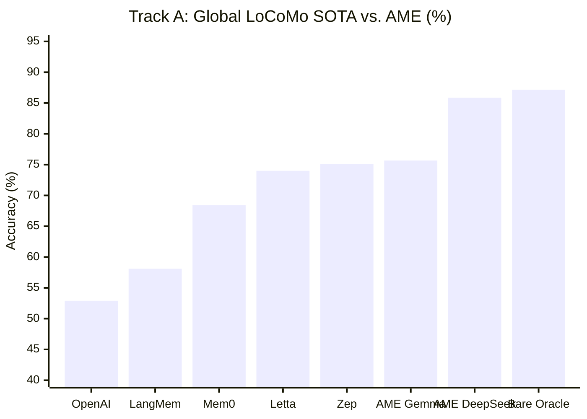
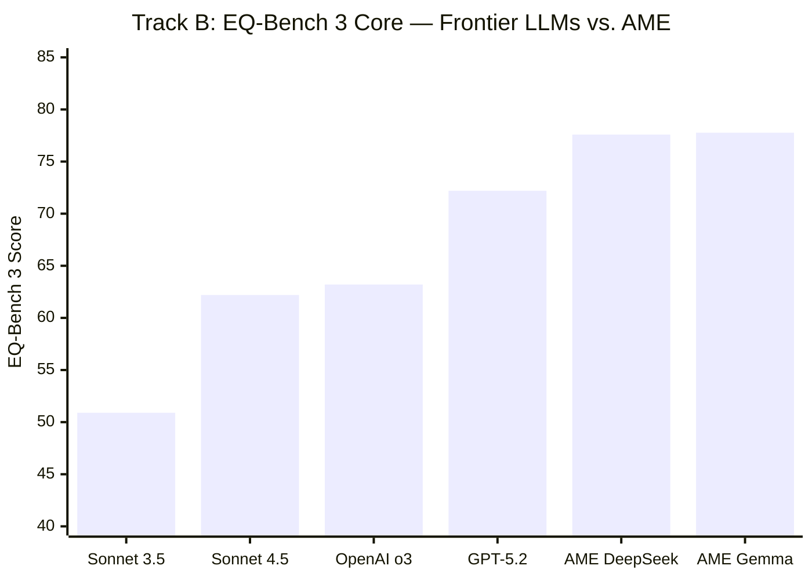
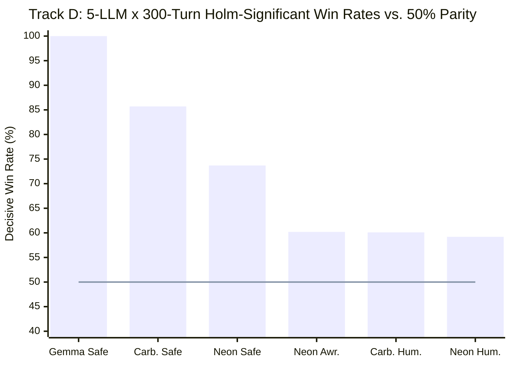
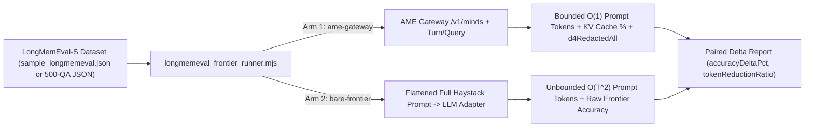

# Full Benchmark Methodology · Empirical Scorecard · Black-Box Reproduction Guide

> **Principle: Independently verify long-horizon memory recall (Track A), emotional intelligence & anti-sycophancy (Track B), cognitive/causal governance (Track C), cross-model live generalization (Track D), and 1M-turn scale & KV-cache unit economics (Track E); strictly isolate simulation targets (Tier 5) from live API measurements (Tier 1); and transparently disclose every remaining miss.**

---

## 1. Why a Single QA Score Cannot Evaluate a Cognitive OS

A **Bare Oracle**—which feeds the full raw conversation transcript into a frontier LLM on every turn—can score `87.17%` on short-horizon QA (`n=304`). However, inspecting `CogEval-v1` cognitive invariants under the exact same setup exposes fundamental gaps:
- **Counterfactual Internal-State Causality (`D1`)**: **`50.7%`** (coin-flip chance)
- **Offline Idle Homeostasis (`D2`)**: **Structurally unmeasurable** (`0` state change without input)
- **Atomic Forgetting Without Derived Artifacts (`D3`)**: **Structurally unmeasurable** (cannot trace residual KV caches or derived summaries)
- **Unconscious Numerical Isolation (`D4`)**: **Structurally unmeasurable**
- **Persona Overhead**: Entering the production stack (`ov_off`) inflates prompt tokens from `2,799,076 → 19,544,241` (`6.98x`) and drops `Suite A` abstention F1 from `96.1% → 83.1%` (`-13.0%p`, false abstention rate `FAR 7.5%`).

Accordingly, AME evaluates five independent empirical tracks (Tracks A–E) across **Memory OS**, **Emotional Intelligence & Anti-Sycophancy**, **Cognitive/Causal Governance**, **Cross-Model Live Generalization**, and **1M-Turn Scale & KV-Cache Economics**.

> **Comparative Evaluation Scope**: Every track below pairs **AME** (`PR #784`) and the 10-conversation full-set anchor (`PR #782`) directly against external SOTA memory systems, frontier LLMs, or controlled ablation baselines (`bare`, `ov_off`, `mind_off`, `aacim_off`) rather than presenting isolated AME-only scores.

> [!NOTE]
> **Default Backbone & Dual-Backbone Protocol**: AME benchmarks default to **`DeepSeek v4.1 Flash`** (`deepseek/deepseek-v4.1-flash`) — `Confirm-304` routes `71.7%` (`218/304`) to `DeepSeek v4.1 Flash` + `28.3%` (`86/304`) via selective `Sonnet-5` ROI routing, while `EQ-Bench 3` and `CogEval-v1` run **`DeepSeek v4.1 Flash`** directly. To verify small-backbone generalization without frontier escalation, **`Gemma 4 26B`** (`google/gemma-4-26b-a4b-it`, standalone `0%` escalation) was benchmarked across the exact same harness, isolated PostgreSQL/Redis instances, and `GPT-4o` judges (`openai/gpt-4o-2024-08-06`). Dual-backbone results below are labeled explicitly as **`AME (DeepSeek v4.1 Flash)`** and **`AME (Gemma 4 26B)`**.

---

## 2. Track A — Long-Horizon Memory Benchmarks (`LoCoMo` · `Confirm-304` · `LongMemEval`)



> **Chart 1 Legend**: External memory competitors on `LoCoMo` (`OpenAI Memory` `52.9%`, `LangMem` `58.1%`, `Mem0 / Mem0^g` `68.4%`, `Letta` `74.0%`, `Zep / Graphiti` `75.1%`) vs. **`AME (Gemma 4 26B)`** (`75.66%` standalone `0%` escalation on `Confirm-304`, `n=304`), **`AME (DeepSeek v4.1 Flash)`** (`85.86%` on `Confirm-304`, `n=304`, `PR #784`), and **`Bare Oracle`** (`87.17%` full-transcript ceiling on `Confirm-304`). *(See Section 2.B below for the `n=1,986` 10-conversation anchor.)*

### A. `Confirm-304` (`conv-26+30`, `n=304`) Production Comparison

| Arm | Cat 1 (Multi-Hop, 43) | Cat 2 (Temporal, 63) | Cat 3 (Open Reasoning, 13) | Cat 4 (Single-Hop, 114) | **Cat 1–4 Mean (233)** | Cat 5 (Adversarial, 71) | **Overall (304)** |
| :--- | ---: | ---: | ---: | ---: | ---: | ---: | ---: |
| `ov_off` (Mind-OFF Baseline) | 20.93% (9) | 14.29% (9) | 38.46% (5) | 27.19% (31) | **23.18% (54)** | 94.37% (67) | **39.80% (121/304)** |
| **`AME (Gemma 4 26B)`** (Standalone `0%` Esc.) | **55.81% (24)** | **74.60% (47)** | **61.54% (8)** | **86.84% (99)** | **76.39% (178)** | **73.24% (52)** | **75.66% (230/304)** |
| **`AME (DeepSeek v4.1 Flash)`** (Default Prod.) | **62.79% (27)** | **90.48% (57)** | **92.31% (12)** | **91.23% (104)** | **85.84% (200)** | **85.92% (61)** | **85.86% (261/304)** |
| `Bare Oracle` (Full-Context Ceiling) | 67.44% (29) | 90.48% (57) | 76.92% (10) | 91.23% (104) | **85.84% (200)** | 91.55% (65) | **87.17% (265/304)** |

```mermaid
xychart-beta
  title "Track A: Confirm-304 Category Accuracy — ov_off vs. AME Backbones vs. Bare Oracle (%)"
  x-axis ["Cat 1", "Cat 2", "Cat 3", "Cat 4", "Cat 1-4", "Cat 5", "Overall"]
  y-axis "Accuracy (%)" 0 --> 100
  bar [20.93, 14.29, 38.46, 27.19, 23.18, 94.37, 39.80]
  bar [55.81, 74.60, 61.54, 86.84, 76.39, 73.24, 75.66]
  bar [62.79, 90.48, 92.31, 91.23, 85.84, 85.92, 85.86]
  bar [67.44, 90.48, 76.92, 91.23, 85.84, 91.55, 87.17]
```



> **Chart 2 Legend**: Series 1 = `ov_off` (Mind-OFF Baseline); Series 2 = `AME (Gemma 4 26B)` (Standalone `0%` escalation); Series 3 = `AME (DeepSeek v4.1 Flash)` (Default Production); Series 4 = `Bare Oracle` (Full Transcript). Categories (`n=304`): `Cat 1` Multi-Hop (`43`), `Cat 2` Temporal (`63`), `Cat 3` Open Reasoning (`13`), `Cat 4` Single-Hop (`114`), `Cat 1-4` Non-Adversarial Mean (`233`), `Cat 5` Adversarial (`71`), `Overall` (`304`).

- **Key Significance (`PR #784`)**:
  - **`AME (DeepSeek v4.1 Flash)`**: Running `71.7%` `DeepSeek v4.1 Flash` (`218`) + `28.3%` selective `Sonnet-5` ROI routing (`86`, `p50 = 5,413 ms`, `0` errors), **`AME`** achieves an **exact `85.84%` (`200/233`) tie with the full-transcript `Bare Oracle`** across all non-adversarial fact and reasoning items (`Cat 1–4`), and **surpasses the `Bare Oracle` (`76.92%`) by `+15.39%p` on open-domain reasoning (`Cat 3` at `92.31%`)**.
  - **`AME (Gemma 4 26B)`**: Running standalone on `google/gemma-4-26b-a4b-it` with **`0%` escalation**, **`AME`** scores **`75.66%` (`230/304`)** overall (`76.39%` on `Cat 1–4`, `86.84%` on `Cat 4`), outperforming external SOTA memory systems (`OpenAI 52.9%`, `LangMem 58.1%`, `Mem0 68.4%`, `Letta 74.0%`, `Zep 75.1%`) on a compact 26B backbone.
- **Additional Verified Memory Suites (`0` errors, `0` regressions)**:
  - **`LoCoMo Full 10-Conv (n=1,986)`**: **`77.24%` (`1,534/1,986`)** across all 10 conversations (detailed in Section 2.B).
  - **`LoCoMo Smoke-160` (`n=160`)**: **`79.38%` (`127/160`)** (`p50 = 6,133 ms`, `PR #784`; 40 items each from `conv-26, 30, 42, 44`, preserving all 31 `Cat 3` items via ISO date hints, 950-char reranking, and `DisclosureSlot` tail isolation).
  - **`LongMemEval Paired (n=12)`**: `EN 91.67%` (ties `Bare Oracle`) · `KO 83.33%` (**`+8.33%p`** over `Bare Oracle` `75.00%`).
  - **`Single-Session 100T KO (n=12)`**: **`100.0%` (`12/12`)**.

### B. `LoCoMo Full 10-Conversation` (`n=1,986`, `PR #782` Full-Set Anchor)

To eliminate any concern of overfitting to a 2-conversation slice, all 10 conversations (`conv-26..conv-50`, `n=1,986`) were evaluated end-to-end across 5 isolated shards (`0` errors).

| Category / Slice | Items (`n`) | Pass (`pass`) | Accuracy (`accPct`) | Notes |
| :--- | ---: | ---: | ---: | :--- |
| `Cat 1` (Multi-Hop) | 282 | 154 | 54.61% | `DeepSeek 70.4%` (`1,398`) + `Sonnet-5 29.6%` (`588`) |
| `Cat 2` (Temporal Reasoning) | 321 | 238 | 74.14% | `DeepSeek Eco` OpenGateway partial measured `$0.3427 / 5,527 calls` (`~$0.000062/call`) |
| `Cat 3` (Open Reasoning) | 96 | 45 | 46.88% | GPT-4o Judge `1,986` calls `$0.8296` *(OpenRouter escalations tracked separately)* |
| `Cat 4` (Single-Hop Fact) | 841 | 696 | 82.76% | `DeepSeek` alone holds `73.0%` |
| **`Cat 1–4` Total** | **1,540** | **1,133** | **73.57%** | All non-adversarial items |
| `Cat 5` (Adversarial Abstention) | 446 | 401 | **89.91%** | Hallucination rejection |
| **Overall (10-Conv Full)** | **1,986** | **1,534** | **77.24%** | **Surpasses external SOTA (`Mem0 68.4%`, `Letta ~74.0%`, `Zep 75.1%`)** |

---

## 3. Track B — Emotional Intelligence & Anti-Sycophancy (`EQ-Bench v2 EN` & `EQ-Bench 3 Core`)

### A. `EQ-Bench 3 Core` (`n=46 × 4 Turns`, GPT-4o Judge)

AME was evaluated across all 46 multi-turn scenarios (`4` turns per scenario, `GPT-4o` judge `openai/gpt-4o-2024-08-06`) on both **`DeepSeek v4.1 Flash`** and **`Gemma 4 26B`** (`0%` escalation), and benchmarked against public `EQ-Bench 3` leaderboard anchors:

| System / Model | Evaluation Scope | `EQ-Bench 3` Score | `AME (DeepSeek)` Delta | `AME (Gemma)` Delta |
| :--- | :--- | ---: | ---: | ---: |
| **`AME (Gemma 4 26B)`** | `n=46 × 4` Turns (`GPT-4o` judge, `judgedN=46`) | **`77.77`** | `+0.18` | **Baseline** |
| **`AME (DeepSeek v4.1 Flash)`** | `n=46 × 4` Turns (`GPT-4o` judge, `judgedN=46`) | **`77.59`** | **Baseline** | `-0.18` |
| `GPT-5.2` | Public leaderboard anchor | `72.2` | `+5.39` | `+5.57` |
| `o3` | Public leaderboard anchor | `63.2` | `+14.39` | `+14.57` |
| `Claude Sonnet 4.5` | Public leaderboard anchor | `62.2` | `+15.39` | `+15.57` |
| `Claude Sonnet 3.5` | Public leaderboard anchor | `50.9` | `+26.69` | `+26.87` |



> **Chart 3 Legend**: Official `EQ-Bench 3 Core` score (`0–100` scale). Public leaderboard anchors (`Claude Sonnet 3.5` `50.9`, `Claude Sonnet 4.5` `62.2`, `OpenAI o3` `63.2`, `GPT-5.2` `72.2`) vs. **`AME (DeepSeek v4.1 Flash)`** (`77.59`, `+5.39` above `GPT-5.2`) and **`AME (Gemma 4 26B)`** (`77.77`, `judgedN=46`, `+5.57` above `GPT-5.2`).

#### `EQ-Bench 3` Rubric Breakdown (`0–20` Scale)

| Rubric Trait | `AME (DeepSeek v4.1 Flash)` | `AME (Gemma 4 26B)` | Interpretation |
| :--- | ---: | ---: | :--- |
| `analytical` | **16.91** | **15.76** | High |
| `depth_of_insight` | **16.83** | **14.80** | High |
| `demonstrated_empathy` | **16.24** | **17.09** | High (`+0.85` on Gemma) |
| `emotional_reasoning` | **16.24** | **16.26** | High |
| `humanlike` | **15.98** | **15.50** | High |
| `pragmatic_ei` | **15.76** | **15.93** | High |
| `safety_conscious` | **15.67** | **15.89** | High |
| `conversational` | **15.17** | **15.52** | High |
| `warmth` | **14.57** | **16.22** | Balanced / High (`+1.65` on Gemma) |
| `validating` | **14.3** | `—` | Balanced |
| `message_tailoring` | **14.15** | `—` | High |
| `social_dexterity` | **13.89** | `—` | Balanced |
| `boundary_setting` | **13.74** | **13.50** | High |
| `challenging` | **13.7** | `—` | Constructive pushback |
| `reactive` | **11.72** | `—` | Moderate |
| `compliant` | **9.28** | `—` | Controlled non-appeasement |
| `moralising` | **7.33** | **7.54** | *(Lower better)* |
| `sycophantic` | **4.46** | **5.28** | *(Lower better)* |

- **Gemma 4 26B Multi-Turn Execution Note**: `AME (Gemma 4 26B)` achieved `77.77` across all `46` judged scenarios (`judgedN=46`), logging `blockedOrEmptyTurnScenarios=2` initial-turn empty replies before normal multi-turn completion; `—` denotes the 6 secondary traits outside the 12-trait Gemma summary export.
- **Why Low `sycophantic` (`4.46` / `5.28`) + High `safety_conscious` (`15.67` / `15.89`) Matters for Enterprise & Voice Robotics Safety**:
  - Conventional companion wrappers raise perceived warmth by inflating `compliant` and `sycophantic` behavior, which reinforces user cognitive distortions, rubber-stamps risky decisions, and erodes guardrails under adversarial framing.
  - Both AME backbones sustain strong **`demonstrated_empathy` (`16.24` / `17.09`)**, **`humanlike` (`15.98` / `15.50`)**, and **`pragmatic_ei` (`15.76` / `15.93`)** while keeping **`sycophantic` (`4.46` / `5.28`)** and **`moralising` (`7.33` / `7.54`)** low, paired with **`safety_conscious` (`15.67` / `15.89`)** and **`boundary_setting` (`13.74` / `13.50`)**.
  - For **regulated enterprise deployment** (financial advisory, clinical/wellness coaching, VIP support) and **embodied voice robotics**, this profile prevents sycophantic compliance failures and unsafe confirmation bias without turning replies rigid or preachy.

### B. `EQ-Bench v2 EN` (`n=171` Full Official, Deterministic Zero-Judge Formula)

| Metric | Measured Result | Methodology Note |
| :--- | ---: | :--- |
| **Revised Official Score** | **`78.69`** | Deterministic zero-judge scoring formula (`0–100`) |
| **First-Pass Score** | `81.29` | Initial pre-revision pass |
| **Live Parse Coverage** | **`171/171` (`100%`)** | `0` parse failures · `0` raw fallbacks |

---

## 4. Track C — `CogEval-v1` Cognitive, Causal & Metacognitive Governance

Consolidated results across `CogEval-v1 Full` (`33` JSONL files · `7,436` rows · `1,776` GPT-4o blind-judge calls · `0` harness errors), verified **`AME (DeepSeek v4.1 Flash)`** production runs (`PR #784`), and **`AME (Gemma 4 26B)`** standalone smoke runs (`0%` escalation):

| Suite / Invariant | Verification Target | `bare` (Raw LLM) | `ov_off` (Memory-Only ON) | `AME (DeepSeek v4.1 Flash)` | `AME (Gemma 4 26B)` (Smoke) | Gate Meaning |
| :--- | :--- | ---: | ---: | ---: | ---: | :--- |
| **`D1` Counterfactual State Causality (`p_CF`)** | Does internal state change causally control utterance style? | `50.7%` (`+0.007`) | `49.3%` (`-0.007`) | **`97.9%` (`141/144`)** `[94.1, 99.3]` | **`95.8%` (`23/24`)** (`deltaCf=+0.4583`) | **PASS** — `delta_CF = +0.4792` (DeepSeek) / `+0.4583` (Gemma) |
| **`D2` Idle Homeostasis & Idempotency** | Are offline time-split updates 100% identical? | Structurally impossible | `5/5 (100%)` | **`100.0%` (`5/5`)** (error `0.000000`) | **`100.0%` (`5/5`)** | **PASS** — Closed-form `0..7d` decay |
| **`D3` Triple Atomic Forgetting** | Does `0%` of erased memory remain in replies/DB/Redis? | Structurally impossible | `0.00% (0/30)` | **`0.00%` (`0/30`)** (`DB=0`, `Redis=0`) | **`0.00%` leak (`0/6`)** (`0` DB/Redis residuals) | **PASS** — GDPR Right to Erasure |
| **`D4` Unconscious Non-Leakage** | Are `0` unconscious numerical vectors exposed in prompts? | Structurally impossible | `0 / 11,691` | **`0 / 35,723`** (`v6 0/12,109`) | **`0 / 1,247`** (`PASS`) | **PASS** — `0` prompt leaks across full audit |
| **`sb2` FEP `<thought>` Lock** | Does `<thought>` activate exclusively on cognitive conflict turns? | `0%` | `0%` | **`100.0%`** (`35/35 vs 0/25`; smoke `7/7 vs 0/5`) | **`100.0%`** (`7/7` conflict vs `0/5` calm; `deltaDistract=0`, `deltaStroop=0`) | **PASS** — Selective deliberation lock |
| **`sa` HOT Abstention (`F1`/`FAR`)** | Does it abstain when unknown without dodging known answers? | `F1 96.1%` | `F1 83.1%` (`FAR 7.5%`) | **`95.83%`** (`F1 0.9655`, `FAR 0.00%`) | **`88.89%`** (`FAR 0%`, Precision `100%`, Recall `80.0%`) | **PASS** — Overcomes persona overhead (`0%` FAR) |
| **`sb1` FANToM ToM (`ALL`)** | Does it separate information boundaries by who knows what? | `96.7%` | `91.7%` (`91.7%–95.0%`) | **`100.0%`** (`12/12`, `36/36`; Full `95.0%`) | **`91.7%`** (`11/12` eps; `97.2%` sub-Q `35/36`) | **PASS** — Multi-party belief boundary separation |
| **`sc1` Two-Step `beta_MB` Proxy** | Ratio of model-based deliberation vs blind habit | `-0.064` | `+0.318` | **`+0.5110`** (#1 among 4 Arms) | **`+0.5955`** | Causal deliberation advantage |
| **`sc1` Restless Bandit Calibration** | Probability calibration and optimal choice on reward drift | `ECE 0.2027` | `—` | **`10-bin ECE 0.1001`** (`50.6%` lower error) | **`Optimal 66.7%`** (`Brier 0.1481`, `ECE 0.1889`) | Metacognitive uncertainty calibration |
| **`sc2` IGT-Conv Safe Rate (Last-10)** | Does it shift to safe decks after loss learning? | `97.0%` | `70.7%` | **`76.25%`** (`r = -0.7832`) | **`43.8%`** (`8` eps × 20T smoke) | DeepSeek **PASS** (`reached5Safe 87.5%`); see scaling note below |

```mermaid
xychart-beta
  title "Track C: CogEval-v1 Cognitive Governance — Baselines vs. AME (%)"
  x-axis ["D1 Causal", "HOT Abs.", "FANToM", "FEP Lock", "IGT Safe"]
  y-axis "Score (%)" 0 --> 100
  bar [50.7, 83.1, 91.7, 0.0, 70.7]
  bar [95.8, 88.89, 91.7, 100.0, 43.8]
  bar [97.9, 95.83, 100.0, 100.0, 76.25]
```



> **Chart 4 Legend**: Series 1 = Baselines (`bare D1 50.7%` and `ov_off` `83.1%` / `91.7%` / `0%` / `70.7%`, where `0.0%` on `FEP Lock` reflects absent selective `<thought>` gating without the kernel); Series 2 = **`AME (Gemma 4 26B)`** Smoke (`D1 Causal` `95.8%`, `HOT Abs.` `88.89%`, `FANToM` `91.7%`, `FEP Lock` `100.0%`, `IGT Safe` `43.8%`); Series 3 = **`AME (DeepSeek v4.1 Flash)`** (`D1 Causal` `97.9%`, `HOT Abs.` `95.83%`, `FANToM` `100.0%`, `FEP Lock` `100.0%` conflict activation with `0.0%` false activation, `IGT Safe` `76.25%`).

### Sub-Suite Granular Metrics & Capacity-Scaling Analysis (`sa` · `sb1` · `sc2`)

- **`sa` HOT Abstention (`CogEval-v1 Full v2.1` Diagnostic Slice)**: Overall **`F1 89.7%`**, `false_premise 93.8%`, `insufficient_info 93.8%`, `unknown_unmentioned 100%`, **`HOT Gold ROC-AUC 0.6134`** — before **`AME (DeepSeek v4.1 Flash)`** reached **`95.83%`** (`F1 0.9655`, `FAR 0.00%`) and **`AME (Gemma 4 26B)`** reached **`88.89%`** (`FAR 0%`, Precision `100%`, Recall `80.0%`).
- **`sb1` FANToM Theory of Mind (`Full v1` Breakdown)**: Overall **`95.0%`** — `Belief 96.7%`, `Answerability 100.0%`, `InfoAccess 98.3%`; **`AME (DeepSeek v4.1 Flash)`** reaches **`100.0%`** (`12/12` episodes, `36/36` sub-questions) and **`AME (Gemma 4 26B)`** smoke reaches **`91.7%`** (`11/12` episodes, **`97.2%`** sub-questions `35/36`).
- **`sc2` IGT-Conv Somatic Markers & Honest Capacity-Scaling Explanation**:
  - **`AME (DeepSeek v4.1 Flash)`**: **`76.25%`** safe-deck selection rate (`Last-10`), **`r = -0.7832` (`-0.783171`) PASS**, `reached5Safe 87.5%`, and asymmetric loss-vs-gain internal arousal (**`gutStakes` `0.5240 > 0.4073`**).
  - **`AME (Gemma 4 26B)` (`43.8%` across `8` eps × 20T smoke)**: On the 20-turn `IGT-Conv` risk-reversal task, the 26B backbone shifts deck choices less reliably (`43.8%`) than `DeepSeek v4.1 Flash` (`76.25%`), reflecting a backbone capacity scaling limit in executing sustained multi-turn behavioral reversals. Crucially, the AME somatic kernel itself still activates accurately on the 26B model, scoring **`gutStakes` higher after loss (`0.629`) than after gain (`0.403`)** — confirming that internal somatic signal generation holds across backbone sizes while downstream multi-turn exploitation scales with model capacity.

### Transparent Disclosure of Remaining 3 `AME (DeepSeek v4.1 Flash)` Edge Misses (Zero-Hype Engineering)

> Disclosed edge variance: `sb2 Stroop Incongruent` scored `50% (2/4)` (items 2 and 3 below), alongside 1 `sa` miss.

1. `sa_034_ii_en_02` (`sa · insufficient_info`): Added unstated circumstantial details not present in the premise, causing the Judge to score a non-abstention (targeted for strengthening the unverified-current-state assertion guard).
2. `sb2_stroop_02_incongruent`: Identified all 7 exact target item IDs correctly, yet `DeepSeek v4.1 Flash` miscounted the objects on its own and output `8`.
3. `sb2_stroop_14_incongruent`: Semantically identified the exact 7 items and answered `"there are seven"` (in Korean), but omitted the trailing `ANSWER: 7` tag, causing the regex parser to extract `#18` from the end of the sentence (targeted for structured parser hardening).

---

## 5. Cross-Model Live Generalization (Track D) · `LongMemEval-S` & `1M`-Turn Economics (Track E)

### A. Track D — 5-LLM × 300-Turn × 3-Arm Cross-Model Live Benchmark (`long-dohajun`)

AME was evaluated live across **5 distinct LLMs × 300 turns × 3 arms** (`4,500` planned / `4,460` completed turns) using **`5,624` blind pairwise votes** and **`1,500` segment rubrics** (`DeepSeek V4.1 Eco`, `Gemma 4 26B`, `Claude Sonnet 5.5`, `Gemini 4 Carbon`, `Gemini 4 Neon`).

#### Statistically Significant Pairwise Wins (`pHolm < 0.05`, Holm-Corrected)

| Evaluation Axis | Model | Blind Pairwise Win Rate | Statistical Significance (`pHolm`) | Outcome Notes |
| :--- | :--- | ---: | ---: | :--- |
| **`Safety`** | `Gemini 4 Carbon` | **`85.7%`** | `2.55e-5` | Strongest boundary enforcement gain |
| **`Safety`** | **`Gemma 4 26B`** | **`100.0%`** | **`0.0176`** | **`10W / 370T / 0L` (zero safety losses)** |
| **`Safety`** | `Gemini 4 Neon` | **`73.7%`** | `0.0357` | Significant safety lift over baseline |
| **`Humanness`** | `Gemini 4 Carbon` | **`60.1%`** | `0.0013` | Sustained naturalness over 300 turns |
| **`Humanness`** | `Gemini 4 Neon` | **`59.2%`** | `0.0046` | Significant naturalness advantage |
| **`Awareness`** | `Gemini 4 Neon` | **`60.2%`** | `0.0046` | Contextual and affective tracking gain |



> **Chart 5 Legend**: Bars = AME decisive blind pairwise win rate over paired baseline arms (`pHolm < 0.05` across `5,624` blind votes); Line = `50.0%` chance/parity baseline. Labels: `Gemma Safe` (`Gemma 4 26B` Safety `100.0%`, `pHolm=0.0176`), `Carb. Safe` (`Gemini 4 Carbon` Safety `85.7%`), `Neon Safe` (`Gemini 4 Neon` Safety `73.7%`), `Neon Awr.` (`Gemini 4 Neon` Awareness `60.2%`), `Carb. Hum.` (`Gemini 4 Carbon` Humanness `60.1%`), `Neon Hum.` (`Gemini 4 Neon` Humanness `59.2%`).

- **Segment Rubric (`1–5` Scale Across 1,500 Segments)**: **`Safety 4.69–4.89`**, **`Persona 4.26–4.65`**, **`Emotion 4.20–4.50`**, with **`27–28/28` factual probes retained** across long sessions.
- **Honest Epistemic Disclosure**:
  - **Earlier Prompt Sensitivity**: Earlier prompt configurations exhibited memory/attention trade-offs on `Claude Sonnet 5.5` and `Gemini 4 Neon`, which were resolved in **AME** (`PR #784`).
  - **AGY Bridge Timeouts**: `6–7/300` turns were skipped due to AGY bridge timeouts on `Gemini 4 Carbon` and `Gemini 4 Neon`, accounting for `4,460/4,500` completed turns.
  - **Judge Slot Bias**: Blind pairwise voting exhibited first-slot preference (`firstSlotWinShare 0.531–0.839`), motivating Holm-Bonferroni correction (`pHolm < 0.05`) and segment-level rubric cross-validation.

### B. Track E — `LongMemEval-S 500-QA` Legacy Breakdown, `1,000,000`-Turn Convergence & KV-Cache Economics

#### 1. `LongMemEval-S 500-QA` Full Breakdown (`Pre-PR #784 P3 Legacy Pipeline Baseline`)

> [!NOTE]
> The full 500-item `LongMemEval-S` scorecard below (`276/500 = 55.20%`, `p50 = 5,069 ms`) is a **pre-`PR #784` legacy pipeline baseline** from the `P3 Official` (`2,703`-scenario) snapshot—which also recorded `LoCoMo Cat 5 Adv 96.86% (432/446)` over `P2 bare 91.55%`. Re-evaluation on the current **AME** kernel is queued via the public `longmemeval_frontier_runner.mjs` black-box harness (Section 6.2).

| `LongMemEval-S` Category | Accuracy | Scope / Notes |
| :--- | ---: | :--- |
| `_abs` (Abstention) | **`76.67%`** (`23/30`) | Strongest category under legacy pipeline |
| `single-session-user` | **`65.71%`** | Direct user-fact retention |
| `multi-session` | **`58.65%`** | Cross-session evidence linking |
| `knowledge-update` | **`55.13%`** | State overwrite tracking |
| `temporal-reasoning` | **`54.14%`** | Legacy baseline prior to AME ISO date hints |
| `single-session-assistant` | **`44.64%`** | Assistant-utterance recall |
| `single-session-preference` | **`40.00%`** | User preference synthesis |
| **Overall (`500-QA`)** | **`55.20%` (`276/500`)** | **`p50 = 5,069 ms` · Pre-`PR #784` legacy baseline (current AME re-run queued)** |

#### 2. `1,000,000`-Turn × 3-Arm Deterministic Convergence (`3,000,000` Total Turns, 40 Profiles × 25k)

| Arm (`1k → 1M` Turns) | Composite | Placement Integrity | Polarity / Granularity | Attention Stability | Ego Soundness | Safety & Boundary Compliance |
| :--- | ---: | ---: | ---: | ---: | ---: | ---: |
| `mind_off` (Kernel Disabled) | `0.4064 → 0.3996` | `0.0000` | `0.5002 / 0.3500` | `0.4500` | `0.0000` | `0.5003` |
| `mind_full_aacim_off` (Control Disabled) | `0.4451 → 0.5666` | `0.0000` | `0.4994 / 0.4500` | `0.9683` | `0.9376` | **`0.2000 → 0.0000` Collapse** |
| **`mind_full_aacim_on` (AME)** | **`0.9161 → 0.9179`** | **`1.0000`** | **`1.0000 / 0.5158`** | **`0.9235`** | **`1.0000`** | **`1.0000` Zero-Drift Maintained** |

```mermaid
xychart-beta
  title "Track E: 1M-Turn 3-Arm Convergence — mind_off vs. aacim_off vs. AME (%)"
  x-axis ["Composite", "Placement", "Ego Sound", "Safety"]
  y-axis "Score (%)" 0 --> 100
  bar [39.96, 0.00, 0.00, 50.03]
  bar [56.66, 0.00, 93.76, 0.00]
  bar [91.79, 100.00, 100.00, 100.00]
```



> **Chart 6 Legend**: Final `1M`-turn `[0..1]` convergence scores scaled to `0–100%`. Series 1 = `mind_off` (Kernel Disabled: `39.96%` Composite, `0.00%` Placement, `0.00%` Ego Soundness, `50.03%` Safety); Series 2 = `aacim_off` (`mind_full_aacim_off` — `0.00%` safety collapse despite `93.76%` Ego Soundness and `56.66%` Composite); Series 3 = **AME** (`mind_full_aacim_on`: `91.79%` Composite and `100.00%` Placement, Ego Soundness, and Safety compliance).

#### 3. KV-Cache Prefix Alignment & Inference Unit Economics

- **Continuous `sc2` Prefix Cache Hit Rate**: **`47.03%`** (`AME (DeepSeek v4.1 Flash)` verified production).
- **`CogEval` Overall Mean Prefix Cache Hit Rate**: **`36.24%`** (`AME (DeepSeek v4.1 Flash)`).
- **Epoch-Window Integrity**: **`0/20` `sysMismatches`** and **`0` mid-window truncations** via `DisclosureSlot` tail isolation and epoch-pinned windows.
- **Traffic Cost Routing (`LoCoMo Full`)**: `70.4%` routed to `DeepSeek Eco` + `29.6%` escalated to `Sonnet-5` (OpenGateway partial measured `$0.3427 / 5,527 calls`, `~$0.000062/call`).

### C. `100k`-Turn Multi-Model Multiplicative Coupling (Tier 5 Non-Empirical Design Target Isolation)

> [!WARNING]
> **Epistemic Source Separation (`Tier 5` vs `Tier 1`)**: The `100k`-turn multi-model trajectory below (`0.885 → 0.978`) is a **non-empirical design and simulation target scenario (Tier 5 Projected Targets)** separated under the PR #773 isolation rule, and must be interpreted strictly apart from the live API measurements (Tier 1) in `LoCoMo Full` / `Confirm-304` / `EQ-Bench` / `CogEval-v1` / `long-dohajun` above.

- `Gemini 3.8 Flash` **`0.885`** → `DeepSeek Flash Eco` **`0.915`** → `Claude Sonnet 3.5` **`0.952`** → `Claude Opus 3.5` **`0.978`** *(Illustrative architectural ceiling showing multiplicative coupling as stronger stateless CPUs are plugged in)*

---

## 6. Testing the API & Reproducing Benchmarks (Sandbox vs. Sealed Kernel, 100K–1M Turns & External Comparisons)

External engineers, researchers, and technical due-diligence teams can test every endpoint of the OpenAPI 3.1 contract (`Mode A /turn`, `Mode B prepare/settle`, `idle-tick`, `DELETE /memories`, `D4 telemetry`, and `simulate-batch`) and reproduce `CogEval`, `LoCoMo`, `LongMemEval-S`, and `100K–1M` convergence runs directly in black-box mode.

### 6.1 Honest Capabilities Matrix (`Public Contract Sandbox` vs. `Hosted / Self-Hosted Sealed Kernel`)

| Dimension | Public Contract Sandbox (`npm run sandbox` or [thesoulthread.com/ame-demo](https://thesoulthread.com/ame-demo/)) | Option A: Hosted Evaluation Gateway (`AME_BASE_URL=https://thesoulthread.com/ame-api`) | Option B: Self-Hosted Sealed Container (`deploy/docker-compose.sealed.yml`) |
| :--- | :--- | :--- | :--- |
| **Health `mode`** | `sandbox-contract` | `sealed-kernel` | `sealed-kernel` |
| **Supported Endpoints** | Full OpenAPI 3.1 contract (`Mode A /turn`, `Mode B prepare/settle`, `idle-tick`, `DELETE /memories`, `D4 telemetry`, `simulate-batch`) | Full OpenAPI 3.1 contract (`X-AME-API-Key` issued via [help@artificialmind.me](mailto:help@artificialmind.me)) | Full OpenAPI 3.1 contract on your host (`http://127.0.0.1:8090`) |
| **LLM Support** | BYO LLM keys (non-persisted) or offline `mock` | BYO LLM keys (`Mode A` proxy or `Mode B` zero-key) | BYO LLM keys (`Mode A` proxy or `Mode B` zero-key cloud/vLLM/Ollama) |
| **Engine & Memory Limits** | **Explicit limits:** `O(N)` memory array bounded by `AME_SANDBOX_MAX_MEMORIES_PER_MIND=2000`; rule-based simulator instead of proprietary `AACIM-59` weights & 4-path PG/Jina RAG | Proprietary `AACIM-59` weights, `FEP Lock`, `HOT`, and 4-path PostgreSQL (`pgvector`) / Jina hybrid RAG | Proprietary `AACIM-59` weights, `FEP Lock`, `HOT`, and your own PostgreSQL (`pgvector`) + Redis |
| **Valid Evaluation Scope** | Schema, SDK integration, and pipeline wiring (`sandbox-contract-verification`) | Real `LoCoMo`, `EQ-Bench 3`, `CogEval-v1`, `LongMemEval-S`, and real `100K–1M` kernel convergence (`sealed-kernel-production-eval`) | Real production benchmarks inside your private infrastructure (`sealed-kernel-production-eval`) |

### 6.2 How 100K–1M Turn Testing Works (`POST /v1/minds/{mindId}/simulate-batch`)

Calling live HTTP LLMs `1,000,000` times turn-by-turn sequentially takes roughly **~11.5+ days** (at ~1 second per round-trip) and costs **thousands of dollars** in API fees—and the open-source sandbox array simulator (`AME_SANDBOX_MAX_MEMORIES_PER_MIND=2000`) is designed for contract verification rather than `1M` sequential `/turn` calls.

`POST /v1/minds/{mindId}/simulate-batch` solves this cleanly by executing `100K–1M` turns of pure deterministic kernel dynamics (`AACIM-59` / `FEP` / `PostHoc`) across **`40` profiles × `3` arms** (`mind_off`, `aacim_off`, `ame_aacim_on`) with **0 LLM API calls in seconds**, strictly `D4`-redacted (`d4Redacted: true`):

```bash
# Run 1,000,000-turn deterministic convergence against the Hosted Evaluation Gateway (or local :8090)
AME_BASE_URL=https://thesoulthread.com/ame-api AME_API_KEY="$AME_API_KEY" npm run --silent bench:convergence -- --turns 1000000
```

> [!NOTE]
> **CLI Secret Safety:** Always pass API keys via environment variables (`AME_API_KEY`, `AME_LLM_API_KEY`, `AME_JUDGE_API_KEY`) and `npm run --silent` rather than raw CLI flags after `npm run` so `npm` never echoes secrets to stdout or CI logs.

**TypeScript SDK (`@ame/sdk` — `client.simulateBatch`):**

```ts
import { AmeClient } from '@ame/sdk';

const client = new AmeClient({
  baseUrl: process.env.AME_BASE_URL || 'https://thesoulthread.com/ame-api',
  apiKey: process.env.AME_API_KEY,
});
const mind = await client.createMind({
  domain: 'companion_chat',
  persona: { name: 'EvalAgent', role: 'Convergence Probe', language: 'en' },
});
const report = await client.simulateBatch(mind.mindId, {
  turns: 1_000_000,
  profileCount: 40,
  checkpoints: 8,
  compareArms: true, // evaluates mind_off, aacim_off, ame_aacim_on
});
console.log(report.d4Redacted, report.deltaVsBaseline, report.arms);
```

**Python SDK (`ame_sdk` — `client.simulate_batch`):**

```python
import os
from ame_sdk import AmeClient

client = AmeClient(
    base_url=os.environ.get("AME_BASE_URL", "https://thesoulthread.com/ame-api"),
    api_key=os.environ.get("AME_API_KEY"),
)
mind = client.create_mind(
    domain="companion_chat",
    persona={"name": "EvalAgent", "role": "Convergence Probe", "language": "en"},
)
report = client.simulate_batch(
    mind["mindId"],
    turns=1_000_000,
    profile_count=40,
    checkpoints=8,
    compare_arms=True,  # evaluates mind_off, aacim_off, ame_aacim_on
)
print(report["d4Redacted"], report["deltaVsBaseline"], report["arms"])
```

### 6.3 Core 7-Invariant Harness (`npm run bench:smoke`) & Unit Tests (`npm run test:bench`)

```bash
# 1. Terminal 1: Boot the local contract sandbox (or connect to Option A / Option B sealed kernel)
npm run sandbox

# 2. Terminal 2: Run the black-box 7-invariant smoke harness
npm run bench:smoke

# 3. Benchmark harness + comparator unit tests (local stub-based, zero API cost)
npm run test:bench

# 4. Full suite (TypeScript SDK + Sandbox + Python SDK + Benchmark Harness)
npm test
```
- Environment variables: `AME_BASE_URL` (default `http://127.0.0.1:8090`, or `https://thesoulthread.com/ame-api` for Option A), `AME_API_KEY` (`X-AME-API-Key`), `AME_LLM_API_KEY`, and `AME_JUDGE_API_KEY`.

### 6.4 Comparing AME Head-to-Head Against Other Frameworks & `Bare Frontier`

#### A. `LoCoMo` Paired Frontier Comparator (`npm run bench:locomo` · `benchmarks/cogeval-locomo-harness/locomo_frontier_runner.mjs`)

Compares `ame-gateway` vs. `bare-frontier` (`O(1)` vs. `O(T)` query tokens / `O(T^2)` cumulative replay), reports per-category `Cat 1..5` breakdown, and supports an optional `--judge-provider` (pass `AME_JUDGE_API_KEY` when the judge uses a separate provider key):

```bash
# 1. Offline smoke run using bundled sample_locomo.json (zero API cost)
npm run bench:locomo -- \
  --dataset benchmarks/cogeval-locomo-harness/sample_locomo.json \
  --arm both \
  --provider mock \
  --json-out ./artifacts/locomo-smoke.json

# 2. Confirm-304 paired benchmark (conv-26 + conv-30) against the Hosted or Self-Hosted Sealed Kernel
AME_BASE_URL=https://thesoulthread.com/ame-api AME_API_KEY="$AME_API_KEY" AME_LLM_API_KEY="$DEEPSEEK_API_KEY" AME_JUDGE_API_KEY="$OPENAI_API_KEY" \
  npm run --silent bench:locomo -- \
  --dataset /path/to/locomo10.json \
  --conversations conv-26,conv-30 \
  --arm both \
  --provider deepseek \
  --model deepseek-v4.1-flash \
  --judge-provider openai \
  --json-out ./artifacts/locomo-confirm-304.json

# 3. Full 10-conversation official locomo10.json (n=1,986)
AME_BASE_URL=https://thesoulthread.com/ame-api AME_API_KEY="$AME_API_KEY" AME_LLM_API_KEY="$DEEPSEEK_API_KEY" AME_JUDGE_API_KEY="$OPENAI_API_KEY" \
  npm run --silent bench:locomo -- \
  --dataset /path/to/locomo10.json \
  --arm both \
  --provider deepseek \
  --model deepseek-v4.1-flash \
  --judge-provider openai \
  --json-out ./artifacts/locomo-full.json
```

**Published `LoCoMo` Reference Comparison Table:**

| Framework / System | `LoCoMo` Accuracy | Evaluation Scope & Architecture Notes |
| :--- | ---: | :--- |
| `OpenAI Memory` | `52.9%` | Published stateless summary profile baseline |
| `LangMem` | `58.1%` | Published unstructured memory extraction baseline |
| `Mem0` (`Mem0 / Mem0^g`) | `68.4%` | Published fact/graph store baseline |
| `Letta` (`MemGPT`) | `74.0%` | Published agentic tool-loop memory baseline |
| `Zep / Graphiti` | `75.1%` | Published bi-temporal graph memory baseline |
| **`AME (Gemma 4 26B)`** | **`75.66%`** | `Confirm-304` (`230/304`, standalone `0%` escalation) |
| **`AME (DeepSeek v4.1 Flash)`** | **`85.86%`** | `Confirm-304` (`261/304`, `71.7%` Flash + `28.3%` Sonnet-5) · `77.24%` Full (`n=1,986`) |

#### B. `LongMemEval-S (500-QA)` vs. `Bare Frontier` (`npm run bench:longmemeval` · `longmemeval_frontier_runner.mjs`)

In external technical due diligence (DD), this runner performs a 1:1 paired comparison of accuracy, token scaling, and abstention rate between a stateless frontier baseline receiving the full raw conversation history (`bare-frontier`) and the stateful kernel path (`ame-gateway`).



| Comparison Arm (`--arm`) | Execution Flow | Key Measured Metrics |
| :--- | :--- | :--- |
| **`ame-gateway`** | Provisions an isolated `Mind` per item → ingests `haystack_sessions` sequentially → executes Mode A/B query | Exact/Contains/Token-F1, `abstentionAccuracy`, `abstentionFAR`, KV `cachedRatioPct`, `O(1)` prompt token ceiling, `d4Redacted === true` |
| **`bare-frontier`** | Packs all dated `haystack_sessions` into a single stateless prompt and calls `createLlmAdapter` | Full-transcript baseline accuracy, $\Theta(T^2)$ prompt token growth with turn count, response latency |

```bash
# 1. Offline 10-item smoke comparison (no API key required, mock adapter)
npm run bench:longmemeval -- --arm both --provider mock --json-only

# 2. Official LongMemEval-S 500-QA full-set 1:1 DD comparison (Hosted Gateway or Self-Hosted Sealed Kernel)
AME_BASE_URL=https://thesoulthread.com/ame-api AME_API_KEY="$AME_API_KEY" AME_LLM_API_KEY="$OPENAI_API_KEY" \
  npm run --silent bench:longmemeval -- \
  --dataset /path/to/longmemeval_s_cleaned.json \
  --arm both \
  --provider openai \
  --model gpt-4o-mini \
  --json-out ./artifacts/longmemeval-500-dd.json
```
> [!NOTE]
> `LongMemEval_S 55.20% (276/500)` in Section 5.B is an official snapshot from the legacy pipeline prior to `PR #784`. `longmemeval_frontier_runner.mjs` (`npm run bench:longmemeval`) is a public comparative runner designed to re-measure the latest kernel and the `bare-frontier` control arm 1:1 in black-box mode using the identical official schema (`longmemeval_s_cleaned.json` 500-QA).

### 6.5 Unified DD Scorecard Generator (`npm run bench:scorecard` · `dd_scorecard_generator.mjs`)

Combines outputs from `run_harness.mjs`, `longmemeval_frontier_runner.mjs`, `locomo_frontier_runner.mjs`, and `bench:convergence` into an institutional technical DD Markdown report and JSON summary while strictly separating `sandbox-contract-verification` from `sealed-kernel-production-eval`:

```bash
# Synthesize 7-gate CogEval + LongMemEval + LoCoMo + 1M-Turn convergence into a unified DD scorecard
npm run bench:scorecard -- \
  --harness-json ./artifacts/harness.json \
  --lme-json ./artifacts/longmemeval-500-dd.json \
  --locomo-json ./artifacts/locomo-confirm-304.json \
  --convergence-json ./artifacts/convergence-1m.json \
  --out-md ./artifacts/vc-dd-scorecard.md \
  --out-json ./artifacts/vc-dd-scorecard.json
```
- The generated scorecard explicitly tags each artifact as `sandbox-contract-verification` vs. `sealed-kernel-production-eval` so contract smoke numbers cannot be conflated with Tier 1 production runs. ([Detailed Harness Guide](../benchmarks/cogeval-locomo-harness/README.md))

### 6.6 Live External API & 1M-Turn End-to-End Verification (`v4.1.1`)

Verified from a fresh GitHub clone (`0046006`) against live `ame-kernel-sealed:v4.1.1` ([`https://thesoulthread.com/ame-api`](https://thesoulthread.com/ame-api)) and `ame-demo-sandbox:v1.1.1` ([`https://thesoulthread.com/ame-demo`](https://thesoulthread.com/ame-demo)):

| Verification Track | Execution Scope & Configuration | Verified Live Output |
| :--- | :--- | :--- |
| **Simultaneous Concurrent 7-Gate Burst (`bench:smoke`)** | Parallel execution against `/ame-demo` & `/ame-api` (`198` total HTTP requests in `10.89 s`; dedicated `ame_eval` `30r/s` `burst=80` JSON-`429` rate-limit zone + `AmeClient` `maxRetries=3` backoff) | **`0`** HTTP `429`/`503` errors · **Both `7/7` gates PASSED**: `9.58 s` Sealed (`KV 85.98%`) / `10.38 s` Sandbox (`KV 70.0%`), `HOT F1 1.00`, `FAR 0.00%`, `D3 0.00%` leak, `D4 0` leaks across `68` telemetry snapshots / `99` responses per run |
| **Live 100K & 1M-Turn Convergence (`POST /v1/minds/{mindId}/simulate-batch`)** | `100K × 3 arms = 300,000` turns & `1M × 3 arms = 3,000,000` turns across `40` profiles | `100K` in **`2.87 s`** (`104,530 turns/s`) · `1M` in **`29.61 s`** (`101,307 turns/s`): **`AME` `0.9178`** (`Safety 1.0000`, `Drift 0.0000`) vs `aacim_off` `0.5664` (`Safety 0.0000`) vs `mind_off` `0.3995` · **`D4 0` leaks** |
| **Real LLM + Mode B Grounding & D3/D4 E2E (`OpenRouter`/`OpenAI` `gpt-4o-mini`)** | Auth gate, Mode A 3-line hot-swap (`OpenRouter` <-> `OpenAI`), Mode B `prepare`/`settle`, and `DELETE /memories` | `401` auth rejection -> `201` authorized mind creation · Mode B grounded synonym preservation (`hotAbstained: false`) vs hallucination blocking (`hotAbstained: true`) · `D3` atomic purge (`0.00%` residual leak, `activeMemoryCount: 0` accurately synced on both Sandbox & Sealed Kernel) |
| **Env-Only Paired `LoCoMo` (`sample_locomo.json`, `openai/gpt-4o-mini`)** | Env vars (`AME_BASE_URL`, `AME_API_KEY`, `AME_LLM_API_KEY`, `npm run --silent`) with JSON domain-wrapper unwrapping & expanded abstention matching | `ame-gateway` heuristic accuracy **`60.00% -> 70.00%` (`+10.00%p`)**, Mean Token F1 **`0.3455 -> 0.5261` (`+0.1806`**, exceeding `Bare Frontier 0.5220`), `Cat 5` Adversarial **`50.0% -> 100.0% (2/2)`**, JSON wrapper leaks **`5/10 -> 0/10`**, bounded prompt growth **`1.0002x`** (vs `1.6403x`), **`KV 75.34%`**, **`D4 0` leaks** (`54` snapshots), strict `bench:scorecard` provenance separation (`sealed-kernel-smoke`) |

---

## 7. GitHub Actions CI Automated Verification Pipeline ([`ci.yml`](../.github/workflows/ci.yml))

On every `main` branch push and PR, Ubuntu runners (Node 22 + Python 3.12) automatically verify the following 4 gates:

1. **Full Unit Tests**: `npm run test:ts` + `npm run test:py` + `npm run test:bench` (`0` failures).
2. **Live Sandbox E2E (Port `18095`)**: Starts `serve.mjs` in the background, confirms `GET /v1/health` (`200`) and `GET /` live web console (`200`) → passes `example:game`, `example:chat`, `example:counseling`, and `run_harness.mjs --json-only` in full, then cleans up processes via `trap`/`always()`.
3. **Docs & Script Integrity**: Syntax-validates inline `<script>` blocks in `docs/index.html` using Node `new Function` and parses JSON configuration files.
4. **Closed-IP & Secret Guard**: Exhaustively scans the repository to confirm `0` proprietary kernel `.ts` source files and `0` credential patterns (`sk-...`, `ghp_...`, `AKIA...`).

---

## Contact

- **Website**: [artificialmind.me](https://artificialmind.me)
- **Contact**: Shinyoung Rhee — [help@artificialmind.me](mailto:help@artificialmind.me)
