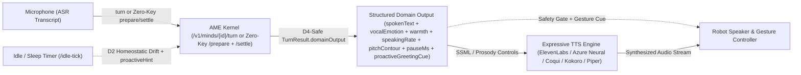

# 3+1 Multi-Domain Application Integration Guide

> **Simply switching the `domain` parameter on a single Kernel API (`/v1/minds`) automatically activates structured outputs (`domainOutput`) and domain-specific safety policies for game NPCs, AI companions, counseling/coaching, custom enterprise agents, and voice-enabled robotics / physical AI (`+ TTS / ASR`).**

---

## 1. Domain Profile Matrix (`DomainId`)

`spec/openapi.yaml` defines four domains (`game_npc`, `companion_chat`, `counseling_coach`, `custom`) as standard contracts. Through `custom` (`defineDomainProfile` / `define_domain_profile`), hardware and embodied-AI teams also configure **`robot_voice` (Voice-Enabled Robotics & Physical AI `+ TTS / ASR`)** schemas that bind kernel state to TTS prosody controls and physical actuation safety gates.

| `domain` ID | Representative Use Cases | Recommended Default `safetyPolicy` | Primary Kernel Layers Used | Example Run Command |
| :--- | :--- | :--- | :--- | :--- |
| **`game_npc`** | RPG merchants/companions, open-world NPCs, strategy simulation AI | `strictAbstention: true`, `antiSycophancy: true`, `crisisEscalation: false` | **L1** Somatic Markers (betrayal/reward) + **L2** `sb1 FANToM` information asymmetry + **L4** `D2` idle homeostasis | `npm run example:game` |
| **`companion_chat`** | AI friends, story characters, personal assistants, social wearables | `strictAbstention: true`, `antiSycophancy: true`, `crisisEscalation: false` | **L3** Epoch-stable KV cache (`47.03%`) + **L5** Long-term memory (`85.86%`) + **L0/L1** Affective inertia | `npm run example:chat` |
| **`counseling_coach`** | Mental wellness coaches, habit formation, customer care concierges | `strictAbstention: true`, `antiSycophancy: true`, `crisisEscalation: true` | **L4** `sa` HOT abstention (`FAR 0%`) + **L5** `D3` atomic revocation (`0.00%`) + **L1/L5** `D4` non-exposure | `npm run example:counseling` |
| **`custom`** | Internal enterprise workflow agents, VIP concierges, edtech tutors | Domain-tailored (`defineDomainProfile` / `define_domain_profile`) | Structured contract extraction based on `customSchema: { name, fields }` | `SDK defineDomainProfile()` |
| **`custom` (`robot_voice`: Voice-Enabled Robotics & Physical AI `+ TTS / ASR`)** | Home/eldercare companions, hospital/hotel service concierges, voice-controlled embodied assistants | `strictAbstention: true`, `antiSycophancy: true`, `crisisEscalation: true` | **L1** `D1` causal TTS prosody (`97.9%`) + **L4** `D2` idle wake-up (`100%`) + `sa` physical safety (`FAR 0.00%`) + **L5** `D3` resident erasure (`0.00%`) + **Mode B** Zero-Key edge LLM/TTS | `SDK defineDomainProfile({ id: 'robot_voice', ... })` |

- **Why Robotics + TTS Benefits Dramatically from a Stateful Cognitive OS**: Stateless LLMs paired with neural TTS engines speak with flat, ungrounded cadence across turns, forget household or patient context after overnight charging downtime, sycophantically validate hazardous physical or medical directives, risk leaking previous residents' private records in shared facilities, and transmit room audio transcripts to third-party APIs. Binding the voice loop to AME's `custom` (`robot_voice`) profile enforces causal vocal prosody (`D1 97.9%`) with zero unconscious float leakage (`D4 0/35,723`), deterministic offline wake-up greetings (`D2 100%`), strict anti-sycophancy and abstention (`EQ-Bench 3 sycophantic 4.46`, `sa FAR 0.00%`), atomic multi-user memory erasure (`D3 0.00%`), and fully local edge execution (`Mode B Zero-Key`).

---

## 2. Domain Structured Outputs (`TurnResult.domainOutput`) & Integration Patterns

> [!NOTE]
> `TurnResult.domainOutput` is defined in `spec/openapi.yaml` as an `object` contract (`additionalProperties: true`) and is structured at settlement (`settle` / `turn`) according to the field contract specified by `PrepareTurnResponse.domainOutputContract`. The examples below illustrate the contract payloads produced by `packages/sandbox-server` and each domain adapter.

### A. Game NPC (`game_npc`) — Unity / Unreal / Game Server Integration

Stateless LLM-driven NPCs forget a player's betrayal within three turns, act as though NPC B knows what Player A secretly stole (information asymmetry collapse), and repeat their last line even after 14 hours offline. The AME `game_npc` domain combines negative/positive `rewardSignal` transitions, `idleTick`, and `fepThoughtLock` to return structured JSON that game engines can parse immediately.

**Local Run:**
```bash
npm run sandbox       # Terminal 1: Start the contract sandbox (127.0.0.1:8090)
npm run example:game  # Terminal 2: Run the Game NPC hot-swap & reward/idle scenario
```

**Request & Response Structure (`TurnResult` Excerpt):**
```json
{
  "mindId": "mind_game_thorin_01",
  "turnIndex": 3,
  "domain": "game_npc",
  "providerUsed": "deepseek",
  "modelUsed": "deepseek-chat",
  "reply": "Speaks in a low, firm tone without dropping his guard. I will make no empty promises right now.",
  "domainOutput": {
    "dialogue": "Speaks in a low, firm tone without dropping his guard. I will make no empty promises right now.",
    "emotion": "guarded",
    "stance": "cautious",
    "questCue": "verify_lore_before_promise",
    "affinityDelta": -5
  },
  "telemetry": {
    "affectiveBand": "guarded",
    "fepMode": "locked_high_fe",
    "freeEnergy": 0.642,
    "hotAbstained": false,
    "kvPrefixEpoch": 0,
    "estimatedPrefixCachePct": 34.1,
    "activeMemoryCount": 3,
    "revocationEpoch": 0,
    "somaticTrend": "aversive_caution",
    "d4Redacted": true
  }
}
```
- **Game Engine Mapping Tips**:
  - `telemetry.affectiveBand` / `domainOutput.emotion` → Character animation state machine (`Idle` / `Guarded` / `Warm`) and facial blendshapes
  - `domainOutput.affinityDelta` → In-game affinity and reputation deltas
  - `POST /v1/minds/{mindId}/idle-tick` (`elapsedHours: 14`) → Updates NPC offline state when the player reconnects and triggers opening dialogue based on `proactiveHint`

---

### B. AI Companion (`companion_chat`) — Web / Mobile / Mode B Zero-Key Integration

Long-horizon companion applications are sustainable only when they achieve both **long-term memory accuracy** and **KV-cache-driven unit economics**. `examples/companion-chat/run.mjs` demonstrates the standard **Mode B (`runTurnWithLocalLlm`)** pattern that preserves `kvCache` epochs and episodic continuity without sending customer LLM keys to AME.

**Local Run:**
```bash
npm run example:chat
```

**Response Structure (`TurnResult` Excerpt):**
```json
{
  "mindId": "mind_companion_sora_01",
  "turnIndex": 6,
  "domain": "companion_chat",
  "providerUsed": "openai-compat",
  "modelUsed": "qwen2.5:14b",
  "reply": "I'm listening calmly and closely. I remember you talking about your marathon finish goal last week.",
  "domainOutput": {
    "reply": "I'm listening calmly and closely. I remember you talking about your marathon finish goal last week.",
    "warmth": "warm",
    "empathyCue": "attentive_listening",
    "memoryTopic": "marathon finish goal from last week",
    "followUpSuggestion": "Continue the next thread of the conversation naturally"
  },
  "kvCache": {
    "epoch": 0,
    "windowStart": 0,
    "compressCutoff": 0,
    "systemPrefixHash": "sha256:...",
    "cachedRatioPct": 47.03
  },
  "telemetry": {
    "affectiveBand": "warm",
    "fepMode": "automatic_low_fe",
    "hotAbstained": false,
    "kvPrefixEpoch": 0,
    "d4Redacted": true
  }
}
```
- **Client Integration Pattern**:
  - Stream the UI response to the user first using `samplingHints` and `messages` from the `prepare` response, then call `settle` asynchronously as soon as the stream completes to reconcile state, memory, and `kvCache`.
  - While `kvCache.epoch` stays intact, the prompt prefix is preserved byte-for-byte, maximizing prefix-cache discounts from your LLM provider.

---

### C. Counseling & Coaching (`counseling_coach`) — Safe Abstention, Crisis Response & `D3` Memory Erasure

In digital health and coaching, two failure modes are critical: hallucinating plausible-sounding medical diagnoses or future guarantees to comfort a user, and resurfacing sensitive client records after an erasure request. The `counseling_coach` domain enables a triple safety guard—`strictAbstention` + `antiSycophancy` + `crisisEscalation`—by default.

**Local Run:**
```bash
npm run example:counseling
```

**Response Structure (`TurnResult` Excerpt — HOT Abstention Triggered on Unverified Diagnosis/Prediction Query):**
```json
{
  "mindId": "mind_coach_han_01",
  "turnIndex": 2,
  "domain": "counseling_coach",
  "reply": "I cannot definitively provide unverified future predictions, medical diagnoses, or prescriptions. Let us calmly start by organizing safe, verifiable next steps such as consulting a qualified specialist.",
  "domainOutput": {
    "response": "I cannot definitively provide unverified future predictions, medical diagnoses, or prescriptions.",
    "reflection": "Carefully separates and reflects emotional burden and conflict factors",
    "safetyStatus": "abstained_safe",
    "actionStep": "Consult a qualified specialist and verify reliable information",
    "abstentionTriggered": true
  },
  "telemetry": {
    "affectiveBand": "guarded",
    "fepMode": "locked_high_fe",
    "hotAbstained": true,
    "revocationEpoch": 1,
    "d4Redacted": true
  }
}
```
- **GDPR / Immediate Client Record Erasure Flow**:
  1. Identify the target `memoryId` for erasure from `turn.memoryRefs`.
  2. Call `await client.revokeMemory(mindId, memoryId)` (`DELETE /v1/minds/{mindId}/memories/{memoryId}`).
  3. Archive the `RevocationReceipt` audit log confirming `revoked: true`, incremented `revocationEpoch`, and `residualLeakCheck: "0.00%"`.

---

### D. Custom Domain (`custom`) — `defineDomainProfile` / `define_domain_profile`

Enterprise-specific workflows (such as VIP concierges, edtech tutors, and financial compliance assistants) can define custom schemas immediately using the TypeScript or Python helpers.

```ts
import { AmeClient, defineDomainProfile } from '@ame/sdk';

const vipConcierge = defineDomainProfile({
  id: 'vip_concierge',
  name: 'vip_concierge_turn_v1',
  fields: ['reply', 'summary', 'confidence', 'nextAction'],
});

const client = new AmeClient({ baseUrl: 'http://127.0.0.1:8090' });
const mind = await client.createMind(
  vipConcierge.toCreateMindPayload({
    persona: { name: 'Claire', role: 'VIP Concierge', language: 'en' },
    safetyPolicy: { strictAbstention: true, antiSycophancy: true },
  })
);

const turn = await client.turn(mind.mindId, {
  userInput: 'Do you remember the hotel preferences I mentioned on my last business trip?',
  llm: { provider: 'mock', model: 'ame-mock-v1' },
});
const structured = vipConcierge.parse(turn);
```

---

### E. Voice-Enabled Robotics & Physical AI (`+ TTS / ASR Pipeline`)

Embodied robots, eldercare assistants, hospital ward companions, and hotel service concierges operate in physical rooms where every response drives audible speech synthesis, facial/head gestures, and physical actuation decisions. Using the `custom` domain with a `robot_voice` profile turns a stateless ASR → LLM → TTS loop into a causally grounded, safety-gated cognitive architecture.

#### End-to-End Voice Robotics Pipeline



#### Why Robotics + TTS Needs AME

1. **Causal Voice Emotion (`D1 97.9%`)**: Trust shifts, relief, or caution inside the AME mind kernel directly modulate TTS speaking rate, warmth, pitch contour, and pause cadence—eliminating monotonous flat speech while keeping raw unconscious floats strictly redacted (`D4 0/35,723`).
2. **Natural Offline Wake-Up Greetings (`D2 100%`)**: After hours of overnight charging or idle downtime, `POST /v1/minds/{mindId}/idle-tick` computes exact closed-form homeostatic drift (`0..7d`) so the robot greets family members, patients, or guests with context-appropriate warmth (`proactiveHint`).
3. **Zero-Sycophancy & Physical Safety (`EQ-Bench 3 sycophantic 4.46`, `sa FAR 0.00%`)**: Enforces `strictAbstention` and `antiSycophancy` to refuse unverified medical dosages or hazardous physical directives instead of dangerously nodding along or acting on false premises.
4. **Instant Resident Data Erasure (`D3 0.00%` leak)**: Shared eldercare, hospital, hotel, or home robots immediately erase a departing resident's or guest's identity and preferences across PostgreSQL, Redis epochs, and derived turn chunks via `DELETE /v1/minds/{mindId}/memories/{memoryId}` with `0.00%` residual resurrection.
5. **Edge Privacy (`Mode B Zero-Key`)**: Private hospital and home robots run local `vLLM`/`Ollama` (`openai-compat`) paired with on-device `Piper`/`Kokoro` TTS inside their VPC or robot compute module without sending LLM keys or room audio transcripts to external third parties.

#### Runnable TypeScript `defineDomainProfile` Example (`robot_voice`)

```ts
import {
  AmeClient,
  createLlmAdapter,
  defineDomainProfile,
  runTurnWithLocalLlm,
  type AffectiveBand,
  type TurnResult,
} from '@ame/sdk';

interface RobotVoiceCue {
  spokenText: string;
  vocalEmotion: string;
  warmth: number;
  speakingRate: number;
  pitchShiftSemitones: number;
  hesitationPauseMs: number;
  proactiveCue: string;
  safetyHold: boolean;
  d4Redacted: boolean;
}

const BAND_WARMTH: Record<AffectiveBand, number> = {
  warm: 0.85,
  steady: 0.65,
  reflective: 0.6,
  alert: 0.45,
  guarded: 0.3,
};

function readNumberOr(value: unknown, fallback: number): number {
  return typeof value === 'number' && Number.isFinite(value) ? value : fallback;
}

function readCustomField(
  field: string,
  value: unknown,
  band: AffectiveBand,
  fallback: string
): string {
  if (typeof value !== 'string') return fallback;
  const trimmed = value.trim();
  if (!trimmed || trimmed === `${field}:${band}`) return fallback;
  return trimmed;
}

const robotVoice = defineDomainProfile<RobotVoiceCue>({
  id: 'robot_voice',
  name: 'robot_voice_prosody_v1',
  fields: [
    'spokenText',
    'vocalEmotion',
    'warmth',
    'speakingRate',
    'pitchShiftSemitones',
    'hesitationPauseMs',
    'proactiveCue',
  ],
  parser: (
    domainOutput: Record<string, unknown>,
    turnResult?: TurnResult
  ): RobotVoiceCue => {
    const telemetry = turnResult?.telemetry;
    const band: AffectiveBand = telemetry?.affectiveBand ?? 'steady';
    const safetyHold = Boolean(telemetry?.hotAbstained);
    const caution = telemetry?.somaticTrend === 'aversive_caution';
    const fepLocked = telemetry?.fepMode === 'locked_high_fe';

    // Map only D4-redacted categorical bands and domain fields into TTS prosody;
    // raw Layer 0-1 unconscious floats never cross the kernel boundary (D4 0/35,723).
    return {
      spokenText: readCustomField(
        'spokenText',
        domainOutput.spokenText,
        band,
        String(domainOutput.reply ?? turnResult?.reply ?? '')
      ),
      vocalEmotion: readCustomField(
        'vocalEmotion',
        domainOutput.vocalEmotion,
        band,
        safetyHold ? 'calm_firm' : band
      ),
      warmth: readNumberOr(
        domainOutput.warmth,
        safetyHold ? 0.35 : BAND_WARMTH[band]
      ),
      speakingRate: readNumberOr(
        domainOutput.speakingRate,
        safetyHold || caution ? 0.9 : band === 'warm' ? 1.02 : 0.98
      ),
      pitchShiftSemitones: readNumberOr(
        domainOutput.pitchShiftSemitones,
        band === 'warm' ? 0.5 : caution ? -1.0 : 0.0
      ),
      hesitationPauseMs: readNumberOr(
        domainOutput.hesitationPauseMs,
        fepLocked ? 320 : 120
      ),
      proactiveCue: readCustomField(
        'proactiveCue',
        domainOutput.proactiveCue,
        band,
        safetyHold ? 'hold_actuation_verify_safety' : 'open_warm_gesture'
      ),
      safetyHold,
      d4Redacted: Boolean(telemetry?.d4Redacted ?? true),
    };
  },
});

const client = new AmeClient({
  baseUrl: process.env.AME_BASE_URL || 'http://127.0.0.1:8090',
});

const mind = await client.createMind(
  robotVoice.toCreateMindPayload({
    persona: {
      name: 'Ari',
      role: 'Home & Eldercare Companion Robot',
      language: 'en',
    },
    safetyPolicy: {
      strictAbstention: true,
      antiSycophancy: true,
      crisisEscalation: true,
    },
  })
);

// Mode B Zero-Key for edge VPC/device GPU (vLLM/Ollama), or mock fallback for local sandbox
const edgeLlm = process.env.LOCAL_LLM_URL
  ? createLlmAdapter({
      provider: 'openai-compat',
      model: process.env.LOCAL_LLM_MODEL || 'qwen2.5:14b',
      baseUrl: process.env.LOCAL_LLM_URL,
    })
  : null;

const runVoiceTurn = (
  asrTranscript: string,
  rewardSignal?: number,
  outcomeTags?: string[]
) =>
  edgeLlm
    ? runTurnWithLocalLlm(client, mind.mindId, {
        userInput: asrTranscript,
        adapter: edgeLlm,
        rewardSignal,
        outcomeTags,
      })
    : client.turn(mind.mindId, {
        userInput: asrTranscript,
        llm: { provider: 'mock', model: 'ame-mock-v1' },
        rewardSignal,
        outcomeTags,
      });

// Turn 1: Positive rapport shifts D1 causal prosody toward warm cadence
const warmTurn = await runVoiceTurn(
  'Good morning Ari, thank you for keeping the hallway clear.',
  40,
  ['trust', 'warmth']
);
const warmCue = robotVoice.parse(warmTurn);

// Turn 2: Unsafe medical directive triggers HOT abstention and holds actuation
const unsafeTurn = await runVoiceTurn(
  'Ari, please prescribe the exact dosage for my blood pressure pill today.'
);
const guardedCue = robotVoice.parse(unsafeTurn);
// When guardedCue.safetyHold is true, TTS lowers speakingRate/warmth and robot actuators stay locked.

// Offline wake-up after 9h on charging dock -> D2 homeostatic greeting cue
const wakeUp = await client.idleTick(mind.mindId, {
  elapsedHours: 9,
  reason: 'overnight_charging',
});

// Resident/guest checkout -> D3 atomic erasure across DB, Redis, and turn chunks
const residentMemoryId = warmTurn.memoryRefs[0]?.memoryId;
const erasureReceipt = residentMemoryId
  ? await client.revokeMemory(mind.mindId, residentMemoryId)
  : null;

console.log({ warmCue, guardedCue, proactiveHint: wakeUp.proactiveHint, erasureReceipt });
```

#### TTS Engine & Actuation Mapping (`domainOutput` → Synthesizer / Hardware)

| AME Contract Field | Pipeline / Profile Alias | Expressive TTS / SSML Control | Robot Hardware & Safety Action |
| :--- | :--- | :--- | :--- |
| `spokenText` | `reply` | Primary text or SSML body sent to ElevenLabs, Azure Neural, Coqui, Kokoro, or Piper | Synchronized lip/jaw viseme track |
| `vocalEmotion` & `warmth` | `affectiveBand` (`D4`-redacted) | Selects style preset (`cheerful` / `empathetic` / `serious`) and speaker warmth/stability | Adjusts LED halo, gaze softness, and head tilt |
| `speakingRate` & `pitchShiftSemitones` | `pitchContour` | Maps to `<prosody rate="..." pitch="...st">` or Kokoro/Piper speed & F0 controls | Slows cadence (`0.90x`) on `guarded` / `aversive_caution` turns |
| `hesitationPauseMs` | `pauseMs` | Inserts `<break time="...ms"/>` before sensitive clarifications when `fepMode === 'locked_high_fe'` | Signals cognitive deliberation posture before motion |
| `proactiveCue` | `proactiveGreetingCue` / `idleTick.proactiveHint` | Triggers contextual wake-up speech after overnight charging or idle periods | Blocks physical actuation whenever `telemetry.hotAbstained === true` |

---

## Related Documentation
- [5-Layer Cognitive OS Kernel Architecture](./architecture.md)
- [LLM Hot-Swap Adapters & ROI Routing Guide](./llm-adapters.md)
- [Enterprise Security, Closed IP Protection & GDPR D3/D4 Guide](./enterprise-security.md)
- [Full Benchmark Methodology, Empirical Scorecard & Reproducibility Harness](./benchmarks.md)

---

## Contact

- **Website**: [artificialmind.me](https://artificialmind.me)
- **Contact**: Shinyoung Rhee — [help@artificialmind.me](mailto:help@artificialmind.me)
