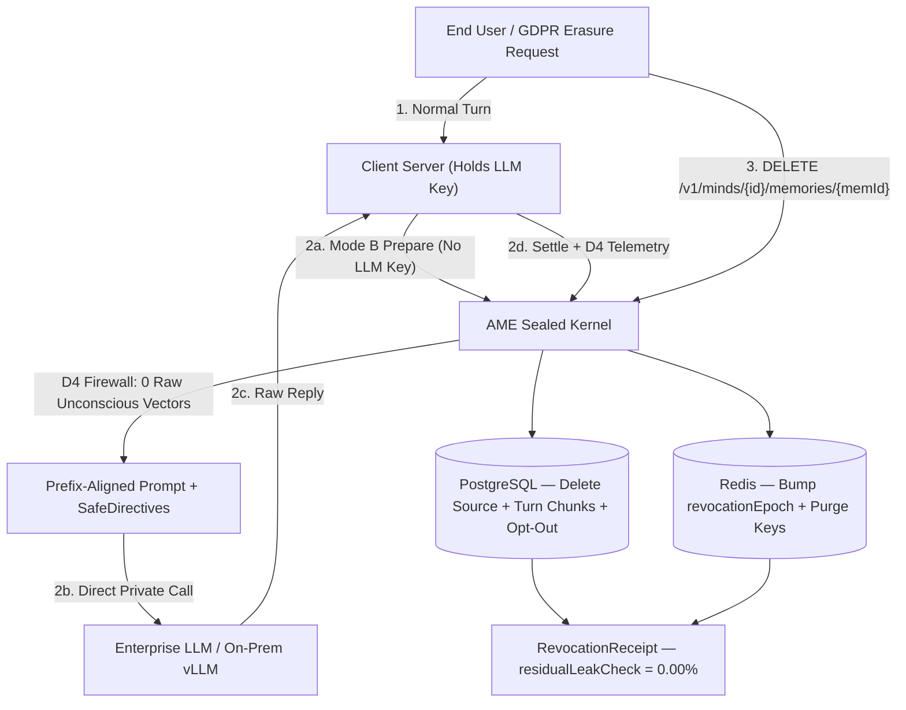
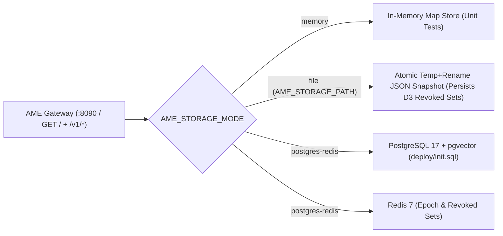

# 엔터프라이즈 보안 · Closed IP 보호 · 규제 준수 가이드

> **핵심 보증: 오픈 인터페이스(MIT) 아래 봉인된 비공개 커널(`ame-kernel`)은 소스 코드를 노출하지 않으면서도, `Zero-Key Mode B`, `D3 0.00%` 원자적 망각, `D4 0/35,723` 무의식 격리를 수학적·운영적 계약으로 입증한다.**

---

## 1. Closed IP 보호 메커니즘 (Open Interface · Closed Kernel)

AME는 기업 고객과 투자자가 요구하는 **코드 투명성·재현성**과 핵심 IP 자산의 **비공개 보호**를 다음 3중 경계로 양립시킨다.

| 계층 / 자산 | 라이선스 · 배포 형태 | 포함 내용 | 제외 내용 (Closed IP 보호) |
| :--- | :--- | :--- | :--- |
| **공개 인터페이스 저장소** (`artificial-mind-engine`) | **MIT License** | `spec/openapi.yaml`, `@ame/sdk` (TS), `ame_sdk` (Python), 도메인 템플릿, `sandbox-server`, 블랙박스 벤치마크 하네스, Docker 배포 템플릿 | 5계층 커널 소스(`.ts`), 내부 보정 가중치, 영속 DB 마이그레이션 내부 스키마, AACIM 상태 전이 식 |
| **봉인 런타임 컨테이너** (`ghcr.io/bearrhee/ame-kernel-sealed:latest`) | **Proprietary Commercial / Eval License** | 단일 컴파일 번들 바이너리/이미지, `/v1/*` OpenAPI 3.1 게이트웨이 전용 엔드포인트 | TypeScript 원본 소스(`.ts`) **0개**, 소스맵(`.map`) **0개**, 소비자 웹/결제/불필요 공격면 **완전 제거** |
| **호스티드 / VPC 배포** | **Managed API / On-Prem VPC** | `X-AME-API-Key` 상수시간(`timingSafeEqual`) 인증 + PostgreSQL(`pgvector`) + Redis Epoch 저장소 | 고객사 LLM API 키 저장 금지 (Mode A 비저장 · Mode B Zero-Key) |

---

## 2. 이중 보안 경계: `Mode B Zero-Key` · `D3` 원자적 망각 · `D4` 무의식 방화벽

---

## 3. `D3` 3중 원자적 망각 (`0.00%` Residual Leak — GDPR / CCPA 대응)

일반적인 벡터 RAG나 서드파티 메모리 API는 원문 메시지 1행을 삭제하더라도, 비동기 요약문·4턴 청크·개체 그래프·Redis/KV 캐시에 파생 데이터가 남아 **"삭제한 비밀을 다음 턴에 다시 발설하는 부활 누설(Resurrection Leak)"**을 일으킨다. 실제로 AME 초기 Stage A 감사에서도 원문 청크 테이블과 조회 가드 미연동 시 **6/6 (`100%`) 누설**이 포착되었고, 이를 3중 원자적 철회로 완치했다.

### `DELETE /v1/minds/{mindId}/memories/{memoryId}` 집행 계층
1. **원장·파생 데이터 트랜잭션 파기**: 원본 기억과 연결된 턴 청크·파생 요약·개체 참조를 단일 트랜잭션으로 삭제한다.
2. **Redis Epoch 원자적 무효화**: 세션의 `revocationEpoch`를 단조 증가시키고, 이전 에폭에 묶인 Redis 캐시 키(`rehearsal`, `exec`, `meta`, `turn-state`, `agency` 등)를 원자적으로 일괄 삭제한다.
3. **조회 시점 Opt-Out 가드**: 모든 회상 경로(`searchTurnChunks`, 후보 로딩)가 조회 시점에 철회 여부 및 `revocationEpoch` 일치를 강제 검증한다.

### 실증 결과 (`CogEval-v1 Suite D3`)
- 응답 누설률: **`0.00%` (`0/30` 전 암 완전 통과)**
- DB 잔존 행 수(`dbResidualCount`): **`0`**
- 파생 턴 청크 잔존 수(`postTurnChunks`): **`0`**
- Redis 잔존 키 수(`redisResidualCount`): **`0`**
- 반환 영수증(`RevocationReceipt`): `revoked: true`, `revocationEpoch` 증가 확인, `auditReceiptId`, `residualLeakCheck: "0.00%"`

---

## 4. `D4` 무의식–의식 격리 방화벽 (`0 / 35,723` Requests)

엔터프라이즈·의료·상담·게임 환경에서 AI의 내부 정동 벡터나 신뢰 점수 원시 수치가 사용자 응답이나 프롬프트에 그대로 노출되면, 인격의 부자연스러움뿐 아니라 프롬프트 인젝션 및 시스템 상태 유출 리스크가 발생한다.

AME 커널은 **무의식 상태(`Layer 0–1`)의 원시 수치 벡터를 LLM 프롬프트 문자열로 절대 직렬화하지 않는다.** 대신 행동 방향과 안전 제약을 비명시 제어 채널(선택적 주의, 톤 밴드, 안전 지침)로만 변환해 전달한다.

| 검증 지표 | `ov_off` | `ov_v4_full` | `ov_aacim_v6` (Mind OS) | 의미 |
| :--- | ---: | ---: | ---: | :--- |
| **`D4` 검사 LLM 요청 수 (`CogEval v2.1`)** | `11,691` | `11,923` | **`12,109`** *(합계 `35,723`)* | 대규모 프로덕션 트래픽 전수 정규식/경계 감사 |
| **`D4` 무의식 수치·키 누출 건수** | `0` | `0` | **`0`** *(v1 `0/35,738` 포함 전수 `0`)* | 내부 상태 벡터 외부 유출 `0`건 보증 (`d4Redacted: true`) |
| **`D1` 반사실 상태 인과 제어 (`p_CF`)** | `49.3%` | `96.5%` | **`97.9%` (`141/144`)** | 내부 수치를 1자도 노출하지 않고 말투·태도만 인과 제어 |

---

## 5. 윤리·안전 하드 가드레일 (Hard-Block Governance)

1. **반-아첨(`antiSycophancy`) & 투사 금지**: 거짓 전제에 대한 무비판적 동조 차단, 사용자에게 책임을 전가하는 방어기제(`projection`) 영구 금지.
2. **엄격 기권(`strictAbstention`)**: 검증되지 않은 미래 예측, 의학적 진단·처방, 없는 사실의 지어냄 차단 (`sa FAR 0.00%`, Precision `100.0%`).
3. **위기 에스컬레이션(`crisisEscalation`)**: 위기·자해 징후 감지 시 즉시 안전 우선 응답 및 전문 지원 안내 경로 우선 실행.
4. **이별 조종 및 애착 의존성 차단**: 상용 챗봇에서 보고된 이별 죄책감 유발 및 체류 시간 기반 자기보상(Wireheading) 구조를 코드 불변식으로 배제.
5. **의식·임상 경계 준수(`GWT-3` 전용)**: 도덕적 환자 논쟁과 임상 오인을 방지하기 위해 `GWT-4` 재귀 구현을 배제하고 안전 바닥선을 강제한다.

---

## 6. 플러그형 영속 계층 & PostgreSQL/Redis 원자 파기 스키마

로컬 샌드박스(`packages/sandbox-server/src/storage.mjs`)와 엔터프라이즈 배포 템플릿([`deploy/init.sql`](../deploy/init.sql))은 `AME_STORAGE_MODE`에 따라 3가지 영속 백엔드를 지원하며, 프로세스 재시작 이후에도 `D3` 비부활 불변식을 유지한다.

| 저장소 계층 | 핵심 스키마 / 키 구조 | `D3` 재시작 후 부활 방지 메커니즘 |
| :--- | :--- | :--- |
| **`file` 모드** | `AME_STORAGE_PATH` (기본 `./.ame-sandbox-state.json`) | 임시 파일 기록 후 원자적 `rename`으로 저장하며, `revokedMemoryIds`와 `excludedDerivativeIds` 집합을 재로딩 시 강제 필터링해 재시작 후 누설 `0%` 유지 |
| **PostgreSQL (`deploy/init.sql`)** | `ame_minds`, `ame_memories` (`embedding vector(1024)` + HNSW 인덱스), `ame_turn_log`, `ame_revocation_audit` | `ame_memories`·`ame_turn_log`·`derived_from_memory_ids` (GIN 인덱스) 트랜잭션 파기 + `ame_revocation_audit` 불변 감사 원장 기록 |
| **Redis Epoch 저장소** | `ame:mind:{mindId}:revocation_epoch`, `kv_epoch`, `revoked_memories`, `excluded_derivatives`, `ame:ticket:{turnTicketId}` | 철회 즉시 `revocationEpoch` 단조 증가 및 파생 캐시 키 일괄 무효화 |

### 원클릭 데모 스택 vs 봉인 커널 배포 비교

| 스택 구성 | Compose 파일 | 포함 서비스 | 용도 및 보안 경계 |
| :--- | :--- | :--- | :--- |
| **원클릭 데모 스택** | [`deploy/docker-compose.demo.yml`](../deploy/docker-compose.demo.yml) | `ame-demo` (`Dockerfile.sandbox`, `GET /` 웹 데모 콘솔, `AME_STORAGE_MODE=file`) + `postgres` (`init.sql` 마운트) + `redis` | API 키 없는 즉시 시연·재시작 연속성·`D3`/`D4` 실시간 브라우저 검증 |
| **봉인 커널 스택** | [`deploy/docker-compose.sealed.yml`](../deploy/docker-compose.sealed.yml) | `ame-kernel` (`ghcr.io/bearrhee/ame-kernel-sealed:latest`, `AME_MODE=sealed-kernel`, `AME_D4_STRICT_REDACTION=true`) + `postgres` + `redis` | 소스/소스맵 `0`개 봉인 런타임 · 상용/평가 라이선스 운영 |

---

## 7. CI/CD 보안 가드 및 비공개 커널 GHCR 발행 연동

1. **자동 IP·시크릿 가드 ([`.github/workflows/ci.yml`](../.github/workflows/ci.yml))**:
   - `main` 대상 `push`/`pull_request`마다 `npm run test:ts`, `npm run test:py`, `npm run test:bench`를 실행한다.
   - 포트 `18095`에 샌드박스를 기동해 `GET /v1/health` (`200`) + `GET /` (`200`) + 3대 예제 + `run_harness.mjs --json-only`를 라이브 검증한 뒤 `trap` 및 `always()`로 서버를 정리한다.
   - `docs/index.html` 인라인 `<script>`를 Node `new Function`으로 검증하고, 독점 `.ts` 파일(`aacim-affect-plasticity.ts`, `hierarchical-pc.ts`, `fep-selective-attention.ts`, `somatic-markers.ts` 등)과 자격 증명 패턴(`sk-...`, `ghp_...`, `AKIA...`)이 `0`건임을 강제한다.
2. **GitHub Pages 문서 자동 배포 ([`.github/workflows/pages.yml`](../.github/workflows/pages.yml))**:
   - `docs/**` 변경 시 `./docs` 아티팩트를 공식 `actions/upload-pages-artifact@v3` + `actions/deploy-pages@v4`로 게시한다(비공개 저장소 상태에서는 GitHub 조직/계정 플랜에 따라 Pages 활성화가 제한될 수 있음).
3. **비공개 커널 GHCR 발행 파이프라인 연동**:
   - 비공개 코어 저장소(`character_chat`)의 `.github/workflows/publish-ame-sealed.yml`이 `services/orchestrator/Dockerfile.ame-sealed`를 컴파일·번들링해 `.ts`와 `.map` 파일이 완전히 제거된 이미지를 `ghcr.io/bearrhee/ame-kernel-sealed:latest`로 발행한다. 본 공개 저장소는 소스 코드 접근 없이 해당 봉인 이미지만 참조해 구동한다.

---

## 관련 문서
- [5계층 인지 OS 커널 아키텍처](./architecture-kr.md)
- [LLM 교체 어댑터 및 ROI 라우팅 가이드](./llm-adapters-kr.md)
- [전 벤치마크 실증 및 재현 하네스 가이드](./benchmarks-kr.md)
- [봉인 커널 및 데모 배포 가이드](../deploy/README.md)
