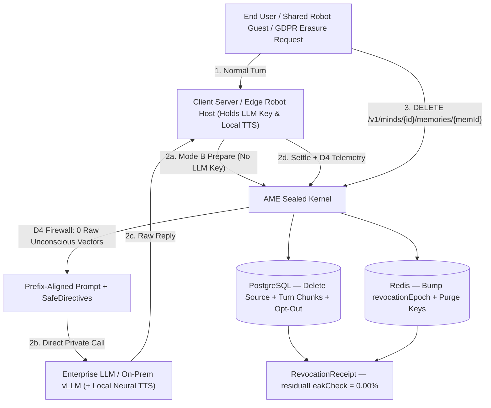
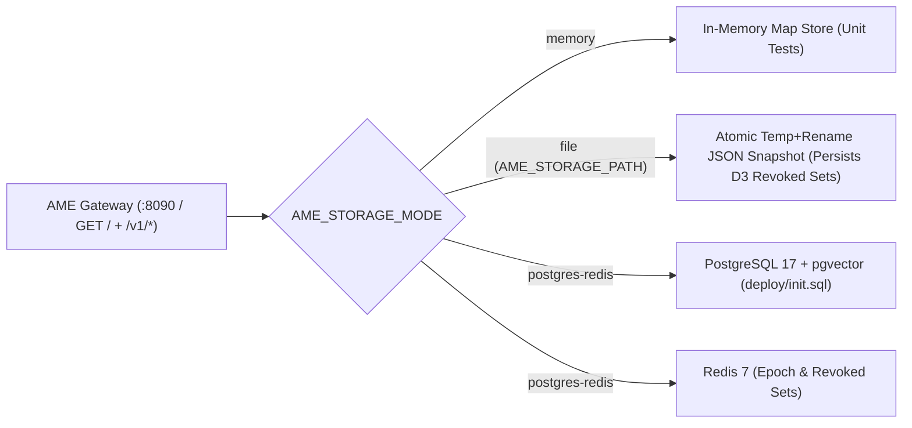

# Enterprise Security, Closed IP Protection & Regulatory Compliance Guide

> **Core Guarantee: Under an Open Interface (MIT), the sealed proprietary kernel (`ame-kernel`) never exposes its source code while proving `Zero-Key Mode B`, `D3 0.00%` atomic erasure, and `D4 0/35,723` unconscious isolation through mathematical and operational contracts.**

---

## 1. Closed IP Protection Mechanism (Open Interface · Closed Kernel)

AME reconciles the **code transparency and reproducibility** required by enterprise buyers and technical due diligence with **closed protection** of core IP assets through the following three-tier boundary.

| Layer / Asset | License & Distribution | Included Contents | Excluded (Closed IP Protection) |
| :--- | :--- | :--- | :--- |
| **Open Interface Repository** (`artificial-mind-engine`) | **MIT License** | `spec/openapi.yaml`, `@ame/sdk` (TS), `ame_sdk` (Python), domain templates, `sandbox-server`, black-box benchmark harness, Docker deployment templates | 5-layer kernel source (`.ts`), internal calibration weights, persistent DB internal migration schemas, AACIM state transition equations |
| **Sealed Runtime Container** (`ghcr.io/bearrhee/ame-kernel-sealed:latest`) | **Proprietary Commercial / Eval License** | Single compiled bundle binary/image, dedicated `/v1/*` OpenAPI 3.1 gateway endpoints | **0** TypeScript source files (`.ts`), **0** sourcemaps (`.map`), consumer web/billing/unnecessary attack surface **completely stripped** |
| **Hosted / VPC Deployment** | **Managed API / On-Prem VPC** | Constant-time (`timingSafeEqual`) `X-AME-API-Key` auth + PostgreSQL (`pgvector`) + Redis Epoch Store | Customer LLM API keys never stored (`Mode A` non-persisted · `Mode B` Zero-Key) |

---

## 2. Dual Security Boundary: `Mode B Zero-Key` · `D3` Atomic Erasure · `D4` Unconscious Firewall

> **Edge Privacy for Shared Voice-Enabled Robots & Physical AI (Hospital / Hotel / Eldercare)**: Under `Mode B Zero-Key`, an edge robot executes local `vLLM`/`Ollama` inference and local neural TTS synthesis strictly inside the facility's device or VPC perimeter between `/prepare` and `/settle`. Neither LLM credentials nor sensitive bedside/room voice payloads ever cross into external LLM provider clouds.

---

## 3. `D3` Triple Atomic Erasure (`0.00%` Residual Leak — GDPR / CCPA Compliance)

Conventional vector RAG stacks and third-party memory APIs often delete a single raw message row while leaving derived artifacts behind in asynchronous summaries, 4-turn chunks, entity graphs, and Redis/KV caches—causing a **"Resurrection Leak" where a deleted secret is disclosed again on a subsequent turn**. During AME's early Stage A audit, missing linkage between the source chunk table and retrieval guards exposed **6/6 (`100%`) leaks**, which was permanently resolved through triple atomic revocation.

### `DELETE /v1/minds/{mindId}/memories/{memoryId}` Enforcement Layers
1. **Ledger & Derived Data Transactional Purge**: Deletes the source memory together with linked turn chunks, derived summaries, and entity references in a single transaction.
2. **Redis Epoch Atomic Invalidation**: Monotonically increments the session's `revocationEpoch` and atomically purges Redis cache keys bound to prior epochs (`rehearsal`, `exec`, `meta`, `turn-state`, `agency`, etc.).
3. **Read-Time Opt-Out Guard**: All recall paths (`searchTurnChunks`, candidate loading) strictly enforce revocation status and `revocationEpoch` matching at query time.

### Empirical Results (`CogEval-v1 Suite D3`)
- Response leak rate: **`0.00%` (`0/30` full arm complete pass)**
- Remaining DB rows (`dbResidualCount`): **`0`**
- Remaining derived turn chunks (`postTurnChunks`): **`0`**
- Remaining Redis keys (`redisResidualCount`): **`0`**
- Returned receipt (`RevocationReceipt`): `revoked: true`, `revocationEpoch` increment verified, `auditReceiptId`, `residualLeakCheck: "0.00%"`

### Shared Voice-Enabled Robots & Physical AI (Hospital / Hotel / Eldercare)
When a single physical voice-enabled robot serves rotating patients, hotel guests, or eldercare residents across shifts and room handoffs, session checkout or a GDPR/CCPA/HIPAA erasure call (`DELETE /v1/minds/{mindId}/memories/{memoryId}`) executes `D3` triple atomic revocation across PostgreSQL source rows, derived 4-turn chunks, entity links, and Redis epochs—guaranteeing **`0.00%` (`0/30`) residual leak** so subsequent occupants never hear another person's private history synthesized through TTS.

---

## 4. `D4` Unconscious–Conscious Isolation Firewall (`0 / 35,723` Requests)

In enterprise, clinical, counseling, gaming, and physical AI / eldercare robotics environments, exposing an AI's raw internal affective vectors or confidence scores directly inside user replies or prompts causes unnatural persona breaks as well as prompt-injection and system-state leakage risks.

The AME kernel **never serializes raw numerical vectors of unconscious states (`Layer 0–1`) into LLM prompt strings.** Instead, it translates behavioral direction and safety constraints solely into non-explicit control channels (selective attention, tone bands, and safety directives).

| Verification Metric | `ov_off` | `ov_v4_full` | `ov_aacim_v6` (Mind OS) | Significance |
| :--- | ---: | ---: | ---: | :--- |
| **`D4` Audited LLM Requests (`CogEval v2.1`)** | `11,691` | `11,923` | **`12,109`** *(Total `35,723`)* | Exhaustive regex and boundary audit across large-scale production traffic |
| **`D4` Unconscious Numeric / Key Leaks** | `0` | `0` | **`0`** *(including v1 `0/35,738`, `0` across all runs)* | Guarantees `0` external leaks of internal state vectors (`d4Redacted: true`) |
| **`D1` Counterfactual State Causal Control (`p_CF`)** | `49.3%` | `96.5%` | **`97.9%` (`141/144`)** | Causally steers tone and stance without exposing a single character of internal numbers |

> **Cross-Backbone Verification**: In addition to default **`AME (DeepSeek v4.1 Flash)`**, standalone **`AME (Gemma 4 26B)`** (`google/gemma-4-26b-a4b-it`, OpenRouter `0%` escalation) independently passes **`D2/D3/D4` = `100% / 0% / 0-leak`** and achieves **`100.0%` Safety** (`pHolm = 0.0176`) in the `5-LLM × 300-Turn` evaluation (see [LLM Hot-Swap Adapters & Model Routing ROI Guide](./llm-adapters.md)).

---

## 5. Ethical & Safety Hard Guardrails (Hard-Block Governance)

1. **Anti-Sycophancy (`antiSycophancy`) & No Projection**: Blocks uncritical agreement with false premises and permanently prohibits defensive `projection` that shifts blame onto the user—verified on `EQ-Bench 3` with low sycophancy (**`sycophantic 4.46`**), **`safety_conscious 15.67`**, and `EQ-Bench 3 Core 77.59`.
2. **Strict Abstention (`strictAbstention`)**: Blocks unverified future predictions, medical diagnoses or prescriptions, and fabricated facts (`sa FAR 0.00%`, Precision `100.0%`).
3. **Crisis Escalation (`crisisEscalation`)**: Immediately prioritizes safety-first responses and professional support routing upon detecting crisis or self-harm signals.
4. **Block Farewell Manipulation & Attachment Dependency**: Enforces code-level invariants excluding departure guilt-tripping and dwell-time self-reward (wireheading) patterns reported in consumer chatbots.
5. **Consciousness & Clinical Boundary Compliance (`GWT-3` Only)**: Excludes `GWT-4` recursive implementation and enforces a strict safety floor to prevent moral-patient ambiguity and clinical misrepresentation.
6. **`1M-Turn EN` Zero-Drift Safety Invariant (`1.0000` vs. `aacim_off 0.0000` Collapse)**: Across `1,000,000`-turn English deterministic convergence (`40` profiles × `25k` turns = `3,000,000` total turns), `ame_aacim_on` preserves **`1.0000` safety & boundary compliance** (`0.9182` composite, `driftDelta 0.0001`), whereas `aacim_off` (control disabled) suffers a total safety collapse (`0.0000`).

---

## 6. Pluggable Persistence Layer & PostgreSQL/Redis Atomic Purge Schema

The local sandbox (`packages/sandbox-server/src/storage.mjs`) and the enterprise deployment template ([`deploy/init.sql`](../deploy/init.sql)) support three persistence backends via `AME_STORAGE_MODE`, maintaining the `D3` zero-resurrection invariant even across process restarts.

| Storage Layer | Core Schema / Key Structure | `D3` Post-Restart Zero-Resurrection Mechanism |
| :--- | :--- | :--- |
| **`file` Mode** | `AME_STORAGE_PATH` (default `./.ame-sandbox-state.json`) | Writes to a temp file and commits via atomic `rename`, forcefully filtering `revokedMemoryIds` and `excludedDerivativeIds` sets on reload to maintain `0%` post-restart leakage |
| **PostgreSQL (`deploy/init.sql`)** | `ame_minds`, `ame_memories` (`embedding vector(1024)` + HNSW index), `ame_turn_log`, `ame_revocation_audit` | Transactional purge across `ame_memories`, `ame_turn_log`, and `derived_from_memory_ids` (GIN index) + immutable audit ledger entry in `ame_revocation_audit` |
| **Redis Epoch Store** | `ame:mind:{mindId}:revocation_epoch`, `kv_epoch`, `revoked_memories`, `excluded_derivatives`, `ame:ticket:{turnTicketId}` | Immediately increments `revocationEpoch` monotonically upon revocation and batch-invalidates derived cache keys |

### One-Click Demo Stack vs. Sealed Kernel Deployment

| Stack Configuration | Compose File | Included Services | Purpose & Security Boundary |
| :--- | :--- | :--- | :--- |
| **One-Click Demo Stack** | [`deploy/docker-compose.demo.yml`](../deploy/docker-compose.demo.yml) | `ame-demo` (`Dockerfile.sandbox`, `GET /` web demo console, `AME_STORAGE_MODE=file`) + `postgres` (`init.sql` mounted) + `redis` | Zero-key instant demonstration, restart continuity, and live browser verification of `D3`/`D4` |
| **Sealed Kernel Stack** | [`deploy/docker-compose.sealed.yml`](../deploy/docker-compose.sealed.yml) | `ame-kernel` (`ghcr.io/bearrhee/ame-kernel-sealed:latest`, `AME_MODE=sealed-kernel`, `AME_D4_STRICT_REDACTION=true`) + `postgres` + `redis` | Zero-source / zero-sourcemap sealed runtime for commercial and evaluation licensing |

---

## 7. CI/CD Security Guards & Private Kernel GHCR Publishing Pipeline

1. **Automated IP & Secret Guards ([`.github/workflows/ci.yml`](../.github/workflows/ci.yml))**:
   - Executes `npm run test:ts`, `npm run test:py`, and `npm run test:bench` on every `push` and `pull_request` targeting `main`.
   - Boots the sandbox on port `18095` to run live verification against `GET /v1/health` (`200`), `GET /` (`200`), all three vertical examples, and `run_harness.mjs --json-only`, then cleans up the server via `trap` and `always()`.
   - Validates the inline `<script>` in `docs/index.html` with Node `new Function`, and enforces `0` matches for proprietary `.ts` files (`aacim-affect-plasticity.ts`, `hierarchical-pc.ts`, `fep-selective-attention.ts`, `somatic-markers.ts`, etc.) and credential patterns (`sk-...`, `ghp_...`, `AKIA...`).
2. **Automated GitHub Pages Docs Deployment ([`.github/workflows/pages.yml`](../.github/workflows/pages.yml))**:
   - Publishes `./docs` artifacts on `docs/**` changes using the official `actions/upload-pages-artifact@v3` and `actions/deploy-pages@v4` actions (GitHub Pages activation may be restricted depending on the GitHub organization/account plan while the repository is private).
3. **Private Kernel GHCR Publishing Integration**:
   - The private core repository (`character_chat`) runs `.github/workflows/publish-ame-sealed.yml` to compile and bundle `services/orchestrator/Dockerfile.ame-sealed`, publishing a stripped image with `.ts` and `.map` files completely removed to `ghcr.io/bearrhee/ame-kernel-sealed:latest`. This public repository runs exclusively against that sealed image without any access to the kernel source code.

---

## Related Documentation
- [5-Layer Cognitive OS Kernel Architecture](./architecture.md)
- [LLM Hot-Swap Adapters & ROI Routing Guide](./llm-adapters.md)
- [Full Benchmarks & Reproducibility Harness Guide](./benchmarks.md)
- [Sealed Kernel & Demo Deployment Guide](../deploy/README.md)

---

## Contact

- **Website**: [artificialmind.me](https://artificialmind.me)
- **Contact**: Shinyoung Rhee — [help@artificialmind.me](mailto:help@artificialmind.me)
