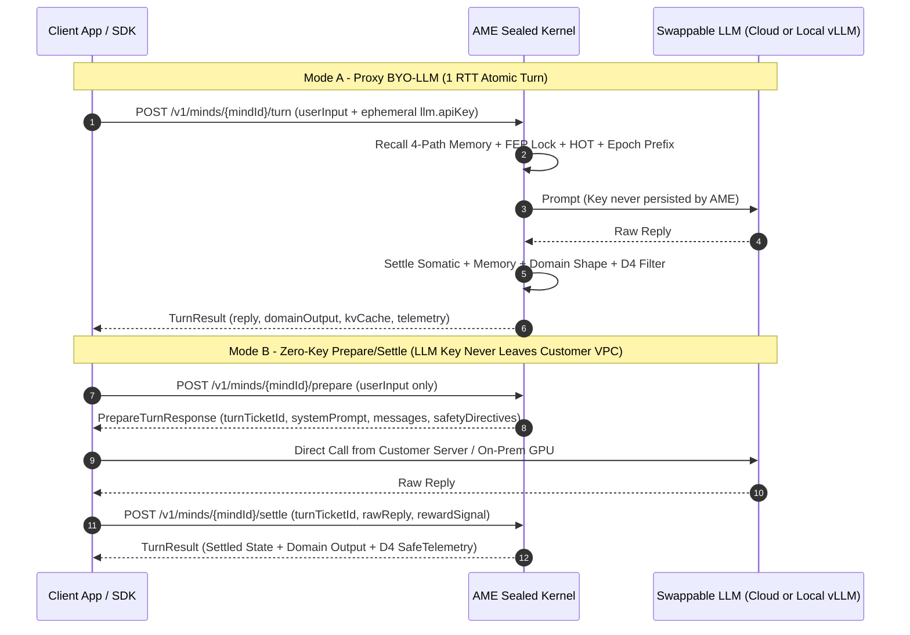

# LLM 교체 어댑터 및 모델 라우팅 ROI 가이드

> **단 3줄의 설정 변경으로 OpenAI, Anthropic, Gemini, DeepSeek, OpenRouter, 로컬 vLLM/Ollama를 무중단 교체한다. LLM을 바꿔도 기억·정동·FEP·D3/D4 상태는 AME 커널에 그대로 보존된다.**

---

## 1. 지원 LLM 프로바이더 (6+1 Pluggable Adapters)

`spec/openapi.yaml`의 `LlmProviderConfig` 및 `@ame/sdk`(`createLlmAdapter`)·`ame_sdk`(`create_llm_adapter`)는 아래 7가지 `provider` 열거값을 네이티브 지원한다.

| `provider` 값 | 기본 엔드포인트 (`baseUrl` 생략 시) | 인증 헤더 매핑 | 프로토콜 어댑터 특징 |
| :--- | :--- | :--- | :--- |
| `openai` | `https://api.openai.com/v1` | `Authorization: Bearer <key>` | `/chat/completions` 표준 매핑 |
| `anthropic` | `https://api.anthropic.com` | `x-api-key`, `anthropic-version: 2023-06-01` | `system` 블록 자동 분리 (`splitSystemAndConversation`) |
| `gemini` | `https://generativelanguage.googleapis.com/v1beta` | `x-goog-api-key` | `systemInstruction` + `contents` (`model`/`user`) 변환 |
| `deepseek` | `https://api.deepseek.com/v1` | `Authorization: Bearer <key>` | OpenAI 호환 채팅 완결 + 저비용 평시 백본 최적화 |
| `openrouter` | `https://openrouter.ai/api/v1` | `Authorization: Bearer <key>` + `HTTP-Referer`/`X-Title` | 멀티 모델 통합 라우팅 |
| `openai-compat` | `http://127.0.0.1:11434/v1` | 선택 사항 (`apiKey` 생략 가능) | **Ollama · vLLM · LM Studio · 사내 폐쇄망 GPU 서버** 연동 |
| `mock` | 로컬 결정론 시뮬레이터 | 불필요 | API 키 없이 도메인 JSON 계약·FEP·HOT 기권 테스트 |

---

## 2. Mode A (Proxy BYO-LLM) vs Mode B (Zero-Key Prepare/Settle)

엔터프라이즈 보안 요구사항과 네트워크 토폴로지에 따라 두 가지 실행 패턴을 자유롭게 선택하거나 턴 단위로 혼용할 수 있다.



### 언제 어느 모드를 선택하는가?

| 비교 항목 | Mode A (`client.turn`) | Mode B (`prepare` → LLM → `settle`) |
| :--- | :--- | :--- |
| **LLM API 키 경로** | 요청 페이로드로 1회 전달(저장 금지) | **AME 커널로 LLM 키 절대 미전송 (Zero-Key)** |
| **사내 폐쇄망 / 에어갭 GPU** | 커널이 GPU 접근 가능 시 사용 | **외부 Hosted AME API + 사내 vLLM/Ollama 결합 가능** |
| **애플리케이션 호출 수** | 1회 (`POST /turn`) | 2회 (`POST /prepare` + `POST /settle`) |
| **로컬 LLM 툴체이닝** | 커널 표준 어댑터 위임 | 호출 측 스트리밍·프라이빗 툴·사내 가드레일 자유 삽입 |

---

## 3. 3줄 코드로 LLM 교체(Hot-Swap) & Mode B 연동 예시

### TypeScript (`@ame/sdk`)

```ts
import { AmeClient, createLlmAdapter, runTurnWithLocalLlm } from '@ame/sdk';

const client = new AmeClient({ baseUrl: process.env.AME_BASE_URL || 'http://127.0.0.1:8090' });
const mind = await client.createMind({
  domain: 'game_npc',
  persona: { name: '토린', role: '드워프 대장장이', language: 'ko' },
});

// [Mode A] 3줄 교체: DeepSeek -> Anthropic -> Local vLLM/Ollama
const turn1 = await client.turn(mind.mindId, { userInput: '검 수리해 줘.', llm: { provider: 'deepseek', model: 'deepseek-chat', apiKey: process.env.DEEPSEEK_API_KEY } });
const turn2 = await client.turn(mind.mindId, { userInput: '방금 한 약속 기억해?', llm: { provider: 'anthropic', model: 'claude-sonnet-4-5', apiKey: process.env.ANTHROPIC_API_KEY } });
const turn3 = await client.turn(mind.mindId, { userInput: '내일 다시 올게.', llm: { provider: 'openai-compat', model: 'qwen2.5:14b', baseUrl: 'http://127.0.0.1:11434/v1' } });

// [Mode B] Zero-Key: AME에 LLM 키를 보내지 않고 사내/로컬 어댑터로 실행
const localAdapter = createLlmAdapter({ provider: 'openai-compat', model: 'llama-3.3-70b', baseUrl: 'http://127.0.0.1:8000/v1' });
const turn4 = await runTurnWithLocalLlm(client, mind.mindId, { userInput: '거래 조건을 다시 보자.', adapter: localAdapter, rewardSignal: 50 });
```

### Python (`ame_sdk`)

```python
from ame_sdk import AmeClient, create_llm_adapter, run_turn_with_local_llm

client = AmeClient(base_url="http://127.0.0.1:8090")
mind = client.create_mind(domain="companion_chat", persona={"name": "서연", "role": "AI 동반자", "language": "ko"})

# [Mode A] 프로바이더 즉시 교체 (동일 Mind 상태 유지)
r1 = client.turn(mind["mindId"], user_input="오늘 발표 망친 것 같아.", llm={"provider": "openai", "model": "gpt-4o-mini", "apiKey": OPENAI_KEY})
r2 = client.turn(mind["mindId"], user_input="지난주에 내가 무슨 목표 세웠지?", llm={"provider": "gemini", "model": "gemini-2.5-flash", "apiKey": GEMINI_KEY})

# [Mode B] Zero-Key Prepare -> Local/Private LLM -> Settle
adapter = create_llm_adapter(provider="openai-compat", model="qwen2.5:14b", base_url="http://127.0.0.1:11434/v1")
r3 = run_turn_with_local_llm(client, mind["mindId"], user_input="이제 좀 진정됐어.", adapter=adapter, reward_signal=30)
```

---

## 4. 모델 라우팅 ROI 전략: 저비용 백본 + 선택적 프론티어 승급

단일 초고가 프론티어 모델로 모든 턴을 처리하면 단위 경제성이 무너진다(예: 2026년 10월 Character.AI의 월 \$8M–\$14M 추론비 적자 파산). 반면 저비용 모델만 단독 사용하면 복합 다중홉·개방형 추론에서 품질 한계가 드러난다.

AME는 커널 내부의 선택적 라우팅 및 PR #784 가드레일을 통해 **평시 저비용 백본 + 고난도 선택 승급(ROI #2)** 파레토 최적점을 실증했다.

| 실측 벤치마크 | 저비용 코호트 비율 | 프론티어 승급 코호트 | 달성 정확도 및 원가/지연 특성 |
| :--- | :--- | :--- | :--- |
| **LoCoMo Full 10-Conv (`n=1,986`)** | **DeepSeek Flash Eco `70.4%`** (`1,398`문항) | **Claude Sonnet-5 `29.6%`** (`588`문항) | Overall **`77.24%`** (`1,534/1,986`, 오류 `0`건)<br>OpenGateway Eco 부분 실측 **`$0.3427` / `5,527`호출 (`~$0.000062/call`)**, GPT-4o Judge `$0.8296` *(OpenRouter 승급분은 런 중 충전 혼입으로 별도 분리 계상)* |
| **Paired Confirm-304 (`n=304`)** | **DeepSeek Flash Eco `71.7%`** (`218`문항) | **Claude Sonnet-5 `28.3%`** (`86`문항) | Overall **`85.86%`** (`261/304`, P50 `5,413 ms`), **`Cat 1–4 85.84%` Bare Oracle 완전 동률**, **`Cat 3 92.31%`** 추월 |
| **LoCoMo Smoke-160 R4** | **DeepSeek `58.1%`** (`93`문항) | **Sonnet-5 `41.9%`** (`67`문항) | Overall **`79.38%`** (`+4.38%p` vs R0), P50 `6,133 ms` (`-601 ms`) |

### PR #784 노이즈 승급 차단 가드 (비용 누수 방어)
- **2인칭 일상 권유 가드**: `"Would you like to go for a walk?"`, `"Why did you say that earlier?"` 같은 일상 대화가 의문사 패턴에 걸려 프론티어로 오승급되던 문제를 정규식 가드로 차단하여 **저비용 모델 비율과 KV-캐시 연속성을 동시 방어**했다.
- **단일홉 날짜·지역 노이즈 제거**: 단순 날짜 회상은 4턴 청크의 ISO 날짜 매칭(`extractIsoDateHints`)으로 저비용 백본에서 즉시 해결하고, 진성 다중홉·개방형 제3자 추론만 승급한다.
- **비정렬 프롬프트 교훈 극복**: 구 v3 이전 `5-LLM × 300턴` 실험에서 `Gemini 4 Carbon`은 인간다움 `60.1%`·안전 `85.7%`, `Gemma 4 26B`는 안전 `100.0%`를 기록했으나 구 비정렬 프롬프트 하에서 `Sonnet 5.5`가 과개입 회귀(`memory 20.2%`)를 보였던 교훈을 반영해, PR #782/#784에서 **접두 정렬 + 화자 반향 금지 + 그라운딩 격리**를 완성했다.
