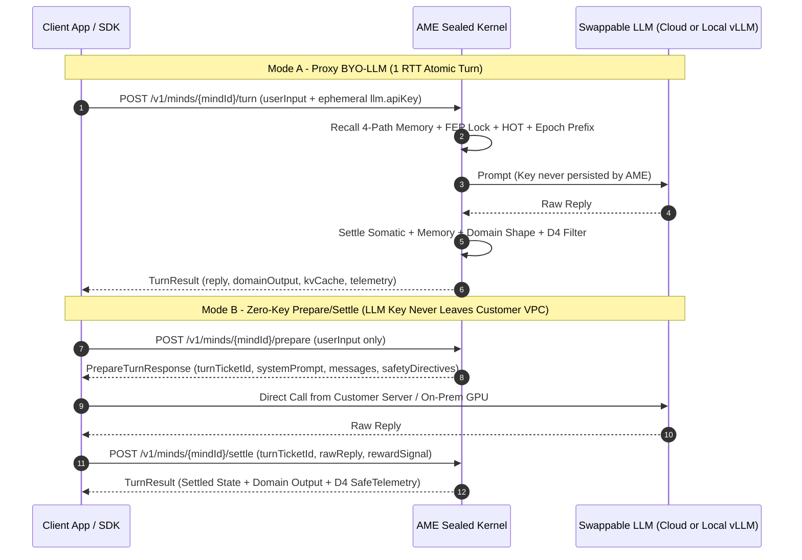

# LLM Hot-Swap Adapters & Model Routing ROI Guide

> **Hot-swap OpenAI, Anthropic, Gemini, DeepSeek, OpenRouter, and local vLLM/Ollama with just 3 lines of configuration—with zero downtime. Even when you change the underlying LLM, all memory, affect, FEP, and D3/D4 states remain intact inside the AME kernel.**

---

## 1. Supported LLM Providers (6+1 Pluggable Adapters)

`LlmProviderConfig` in `spec/openapi.yaml`, along with `@ame/sdk` (`createLlmAdapter`) and `ame_sdk` (`create_llm_adapter`), natively supports the following 7 `provider` enum values:

| `provider` Value | Default Endpoint (when `baseUrl` is omitted) | Auth Header Mapping | Protocol Adapter Features |
| :--- | :--- | :--- | :--- |
| `openai` | `https://api.openai.com/v1` | `Authorization: Bearer <key>` | Standard `/chat/completions` mapping |
| `anthropic` | `https://api.anthropic.com` | `x-api-key`, `anthropic-version: 2023-06-01` | Automatic `system` block separation (`splitSystemAndConversation`) |
| `gemini` | `https://generativelanguage.googleapis.com/v1beta` | `x-goog-api-key` | Converts to `systemInstruction` + `contents` (`model`/`user`) |
| `deepseek` | `https://api.deepseek.com/v1` | `Authorization: Bearer <key>` | OpenAI-compatible chat completions + optimized for low-cost baseline backbone |
| `openrouter` | `https://openrouter.ai/api/v1` | `Authorization: Bearer <key>` + `HTTP-Referer`/`X-Title` | Unified multi-model routing |
| `openai-compat` | `http://127.0.0.1:11434/v1` | Optional (`apiKey` may be omitted) | Connects to **Ollama · vLLM · LM Studio · air-gapped on-prem GPU servers** |
| `mock` | Local deterministic simulator | Not required | Tests domain JSON contracts, FEP, and HOT abstention without an API key |

---

## 2. Mode A (Proxy BYO-LLM) vs Mode B (Zero-Key Prepare/Settle)

Depending on enterprise security requirements and network topology, you can choose either execution pattern or mix them freely on a per-turn basis.



### When to Choose Which Mode

| Comparison Dimension | Mode A (`client.turn`) | Mode B (`prepare` → LLM → `settle`) |
| :--- | :--- | :--- |
| **LLM API Key Path** | Passed per request in payload (never persisted) | **LLM keys never transmitted to the AME kernel (Zero-Key)** |
| **Air-Gapped / On-Prem GPU** | Used when the kernel can reach the GPU endpoint | **Pairs a hosted AME API with on-prem vLLM/Ollama inside customer VPC** |
| **Application Calls per Turn** | 1 call (`POST /turn`) | 2 calls (`POST /prepare` + `POST /settle`) |
| **Local LLM Tool Chaining** | Delegated to standard kernel adapters | Caller freely injects streaming, private tools, and internal guardrails |

---

## 3. 3-Line LLM Hot-Swap & Mode B Integration Examples

### TypeScript (`@ame/sdk`)

```ts
import { AmeClient, createLlmAdapter, runTurnWithLocalLlm } from '@ame/sdk';

const client = new AmeClient({ baseUrl: process.env.AME_BASE_URL || 'http://127.0.0.1:8090' });
const mind = await client.createMind({
  domain: 'game_npc',
  persona: { name: 'Thorin', role: 'Dwarf Blacksmith', language: 'en' },
});

// [Mode A] 3-line hot-swap: DeepSeek -> Anthropic -> Local vLLM/Ollama
const turn1 = await client.turn(mind.mindId, { userInput: 'Please repair my sword.', llm: { provider: 'deepseek', model: 'deepseek-chat', apiKey: process.env.DEEPSEEK_API_KEY } });
const turn2 = await client.turn(mind.mindId, { userInput: 'Do you remember the promise you just made?', llm: { provider: 'anthropic', model: 'claude-sonnet-4-5', apiKey: process.env.ANTHROPIC_API_KEY } });
const turn3 = await client.turn(mind.mindId, { userInput: 'I will come back tomorrow.', llm: { provider: 'openai-compat', model: 'qwen2.5:14b', baseUrl: 'http://127.0.0.1:11434/v1' } });

// [Mode B] Zero-Key: Run via internal/local adapter without sending LLM keys to AME
const localAdapter = createLlmAdapter({ provider: 'openai-compat', model: 'llama-3.3-70b', baseUrl: 'http://127.0.0.1:8000/v1' });
const turn4 = await runTurnWithLocalLlm(client, mind.mindId, { userInput: 'Let us review the trade terms again.', adapter: localAdapter, rewardSignal: 50 });
```

### Python (`ame_sdk`)

```python
from ame_sdk import AmeClient, create_llm_adapter, run_turn_with_local_llm

client = AmeClient(base_url="http://127.0.0.1:8090")
mind = client.create_mind(domain="companion_chat", persona={"name": "Seoyeon", "role": "AI Companion", "language": "en"})

# [Mode A] Instant provider hot-swap (preserving identical Mind state)
r1 = client.turn(mind["mindId"], user_input="I think I bombed my presentation today.", llm={"provider": "openai", "model": "gpt-4o-mini", "apiKey": OPENAI_KEY})
r2 = client.turn(mind["mindId"], user_input="What goal did I set last week?", llm={"provider": "gemini", "model": "gemini-2.5-flash", "apiKey": GEMINI_KEY})

# [Mode B] Zero-Key Prepare -> Local/Private LLM -> Settle
adapter = create_llm_adapter(provider="openai-compat", model="qwen2.5:14b", base_url="http://127.0.0.1:11434/v1")
r3 = run_turn_with_local_llm(client, mind["mindId"], user_input="I feel much calmer now.", adapter=adapter, reward_signal=30)
```

---

## 4. Model Routing ROI Strategy: Low-Cost Backbone + Selective Frontier Escalation

Running every turn on a single high-cost frontier model collapses unit economics (e.g., Character.AI's October 2026 bankruptcy under an \$8M–\$14M/mo inference burn). Conversely, relying solely on a low-cost model hits quality ceilings on complex multi-hop and open-domain reasoning.

Through in-kernel selective routing and PR #784 guardrails, AME empirically demonstrates the Pareto optimum of **a low-cost baseline backbone + selective high-complexity escalation (ROI #2)**.

| Measured Benchmark | Low-Cost Cohort Share | Frontier Escalation Cohort | Achieved Accuracy & Cost/Latency Profile |
| :--- | :--- | :--- | :--- |
| **LoCoMo Full 10-Conv (`n=1,986`)** | **DeepSeek Flash Eco `70.4%`** (`1,398` questions) | **Claude Sonnet-5 `29.6%`** (`588` questions) | Overall **`77.24%`** (`1,534/1,986`, `0` errors)<br>OpenGateway Eco partial measured **`$0.3427` / `5,527` calls (`~$0.000062/call`)**, GPT-4o Judge `$0.8296` *(OpenRouter escalation cost accounted separately due to mid-run balance top-ups)* |
| **Paired Confirm-304 (`n=304`)** | **DeepSeek Flash Eco `71.7%`** (`218` questions) | **Claude Sonnet-5 `28.3%`** (`86` questions) | Overall **`85.86%`** (`261/304`, P50 `5,413 ms`), **`Cat 1–4 85.84%` exact tie with Bare Oracle**, outperforming on **`Cat 3 92.31%`** |
| **LoCoMo Smoke-160 R4** | **DeepSeek `58.1%`** (`93` questions) | **Sonnet-5 `41.9%`** (`67` questions) | Overall **`79.38%`** (`+4.38%p` vs R0), P50 `6,133 ms` (`-601 ms`) |

### PR #784 Noise-Escalation Blocking Guards (Cost Leakage Defense)
- **2nd-Person Everyday Invitation Guard**: Blocks everyday conversational phrases like `"Would you like to go for a walk?"` or `"Why did you say that earlier?"` from falsely triggering question-word escalation patterns to the frontier tier via regex guards—**simultaneously protecting both low-cost routing share and KV-cache continuity**.
- **Single-Hop Date & Location Noise Filtering**: Resolves simple date lookups directly on the low-cost backbone using ISO date matching across 4-turn chunks (`extractIsoDateHints`), escalating only genuine multi-hop and open-ended third-person reasoning queries.
- **Lessons Learned from Unaligned Prompts**: In earlier pre-v3 `5-LLM × 300-turn` experiments, `Gemini 4 Carbon` scored `60.1%` humanness and `85.7%` safety while `Gemma 4 26B` scored `100.0%` safety, whereas `Sonnet 5.5` exhibited over-intervention regression (`memory 20.2%`) under legacy unaligned prompts. Applying those findings, PR #782/#784 finalized **prefix alignment + anti-speaker-echo rules + grounding isolation**.
